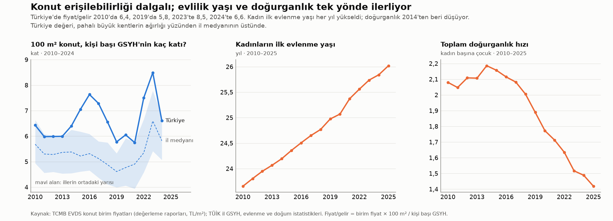
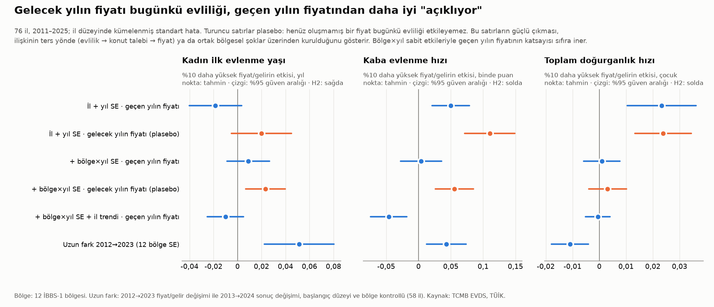
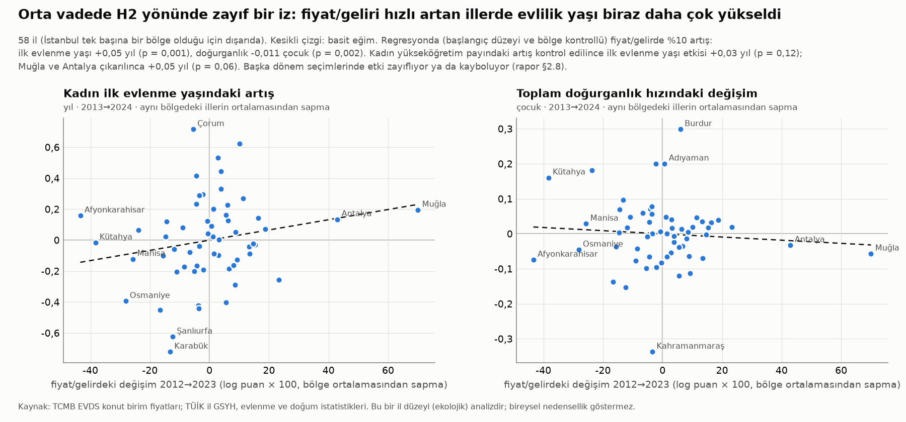

# Faz 2 · Rapor 3 — Konut Maliyeti, Evlilik ve Doğurganlık (H2)

*26 Ekim 2026 · Sürüm 0.1*

| Ne | Nerede |
|---|---|
| Panel (81 il × 2005–2025; 76 ilde konut fiyatı) | [03_VERI/islenmis/konut_paneli.csv](../03_VERI/islenmis/konut_paneli.csv) · bölge paneli [konut_paneli_kfe_bolge.csv](../03_VERI/islenmis/konut_paneli_kfe_bolge.csv) · [kaynaklar](../03_VERI/ham/konut/kaynaklar.md) |
| Veri kodu | [05_ANALIZ/kod/konut_h2_veri.py](../05_ANALIZ/kod/konut_h2_veri.py) (TCMB EVDS3 + TÜİK SDMX; ham yanıtlar `03_VERI/ham/konut/`) |
| Analiz kodu ve sonuçlar | [05_ANALIZ/kod/konut_h2_analiz.py](../05_ANALIZ/kod/konut_h2_analiz.py) · `05_ANALIZ/sonuclar/konut_*.csv` |
| Grafikler | [konut_turkiye_seyir.png](../05_ANALIZ/grafikler/konut_turkiye_seyir.png) · [konut_katsayilar.png](../05_ANALIZ/grafikler/konut_katsayilar.png) · [konut_uzun_fark.png](../05_ANALIZ/grafikler/konut_uzun_fark.png) |

---

## Özet

**Soru (H2):** Konut pahalılaştıkça (gelire göre) evlilik ertelenir ve doğurganlık düşer mi?

**Kısa cevap:** İl düzeyinde ve 2010–2025 döneminde **bu veriyle desteklenmiyor.** Konut maliyetindeki iller arası ve yıllar arası farklar, evlilik yaşındaki artışı ve doğurganlıktaki düşüşü açıklamıyor. Bulunan ilişkiler ya sıfıra yakın ya da H2'nin tersi yönde. Ters yöndeki ilişkilerin ana kaynağı ters nedensellik: evlilik ve nüfus artışı konut talebini, o da fiyatı yükseltiyor.

1. **Veri ilk kez il düzeyinde kuruldu.** TCMB'nin herkese açık EVDS arka ucundan, anahtar ya da hesap kullanmadan şu seriler alındı:
   - 81 il için çeyreklik konut birim fiyatları (2010→) ve birim kiraları (2018→);
   - 19 bölge için Konut Fiyat Endeksi ve Yeni Kiracı Kira Endeksi.

   Bu seriler TÜİK'in il düzeyindeki evlilik, doğum, gelir ve nüfus serileriyle (SDMX) birleştirildi. Ana ölçü **fiyat/gelir**: 100 m² konutun ilin kişi başı GSYH'sinin kaç katı olduğu. 2024'te iller arasında 3,4 (Kocaeli) ile 12,5 (Muğla) arasında değişiyor; medyan 5,8.
2. **Basit panel modelinde işaretler H2'nin tersi.** İl ve yıl sabit etkileriyle, geçen yılın fiyat/geliri %10 yüksek olan illerde:
   - kaba evlenme hızı +0,05 binde puan (p = 0,001);
   - doğurganlık +0,023 çocuk (p = 0,001);
   - kadın ilk evlenme yaşı −0,02 yıl (p = 0,10).
3. **Plasebo testi ters nedenselliği gösteriyor.** Gelecek yılın fiyatı bugünkü evliliği geçen yılın fiyatından daha iyi "açıklıyor" (%10 → +0,11 binde puan, p < 0,001). Geçen yılın fiyatının etkisi ise sıfıra iniyor. Gerçekleşmemiş bir fiyat bugünkü kararı etkileyemez. Bu yüzden ilişki büyük olasılıkla ters yönde (evlilik → konut talebi → fiyat) ya da ortak bölgesel şoklar üzerinden kuruluyor.
4. **Sıkı modelde etki sıfır ve dar sınırlı.** Model 12 bölge × yıl sabit etkileriyle kuruldu, yani aynı bölgede aynı yıl içindeki iller karşılaştırıldı. Fiyat/gelirde %10 artışın etkisi:
   - kadın ilk evlenme yaşı: **+0,009 yıl** [%95 GA −0,009; +0,027], yani en fazla yaklaşık 10 gün;
   - toplam doğurganlık hızı: **+0,001 çocuk** [−0,006; +0,008];
   - kaba evlenme hızı: +0,004 binde puan [−0,028; +0,036].

   Bu aralıklar, Kore için basında aktarılan büyüklüğü (%10 fiyat artışı → TDH −0,02; birincil rapor doğrulanmadı) dışarıda bırakıyor.
5. **Destekleyici tek iz zayıf ve kırılgan.**
   - *Orta vade (2012→2023):* Fiyat/geliri aynı bölgedeki öteki illerden hızlı artan illerde kadın ilk evlenme yaşı %10 başına +0,05 yıl daha çok yükseldi, doğurganlık −0,011 çocuk daha çok düştü. Kadın eğitimindeki artış kontrol edilince bu etki anlamsızlaşıyor. Dönem seçimine de duyarlı.
   - *İl trendleri eklenince:* Trendin üstündeki fiyat, ertesi yıl biraz daha az evlilikle ilişkili (%10 → −0,05 binde puan, ortalamanın yaklaşık %0,7'si). Ancak evlenme yaşında ve doğurganlıkta etki yok.
6. **H2'nin öngördüğü ayrışmalar da görülmüyor.**
   - Kiracı payı yüksek illerde etki daha güçlü değil.
   - Fiyat arttığında evlilikler genç yaşlardan (20–24) ileri yaşlara (30–34) kaymıyor.
   - Kira/gelir oranı fiyat/gelirle aynı tabloyu veriyor.
   - TCMB'nin kalite düzeltilmiş bölge endeksi (KFE) de aynı sonucu veriyor.
7. **2025 kesiti:** Kadın eğitimi ve bölge sabit tutulduğunda fiyat/gelir ile ilk evlenme yaşı (β = −0,04) ve doğurganlık (β = +0,08) arasında ilişki yok.

**Proje için anlamı:**
- **İl farkları:** Türkiye'de illerin evlilik yaşı ve doğurganlık farklarını konut maliyeti değil, Rapor 1 ve 2'de gösterildiği gibi eğitim ve bölge-kültür açıklıyor.
- **Ulusal etki açık:** Bu sonuç konut maliyetinin *ulusal* düzeyde etkisiz olduğunu göstermez. Bütün illeri aynı anda etkileyen kredi koşulları, enflasyon ve kira şokları yıl sabit etkilerinin içinde kalıyor ve bu tasarımla ölçülemiyor.
- **"Fıtrata uygun şehir" tezi için:** Konut erişilebilirliği, il ölçeğinde doğurganlığı yükseltecek bir kaldıraç olarak sunulmamalı. Gerekçe aile kurmanın önündeki maddi engellerin azaltılması ve yaşam kalitesi olmalı. Kanıtın asıl sınanacağı yer bireysel veri (Bölüm 6).

---

## 1. Veri ve yöntem

### 1.1 Veri

| Bileşen | Kaynak | Kapsam |
|---|---|---|
| Konut birim fiyatı (TL/m²) | TCMB EVDS, değerleme raporlarına dayalı birim fiyatlar (`bie_birimfiyat`) | 81 il, çeyreklik, 2010-1Ç → 2026-3Ç. 60 ilde 2010'dan, 10 ilde 2014'ten, 7 ilde 2022–23'ten; 5 ilde yok |
| Konut birim kirası (TL/m²/ay) | TCMB EVDS (`bie_bk`) | 81 il, çeyreklik, 2018 → 2026-3Ç; 7 ilde yok |
| Konut Fiyat Endeksi; Yeni Kiracı Kira Endeksi (2023=100) | TCMB EVDS (`bie_kfe`, `bie_ykke`) | Türkiye + **19 bölge** (13 İBBS-2 + 6 birleşik İBBS-1), aylık; KFE 2010→, YKKE 2018→ |
| Kaba evlenme hızı; kadın ve erkek ortalama ilk evlenme yaşı; ilk evlenmeler (yaş grubu) | TÜİK SDMX: `DF_KABA_EVLENME_HIZI`, `DF_EVLENME_ORT_ILK_EVL_YAS`, `DF_EVLENME_ILK_YASGR` | 81 il, 2005–2025 |
| Toplam doğurganlık hızı; ilk doğumda anne yaşı | `DF_DOGUM_IL_TDH_C`, `DF_DOGUM_ORTYAS_ILKDOG_C` | 2009–2025; 2014–2025 |
| Kişi başı GSYH (cari TL) | `DF_UH_BH_KISI_BASI` | 81 il, 2005–2024 |
| Kadın nüfusu (5'li yaş); 15+ kadınların eğitimi | `DF_ADNKS_T16`, `DF_ULUSAL_EGITIM_ISTATISTIK_BED_NUFUS` | 2007–2025; 2008–2025 |
| Kiracı hane payı (2021), kadın eğitim süresi (2025) | `il_paneli_2025.csv` (Rapor 1) | kesit |

**Doğrulama** (ayrıntı: [kaynaklar.md](../03_VERI/ham/konut/kaynaklar.md)):
- **TÜİK SDMX ile bültenler:** 2025 il değerleri, Veri Portalı bültenlerinden kurulan Rapor 1 paneliyle 81 ilde yuvarlama farkı içinde aynı.
- **TCMB serileri:** KFE Eylül 2026 değeri (239,38) TCMB bülteniyle (239,4) aynı. TÜFE serileri iki kurumda birebir eşleşiyor.
- **Bulunan veri hatası:** TÜİK SDMX'teki kadın ilk evlenme yaş dağılımı 2024–2025'te tutarsız. Bu dağılımdan türetilen ortalama yaş, yayımlanan ortalamadan 2,1–4,3 yıl yüksek. Bu yüzden yaş dağılımına dayanan iki ölçü 2024–2025 için kullanılmadı: kadın toplam ilk evlenme hızı (TİEH) ve yaşa özel hızlar.

### 1.2 Ölçüler

| Ölçü | Tanım | 2011–2024 il ortalaması |
|---|---|---|
| **Fiyat/gelir** | Birim fiyat × 100 m² / kişi başı GSYH. Yorumu: 100 m² konut, ilin kişi başı yıllık gelirinin kaç katı | 5,5 |
| **Kira/gelir** | 100 m² konutun yıllık kirası / kişi başı GSYH (%) | %25 (2018–2024) |
| Kadın ilk evlenme yaşı | TÜİK ortalaması | 24,5 |
| Kaba evlenme hızı | Bin kişi başına evlenme (olay yerine göre) | ‰ 7,0 |
| **Kadın toplam ilk evlenme hızı (TİEH)** | 5 × Σ (yaş grubundaki kadın ilk evlenmeleri / o yaştaki kadın nüfusu), 15–49 yaş. Yaş yapısından bağımsız; TDH'nin evlilik karşılığı | 0,76 |
| Toplam doğurganlık hızı | TÜİK | 1,85 |

**Neden İBBS-2 değil il?** TCMB birim fiyatları il düzeyinde yayımlıyor. KFE ise 26 değil yalnızca 19 bölge için var. İl paneli 76 il × 14 yıl gözlem sağlıyor (1.025 il-yıl). KFE bölge paneli, kalite düzeltilmiş endeksle yapılan bir sağlama olarak eklendi.

Fiyat/gelirin ham standart sapması 0,28 log puan. İl ve yıl ortalamaları çıkarıldığında 0,11'e iniyor. Yani panel tahmini bir ilin kendi ortalamasından yaklaşık %11'lik sapmalara dayanıyor. "%10 artış" etki birimi bu yüzden seçildi.

### 1.3 Tasarım

1. **Ana panel (il × yıl, 2011–2025).** Model: Yit = b · ln(fiyat/gelir)i,t−1 + il SE + yıl SE.
   - Fiyat bir yıl gecikmeli; evlilik kararı fiyatı izlesin diye.
   - Standart hata il düzeyinde kümelenmiş; serbestlik düzeltmesi reghdfe tipi.
   - **Sıkı model:** yıl SE yerine 12 İBBS-1 bölge × yıl SE. Doğu ile Batı'nın farklı demografik trendleri böylece karşılaştırmadan çıkıyor.
2. **Plasebo (öncü) testi.** Gelecek yılın fiyat/geliri (t+1) modele eklendi. Fiyat evliliğe yol açıyorsa öncünün katsayısı sıfır olmalı.
3. **Sağlamlık.** Altı varyant: İBBS-2 kümeli standart hata; 20–34 yaş kadın nüfusuyla ağırlık; 2023 depreminden etkilenen 11 il hariç; 2011–2019 (pandemi ve 2022 fiyat patlaması öncesi); il trendi; fiyat ile gelirin ayrı girmesi.
4. **Ayrışma testleri.** Biri Dettling & Kearney (2014) tipi: fiyat × kiracı payı etkileşimi. Kiracılar fiyat artışından zarar görür, ev sahipleri servet kazanır. Öteki erteleme testi: yaşa özel ilk evlenme hızları.
5. **Ek kollar.** Kira/gelir paneli (2019–2025); KFE bölge paneli (19 bölge; az küme olduğu için yabani küme bootstrap p-değeri, 1.999 tekrar); uzun fark (2012→2023); 2025 kesiti.

---

## 2. Bulgular

### 2.1 Türkiye seyri: erişilebilirlik dalgalı, evlilik yaşı ve doğurganlık tek yönlü

**Fiyat/gelir (Türkiye):**
- 2010'da 6,4 → 2016'da 7,6 → 2019'da 5,8 → 2023'te **8,5** → 2024'te 6,6.
- Reel birim fiyat (2003 TL'si) 2010'dan 2024'e 2,4 kat arttı (580 → 1.408 TL/m²). Kişi başı gelir de hızlı arttığı için oran dalgalı kaldı.

**Aynı dönemde sonuçlar:**
- Kadın ilk evlenme yaşı her yıl yükseldi: 23,7'den 26,0'ya.
- Doğurganlık 2014'ten beri kesintisiz düşüyor: 2,19'dan 1,42'ye.

Ulusal düzeyde iki seri birlikte hareket etmiyor. Örneğin 2016–2019'da erişilebilirlik iyileşti, ama evlilik yaşı artmaya, doğurganlık düşmeye devam etti. 15 yıllık bir seriyle bu, ulusal etkiyi dışlamaz; ancak destek de vermez.

**İller arasında (2024):**
- En erişilebilir iller sanayi ve yüksek gelir illeri: Kocaeli 3,4, Ankara 3,5, Kırıkkale 3,9, Bilecik 4,1, Kayseri 4,3.
- En pahalı iller kıyı ve turizm illeri ile düşük gelirli Doğu illeri: Muğla 12,5, Van 10,4, Şanlıurfa 8,9, Bartın 8,8, Aydın 8,7.
- Kira/gelir: Kocaeli %18 ile Van %57 arası.

Fiyat/gelir kişi başı gelirle ters ilişkili (r = −0,40). Pahalılığın bir kısmı yüksek fiyattan değil, düşük gelirden geliyor.

### 2.2 Ana panel: basit model H2'nin tersi, sıkı model sıfır

Değerler, geçen yılın fiyat/gelirindeki **%10 artışın** sonuç birimindeki etkisi; köşeli parantezde %95 güven aralığı. Anlamlılık: *** p<0,001 · ** p<0,01 · * p<0,05 · † p<0,10. H2'nin öngördüğü işaret: ilk evlenme yaşı ve ilk doğum yaşı **+**; evlenme hızları ve doğurganlık **−**.

| Sonuç | A: il + yıl SE | C: il + bölge×yıl SE | G: C + il trendi |
|---|---|---|---|
| Kadın ilk evlenme yaşı (yıl) | −0,018† [−0,040; +0,003] | +0,009 [−0,009; +0,027] | −0,010 [−0,025; +0,005] |
| Kaba evlenme hızı (‰) | +0,050*** [+0,021; +0,079] | +0,004 [−0,028; +0,036] | −0,046** [−0,074; −0,018] |
| Kadın TİEH (2011–2023) | +0,005** [+0,001; +0,009] | +0,001 [−0,003; +0,006] | −0,006** [−0,009; −0,002] |
| Toplam doğurganlık hızı | +0,023*** [+0,011; +0,036] | +0,001 [−0,006; +0,008] | −0,001 [−0,005; +0,004] |
| İlk doğumda anne yaşı (yıl) | −0,016 [−0,035; +0,004] | −0,004 [−0,020; +0,012] | +0,004 [−0,011; +0,019] |

*n = 1.010 il-yıl, 76 il (TİEH: 857; ilk doğum yaşı: 833). Kaynak: `konut_panel_modeller.csv`.*

**Okuma:**
- **Basit model (A):** Fiyat/geliri artan illerde *daha çok* evlilik ve *daha yüksek* doğurganlık var; evlilik yaşı biraz düşüyor. Üç işaret de H2'nin tersi.
- **Sıkı model (C):** Aynı bölgede aynı yıl içinde karşılaştırınca bütün katsayılar sıfıra iniyor ve güven aralıkları dar. A'daki ilişkiyi Doğu-Batı'nın farklı seyri üretiyor.
- **İl trendi (G):** Evlenme *hızlarında* H2 yönünde küçük bir etki çıkıyor. Fiyat ilin kendi trendinin %10 üstündeyken ertesi yıl kaba evlenme hızı 0,05 binde puan (ortalamanın %0,7'si), TİEH 0,006 (%0,8) düşüyor. Evlenme yaşı ve doğurganlıkta bu etki görülmüyor. Plasebo testi de bu sinyali kısmen zayıflatıyor (§2.3). En fazla, evliliğin zamanlamasında kısa süreli ve küçük bir kayma olarak yorumlanabilir.

### 2.3 Plasebo testi: fiyat evliliği değil, evlilik fiyatı izliyor

| Sonuç | Öncü (t+1) · il + yıl SE | Gecikme (t−1) aynı modelde | Öncü (t+1) · bölge×yıl SE | Öncü (t+1) · il trendi | Gecikme (t−1) · il trendi |
|---|---|---|---|---|---|
| Kadın ilk evlenme yaşı | +0,020 | −0,030** | +0,023** | +0,007 | −0,000 |
| Kaba evlenme hızı | +0,110*** | −0,013 | +0,055*** | +0,028 | −0,060** |
| Kadın TİEH | +0,011*** | +0,001 | +0,006*** | +0,004* | −0,005** |
| Toplam doğurganlık hızı | +0,024*** | +0,001 | +0,003 | +0,005* | −0,001 |

*Etki birimi %10 fiyat/gelir artışı. n = 857 (öncü için 2026 fiyatı gerektiğinden 2025 sonuçları düşüyor).*

**Neden önemli?**
- Gelecek yılın fiyatı bugünkü evliliği etkileyemez. Ama bugünkü evlilikler ve hane kuruluşları gelecek yılın konut talebini ve fiyatını artırabilir. Bir bölgeye gelen ekonomik canlılık ya da göç de ikisini birlikte yükseltebilir.
- Kaba evlenme hızında öncünün etkisi büyük ve çok anlamlı (+0,110). Aynı modelde gecikmenin etkisi sıfıra iniyor (−0,013).
- Bölge×yıl sabit etkileriyle bile öncü güçlü kalıyor. Aynı bölgedeki iller arasında da "evlilik → konut talebi" kanalı işliyor.
- Konut fiyatı ile evlilik arasındaki ham ilişki bu yüzden H2'nin değil, **ters yönlü bir ilişkinin** imzasını taşıyor.

**İl trendli modelin durumu (§2.2):**
- Kaba evlenme hızında öncü küçük ve anlamsız (+0,028), gecikme ise anlamlı ve H2 yönünde (−0,060**). Bu sonuç "fiyat şoku ertesi yıl evliliği biraz azaltıyor" yorumuna en yakın kanıt.
- TİEH'te öncü de anlamlı (+0,004*). Burada ters yönlü ilişki tamamen dışlanamıyor.

### 2.4 Sağlamlık (sıkı model C'nin varyantları)

| Varyant | İlk evlenme yaşı | Kaba evlenme hızı | TİEH | TDH |
|---|---|---|---|---|
| C: il + bölge×yıl SE | +0,009 | +0,004 | +0,001 | +0,001 |
| İBBS-2 düzeyinde kümeli SH | +0,009 | +0,004 | +0,001 | +0,001 |
| 20–34 yaş kadın nüfusuyla ağırlıklı | +0,020† | +0,008 | +0,001 | +0,001 |
| Deprem bölgesi (11 il) hariç | −0,000 | +0,002 | +0,002 | −0,005 |
| 2011–2019 | +0,016 | −0,030 | −0,000 | +0,001 |
| Fiyat ve gelir ayrı: ln fiyat katsayısı | +0,005 | +0,007 | +0,003 | +0,004 |
| Gecikme t−1 + t−2 toplamı | +0,009 | +0,007 | +0,002 | +0,001 |
| **Fiyat × kiracı payı (1 SS)** | −0,004 | +0,003 | +0,001 | −0,002 |

*Hücreler %10 fiyat/gelir artışının etkisi.*

- **Bütün varyantlarda etki sıfıra yakın.** Tek istisna, nüfus ağırlıklı modelde evlenme yaşındaki +0,02 yıl (p = 0,08). Bu da H2 yönünde ama küçük: %10 pahalılaşma ≈ 1 hafta.
- **Kiracı payı etkiyi değiştirmiyor.** İllerin kiracı payı %16–37 arasında. Dettling & Kearney'nin "kiracılar kaybeder" mekanizması il ortalamalarında görünmüyor.

### 2.5 Kira/gelir (2019–2025)

| Sonuç | A: il + yıl SE | Öncü (t+1) | C: bölge×yıl SE |
|---|---|---|---|
| Kadın ilk evlenme yaşı | −0,013 | +0,008 | −0,009 [−0,027; +0,009] |
| Kaba evlenme hızı | +0,027* | +0,073* | +0,009 [−0,018; +0,036] |
| Kadın TİEH (2019–2023) | +0,003† | +0,009** | −0,002 [−0,006; +0,002] |
| Toplam doğurganlık hızı | +0,017** | +0,018*** | +0,003 [−0,003; +0,010] |

Kira yükü, konut fiyatıyla aynı tabloyu veriyor: basit modelde H2'nin tersi, öncü güçlü, sıkı modelde sıfır. Kira serisi yalnızca 7 yıllık; 2021–2024 kira patlaması ulusal bir şok olduğu için büyük kısmı yıl sabit etkileri tarafından yutuluyor.

### 2.6 Erteleme testi: evlilikler ileri yaşlara kayıyor mu?

H2 doğruysa pahalılaşan illerde genç yaşta (20–24) ilk evlenme azalmalı, ileri yaşta (30–34) artmalı.

| Yaşa özel kadın ilk evlenme hızı (‰) | 2011–2023 ortalaması | A: il + yıl SE | C: bölge×yıl SE |
|---|---|---|---|
| 15–19 | 28,6 | +0,68** | +0,07 [−0,40; +0,53] |
| 20–24 | 60,7 | +0,26 | −0,04 [−0,54; +0,47] |
| 25–29 | 45,9 | +0,00 | +0,15 [−0,20; +0,49] |
| 30–34 | 11,0 | +0,07 | +0,08 [−0,05; +0,20] |

*Hücreler %10 fiyat/gelir artışının etkisi.*

Sıkı modelde hiçbir yaş grubunda anlamlı kayma yok. Basit modeldeki 15–19 yaş katsayısı (+0,68‰) ise ters yönde: genç yaşta evliliğin yaygın olduğu Doğu illerinde fiyat/gelir de daha hızlı arttı. Bu da bölgesel trendlerin karışmasının tipik bir örneği.

### 2.7 KFE bölge paneli (19 bölge, kalite düzeltilmiş endeks)

Birim fiyat değerleme raporlarına dayanıyor ve küçük illerde gürültülü olabilir; ölçüm hatası katsayıyı sıfıra çeker. TCMB'nin hedonik endeksi (KFE / kişi başı GSYH) bu açıdan bir sağlama:

| Sonuç | Gecikme (t−1) | p (bootstrap) | Öncü (t+1) | p (bootstrap) |
|---|---|---|---|---|
| Kadın ilk evlenme yaşı | −0,017 | 0,31 | +0,021 | 0,31 |
| Kaba evlenme hızı | +0,087 | 0,06 | +0,149 | 0,002 |
| Kadın TİEH | +0,010 | 0,09 | +0,017 | 0,001 |
| Toplam doğurganlık hızı | +0,048 | 0,01 | +0,053 | 0,002 |

*Bölge + yıl SE; 19 küme, yabani küme bootstrap (Rademacher, 1.999 tekrar); n = 285 (TİEH 247).*

Tablo il paneliyle aynı: işaretler H2'nin tersi ve öncü gecikmeden güçlü. Sonuç, birim fiyat ölçüsünün gürültüsünden kaynaklanmıyor.

### 2.8 Uzun fark: orta vadede H2 yönünde zayıf bir iz

Kısa dönemli dalgalanmalar yerine on yıllık değişimler karşılaştırıldı. Model: Δ sonuç (2013→2024) ~ Δ ln fiyat/gelir (2012→2023) + başlangıç düzeyi + 12 bölge SE.

| Pencere / model | n | İlk evlenme yaşı | Kaba evlenme hızı | TDH |
|---|---|---|---|---|
| **2012→2023 (ana)** | 58 | +0,051*** [+0,022; +0,080] | +0,043** | −0,011** [−0,018; −0,004] |
| + kadın yükseköğretim payındaki artış | 58 | +0,034 [−0,009; +0,078] | +0,018 | −0,008 |
| Muğla ve Antalya hariç | 56 | +0,045† | +0,038 | −0,009 |
| 2010→2023 | 58 | +0,042† | +0,035† | −0,010* |
| 2014→2023 (daha çok il) | 68 | +0,020 | +0,050* | −0,003 |
| 2012→2018 | 58 | +0,036* | −0,007 | +0,001 |
| 2017→2023 | 68 | −0,009 | +0,040 | −0,001 |
| 2012→2022 | 58 | +0,041** | +0,023 | −0,004 |

*Hücreler %10 fiyat/gelir artışının etkisi; HC1 SH. Tam tablo: `konut_uzun_fark.csv`.*

**Destekleyen yön:**
- 2012'den başlayan pencerelerde fiyat/geliri bölgesinden hızlı artan illerde kadın ilk evlenme yaşı daha çok yükseldi.
- Ana pencerede doğurganlık da daha çok düştü.
- Büyüklük: 2012→2023'te fiyat/gelirdeki tipik farklılaşma (1 SS ≈ 22 log puan) → ilk evlenme yaşı +0,12 yıl, TDH −0,026.

**Zayıflatan yön:**
1. **Eğitimle karışma:** Kadın yükseköğretim payındaki artış kontrol edilince etki üçte bir küçülüyor ve anlamsızlaşıyor. Fiyatı hızlı artan kıyı illeri (Muğla, Antalya, Aydın, İzmir) aynı dönemde eğitimli ve yaşlı nüfus göçü de aldı.
2. **Dönem ve örneklem duyarlılığı:** 2014'te başlayan (68 il) ve 2017'de başlayan pencerelerde etki yok.
3. **Aynı modelde evlenme hızı da artıyor** (+0,043). Bu, H2 ile çelişiyor ve göçün evlilikleri il içine taşıdığını düşündürüyor.

**Değerlendirme:** Orta vadede konut pahalılığı ile evliliğin ertelenmesi arasında *zayıf* bir birliktelik var. Bu birliktelik eğitim ve göçle karışıyor; nedensel olarak yorumlanamaz.

### 2.9 2025 kesiti

Model: 2025 sonuçları ~ ln fiyat/gelir (2024) + kadın eğitim süresi + 12 bölge SE. Standartlaştırılmış β; HC1; n = 75.

| Sonuç | Ham β | + eğitim + bölge β | R² | Fiyat ve gelir ayrı: ln fiyat β | Kira/gelir β |
|---|---|---|---|---|---|
| Kadın ilk evlenme yaşı | −0,05 | −0,04 | 0,65 | +0,10 | −0,03 |
| Kaba evlenme hızı | −0,02 | +0,14 | 0,56 | +0,03 | +0,21* |
| Toplam doğurganlık hızı | +0,17 | +0,08 | 0,83 | +0,07 | +0,11 |
| İlk doğumda anne yaşı | −0,15 | −0,08 | 0,76 | +0,12 | −0,10 |

Kesitte hiçbir ölçüde H2 yönünde anlamlı ilişki yok. Pahalı iller iki uçtan geliyor: Muğla ve Aydın gibi geç evlenen kıyı illeri ile Van ve Şanlıurfa gibi erken evlenen Doğu illeri. Bu iki grup birbirinin etkisini götürüyor. Rapor 1'deki "eğitim ve bölge-kültür belirleyici" sonucu burada da geçerli.

---

## 3. Literatürle karşılaştırma

| Çalışma | Bulgu | Bu raporla ilişkisi |
|---|---|---|
| Dettling & Kearney (2014), ABD, metropol paneli | 10.000 $ ev fiyatı artışı: ev sahiplerinde doğurganlık +%5, kiracılarda −%2,4; ortalama sahiplik oranında net +%0,8 | Net etkinin küçük olması bizim sıfıra yakın sonucumuzla uyumlu. Ancak kiracı payına göre ayrışma il ortalamalarında görülmüyor. Türkiye'de kiracı payı (%16–37) düşük ve aile desteği güçlü; kiracı kanalı il ölçeğinde zayıf kalabilir |
| Lovenheim & Mumford (2013), ABD, PSID | Ev sahiplerinde konut serveti artışı çocuk sahibi olma olasılığını artırıyor; kiracılarda bölgesel fiyat etkisi yok | Kiracılarda etki yokluğu bizim bulgumuzla uyumlu |
| Clark, Yi & Zhang (2020), Çin, hane paneli + araç değişken | Ev fiyatı artışı 2 yaş altı çocuk sahibi olma olasılığını düşürüyor; etki yalnız 35 büyük kentte | Türkiye'de il düzeyinde benzer etki yok. Etki büyük kentlere özgüyse il ortalaması onu sulandırabilir; İstanbul tek başına sınanamıyor |
| KRIHS (Kore), basın aktarımı, birincil rapor doğrulanmadı | %1 medyan fiyat artışı → TDH −0,002 (%10 → −0,02) | Sıkı modelin %95 güven aralığı (%10 → −0,006 ile +0,008) bu büyüklüğü dışarıda bırakıyor. Türkiye'de il ölçeğinde Kore benzeri bir etki görünmüyor |
| Rapor 1 (bu proje) | Oturulan binanın kat sayısı ile ilk evlenme yaşı arasında artı ilişki; bölge sabit etkileriyle anlamsız | Konut maliyeti kanalı da aynı sonucu veriyor: bölge sabit tutulunca ilişki kayboluyor |

**Literatürden metodolojik ders:** Güvenilir çalışmalar ya bireysel panel kullanıyor ya da dışsal bir fiyat şoku arıyor (arz esnekliği, araç değişken). Basit bölge paneli ters nedenselliğe açık. Bu raporun plasebo testi bu tuzağı açıkça gösterdi.

---

## 4. Yorum

1. **Ters nedensellik baskın.** Konut talebinin ana kaynağı yeni hanelerdir. Evlenen, nüfusu genç ve artan iller konut talebini ve fiyatı yukarı itiyor. İl panelinde gözlenen "pahalı il = çok evlilik" ilişkisinin yönü bu.
2. **Bölgesel trendler karıştırıcı.** 2010–2025'te Doğu ve Güneydoğu'da doğurganlık hızla düştü, fiyat/gelir de görece arttı (düşük gelir tabanı). Bölge×yıl sabit etkileri bu ortak seyri ayıklayınca ilişki kalmıyor.
3. **İl ölçeğinin sınırı.** Evlilik ve konut kararı hanede veriliyor. Aynı ilde ev sahibi ailenin çocuğu ile kiracı genç çift fiyat artışından zıt yönde etkilenir; il ortalaması bu iki etkiyi birbirine katar. Türkiye'de ilk evliliğin önemli bir kısmında ailelerin konut desteği (ev verme, birlikte oturma) devrede. Fiyatın bireysel etkisi, aile servetine göre farklılaşıyor olabilir.
4. **Ulusal kanal açık.** 2018 sonrası kur şoku, 2020 kredi kampanyası, 2022–2023 fiyat patlaması ve 2021–2024 kira şoku bütün illeri aynı anda etkiledi. Bu tasarım yalnızca iller arası *farklı* şokları kullanıyor. Konut maliyetinin ulusal evlilik eğilimine etkisi bu yüzden sınanamadı. Ulusal seri ise (Grafik 1) evlilik yaşının konut döngüsünden bağımsız biçimde düzenli yükseldiğini gösteriyor.
5. **Pozitif yanda kalan küçük iz.** İl trendli modelde evlenme hızında ve uzun farkta evlenme yaşında H2 yönünde küçük işaretler var. Büyüklükleri, %10 pahalılaşma başına evlenme yaşında en fazla birkaç hafta ve evlenme hızında %1'in altında. Bu, konut maliyetinin evliliği hiç etkilemediği anlamına gelmiyor. Ama il farklarının ana açıklayıcısı olmadığını gösteriyor.

### Hipotez durumu

| Hipotez | Faz 2 konut bulgusu | Durum |
|---|---|---|
| H2** Konut maliyeti → evliliğin ertelenmesi, düşük doğurganlık | Sıkı il panelinde etki sıfır, güven aralığı dar (%10 → evlenme yaşı +0,009 yıl, TDH +0,001). Basit ilişkiler ters yönde ve plasebo testine göre ters nedenselliğe dayanıyor. Orta vadede zayıf, eğitimle karışan bir iz var. Kiracı ayrışması ve yaşa göre erteleme yok. | **İl ölçeğinde desteklenmedi.** Ulusal düzeyde ve bireysel düzeyde açık. |
| H2'nin alt iddiası: kira yükü | Kira/gelir aynı tabloyu veriyor (sıkı modelde sıfır) | Desteklenmedi (2019–2025, kısa seri) |
| **Yeni bulgu** | Evlilik → konut talebi kanalı: gelecek yılın fiyatı bugünkü evlilikle güçlü ilişkili | Konut politikası tasarımında talep tarafı (yeni hane sayısı) dikkate alınmalı |

---

## 5. Sınırlılıklar

- **Ekolojik ve gözlemsel.** İl düzeyindeki ilişkiler bireylere aktarılamaz. Nedensellik iddiası yok; sıfır sonucu da "etki yok" diye değil, "il farklarında görünür bir etki yok" diye okunmalı.
- **Fiyat ölçüsü.** TCMB birim fiyatları konut kredisi değerleme raporlarına dayanıyor. Kredili alınan konutları temsil ediyor ve kalite düzeltmesi yok. Küçük illerde gürültülü; 5 ilde hiç veri yok, 17 ilde seri 2014'ten ya da 2022–2023'ten başlıyor. Ölçüm hatası katsayıları sıfıra çekebilir. Ancak hedonik KFE bölge paneli de aynı sonucu veriyor.
- **Gelir ölçüsü.** Kişi başı GSYH, hanehalkı harcanabilir geliri değil. Sanayi illerinde (Kocaeli) erişilebilirliği olduğundan iyi gösterir. İl GSYH'si 2024'te bittiği için 2025 fiyat/geliri hesaplanamadı.
- **Olay yeri.** Evlenme istatistikleri olay yerine göre derleniyor. Göç alan illerde evlilikler, nüfusa göre olduğundan yüksek görünebilir. TİEH yaş yapısını düzeltir ama bu kaymayı düzeltmez.
- **Veri hatası.** TÜİK SDMX'teki 2024–2025 kadın ilk evlenme yaş dağılımı tutarsız. TİEH ve yaşa özel hızlar 2023'te bitiyor.
- **Ulusal şoklar ölçülemiyor.** Yıl sabit etkileri kredi faizi, kur ve enflasyon gibi ortak şokları yutuyor.
- **Kısa kira serisi.** Birim kira 2018'de başlıyor ve dönem olağanüstü bir enflasyon dönemine denk geliyor.
- **Çoklu test.** Çok sayıda model tahmin edildi. Tek tek anlamlı çıkan küçük H2 yönlü katsayılar (il trendi, uzun fark) bu yüzden ihtiyatla okunmalı.

---

## 6. Sonraki adımlar

1. **Bireysel veri (en güçlü test).**
   - TÜİK Gelir ve Yaşam Koşulları Araştırması panel mikro verisi kira yükünü, mülkiyeti, hane yapısını ve evlilik geçişini birlikte gözlüyor.
   - Amaç: aynı il ve yılda kiracı ile ev sahibi gençlerin evlenme ve ilk çocuk geçişlerinin konut maliyetine tepkisini ölçmek. Bu Dettling & Kearney tasarımının bireysel karşılığı.
   - Başvuru gerektiriyor.
2. **Dışsal fiyat şoku.**
   - (a) *Arz esnekliği aracı:* İl ve ilçe yapılaşabilir alan kısıtı (eğim, su ve korunan alan; GHSL ve sayısal yükseklik modeli). Ulusal konut döngüsü × il arz esnekliği, Saiz tipi bir araç değişken üretir.
   - (b) *2023 depremi:* Deprem bölgesinden göç alan illerdeki kira şoku, fark içinde fark tasarımıyla sınanabilir. Deprem bölgesinin kendisi dışarıda tutulmalı.
3. **Ulusal kanal.**
   - Aylık evlenme serisi (`DF_EVLENME_IL_AY`) konut kredisi faizi ve kampanya dönemleriyle karşılaştırılabilir (olay çalışması). Örnekler: 2020 düşük faiz kampanyası, 2023 sonrası kredi sıkılaştırması.
   - İpotekli konut satış payı (`DF_SATIS_SEKLI_DURUMU_ILILCE_V3`) il düzeyinde kredi erişimi vekili olarak eklenebilir.
4. **Büyük kent içi ölçek.** Kore ve Çin'deki etkiler büyük kentlerde yoğunlaşıyor. İstanbul, Ankara ve İzmir'de ilçe düzeyinde kira ve fiyat verisi (ilan verisi) ile ilçe doğum verisi (Rapor 2) birleştirilebilir.
5. **Veri hatası bildirimi.** `DF_EVLENME_ILK_YASGR` 2024–2025 kadın yaş dağılımındaki tutarsızlık TÜİK'e bildirilmeli ve Veri Portalı bülten tablosuyla karşılaştırılmalı.
6. **Proje çerçevesine yansıtma.** H2 il ölçeğinde zayıfladı. "Fıtrata uygun şehir" tezinin doğurganlık iddiası, Rapor 1 ve 2'deki gibi eğitim ve evlilik zamanlaması ekseni üzerinden yeniden kurulmalı. Konut erişilebilirliği ise aile kurmanın maddi engellerini azaltan bir *refah* gerekçesiyle savunulmalı.
