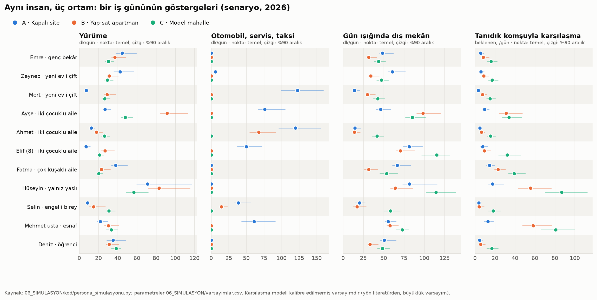
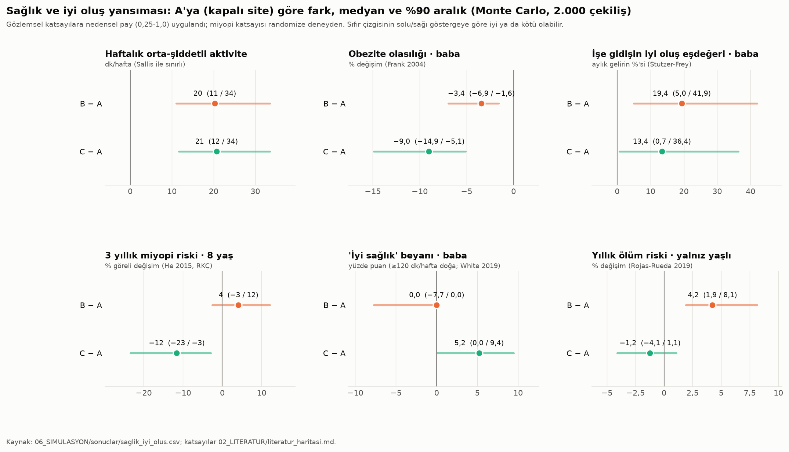
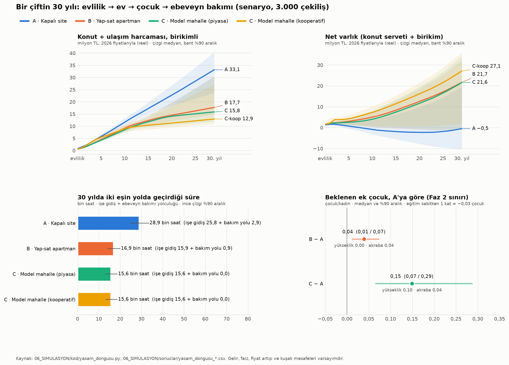
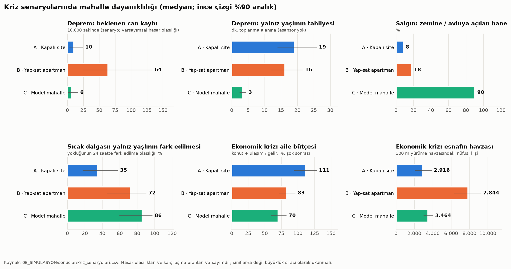

# Faz 4 · Rapor 1 (İP7) — Zihinsel Simülasyonlar: Aynı İnsan, Üç Ortam

*26 Ekim 2026 · Sürüm 0.1*

| Ne | Nerede |
|---|---|
| Kod: persona "bir gün", kriz, sağlık yansıması | [06_SIMULASYON/kod/persona_simulasyonu.py](../06_SIMULASYON/kod/persona_simulasyonu.py) |
| Kod: 30 yıllık yaşam döngüsü | [06_SIMULASYON/kod/yasam_dongusu.py](../06_SIMULASYON/kod/yasam_dongusu.py) |
| Varsayım tablosu (174 parametre, 325 ortam satırı; değer, aralık, kaynak) | [06_SIMULASYON/varsayimlar.csv](../06_SIMULASYON/varsayimlar.csv) |
| Sonuç tabloları | `06_SIMULASYON/sonuclar/`: `persona_zaman_butcesi.csv`, `persona_gostergeler.csv`, `persona_yolculuk_tanimlari.csv`, `hane_aylik_maliyet.csv`, `cocuk_bagimsiz_hareket.csv`, `saglik_iyi_olus.csv`, `kriz_senaryolari.csv`, `yasam_dongusu_ozet.csv`, `yasam_dongusu_yillik.csv`, `duyarlilik_c.csv` |
| Grafikler | [persona_gostergeler.png](../06_SIMULASYON/grafikler/persona_gostergeler.png) · [saglik_iyi_olus.png](../06_SIMULASYON/grafikler/saglik_iyi_olus.png) · [yasam_dongusu.png](../06_SIMULASYON/grafikler/yasam_dongusu.png) · [kriz_dayaniklilik.png](../06_SIMULASYON/grafikler/kriz_dayaniklilik.png) (her biri `.svg` olarak da var) |
| Persona anlatıları | [06_SIMULASYON/persona_anlatilari.md](../06_SIMULASYON/persona_anlatilari.md) |

Çalıştırma: `python 06_SIMULASYON/kod/persona_simulasyonu.py`. Komut iki modeli de çalıştırır, sabit tohumla yaklaşık 40 saniye sürer.

---

## Özet

**Soru:** Aynı insan aynı işte çalışıp aynı geliri kazansa, üç ortamda gündelik hayatı, bütçesi, ailesi ve kriz anındaki güvenliği nasıl değişir? Ortamlar şunlar:

- **A:** Megakent kapalı sitesi. 12 kat, çeperde, araca bağımlı.
- **B:** Eski yap-sat apartman mahallesi. 5-6 kat, karma kullanımlı, yeşilsiz.
- **C:** Model mahalle. Z+2/Z+3, avlulu, 15 dakikalık erişim.

**Kısa cevap:** Mekânın en büyük farkı zamanda, parada, çocuğun ve yaşlının bağımsızlığında ve deprem güvenliğinde ortaya çıkıyor. Doğurganlıkta ve ölçülen sağlık sonuçlarında fark küçük. Bunların hepsi **senaryodur**, öngörü değildir.

1. **Zaman: asıl kayıp A'da.**
   - İzlenen 11 kişinin günlük ulaşımı ortalama A'da **125 dk**, B'de **72 dk**, C'de **68 dk**. TÜİK Zaman Kullanım 2025'e göre Türkiye ortalaması 61 dk.
   - Çalışan ve öğrencilere kalan ev içi serbest zaman A'da 113, B'de 179, C'de 163 dk.
   - 30 yılda genç bir çift yolda A'da **28,9 bin saat**, C'de **15,6 bin saat** geçiriyor. Fark ≈13 bin saat, yani yaklaşık 6,5 iş yılı.
   - **Ancak** C'nin işe gidiş üstünlüğü büyük ölçüde konumdan ve toplu taşımadan geliyor. C, A'nın konumuna kurulursa bu üstünlük eriyor (Bölüm 2.8).
2. **Para: araç bağımlılığı mülkiyete erişimin gizli vergisi.**
   - İki çocuklu ailenin aylık ulaşım gideri A'da (iki araç ve servis) **44.419 TL**, B'de 24.204, C'de (araçsız) **8.756 TL**.
   - 30 yılda konut + ulaşım harcaması (reel, 2026 TL) A'da **33,1 milyon**, B'de 17,7, C'de 15,8, C-kooperatif yolunda 12,9 milyon.
   - A'daki çift çekilişlerin yalnız **%28'inde** 30 yıl içinde ev sahibi olabiliyor. Bu oran B'de %84, C'de %77, C-kooperatifte %92.
   - **Uyarı:** C'nin maliyet üstünlüğü yalnızca arabasız yaşanırsa var. Aile C'de bir araç tutarsa aylık gideri 73.657 TL olur ve B'yi (70.524) geçer. C'de kira primi B'den yüksek.
3. **Çocuk ve bakım veren:**
   - C'de 8 yaşındaki çocuk 5 gündelik hedefin **5'ine** (okul, yeşil, bakkal, arkadaş, mescit) yalnız gidebiliyor. A'da ve B'de bu sayı **2**.
   - Çocuğun ebeveynsiz dolaşabildiği alan C'de 12 ha, A'da 4 ha (site duvarları içi), B'de 1 ha.
   - Gün ışığında dış mekân süresi C'de 115 dk, A'da 81, B'de 70 dk. Bu fark He ve ark. (2015) randomize deneyine göre üç yıllık miyopi riskinde C'de A'ya göre **−%12** (%90 aralık: −%23 / −%3) demek.
   - B'de anne çocuk eşliği yüzünden günde 91 dk yürüyor. C'de çocuğun bağımsızlığı anneye A'ya göre günde 63 dk, B'ye göre 28 dk serbest zaman geri veriyor.
4. **Yaşlı, engelli ve deprem: B'nin zaafı bina, A'nınki ölçek.**
   - **Yalnız yaşlı:** Günlük tanıdık karşılaşma A'da 18, B'de 56, C'de 87. Sıcak dalgasında yokluğunun 24 saatte fark edilme olasılığı A'da **%35**, B'de %72, C'de **%86**.
   - **Tahliye:** Konuttan toplanma alanına A'da 19 dk (9. kat), B'de 16 dk (asansörsüz 4. kat), C'de 3 dk.
   - **Tekerlekli sandalye kullanıcısı:** B'de **hiçbir yolculuğunu** bağımsız yapamıyor; giriş basamağı ve kırık kaldırım yüzünden. C'de günde 2,5 bağımsız yolculuk yapıyor ve işe otobüsle gidiyor.
   - **Deprem:** Senaryo depreminde 10.000 sakin başına beklenen can kaybı A'da 10, **B'de 64**, C'de 6. Hasar olasılıkları varsayımdır; büyüklük sırası olarak okunmalı.
5. **Sağlık kazancı ölçülü, doğurganlık etkisi küçük.**
   - Literatürle sınırlandırılmış aktivite farkı A'ya göre **haftada yalnız ≈20 dk**. B ile C bu açıdan aynı, çünkü B de yoğun ve bağlantılı bir doku.
   - Zaman bütçesinin mekanik yürüme farkı bundan çok daha büyük görünüyor. Bu fark sağlık hesabına olduğu gibi aktarılmadı.
   - Doğurganlıkta C ile A arasındaki fark **+0,15 çocuk** (%90: 0,07-0,29). Bunun 0,10'u Faz 2'nin yükseklik katsayısından, ≈0,05'i varsayımsal kuşak yakınlığı kanalından geliyor. B ile A arasındaki fark +0,04.

**Proje için anlamı:** Simülasyon Faz 2'nin dersini destekliyor. Mekân doğurganlığı "kurtaran" bir kaldıraç değil. "Fıtrata uygun mahalle" tezinin güçlü dayanakları şunlar:

- Aileye zaman ve para kazandırmak
- Çocuğa bağımsızlık vermek
- Yaşlıyı ve engelliyi toplulukta tutmak
- Deprem güvenliği

İki uyarı da öne çıkıyor:

- **Konum ve toplu taşıma olmadan biçim yetmez.** Çeperde ama raylı sistemsiz bir C, A'nın yol sorununu taşır.
- **Arabasız yaşam ve kooperatif olmadan C pahalılaşır.** Kira primi ve otopark maliyeti avantajı siler.

B'nin karma ve sık dokusu birçok göstergede C'ye çok yakın. B'yi ayıran en büyük zaaflar bina stoku (deprem, merdiven, erişilebilirlik) ve yeşil eksikliği. Dolayısıyla **B tipi dokuyu yıkıp yükseltmek değil, onarmak** (az katlı yeniden yapım, yeşil cep, erişilebilir giriş) bu modelin en ucuz kazanımı olabilir.

---

## 1. Yöntem

### 1.1 Üç ortamın tanımı (temel değerler; aralıklar `varsayimlar.csv`'de)

| Parametre | A · Kapalı site | B · Yap-sat apartman | C · Model mahalle | Kaynak |
|---|---|---|---|---|
| Kat / bina yüksekliği | 12 kat / 36 m | 5-6 kat / ≈16,5 m | 3 kat / 9 m | A, C: `ayni_yogunluk_uc_bicim_metrikler.csv` [H]; B: TÜİK BKNA 2021 (hanelerin %27,4'ü 5-6 katlı binada) |
| Bir yapıyı paylaşan daire | 48 | 11 | ≈7 (tipoloji ağırlıklı) | [H] |
| Zemine / avluya doğrudan açılan hane | %8,3 | ≈%18 | ≈%90 | CSV [H]; B [V] |
| Asansör | var (zorunlu) | yok | yalnız T3 (4 kat) ve T4 | CSV; BKNA: 3+ katlı binadaki hanelerin %53,6'sı asansörsüz |
| Bakkal / mescit / ilkokul (ağ mesafesi) | 900 / 700 / 1.400 m | 120 / 250 / 600 m | 200 / 150 / 400 m | C: tasarım parametreleri 9.5 ve MPYY Md. 12 [D]; A, B [V] |
| Kullanılabilir yeşil | site bahçesi 80 m | 700 m | komşuluk yeşili 180 m | CSV (A kişi başı 18,5 m² ortak alan); C tasarım [D/H]; B [V] |
| Toplu taşıma durağı | 900 m | 300 m | 300 m | C tasarım; A, B [V] |
| Merkeze uzaklık | 22 km | 10 km | 10 km (duyarlılık: 22 km) | [V] konum varsayımı |
| Hane başına araç (persona) | 1-2 | 0-1 | 0 (esnaf 1) | [V]; Türkiye ≈0,65 otomobil/hane [H] |
| Kira / aidat | 340 / 35 TL/m² | 380 / 6 TL/m² | 420 / 12 TL/m² | İstanbul ortalama kira 45.510 TL (Emlakjet-Endeksa, Ağu 2026) [İ]; ortam farkları [V] |
| Satış fiyatı | 52.000 TL/m² | 55.000 TL/m² | 60.000 TL/m² | İstanbul ortalama ≈58.900 TL/m² [H, İ]; ortam farkları [V] |

**Fiyatlar (2026, ikincil kaynak):**

- Net asgari ücret 28.075,50 TL.
- Benzin 79,60 TL/L (İstanbul, 20.10.2026).
- İBB tam abonman 3.628 TL, öğrenci abonmanı 653 TL (Temmuz 2026 tarifesi).
- Araç başına sabit maliyet 12.000 TL/ay (7.000-18.000) [V].

**Bilgi notu — yapım maliyeti:** ÇŞİDB'nin 2026 Yapı Yaklaşık Birim Maliyetleri Tebliği (RG 03.02.2026/33157) şu sınıfları veriyor:

- Üç kata kadar apartman tipi konut: **19.800 TL/m²** (III-A)
- 21,5 m'ye kadar konut: 21.050 TL/m² (III-B)
- 30,5-51,5 m arası konut: **26.450 TL/m²** (IV-A)

Yani resmî sınıflamada yüksek konutun birim maliyeti üç katlıdan **%34 fazla** [İ]. Bu değerler ücret hesabı içindir, piyasa maliyeti değildir. Bu sürümde hesaplara girmedi.

### 1.2 Personalar

Sekiz persona, toplam 11 izlenen kişi var. İki çocuklu ailede anne, baba ve 8 yaşındaki çocuk ayrı ayrı izleniyor; yeni evli çiftte iki eş ayrı.

| Persona | İzlenen kişi | Hane, gelir, mülkiyet |
|---|---|---|
| Genç bekâr | Emre (27, merkezde ofis) | 1 kişi, 70 m², 2 asgari ücret, kiracı |
| Yeni evli çift | Zeynep (26, semtte öğretmen), Mert (29, merkezde satış) | 90 m², 4,6 asgari ücret, kiracı |
| İki çocuklu aile | Ayşe (36, yarı zamanlı), Ahmet (39, merkez), Elif (8); ayrıca Can (4) | 120 m², 4 asgari ücret, kiracı |
| Çok kuşaklı aile | Fatma (68, büyükanne); oğlu, gelini, iki torunu | 160-190 m², ev sahibi |
| Yalnız yaşlı | Hüseyin (76, dizinden rahatsız) | 75 m², emekli (0,8 asgari ücret), ev sahibi |
| Engelli birey | Selin (31, tekerlekli sandalye, haftada 3 gün ofis) | annesiyle 85 m², kiracı |
| Esnaf | Mehmet usta (52, bakkal) | aile, ev sahibi |
| Öğrenci | Deniz (20, üniversite) | aileyle, 120 m², kiracı |

Her kişinin günü bir yolculuk zinciri olarak tanımlandı: amaç, hedef, sıklık, ortama göre ulaşım modu ve hedefte kalış süresi. Zincirlerin tamamı `persona_yolculuk_tanimlari.csv` dosyasında.

### 1.3 Model

- **Bir gün motoru.** Her yolculuğun süresi şu bileşenlerin toplamı:
  - Ağ mesafesi / kişinin yürüme hızı
  - Toplu taşımada durağa yürüme + bekleme + araç içi süre + aktarma + varış yürüyüşü
  - Araçta otopark erişimi + sürüş + park yeri arama
  - Dikey dolaşım: asansör ya da kat başına merdiven süresi

  Sabit bloklar (uyku, iş/okul, bakım) ve serbest zaman eklenip kalan süre "ev içi serbest zaman" olarak yazılıyor. Bütün bütçeler 1.440 dakikaya kapanıyor. Dış mekân ve gün ışığı süreleri yolculuk ve kalış türüne göre hesaplandı.
- **Komşuyla karşılaşma.** Beklenen tanıdık karşılaşma = Σ (alanda geçen dakika × dakikada karşılaşılan kişi × bunların tanıdık komşu payı). Alanlar: bina içi, sokak, avlu/park, dükkân, mescit, kahvehane, okul kapısı. Bu kısım **kalibre edilmemiş bir varsayım modelidir**:
  - Yönü literatürden geliyor: Gifford 2007, Wood ve ark. 2010, Leyden 2003, Alexander'ın 8-12 haneli avlu grubu.
  - Karşı kanıt da var: Brueckner & Largey 2008.
  - Büyüklükler varsayım. Plandaki M3 ajan tabanlı modelde sınanacak.
- **Çocuğun bağımsız hareketi.** İki ölçü kullanıldı:
  - Ebeveynsiz dolaşılabilen alan (ha)
  - 5 gündelik hedeften kaçına ≤500 m'de ve ana yol geçmeden ulaşılabildiği (PSI yöntemine dayanır)
- **Maliyet.** Hane düzeyinde hesaplandı:
  - Kiracılar için kira + aidat; ev sahipleri için aidat + bakım
  - Araç sabiti, yakıt ve aşınma, otopark, abonman, servis, erişilebilir taksi, paylaşımlı araç
- **Sağlık yansıması.** Yalnız `literatur_haritasi.md`'de doğrulanmış katsayılar kullanıldı (Bölüm 2.5'teki tablo). Kesitsel ya da gözlemsel katsayılara **nedensel pay** (0,25-1,0, temel 0,5) uygulandı. Gerekçe Faz 2'nin seçilim dersi. Randomize deneye (miyopi) bunun yerine taşınabilirlik payı (0,5-1,0) uygulandı.
- **Yaşam döngüsü (30 yıl).** Persona P2'deki çift izleniyor. Gelir, kira veya taksit, aidat, ulaşım, diğer tüketim ve birikim yıllık olarak hesaplandı. Peşinat birikince ev alınıyor.

  Dört yol karşılaştırıldı: A, B (30 yıl içinde 6306'ya göre dönüşüm olasılığıyla), C (piyasa) ve C-kooperatif (fiyat piyasanın ≈%70'i, teslim 3 yıl sonra).

  Kuşak yakınlığı şu kanallardan sonucu etkiliyor:
  - Büyükanne-büyükbabanın çocuk bakımı
  - Annenin istihdamı (Compton & Pollak 2014: +4-10 puan)
  - Ebeveyn bakımı için yolculuk süresi

  **Doğurganlık Faz 2 ile sınırlandı:**
  - Eğitim sabitken 3 m (≈1 kat) başına 0,029 çocuk; aralık 0 ile 0,136
  - Yalnız verinin desteklediği ≤15 m yükseklik aralığında uygulandı. Rapor 2'de 12 m üstünde ek ayrışma yok
  - Küçük bir akraba yakınlığı kanalı (0-0,10) eklendi
  - Toplam fark 0,3 çocukla tavanlandı
- **Kriz senaryoları.** Dört senaryo için basit nicel göstergeler ve nitel değerlendirme yapıldı: deprem, salgın, sıcak dalgası, ekonomik kriz (gelir −%20, yakıt +%50).

### 1.4 Belirsizlik ve tekrarlanabilirlik

- **Örnekleme.** Her parametre üçgen dağılımla (düşük, temel, yüksek) örneklendi. Sallis aralığında düzgün dağılım kullanıldı.
- **Monte Carlo.** Persona ve kriz modelinde 2.000, yaşam döngüsünde 3.000 çekiliş yapıldı. Tohum 2026; aynı komut aynı sonucu üretir.
- **Raporlama.** Tablolarda temel değer, ya da medyan ve %90 aralık (p5-p95) veriliyor.
- **Bağımsızlık varsayımı.** Ortamların parametreleri birbirinden bağımsız çekildi. Bu, ortamlar arası farkların belirsizliğini olduğundan **büyük** gösterir; ihtiyatlı bir tercih.

### 1.5 Kaynak işaretleri ve varsayım payı

İşaret sistemi `tasarim_parametreleri.md` ile aynı, **[V]** eklendi:

| İşaret | Anlamı |
|---|---|
| [D] | Doğrulanmış literatür ya da proje verisi |
| [İ] | İkincil kaynak (basın, kurum özeti) |
| [H] | Bu çalışmada hesaplandı |
| [V] | Varsayım |

174 parametrenin **135'i yalnızca varsayım [V]**. 13'ü [D], 13'ü [İ], 15'i [H] içeriyor; bunların bir kısmı karma işaretli. Bu oran modelin bir **düşünme aracı** olduğunu açıkça gösteriyor.

### 1.6 Sağlamalar (tutarlılık kontrolleri)

| Kontrol | Sonuç |
|---|---|
| Ortalama günlük ulaşım ile TÜİK Zaman Kullanım 2025 (10+ yaş, 61 dk) | B 72, C 68 dk. Personaların çoğu çalışan olduğu için hafifçe yukarıda; tutarlı. A'nın 125 dakikası bir uç durumu temsil ediyor |
| Aktivite farkı ile Sallis 2016 (en ve en az aktivite dostu mahalle farkı 68-89 dk/hafta) | Sağlık hesabına giren fark ≈20 dk/hafta (nedensel pay sonrası). Literatür sınırının altında |
| Doğurganlık ile Faz 2 (bir kat ≈ −0,03 çocuk; büyükşehirde 10,2 m → 6 m için +0,04) | C ile A arasında yükseklik kanalı temel değerde 0,058, MC medyanında 0,10. Aynı büyüklük sırasında |
| Deprem can kaybı oranı ile 6 Şubat 2023 | Ağır hasarlı konutta kişi başına can kaybı 53.537 / (518.009 × 3,1) ≈ 0,033 (ikincil veri). Senaryo bu oranı kullanıyor |

---

## 2. Bulgular

### 2.1 Bir iş günü: zaman, dış mekân, karşılaşma

| İş günü ortalaması (temel) | A | B | C |
|---|---|---|---|
| Ulaşım, 11 kişi (dk/gün) | **125** | 72 | 68 |
| Ulaşım, çalışan ve öğrenciler (8 kişi) | 142 | 83 | 81 |
| Ev içi serbest zaman, çalışan ve öğrenciler | 113 | **179** | 163 |
| Otomobil, servis, taksi (dk/gün) | 43 | 7,5 | 0 |
| Yürüme (dk/gün; merdiven dahil) | 29 | **38** | 33 |
| Gün ışığında dış mekân (dk/gün) | 49 | 44 | **66** |
| Tanıdık komşuyla karşılaşma (beklenen, /gün) | 8 | 20 | **34** |

**Öne çıkanlar:**

- **A'da yol, serbest zamanı yiyor.** Arabasız genç bekâr işe tek yön 93 dk gidiyor ve kendine 44 dk kalıyor. Merkeze araçla giden babanın günü 120 dk direksiyonda geçiyor.
- **Yürüme paradoksu.** En çok yürünen ortam C değil, B. Bunun nedenleri:
  - Annenin okul ve anaokulu eşliği
  - Yaşlının merdivenleri
  - A'da arabasız sakinler de uzun ve zorunlu yürüyüşler yapıyor: otoyol kenarından 900 m'deki durağa

  Bu yüzden zaman bütçesindeki yürüme dakikası doğrudan "sağlık" sayılmadı (Bölüm 2.5).
- **C'nin farkı dış mekân ve karşılaşmada.** Avlu, komşuluk yeşili ve yakın mescit gün ışığı süresini ve tanıdık karşılaşmayı artırıyor. B kalabalık ama yabancı dolu: karşılaşma çok, tanıdık payı düşük. A'da asansör 48 haneyle paylaşılıyor ve sokak hayatı yok.
- **İbadete erişim.** En yakın mescide tek yön yürüme:
  - Sağlıklı yetişkin: A'da ≈11 dk, B'de 4 dk, C'de 2-3 dk
  - Dizinden rahatsız yaşlı: A'da 18, B'de 10 (merdiven dahil), C'de 3,6 dk

  Bu fark yaşlının cemaate katılımını günde bir vakitten üç vakte çıkarıyor. Katılım sıklığı varsayımdır.

### 2.2 Aylık konut + ulaşım maliyeti (2026, temel; TL/ay ve gelire oranı)

| Hane | A | B | C |
|---|---|---|---|
| Emre (tek kişi, kiracı) | 29.878 (%53) | 30.648 (%55) | 33.868 (%60) |
| Zeynep ve Mert (kiracı) | 62.913 (%49) | **41.996 (%33)** | 47.636 (%37) |
| İki çocuklu aile (kiracı) | **89.419 (%80)** | 70.524 (%63) | **60.596 (%54)** |
| · bunun ulaşımı | 44.419 | 24.204 | 8.756 |
| · C'de bir araç tutarsa | — | — | 73.657 (%66) |
| Çok kuşaklı aile (ev sahibi; aidat + bakım + ulaşım) | 42.125 | 26.070 | 11.788 |
| Yalnız yaşlı (ev sahibi) | 4.250 | 2.169 | 2.775 |
| Selin ve annesi (kiracı) | 47.890 | 41.910 (taksi 9.100) | 36.720 |
| Esnaf ailesi (ev sahibi) | 26.042 | 17.634 | 19.001 |
| Öğrencinin ailesi (kiracı) | 70.712 | 67.549 | 57.621 |

**Okuma:**

- **A pahalı, çünkü araca bağımlı.** A'nın kira ve aidatı birlikte B ile benzer; farkı yaratan araç, servis ve otopark.
- **C'nin kirası en yüksek.** C ancak arabasız yaşandığında ucuzluyor. Bekâr ve esnaf gibi araç tasarrufu yapamayanlar için C, B'den pahalı.
- **Ortak payda.** İstanbul'da kiracı olan her persona gelirinin üçte birinden fazlasını konut ve ulaşıma veriyor. Aşırı yük eşiği %40, ama bu hesap tanım olarak kira ve ulaşımı birlikte kapsıyor.

### 2.3 Çocuk ve bakım veren

| Gösterge (8 yaş) | A | B | C |
|---|---|---|---|
| Ebeveynsiz dolaşılabilen alan | 4 ha (site içi) | 1 ha (sokak) | **12 ha** (araç hücresi) |
| Yalnız ulaşılan hedef (5 hedeften) | 2: yeşil, arkadaş | 2: bakkal, arkadaş | **5** |
| Okula yalnız gidebiliyor mu? | hayır (servis 2 × 25 dk) | hayır (trafikli cadde) | **evet (6 dk)** |
| Gün ışığında dış mekân (dk/gün) | 81 | 70 | **115** |
| 3 yıllık miyopi riski, A'ya göre (He 2015) | — | +%4 (−3 / +12) | **−%12** (−23 / −3) |
| Annenin kendine kalan zamanı | 165 dk | 200 dk | **228 dk** |

- **Gözetim ile güvenlik.** Kapalı site çocuğa güvenli bir iç bahçe veriyor. Bu yüzden A'nın gün ışığı süresi B'den yüksek. Ama site sınırı aynı zamanda çocuğun dünyasının sınırı.
- **B'nin bedeli.** Sokak dokusu var ama trafik ve yeşil eksikliği çocuğu annenin eşliğine bağlıyor.

### 2.4 Yaşlı, engelli, esnaf

- **Yalnız yaşlı (76).**
  - **A:** 9. katta asansöre bağlı. Mescide 18 dk, günde bir vakit cemaat. Tanıdık karşılaşma 18.
  - **B:** Kahvehane ve iki vakit cemaatle topluluğa bağlı (karşılaşma 56). Ama 4 kat merdiven günde ≈36 dk.
  - **C:** Zemin kat, 150 m'de mescit, çay bahçesi ve avlu. Karşılaşma 87.
- **Tekerlekli sandalye kullanıcısı.**
  - **A:** Site içi erişilebilir, dışı değil. Hareketi uyarlanmış araca bağlı.
  - **B:** Giriş basamağı ve kaldırım yüzünden bağımsız yolculuk sıfır. Mescide erişemiyor. İşe taksiyle gidiyor: ayda 9.100 TL.
  - **C:** Kotsuz yüzey ve alçak tabanlı otobüsle işe bağımsız 23,5 dk.
- **Esnaf.**
  - **B:** Dükkânın 300 m'lik yürüme havzasında ≈7.800 kişi var. Yoğunluğun ekonomik değeri burada görülüyor.
  - **C:** Havza ≈3.500 kişi. Yoğunluk B'nin yarısından az; bu açık planlı çarşı ve zemin kat ticaretiyle kapatılmalı (80-120 dükkân, dükkân başına ≈72 kişi).
  - **A:** Esnaf siteye taşınırsa dükkânına günde 61 dk araçla gidip geliyor. Müşterileri komşusu değil.

### 2.5 Sağlık ve iyi oluş yansıması

A'ya göre fark, medyan [%90 aralık]. Gözlemsel katsayılara nedensel pay uygulandı.

| Gösterge | Katsayı (kaynak, kanıt gücü) | B − A | C − A |
|---|---|---|---|
| Haftalık orta-şiddetli aktivite (bütün yetişkinler) | Sallis 2016: en ve en az aktivite dostu mahalle farkı 68-89 dk/hafta. Ortamlar Sallis'in dört özelliğiyle (yoğunluk, kavşak, durak, park) 0-1 arası puanlandı. A 0,21, B 0,67, C 0,68 (orta, kesitsel) | +20 [11; 34] dk | +21 [12; 34] dk |
| Obezite olasılığı, araçla işe giden baba | Frank 2004: arabada her ek saat/gün +%6, her ek km yürüme/gün −%4,8 (orta, kesitsel) | −%3,4 [−6,9; −1,6] | **−%9,0** [−14,9; −5,1] |
| İşe gidiş süresinin iyi oluş eşdeğeri, baba | Stutzer & Frey 2008: 22 dk tek yön ≈ gelirin %35,4'ü. Temel değer bunun yarısı, alt uç 0 (Hirte & Illmann 2018) (orta, panel) | +%19 [5; 42] gelir ≈ 15.200 TL/ay | +%13 [1; 36] ≈ 10.500 TL/ay |
| Aynısı, arabasız genç bekâr | aynı | +%35 [11; 75] ≈ 19.700 TL/ay | +%36 [11; 73] |
| Topluluk katılımı, baba | Putnam 2000: +10 dk işe gidiş ≈ −%10 (ikincil; alt uç 0) | +%12 [3; 26] | +%8 [1; 23] |
| "İyi sağlık" beyanı, çalışan yetişkin | White 2019: ≥120 dk/hafta doğa teması OR 1,59. Haftalık doğa teması A 95, B 47, C 164 dk (orta-zayıf, kesitsel) | 0 [−7,7; 0] puan | **+5,2** [0; 9,4] puan |
| 3 yıllık miyopi, 8 yaş | He 2015 RKÇ: +40 dk/gün dış mekân → −9,1 puan. Xiong 2017: doz-yanıt doğrusal değil, tavan 80 dk (güçlü) | +%4 [−3; 12] | **−%12** [−23; −3] |
| Yaşlıda yıllık ölüm riski | Rojas-Rueda 2019: 500 m'de her 0,1 NDVI → HR 0,96. NDVI A 0,30, B 0,12, C 0,35 [V] (orta-güçlü, korelasyonel) | **+%4,2** [1,9; 8,1] ≈ binde +1,7/yıl | −%1,2 [−4,1; 1,1] |

**Okuma:**

- **Sağlık kazancı ılımlı ve belirsiz.** Aralıklar geniş. En sağlam kanıt (randomize deney) çocuğun gözüyle ilgili.
- **Gözlemsel katsayılar abartılmamalı.** Literatürün en güçlü sinyali olan yeşil-ölüm ilişkisi bile korelasyonel. B'nin yeşilsizliği bu kanalda yaşlıya A'ya göre yılda binde ≈1,7 ek ölüm riski yüklüyor.
- **Mekanik yürüme ile gerçek aktivite ayrı.** Zaman bütçesine göre B'deki anne haftada 446 dk, C'deki baba 90 dk daha fazla yürüyor. Bu "ulaşım yürüyüşü", ikame etkisi ve seçilim yüzünden sağlık kazancına birebir çevrilmedi. Hesapta yalnız Sallis sınırlı fark kullanıldı.
- **Arabasız A sakini paradoksu.** Frank katsayısıyla A'daki arabasız bekâr, C'dekinden daha az obezite riski taşıyor (+%3-4, C aleyhine), çünkü durağa 900 m yürüyor. Bu bir model yapıntısı değil, dikkat çekilmesi gereken bir gerçek. Araca bağımlı dokuda arabasız olmak, uzun ve güvensiz yürüyüş demek.

### 2.6 30 yıllık yaşam döngüsü: evlilik → ev → çocuk → ebeveyn bakımı

Çift: Zeynep 26, öğretmen, 2,2 asgari ücret; Mert 28, merkezde satış, 2,4 asgari ücret. İlk çocuk 2. yılda, ikinci çocuk 5. yılda (olasılıkla). 3. yılda 3+1'e geçiyorlar, ebeveyn bakımı ≈19. yılda başlıyor. Monte Carlo medyanı [%90 aralık]:

| Gösterge | A | B | C (piyasa) | C-kooperatif |
|---|---|---|---|---|
| 30 yılda konut + ulaşım (milyon TL, reel) | **33,1** [23,6; 40,4] | 17,7 [14,8; 30,5] | 15,8 [11,9; 30,4] | **12,9** [11,0; 27,2] |
| · bunun ulaşımı | 16,0 | 7,3 | 3,1 | 3,1 |
| 30 yıl içinde ev sahibi olma (çekilişlerin %'si) | **28** | 84 | 77 | **92** |
| Temel senaryoda ev alım yılı | alamıyor | 3. yıl | 4. yıl | 2. yıl (taşınma 5.) |
| 30. yılda net varlık (milyon TL) | **−0,5** [−10,4; 19,5] | 21,7 [−0,8; 32,3] | 21,6 [−0,9; 34,2] | **27,1** [1,9; 36,2] |
| İlk yıl konut + ulaşım / gelir | %49 | %33 | %37 | %37 |
| Yolda geçen süre (bin saat; işe gidiş + bakım yolu) | **28,9** (25,8 + 2,9) | 16,9 (15,9 + 0,9) | 15,6 (15,6 + 0) | 15,6 |
| Kuşaklar arası mesafe / ebeveyne yolculuk | 18,9 km / 52 dk | 4,3 km / 16 dk | 0,7 km / 8 dk (bakımda aynı ev) | aynı |
| Büyükanne-büyükbabadan çocuk bakımı (bin saat, 2.-11. yıl) | 0 [0; 2,5] | 6,5 | 7,6 | 7,6 |
| Annenin küçük çocuklu dönemde çalışmayı sürdürme olasılığı | 0,70 | 0,76 | **0,77** | 0,77 |
| Beklenen ek çocuk, A'ya göre | — | +0,04 [0,01; 0,07] | **+0,15** [0,07; 0,29] | +0,15 |
| · yükseklik kanalı (Faz 2) / akraba kanalı (varsayım) | — | 0,00 / 0,04 | 0,10 / 0,045 | aynı |

**Okuma:**

- **A yolunu belirleyen araç.** A'da iki araç, servis ve merkezde otopark birikimi eritiyor. Aynı gelirle A'daki çift çoğu senaryoda 30 yıl kirada kalıyor. Tek araçla yetinse bile ev sahibi olma payı yalnızca %48'e çıkıyor (net varlık 5,0 milyon TL).
- **Kooperatifin etkisi.** C'nin piyasa fiyatı B'den yüksek olduğu için piyasa yolunda C, B ile başa baş. Kooperatif ya da maliyetine konut (fiyatın ≈%70'i) C'yi açık ara en iyi yol yapıyor. Bu, `tasarim_parametreleri.md`'deki "en az %30 kooperatif" hedefinin sayısal gerekçesi. Ancak kooperatif fiyat oranı Türkiye verisiyle ölçülmüş değil.
- **B'nin gizli riski.** Çekilişlerin %51'inde 30 yıl içinde 6306 kapsamında dönüşüm yaşanıyor: 2-4 yıl evden uzak kalma ve kira yükü. Dönüşüm aileyi çoğu zaman daha yüksek bir binaya taşıyor.
- **Doğurganlık küçük, ama sıfır değil.** C-A farkı +0,15 çocuk. Bunun ≈0,10'u yükseklik kanalı. Kanal eğitim sabitken bir kat başına 0,03 çocuk katsayısının ve onun sağa çarpık aralığının (en fazla 0,136) sonucu; bu yüzden MC medyanı nokta tahminden (0,058) yüksek. ≈0,05'i ise tamamen varsayıma dayanan akraba kanalı. Tavan 0,3 hiçbir çekilişte aşılmıyor.

  Bu sayı Faz 2 Rapor 1'deki "yoğun kent → orta yoğun kent" üst sınırıyla (+0,13) aynı büyüklükte. **Hiçbir yol doğurganlığı yenilenme düzeyine yaklaştırmıyor.**

### 2.7 Kriz senaryoları: mahalle dayanıklılığı

| Kriz | Gösterge (medyan [%90]) | A | B | C |
|---|---|---|---|---|
| **Deprem** | Senaryo: ağır hasar / yıkılma olasılığı (yapı başına) [V] | %2 | %15 | %1 |
| | Beklenen can kaybı, 10.000 sakinde | 10 [4; 24] | **64** [25; 133] | 6 [2; 16] |
| | Tek yapıda yaşayan kişi (bir göçmede etkilenen) | **149** | 34 | 22 |
| | Tahliye: sağlıklı yetişkin / yalnız yaşlı / tekerlekli (dk) | 4 / 19 / 33 | 7 / 16 / 27 | 2 / 3 / 2,5 |
| | Risk sınıfı (rubrik: yapım dönemi, yükseklik, yumuşak kat, toplanma alanı, sokak H:W, yapı başına malik) | 3 | 4 | 1 |
| **Salgın** | Zemine / avluya doğrudan açılan hane | %8 | %18 | **%90** |
| | Kişi başı özel bahçe / avlu | 0 | 0 | 10,9 m² |
| | Aynı asansörü / merdiveni paylaşan hane | **48** | 11 | 7 |
| | Yalnız yaşlının bakkala tek yön yürüyüşü | 24 dk | 7 dk | 5 dk |
| | Büyükannenin günlük tanıdık teması (yardımlaşma kapasitesi) | 15 | 25 | **41** |
| **Sıcak dalgası** | Ağaç örtüsü (başlangıç) | %20 | **%5** | %15 (15-20 yılda hedef %30) |
| | Yalnız yaşlının en yakın serin kamusal yere (mescit) | 20 dk | 10 dk | 4 dk |
| | Yokluğunun 24 saatte fark edilme olasılığı | **%35** [18; 57] | %72 [46; 90] | **%86** [60; 97] |
| **Ekonomik kriz** (gelir −%20, yakıt +%50) | Aile: konut + ulaşım / gelir, önce → sonra | %83 → **%111** | %65 → %83 | %56 → %70 |
| | Yakıt şokunun aileye aylık ek maliyeti | 5.937 TL | 2.002 TL | 0 |
| | Arabasız yaşanabilirlik (işe toplu taşıma / araç süresi) | 1,44 kat | 1,19 | 1,19 |
| | Esnafın 300 m yürüme havzası | 2.916 kişi | **7.844** | 3.464 |

**Nitel değerlendirme:**

- **Deprem.**
  - **B en kırılgan ortam:** 1970-2000 yap-sat stoku, zemin kat dükkânlarının yarattığı yumuşak kat, kaçak kat riski, 1,8 H:W oranlı dar sokakların enkazla kapanması ve 450 m uzaktaki toplanma alanı.
  - **A'nın riski farklı:** yapısal olarak görece güvenli ama tek binada ≈150 kişi var. Asansör ve hidrofor elektriğe bağlı, yaşlı ve engelli için dikey tahliye uzun. 48 malikli yapıda yeniden yapım kararı zor (6306 md. 6 salt çoğunluk).
  - **C'de** düşük yükseklik, avlu ve 150 m'deki komşuluk yeşili ilk sığınağı oluşturuyor.
- **Salgın.** Kapanma koşullarında C'de hanelerin ≈%90'ı kendi avlusuna ya da bahçesine çıkabiliyor. Yaşlılar için sokağa çıkma kısıtı sırasında bu, gün ışığına erişim demek.

  A'da 48 hane tek asansörü paylaşıyor; bu hem bulaş hem yalıtım riski. B'de günlük ihtiyaç kapının dibinde ama balkondan başka dış mekân yok.
- **Sıcak dalgası.** B'nin yeşilsiz beton dokusu en sıcak doku (ağaç örtüsü ≈%5). A'da üst kat ve cam cephe ısınıyor; elektrik kesilince asansör ve su kesiliyor. C'nin ağaç örtüsü başlangıçta A'dan düşük: dayanıklılık zamanla kazanılıyor.

  En belirleyici gösterge sosyal. Yalnız yaşlının yokluğunu fark edecek bir komşunun olması A'da üç senaryodan birinde, C'de altı senaryodan beşinde mümkün. Bu gösterge varsayımsal "yakın tanıdık payı"na (%2-10) bağlı.
- **Ekonomik kriz.** A'daki araçlı aile şokta gelirinin tamamından fazlasını konut ve ulaşıma ayırmak zorunda kalıyor. Arabadan vazgeçmek de zor: toplu taşıma 1,44 kat daha uzun ve durak 900 m uzakta. C araçsız olduğu için yakıt şokundan etkilenmiyor. B'nin yoğunluğu esnafa en geniş müşteri tabanını sağlıyor.

**Dayanıklılık özeti (nitel sınıf):**

| Kriz | A | B | C |
|---|---|---|---|
| Deprem | orta | düşük | yüksek |
| Salgın | düşük | orta | yüksek |
| Sıcak dalgası | orta | düşük | orta → yüksek (ağaçlar büyüdükçe) |
| Ekonomik kriz | düşük | orta-yüksek | yüksek (araçsızsa) |

### 2.8 Konum mu, biçim mi? C'nin zayıf yanları

`duyarlilik_c.csv` dosyasına göre C, A'nın konumunda kurulursa sonuçlar şöyle değişiyor (merkeze 22 km, raylı sistem 32 km/sa, kira 360 TL/m²):

| Kişi, işe tek yön (dk) | A | B | C (temel) | C-çeper |
|---|---|---|---|---|
| Emre (genç bekâr) | 93 | 46 | 46 | 60 |
| Mert / Ahmet (merkez) | 64 | 46 / 38 | 45 | 59 |
| Deniz (öğrenci) | 101 | 51 | 51 | 65 |
| Aile, konut + ulaşım (TL/ay) | 89.419 | 70.524 | 60.596 | 53.396 |

- **İşe gidiş üstünlüğü konumdan geliyor.** Ahmet B'de araçla, C'de toplu taşımayla gidiyor; B'de 7 dk daha hızlı. C'yi çeperde kurmak yolu A düzeyine yaklaştırıyor, ama ucuz kira ve araçsızlık sayesinde maliyet üstünlüğü sürüyor.
- **Biçim kazançları konumdan bağımsız.** Çocuk, yaşlı, engelli, karşılaşma, deprem tahliyesi ve salgında dış mekân kazançları C-çeperde değişmiyor.
- **C'nin zayıf yanları:**
  - Kira primi
  - Araç tutulduğunda maliyet avantajının kaybolması
  - B'den düşük yoğunluk: esnaf havzası ve toplu taşıma eşiği
  - Ağaç örtüsünün başlangıçta düşük olması
- **B'nin güçlü yanları gerçek.** Yoğunluk, karma kullanım, kahvehane ve mescit ağı, kısa yolculuk. B'nin sorunu doku değil, bina stoku ve yeşil eksikliği.

---

## 3. Proje tezine etkisi

| Tez (Faz 1 sentezi, Bölüm 6) | Simülasyonun söylediği | Durum |
|---|---|---|
| Alçak-orta katlı sık doku aileye zaman kazandırır | Zaman kazancı A'ya göre büyük, B'ye göre küçük. Kazancın çoğu konum ve toplu taşımadan geliyor | **Kısmen.** Biçim + konum + toplu taşıma birlikte |
| Araç bağımlılığı aile bütçesini ve mülkiyeti aşındırır | A'da 30 yılda C'ye göre +17 milyon TL konut + ulaşım; ev sahibi olma %28 | **Güçlü sinyal** (varsayımlara duyarlı) |
| Çocuğun bağımsız hareketi tasarımla mümkün olur | 5 / 5 hedef, 12 ha, okula yalnız; miyopi −%12 | **Güçlü sinyal** (RKÇ'ye dayalı tek nicel sağlık kazancı) |
| Kuşak yakınlığı bakım yükünü hafifletir | Çocuk bakımı 7,6 bin saat; anne istihdamı +7 puan; bakım yolu sıfır | **Destekleniyor** (mesafe senaryo varsayımı) |
| Az katlı yapı deprem güvenliği sağlar | Can kaybı B'de C'nin ≈10 katı; A ile C arasındaki fark tahliye ve ölçekte | **Destekleniyor** (hasar olasılıkları varsayım) |
| Mekân doğurganlığı artırır | C-A +0,15 çocuk (0,07-0,29); yenilenme düzeyinden çok uzak | **Zayıf.** Faz 2 ile tutarlı biçimde küçük |

---

## 4. Sınırlılıklar

- **Kehanet değil, senaryo.** 174 parametrenin 135'i varsayım. Sayılar büyüklük sırası ve yön için okunmalı. Kesin değer ve sıralama iddiası yok.
- **Karşı-olgu kurgusu.** "Aynı kişi, aynı gelir" kurgusu seçilimi yok sayıyor. Gerçekte A'da daha varlıklı haneler oturuyor. Bu yüzden A'nın gelire oranla yüksek yükü A sakinlerinin gerçek yükü değil, aynı ailenin A'yı seçmesinin bedeli.
- **Karşılaşma modeli kalibre edilmedi.** Dakika başına karşılaşma ve tanıdık payı varsayımdır. Komşuluk ve yardımlaşma sonuçları, özellikle "yokluğun fark edilmesi", bu varsayımlara duyarlı. TAYA komşuluk verisi ve M3 ajan tabanlı modelle sınanmalı.
- **Fiyatlar ikincil kaynaklı.**
  - Kira ve fiyatlar Emlakjet-Endeksa basın aktarımları.
  - Ortamlar arası farklar varsayım.
  - TCMB konut fiyat endeksi ve kira verisi bu çalışmada okunamadı.
  - Sonuçlar İstanbul'a özgü. Orta ölçekli bir Anadolu kentinde kira, mesafe ve araç dengesi farklı olur.
- **Deprem hasar olasılıkları varsayım.** Yapım yılına ve kat sayısına göre 6 Şubat hasar verisi (SBB 2023 raporu) ile kalibre edilmeli. Can kaybı oranı ikincil verilerle hesaplandı. Yükseklikle artan kurtarma güçlüğü modelde yok.
- **Sağlık katsayıları başka ülkelerden.** Çoğu kesitsel ve yabancı örneklemli: Atlanta, Almanya, Guangzhou, Avrupa kohortları. Nedensel pay ve taşınabilirlik indirimi keyfî ama açık.
- **Yaşam döngüsü basitleştirildi.**
  - Reel 2026 TL kullanıldı; enflasyon ve faiz dinamiği yok.
  - Tek bir çift izlendi, beklenen değerler kullanıldı.
  - Mirasa, ikinci ele ve taşınmaya yer verilmedi.
  - Kooperatif fiyat oranı ve 6306 dönüşüm olasılığı ölçülmüş değil.
- **Doğurganlık.** Ekolojik ilçe katsayısı bireysel bir yaşam döngüsüne uygulandı. Bu yalnızca bir **sınır** hesabı.
- **Paydaş oyunu yok.** Planın 4.1(d) bölümündeki paydaş oyunu bu sürümde yok. → İlk sürümü [Rapor 24](24_paydas_oyunu.md)'te (28.10.2026).

---

## 5. Sonraki adımlar

1. **Kalibrasyon verileri.**
   - TÜİK Zaman Kullanım mikro verisi
   - İBB hanehalkı seyahat anketi
   - TCMB konut fiyat endeksi ve kira
   - SBB 2023 deprem raporundaki yapım yılına göre hasar
   - TAYA 2021 komşuluk tabloları
2. **M3 karşılaşma modeli.** Ajan tabanlı model (Mesa). Model mahallenin sokak ağı ve zemin kat kullanımıyla karşılaşma varsayımlarının sınanması.
3. **M5 ve M6.** Deprem kaybı modeli ile kooperatif ve maliyetine konutun nakit akışı. "C-kooperatif" yolunun gerçekçiliği buna bağlı.
4. **Pilot şehir sürümü.** Aynı kod orta ölçekli bir Anadolu kentinin (Konya, Kayseri) ve deprem bölgesinin (Antakya) fiyat ve mesafe parametreleriyle çalıştırılmalı.
5. **Paydaş oyunu (4.1d).** "Konutta 4 kat sınırı + emsalin yeniden dağıtımı" düzenlemesinde malik, müteahhit, belediye, banka, kiracı, genç çift ve muhtar nasıl davranır?
6. **Onarım senaryosu (B → B+).** B dokusunu yıkmadan onaran bir senaryo eklenmeli: az katlı yeniden yapım, yeşil cepler, erişilebilir giriş, okul sokağı. Simülasyon bunun en ucuz kazanım olabileceğini düşündürüyor.
