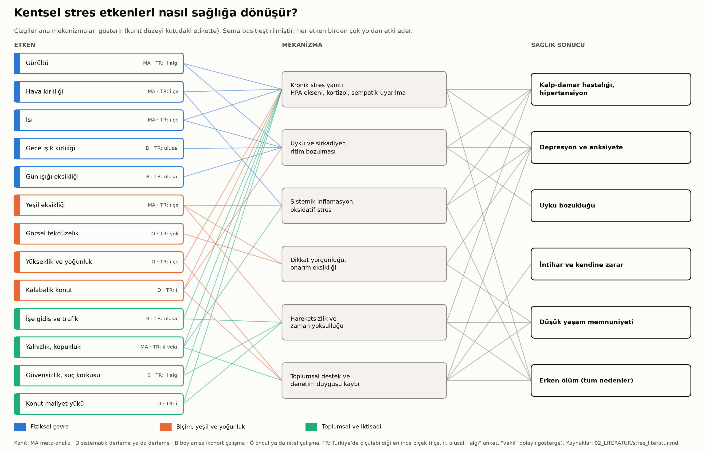
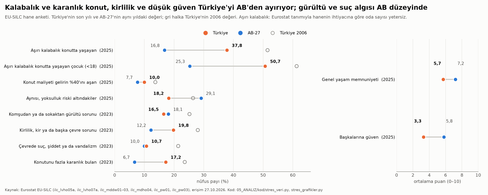
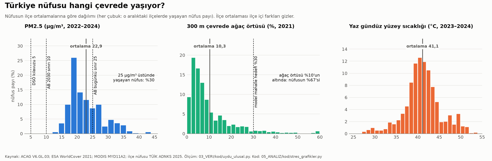
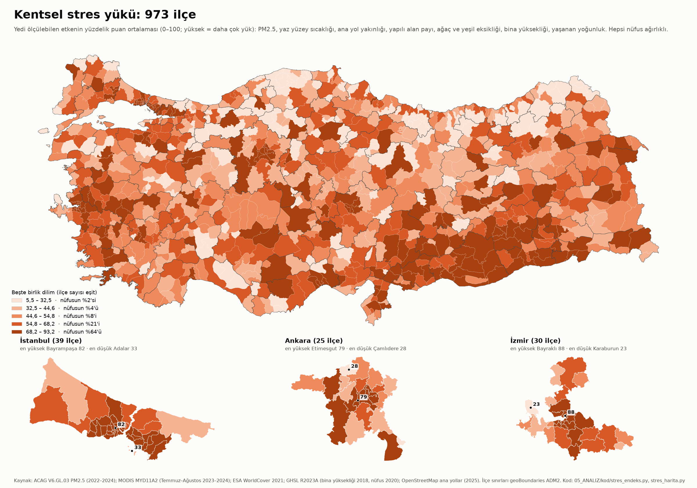
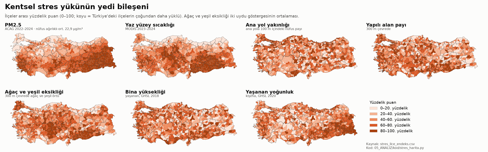
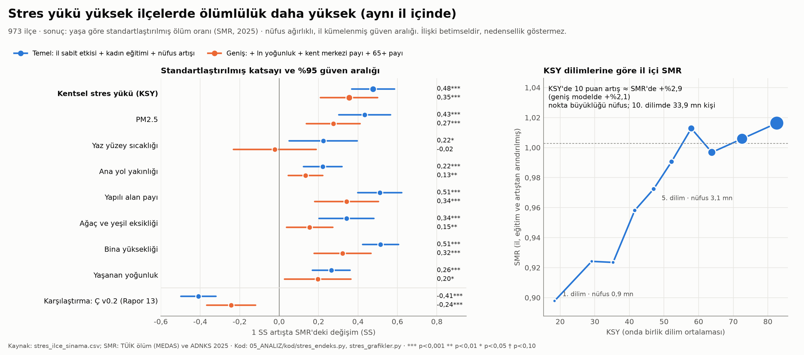
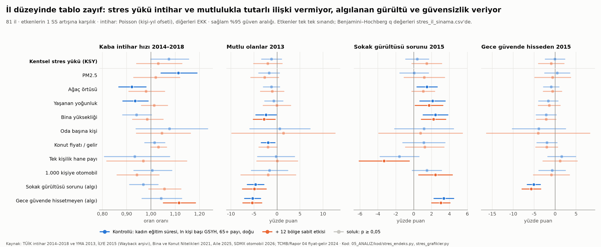

# Faz 4 · Rapor 1 — Kentsel Stres Etkenleri

*27 Ekim 2026 · Sürüm 0.1*

| Ne | Nerede |
|---|---|
| Kanıt taraması (13 etken, 76 kaynak, künyeler doğrulandı) | [02_LITERATUR/stres_literatur.md](../02_LITERATUR/stres_literatur.md) · `05_ANALIZ/sonuclar/stres_literatur_kunye.csv` |
| Türkiye verisi | `05_ANALIZ/sonuclar/stres_turkiye_yayginlik.csv` · `stres_turkiye_ab.csv` · `stres_il_dis_veri.csv` · kaynak notu [03_VERI/ham/stres/kaynaklar.md](../03_VERI/ham/stres/kaynaklar.md) |
| Kentsel stres yükü endeksi (973 ilçe) | `05_ANALIZ/sonuclar/stres_ilce_endeks.csv` |
| Sınama | `stres_ilce_sinama.csv` · `stres_ilce_duyarlilik.csv` · `stres_il_veri.csv` · `stres_il_sinama.csv` |
| Haritalar | [04_HARITA/stres_ksy_ilce.png](../04_HARITA/stres_ksy_ilce.png) · [stres_bilesenler_ilce.png](../04_HARITA/stres_bilesenler_ilce.png) |
| Grafikler | [stres_sema.png](../05_ANALIZ/grafikler/stres_sema.png) · [stres_turkiye_ab.png](../05_ANALIZ/grafikler/stres_turkiye_ab.png) · [stres_maruziyet.png](../05_ANALIZ/grafikler/stres_maruziyet.png) · [stres_ilce_sinama.png](../05_ANALIZ/grafikler/stres_ilce_sinama.png) · [stres_il_sinama.png](../05_ANALIZ/grafikler/stres_il_sinama.png) |
| Kod (sırayla) | `05_ANALIZ/kod/stres_veri.py` → `stres_endeks.py` → `stres_harita.py` → `stres_grafikler.py`; ayrıca `stres_literatur_dogrula.py` |

İşaretler: **[D]** doğrulandı · **[İ]** ikincil kaynak · **[DY]** doğrulanmadı · **[V]** varsayım · **[H]** bu projede hesaplandı.

---

## Özet

**Soru:** Günümüz şehirlerinde insanların stresini artıran unsurlar neler? Türkiye'de hangileri ne kadar yaygın? Hangileri ölçülebilir ve sağlık sonuçlarıyla ilişkili?

**Kısa cevap:**

1. **Kanıtı en güçlü etkenler fiziksel çevrede.**
   - **Hava kirliliği:** PM2.5 +10 µg/m³ → doğal nedenli ölüm RR 1,08 (Chen ve Hoek 2020) [D].
   - **Isı:** +1 °C → ruh sağlığı nedenli ölüm RR 1,022 (Liu ve ark. 2021) [D].
   - **Gürültü:** Karayolu gürültüsü +10 dB → iskemik kalp hastalığı RR 1,08 (van Kempen ve ark. 2018) [D].
   - **Yeşil:** +0,1 NDVI → ölüm HR 0,96 (Rojas-Rueda ve ark. 2019) [D].
   - Toplumsal tarafta **yalnızlık ve sosyal izolasyon** aynı güçte: izolasyonda ölüm 1,32 (Wang ve ark. 2023) [D].
   - Gürültünün ruh sağlığına etkisi, yükseklik ve yoğunluk ile görsel tekdüzelik için kanıt zayıf ya da karışık.
2. **Türkiye'de en yaygın yükler.**
   - **Hava:** Nüfusun **%98,7**'si DSÖ ara hedefi 15 µg/m³'ün, **%29,6**'sı AB'nin bugünkü sınırı 25 µg/m³'ün üstündeki ilçelerde yaşıyor (ACAG 2022–2024) [H].
   - **Ağaç:** Nüfusun **%67**'si, 300 m çevresinde ağaç örtüsü %10'un altında kalan ilçelerde yaşıyor (WorldCover 2021) [H].
   - **Gece ışığı:** Nüfusun **%97,8**'i ışık kirli gökyüzü altında (Falchi ve ark. 2016) [D].
   - **Kalabalık konut:** Nüfusun **%37,8**'i aşırı kalabalık konutta yaşıyor; AB'de %16,8. Çocuklarda bu oran %50,7 (Eurostat 2025) [D].
   - **Güven:** Başkalarına güven 10 üzerinden **3,3**; AB'de 5,8 (Eurostat 2025) [D].
   - Gürültü (%16,5) ve suç (%10,7) algısında ise Türkiye AB düzeyinde (Eurostat 2023) [D].
3. **Yedi etken ilçe düzeyinde ölçülebiliyor ve tek bir endekste toplandı.**
   - Kentsel stres yükü (KSY) şu etkenlerden oluşuyor: PM2.5, yaz yüzey sıcaklığı, ana yol yakınlığı, yapılı alan, ağaç ve yeşil eksikliği, bina yüksekliği, yaşanan yoğunluk.
   - Türkiye nüfusunun **%64**'ü en yüklü beşte birlik ilçelerde yaşıyor.
4. **Endeks ölümlülükle sınandı. Sonuç: aynı il içinde KSY'si yüksek ilçelerde ölümlülük daha yüksek.**
   - Kadın eğitimi ve nüfus artışı sabitken β = **+0,48** (%95 GA 0,37–0,59).
   - Kentsellik ve yaş yapısı da sabitken **+0,36** (0,21–0,50); ikisi de p < 0,001 [H].
   - KSY'de 10 puan, standartlaştırılmış ölüm oranında (SMR) ≈ **+%2,9** (geniş modelde +%2,1) [H].
   - Ancak bu ilişki büyük ölçüde **PM2.5 ve yapılı alandan** geliyor. Endeks, Rapor 13'ün çevre-ölçek ekseniyle neredeyse aynı şeyi ölçüyor (ρ = −0,91). Nedensellik iddiası yok.
5. **İl düzeyinde tablo zayıf.**
   - İl KSY'si ne intiharla (2014–2018) ne mutlulukla (2013) tutarlı bir ilişki veriyor.
   - Algılanan **sokak gürültüsü** ve **gece güvensizliği** (2015) ise mutlulukla güçlü ilişkili: 1 SS başına mutlu payı −4,7 ve −5,3 puan. Bu ilişkiler çoklu karşılaştırma düzeltmesinden sonra da kalıyor [H].
   - İl PM2.5'i intiharla ilişkili çıkıyor (1 SS → RR 1,11; BH q = 0,013). Ama bölge sabit etkisi eklenince kayboluyor.

**Proje için anlamı:** Stres etkenlerinin en ölçülebilir ve sağlıkla en sağlam ilişkili olanları aynı zamanda şehir tasarımıyla en doğrudan değiştirilebilenler: **temiz hava, ağaç, sessiz ve serin sokak**. Bunlar Rapor 13'ün bulgusunu sağlık literatürüyle bağlıyor. Toplumsal etkenler (yalnızlık, güvensizlik, konut yükü) de güçlü; ama mekânla bağları dolaylı. Bu yüzden avlu, komşuluk birimi ve sokağa bakan cephe, bu projede henüz ölçülmemiş ama literatürde gerekçesi olan araçlar olarak kalıyor.

---

## 1. Kanıt

Ayrıntı ve künyeler: [02_LITERATUR/stres_literatur.md](../02_LITERATUR/stres_literatur.md).

**Ortak yol.** Etkenlerin çoğu aynı son yola çıkıyor: stres sistemlerinin uzun süre açık kalması.
- Kortizol ekseni ve sempatik sinir sistemi kronik olarak uyarılıyor.
- Amigdala aktivitesi artıyor. Bu artış kemik iliği ve arter iltihabı üzerinden kalp-damar olaylarını öngörüyor: SS başına HR 1,59 (Tawakol ve ark. 2017) [D].
- Gürültüde de aynı zincir görülüyor: +5 dBA → majör kalp olayı HR 1,34. İlişkinin %12–26'sı amigdala ve arter iltihabından geçiyor (Osborne ve ark. 2020) [D].
- Uyku ve iç saat bozulması ikinci ortak yol: gürültü, ısı, gece ışığı ve yalnızlık uykuyu bozuyor.

**13 etken, tek bakışta:**

| Etken | En güçlü nicel kanıt | Düzey | Türkiye'de ölçülebildiği en ince ölçek |
|---|---|---|---|
| Gürültü | +10 dB Lden → iskemik kalp hastalığı RR 1,08 (1,01–1,15); gece uykusu çok bozulan payı OR 2,13 [D] | MA | İl algısı (İLYE 2015); maruziyet haritası açık değil [DY] |
| Hava kirliliği | +10 µg/m³ PM2.5 → ölüm RR 1,08; depresyon OR 1,10 [D] | MA | İlçe |
| Isı | +1 °C → ruh sağlığı ölümü RR 1,022; aylık intihar +%1,5 [D] | MA | İlçe (yüzey sıcaklığı) |
| Kalabalık konut | Oda başına kişi ↔ çocukta psikolojik sağlık [D] | D | İl (2021), ulusal (2025) |
| İşe gidiş süresi | Toplu taşımada > 60 dk → sağlık şikâyeti OR 1,2–1,6 [D] | B | Ulusal (2014–15), 11 il (TomTom 2025) |
| Yeşil eksikliği | +0,1 NDVI → ölüm HR 0,96; ≥ %30 ağaç → yeni psikolojik sıkıntı OR 0,69 [D] | MA | İlçe |
| Gece ışığı | Yatak odası ≥ 5 lüks → depresif belirti HR 1,89 [D] | D | Ulusal (2015 uydu) |
| Yalnızlık | İzolasyon → ölüm 1,32; yalnızlık 1,14 [D] | MA | İl vekili (tek kişilik hane 2025) |
| Suç korkusu | Yüksek korku → depresyon 1,93 kat [D] | B | Ulusal (2017), il (2015) |
| Konut maliyet yükü | Karşılanamaz konuta geçiş → ruh sağlığı puanı −1,19 [D] | D | Ulusal (2025), il fiyat/gelir (2024) |
| Yükseklik ve yoğunluk | Yoğunluk → şizofreni OR 1,10, kardeşler arasında 1,02 (anlamsız) [D] | D | İlçe |
| Gün ışığı eksikliği | Yetersiz doğal ışık → depresyon 1,4 kat [D] | B | Ulusal (2023) |
| Görsel tekdüzelik | Can sıkıntısında kalp hızı ve kortizol artışı (laboratuvar) [D] | Ö | Ölçüm yok |

Düzey: MA meta-analiz · D sistematik derleme ya da derleme · B boylamsal ya da kohort · Ö öncül ya da laboratuvar.

**Üç dikkat noktası:**
1. **Gürültü kalbe ve uykuya dokunuyor, ruh sağlığına daha az.** DSÖ derlemesindeki ruh sağlığı çalışmalarının %90'ı kesitsel (Clark ve Paunovic 2018) [D]. Karayolu gürültüsünün depresyonla ilişkisi anlamsız: OR 1,04 (0,97–1,11) (Dzhambov ve Lercher 2019) [D].
2. **Ağaç ve çim aynı şey değil.** Avustralya'da ≥ %30 ağaç örtüsü yeni psikolojik sıkıntıyı azaltıyor. Çim payı ise ters yönde ilişkili (Astell-Burt ve Feng 2019) [D]. Ağaç örtüsü %30'a çıkarılırsa Avrupa kentlerinde yaz ölümlerinin %1,84'ü önlenebilir (Iungman ve ark. 2023) [D].
3. **Yoğunluğun "etkisi" büyük ölçüde seçilim.** İsveç'te yoğunluk–şizofreni ilişkisi kardeşler karşılaştırılınca kayboluyor (Sariaslan ve ark. 2015) [D]. Yüksek katlı konutun olumsuz izleri tekrarlıyor, ama en çok düşük gelirlilerde ve tasarımla azaltılabiliyor (Kalantari ve Shepley 2021) [D].

---

## 2. Türkiye verisi

### 2.1 Yaygınlık

| Etken | Gösterge | Değer | Yıl | Kaynak | İşaret |
|---|---|---|---|---|---|
| Hava | PM2.5, nüfus ağırlıklı ilçe ortalaması | **22,9 µg/m³** | 2022–2024 | ACAG V6.GL.03 | [H] |
|  | Aynı, DSÖ model tahmini | 20,6 µg/m³ | 2023 | DSÖ GHO | [D] |
|  | DSÖ kılavuzu 5 ve AB 2030 sınırı 10 µg/m³'ü aşan ilçelerde yaşayan nüfus | %100 | 2022–2024 | ACAG | [H] |
|  | DSÖ ara hedefi 15 µg/m³'ü aşan | %98,7 | 2022–2024 | ACAG | [H] |
|  | AB'nin bugünkü sınırı 25 µg/m³'ü aşan | **%29,6** | 2022–2024 | ACAG | [H] |
|  | "Kirlilik, kir ya da başka çevre sorunu" bildiren | %19,8 (AB 12,2) | 2023 | Eurostat ilc_mddw02 | [D] |
| Isı | Yaz gündüz yüzey sıcaklığı, nüfus ağırlıklı | 41,1 °C | Tem–Ağu 2023–2024 | MODIS MYD11A2 | [H] |
|  | Yüzey sıcaklığı 45 °C'yi aşan ilçelerde yaşayan | %14,4 | 2023–2024 | MODIS | [H] |
| Gürültü ve trafik | Ana yola 100 m içinde yaşayan | %13,3 | OSM 2025, GHSL 2020 | Rapor 10 göstergesi | [H] |
|  | Komşudan ya da sokaktan gürültü sorunu bildiren | %16,5 (AB 18,1) | 2023 | Eurostat ilc_mddw01 | [D] |
|  | Trafik kazasında ölen ya da yaralanan, 1.000 kişide | 4,55 (6.351 ölü, 385.117 yaralı) | 2024 | TÜİK SDMX | [H] |
| Yeşil | 300 m çevrede ağaç örtüsü, nüfus ağırlıklı | **%10,3** | 2021 | ESA WorldCover | [H] |
|  | Ağaç örtüsü %10'un altındaki ilçelerde yaşayan | **%67** | 2021 | WorldCover | [H] |
| Yapılı çevre | 300 m çevrede yapılı alan, nüfus ağırlıklı | %70,7 | 2021 | WorldCover | [H] |
| Yükseklik ve yoğunluk | Ortalaması ≥ 15 m (≈ 5+ kat) olan 100 m hücrelerde yaşayan | %13,5 | 2018/2020 | GHSL R2023A | [H] |
|  | Yaşanan yoğunluk, nüfus ağırlıklı | 190 kişi/ha | 2020 | GHSL | [H] |
| Kalabalık | Aşırı kalabalık konutta yaşayan | **%37,8** (AB 16,8; TR 2006: 51,5) | 2025 | Eurostat ilc_lvho05a | [D] |
|  | Aynı, 18 yaş altı | %50,7 (AB 25,3) | 2025 | aynı | [D] |
| Konut maliyeti | Konut gideri gelirin %40'ını aşan | %10,0 (AB 7,7) | 2025 | Eurostat ilc_lvho07a | [D] |
|  | Aynı, yoksulluk riski altındakiler | %18,2 (AB 29,1) | 2025 | aynı | [D] |
| Gün ışığı | Konutunu fazla karanlık bulan | **%17,2** (AB 6,7) | 2023 | Eurostat ilc_mdho04 | [D] |
| Gece ışığı | Işık kirli gökyüzü altında (> 14 µcd/m²) | **%97,8** | 2015 verisi | Falchi ve ark. 2016, Tablo 2 | [D] |
|  | Samanyolu'nu göremeyen (> 688 µcd/m²) | %49,9 | 2015 verisi | aynı | [D] |
|  | Gözün karanlığa uyum sağlayamadığı parlaklıkta (> 3.000 µcd/m²) | %24,3 | 2015 verisi | aynı | [D] |
| İşe gidiş | Çalışanların günlük ulaşım süresi (yalnız işe gidiş değil) | 82 dk (erkek 90, kadın 65) | 2014–15 | TÜİK Zaman Kullanım Araştırması | [D] |
|  | İstanbul şehir merkezi trafik sıkışıklığı | %62,0 (Ankara 55,8; İzmir 54,1) | 2025 | TomTom Traffic Index | [İ] |
| Suç korkusu | Gece yalnız yürürken kendini güvende hisseden | %57,1 | 2017 | TÜİK YMA | [D] |
|  | Çevresinde suç, şiddet ya da vandalizm bildiren | %10,7 (AB 10,0) | 2023 | Eurostat ilc_mddw03 | [D] |
| Yalnızlık | Tek kişilik hane payı | %20,5 (2014: 13,9) | 2025 | TÜİK Aile İstatistikleri | [D] |
|  | Sık sık yalnız hisseden, 18–70 yaş | %34 | 2022 | Üsküdar Üniv. ve Method, çevrimiçi anket | [İ] |
|  | İhtiyaç anında güvenebileceği biri olan, 16+ | %90,3 (AB 88,8) | 2022 | Eurostat ilc_pw06 | [D] |
|  | Başkalarına güven (0–10) | **3,3** (AB 5,8; TR 2013: 4,5) | 2025 | Eurostat ilc_pw03 | [D] |

**Sağlık ve iyi oluş göstergeleri (sonuç tarafı):**

| Gösterge | Değer | Yıl | Kaynak | İşaret |
|---|---|---|---|---|
| Kendini mutlu beyan eden, 18+ | %53,3 (2010: 61,2) | 2025 | TÜİK YMA | [D] |
| Kendini mutsuz beyan eden | %13,0 | 2025 | TÜİK YMA | [D] |
| Genel yaşam memnuniyeti (0–10) | 5,7 (AB 7,2) | 2025 | Eurostat ilc_pw01 | [D] |
| Depresif belirti (PHQ-8), 15+ | %6,6 (AB 7,0) | 2019 | Eurostat hlth_ehis_mh1e | [D] |
| Antidepresan tüketimi, günlük doz / 1.000 kişi | 58,0 (2010: 32,7) | 2024 | OECD | [D] |
| Hipertansiyon (beyan), 15+ | %16,9 | 2025 | TÜİK Türkiye Sağlık Araştırması | [D] |
| İş dışında aerobik aktivite yapmayan, 15+ | %86,6 | 2025 | TÜİK TSA | [D] |
| Kaba intihar hızı, yüz binde | 4,12 (2019) · 5,35 (2025) | 2019 · 2025 | TÜİK arşiv tablosu · haber kaynağı | [D] · [İ] |

Tablonun tamamı: `05_ANALIZ/sonuclar/stres_turkiye_yayginlik.csv`.

**Okuma:**
- **Türkiye'yi AB'den ayıranlar:**
  - **Kalabalık konut:** 2,2 kat; çocuklarda 2 kat.
  - **Karanlık konut:** 2,6 kat.
  - **Kirlilik algısı:** 1,6 kat.
  - **Düşük güven:** 3,3'e karşı 5,8.
- **AB düzeyinde olanlar:** gürültü ve suç algısı.
- **Konut maliyet yükü** genelde AB'den biraz yüksek, yoksulluk riski altındakilerde ise düşük. Bunun nedeni büyük olasılıkla ev sahipliği ve aile yanında oturma oranı [V].
- **2006'dan beri iyileşenler:** Kalabalık 51,5'ten 37,8'e, karanlık konut 23,6'dan 17,2'ye, suç algısı 21,4'ten 10,7'ye indi.
- **Kötüleşenler:** Güven 4,5'ten (2013) 3,3'e düştü. Mutluluk 61,2'den (2010) 53,3'e indi. Antidepresan tüketimi 2010'dan bu yana 1,8 katına çıktı.

### 2.2 Veri boşlukları

| Etken | Eksik olan | Durum |
|---|---|---|
| Gürültü | Lden ≥ 55 dB'ye maruz nüfus | Çevre Bakanlığı ve TÜBİTAK MAM 17 ilin stratejik gürültü haritasını çıkardı (2017) [İ]. Maruz nüfus tablosu açık değil [DY] |
| İşe gidiş | İl ya da ilçe düzeyinde ortalama işe gidiş süresi | Bulunamadı. Ulusal ZKA 2014–15 ve 11 il için TomTom var |
| Gece ışığı | İlçe düzeyinde gece ışığı | VIIRS uydu verisiyle hesaplanabilir; bu çalışmada yapılmadı |
| Isı | Gece yüzey ve hava sıcaklığı | Sağlık için daha önemli; ölçülmedi (Rapor 13 de aynı açığı not etti) |
| Yalnızlık | Temsilî, il düzeyinde yalnızlık ölçümü | Yok. Tek kişilik hane yalnız kaba bir vekil |
| Suç korkusu | 2017 sonrası seri ve il kırılımı | "Gece güvende" serisi 2017'de kesiliyor; il verisi yalnız İLYE 2015 |
| Mutluluk ve intihar | 2013 sonrası il mutluluğu; 2019 sonrası il intiharı | Yeni portal tabloları arşivde yok; erişilemedi |
| Görsel tekdüzelik | Herhangi bir ölçüm | Yok. Sokak görüntüsü verisiyle ölçülebilir |

---

## 3. Endeks ve sınama

### 3.1 Kentsel stres yükü (KSY) nasıl kuruldu?

- **Bileşenler:** İlçe düzeyinde ölçülebilen yedi etken. Hepsi 100 m nüfus hücrelerinden nüfus ağırlıklı.

  | Bileşen | Gösterge | Kaynak | Literatürdeki karşılığı |
  |---|---|---|---|
  | PM2.5 | Yıllık ortalama, µg/m³ | ACAG 2022–2024 | Hava kirliliği (MA) |
  | Isı | Yaz gündüz yüzey sıcaklığı | MODIS, Temmuz–Ağustos 2023–2024 | Isı (MA); gündüz yüzey ≠ gece hava sıcaklığı |
  | Ana yol | Ana yola 100 m içindeki nüfus payı | OSM 2025 | Gürültü ve trafik kirliliği vekili |
  | Yapılı alan | 300 m çevrede yapılı alan payı | WorldCover 2021 | Isı adası, sert yüzey |
  | Ağaç ve yeşil eksikliği | 300 m çevrede ağaç örtüsü ve yeşil örtü (ikisinin ortalaması) | WorldCover 2021 | Yeşil eksikliği (MA) |
  | Yükseklik | Yaşanan bina yüksekliği | GHSL 2018 | Yükseklik (D) |
  | Yoğunluk | Yaşanan yoğunluk, kişi/ha | GHSL 2020 | Yoğunluk ve kalabalık (D) |

- **Ölçek:** Her bileşen 973 ilçe arasında yüzdelik puana çevrildi (0–100; yüksek = daha çok yük). Eşit ağırlıkla ortalandı.
- **Sonuç göstergeleri endekse girmez.** Ölümlülük, intihar ve mutluluk yalnız sınamada kullanıldı.
- **Bileşenler birbirine bağlı.**
  - Yapılı alan–yükseklik ρ = 0,91; yapılı alan–yeşil eksikliği 0,73; PM2.5–ısı 0,67.
  - Birinci temel bileşen varyansın %46'sını açıklıyor.
- **Önceki eksenlerle ilişki.**
  - KSY, Rapor 13'ün çevre-ölçek ekseni (Ç v0.2) ile ρ = **−0,91**. Büyük ölçüde aynı bileşenlerden kurulduğu için bu beklenen bir sonuç. KSY yeni bir boyut değil; Ç'nin **stres diliyle yeniden okunuşu**.
  - Erişim ekseniyle (E) ρ = +0,61. Yürüyerek erişimin iyi olduğu yer, stres yükünün de yüksek olduğu yer.

### 3.2 Dağılım

- **İlçe dağılımı:** Ortalama 50, SS 19,1. En düşük Köprübaşı (Trabzon) 5,5; en yüksek Bağlar (Diyarbakır) 93,2 [H].
- **Nüfus ağırlıklı ortalama 69,9.** Türkiye nüfusunun **%64**'ü en yüklü beşte birlik ilçelerde (KSY ≥ 68,2), yalnız %2'si en hafif beşte birlikte yaşıyor [H].
- **En yüklü ilçeler:** Bağlar 93,2; Şahinbey 92,3; Battalgazi 91,7; Batman Merkez 91,6; Kayapınar 90,4. Güneydoğu'nun büyük kentleri yüksek PM2.5, yüksek ısı ve ağaçsızlığı bir arada taşıyor.
- **En kalabalık 15 ilçenin hepsi** en yüklü beşte birlikte. Örnekler: Esenyurt 77,5; Çankaya 73,3; Osmangazi 81,8; Seyhan 82,4.
- **Büyükşehirler:**

  | Şehir | Nüfus ağırlıklı KSY | En yüksek | En düşük |
  |---|---|---|---|
  | İstanbul | 74,6 | Bayrampaşa 82 | Adalar 33 |
  | Ankara | 73,6 | Etimesgut 79 | Çamlıdere 28 |
  | İzmir | 76,0 | Bayraklı 88 | Karaburun 23 |

- **Pilot ilçeler:** Safranbolu 50,7 · Silivri 55,0 · Meram 67,3 · Başakşehir 69,3 · Beypazarı 69,7 · Nilüfer 73,4 · Antakya 75,8 · Fatih 79,3 · Kocasinan 84,7 · Onikişubat 87,3 [H].
  - Safranbolu ve Silivri yine en iyi durumda (Rapor 13 ile aynı).
  - Başakşehir'in KSY'si yüksek (69), ama SMR'si 0,8. Faz 3'teki "pozitif sapma" sorusu burada da duruyor.

### 3.3 İlçe sınaması: ölümlülük

**Kurgu** (Rapor 10 ve 13 ile aynı, `fue_ilce_gecerlilik.py`):
- Sonuç: 2025 yaşa göre standartlaştırılmış ölüm oranı (SMR), z puanı.
- Açıklayıcılar: gösterge z puanı + kadın eğitimi + nüfus artışı + il sabit etkisi.
- Nüfus ağırlıklı en küçük kareler (WLS); güven aralıkları il düzeyinde kümelenmiş. n = 973.
- Geniş model: + ln yoğunluk + kent merkezi payı + 65 yaş üstü payı.

| Gösterge | Temel | + ln yoğunluk | + kentsellik ve yaş yapısı |
|---|---|---|---|
| **KSY** | **+0,48\*\*\*** (0,37; 0,59) | +0,49\*\*\* | **+0,36\*\*\*** (0,21; 0,50) |
| PM2.5 puanı | +0,43\*\*\* | +0,37\*\*\* | +0,28\*\*\* |
| Yaz yüzey sıcaklığı puanı | +0,22\* | +0,15 | −0,02 |
| Ana yol yakınlığı puanı | +0,22\*\*\* | +0,19\*\*\* | +0,13\*\* |
| Yapılı alan puanı | +0,51\*\*\* | +0,48\*\*\* | +0,34\*\*\* |
| Ağaç ve yeşil eksikliği puanı | +0,34\*\*\* | +0,29\*\*\* | +0,16\*\* |
| Bina yüksekliği puanı | +0,51\*\*\* | +0,48\*\*\* | +0,32\*\*\* |
| Yaşanan yoğunluk puanı | +0,27\*\*\* | +0,36\*\* | +0,20\* |
| Karşılaştırma: Ç v0.2 (Rapor 13) | −0,41\*\*\* | −0,36\*\*\* | −0,24\*\*\* |

Standartlaştırılmış katsayılar. \*\*\* p < 0,001 · \*\* p < 0,01 · \* p < 0,05 [H].

**Ölçek.**
- KSY'de 10 puan → SMR +0,029, yani ≈ %2,9 (geniş modelde %2,1) [H].
- KSY'de 1 SS (19 puan) → SMR ≈ +%5,5 [H].
- İl içi farklar arındırılınca en hafif onda birlikteki ilçelerin SMR'si 0,90, en yüklü onda birlikteki 1,02 [H].

**Hangi bileşen taşıyor?** Yedi bileşen aynı modele konunca:
- PM2.5 her modelde ayakta kalıyor: +0,24\*\*\* / +0,24\*\*\* / +0,26\*\*\*.
- Yapılı alan temel modelde kalıyor: +0,37\*; geniş modelde +0,28 (p = 0,12).
- Diğer beşi sıfıra yakın.
- Bileşenler çok bağlantılı olduğu için bu ayrıştırma kırılgan. Ama yön Rapor 13 ile aynı: **ilişkinin çekirdeği kirli hava ve sert yüzey.**

### 3.4 Duyarlılık

| Endeks türü | Temel | Geniş | KSY ile ρ |
|---|---|---|---|
| KSY (ilçe yüzdeliği, eşit ağırlık) | +0,48\*\*\* | +0,36\*\*\* | — |
| Kırpılmış z puanı ortalaması | +0,48\*\*\* | +0,36\*\*\* | 0,99 |
| Birinci temel bileşen ağırlıkları | +0,42\*\*\* | +0,32\*\*\* | 0,99 |
| Nüfus ağırlıklı yüzdelik | +0,30\*\*\* | +0,19\*\*\* | 0,96 |
| Yalnız çevre bileşenleri (PM2.5, ısı, ana yol, yeşil) | +0,42\*\*\* | +0,24\*\*\* | — |
| Yalnız biçim bileşenleri (yapılı, yükseklik, yoğunluk, ana yol) | +0,50\*\*\* | +0,40\*\*\* | — |
| Herhangi bir bileşen çıkarılınca (7 sürüm) | +0,45 ile +0,49 | +0,32 ile +0,39 | — |
| **İl sabit etkisi olmadan** | **+0,25\*\*\*** | — | — |

**Okuma:**
- Sonuç endeksin kuruluş biçimine ve tek bir bileşene bağlı değil.
- İl sabit etkisi kaldırılınca katsayı yarıya iniyor. Ham SMR, KSY dilimleri arasında neredeyse düz: 0,97–1,03.
- İlişki çoğunlukla **aynı il içindeki ilçeler arasında**. İller arası farklar (iklim, bölgesel ölüm düzeyi) başka etkenlerle belirleniyor.

### 3.5 İl sınaması: intihar, mutluluk, algı

**Kurgu:**
- 81 il. 11 etken × 8 sonuç × 3 model = 258 sınama.
- İntihar: 2014–2018 toplamı, Poisson, kişi-yıl ofseti, sağlam SH.
- Diğer sonuçlar: en küçük kareler, HC3.
- Kontroller: kadın eğitim süresi, ln kişi başı GSYH, 65+ payı, doğu.
- Çoklu karşılaştırma için her model ailesinde Benjamini–Hochberg q değeri hesaplandı.

| Etken (1 SS) | İntihar 2014–2018 (oran oranı) | Mutlu 2013 (puan) | Mutsuz 2013 (puan) | SMR 2025 (il) |
|---|---|---|---|---|
| **İl KSY'si** | 1,07 (p = 0,055) · bölge SE ile 1,03 | −1,2 (p = 0,28) | +0,3 | +0,016 (p = 0,12) |
| PM2.5 | **1,11** (p = 0,002; q = 0,013) · bölge SE ile 1,02 | −1,7 (p = 0,14) | +0,2 | −0,012 |
| Ağaç örtüsü | 0,92 (p = 0,009) · bölge SE ile 0,98 | −1,2 | +0,1 | −0,016 (p = 0,03) |
| Oda başına kişi | 1,08 (p = 0,30) | +0,6 | +0,1 | 0,00 |
| Konut fiyatı / gelir | 1,02 | −1,9 (p = 0,011) | +0,4 | −0,005 |
| Tek kişilik hane payı | 0,93 (p = 0,35) | −0,2 | −0,1 | −0,041 |
| Sokak gürültüsü sorunu (algı, 2015) | 0,97 · bölge SE ile 1,06 (p = 0,09) | **−4,7\*\*\*** (q < 0,001) | **+1,4\*\*\*** | −0,017 |
| Gece güvende hissetmeyen (algı, 2015) | 1,04 · bölge SE ile **1,12\*\*\*** (q = 0,004) | **−5,3\*\*\*** (q < 0,001) | **+1,7\*\*\*** | −0,003 |

Kontrollü model; aksi yazmadıkça bölge (İBBS-1) sabit etkisi yok [H]. Tam tablo: `stres_il_sinama.csv`.

**Okuma:**
1. **İl KSY'si ne intiharla ne mutlulukla ilişkili.** Ham ilişkiler (ör. mutluluk −1,6\*) gelir, eğitim ve bölge kontrolüyle kayboluyor. İl, kentsel stresi ölçmek için kaba bir birim: nüfus ağırlıklı il ortalaması, il içindeki büyük ilçe farklarını gizliyor (§3.4).
2. **PM2.5 ile intihar arasındaki ilişki dikkat çekici, ama kırılgan.** Kontrollü modelde il PM2.5'inde 1 SS (≈ 5,4 µg/m³) artış intiharda +%11 ile ilişkili. Bu ilişki çoklu karşılaştırmadan sonra da kalıyor. Ama 12 bölge sabit etkisi eklenince kayboluyor. Literatürdeki kısa dönem PM–intihar bulgusuyla uyumlu bir yön, ama kanıt değil (Braithwaite ve ark. 2019) [D].
3. **Algılanan gürültü ve güvensizlik mutluluğun en güçlü ilişkileri.** İkisi de bölge sabit etkisiyle ve düzeltmeden sonra ayakta kalıyor. Ancak:
   - Algı ve mutluluk anket göstergeleri. Aynı insanların genel memnuniyetsizliğini yansıtıyor olabilirler (ortak yöntem yanlılığı).
   - İLYE göstergelerinin hangi anketten geldiği bu çalışmada ayrıca doğrulanmadı [DY]. İLYE'nin mutluluk göstergesinin YMA 2013 ile birebir aynı olduğu doğrulandı [D].
   - Güvensizlik algısı bölge sabit etkisiyle intiharla da ilişkili (+%12, q = 0,004). Bu, Stafford ve ark. (2007) bulgusuyla aynı yönde [D].
4. **Kalabalık ve konut maliyeti il düzeyinde zayıf.** Oda başına kişi Güneydoğu'da yüksek (Şanlıurfa, Batman, Şırnak 1,43). İntihar ise Kuzeydoğu Anadolu, Ege ve Batı Akdeniz illerinde yüksek (2014–2018, yüz binde: Tunceli 9,9; Ardahan 7,7; Burdur 7,4; Aydın 6,5). Bu yüzden ham ilişki ters yönde çıkıyor ve kontrollerle kayboluyor [H].

### 3.6 Sınamanın sonucu

| Soru | Cevap |
|---|---|
| KSY sağlık sonucuyla ilişkili mi? | **Ölümlülükle evet**, aynı il içinde ve kontrollerle: β = +0,36 ile +0,48. **İntihar ve mutlulukla hayır**, il düzeyinde |
| Hangi etken taşıyor? | PM2.5 ve yapılı alan. Yükseklik ve yoğunluk tek başına güçlü görünüyor, ama birlikte modelde bunlara katkı vermiyor |
| Algılanan etkenler? | Gürültü ve güvensizlik algısı mutlulukla güçlü ve sağlam ilişkili; ama ortak yöntem yanlılığı dışlanamıyor |
| Endeks yeni bir şey söylüyor mu? | Kısmen. Çevre-ölçek ekseniyle neredeyse aynı (ρ = −0,91). Katkısı, ölçülen çevre yükünü stres literatürüne ve sağlık mekanizmasına bağlamak |

---

## 4. Şehir tasarımına karşılıkları

Fıtrata uygun şehir bu etkenleri nasıl azaltır? Tablodaki araçlar Fıtrat Kodu v0.2.1 ve model mahalle v2.1'den alındı (`07_TASARIM_CIZIM/`). Hedefler projenin önerisidir [V].

| Etken | Fıtrata uygun şehirdeki karşılığı | Ölçüt / hedef | Kanıt | Projede |
|---|---|---|---|---|
| **Hava kirliliği** | Günlük ihtiyaçlara yürüme mesafesi, böylece daha az araç (okul ≤ 500 m, bakkal 200 m, mescit 150–400 m); toplayıcı yol çeperde; mobilite noktası; temiz ısınma | PM2.5 ≤ 10 µg/m³ (DSÖ ara hedef 4; toplum hedefleri). Bugün 22,9 (2022–2024) [H] | MA · bu projede en sağlam bileşen | Model v2 · Rapor 18 (enerji) |
| **Isı** | Ağaç örtüsü ≥ %30; ağaç dikim kuralları; yağmur bahçesi; sert yüzeyi sınırlayan bahçe ve avlu | Ağaç ≥ %30 (model %31,1 [H]); yapılı alan payını düşürmek (bugün %70,7; 2021) | MA (Iungman ve ark. 2023: %30 ağaçla yaz ölümlerinin %1,84'ü önlenir) | Fıtrat Kodu §3.2 |
| **Gürültü** | Ana yollar mahalle çeperinde; iç sokakta düşük hız ve yavaşlatma ağacı; yatak odaları avluya ya da bahçeye bakar | Konutların çoğu Lden < 53 dB [V]; ana yola 100 m içindeki nüfus payı < %5 [V] (bugün %13,3; 2025) | MA (kalp ve uyku) | Model v2 sokak tipleri; ölçüm yok |
| **Yeşil eksikliği** | 3–30–300 kuralı; ≥ 10 m²/kişi açık-yeşil; bahçede 2 ağaç; avluda ≥ 4 ağaç; çim değil ağaç | 3 ağaç görüş, %30 örtü, 300 m'de yeşil. Model: 12,3 m²/kişi | MA | Fıtrat Kodu §3.2 · Rapor 13 |
| **Kalabalık konut** | Aile büyüklüğüne göre oda sayısı; sıra ev (T1/T2) ve avlu grubu (T3) tipolojileri; çocuğa ayrı oda | Aşırı kalabalık ≤ %20 (bugün %37,8; 2025); kendine ait odası olan çocuk ≥ %60 (bugün %34; toplum hedefleri) | D | Toplum hedefleri · konut rehberi |
| **İşe gidiş** | Karma kullanım; esnek zemin kat; semt çarşısı; ev-işyeri izni | Günlük ihtiyaçlar 15 dk yürüme; işe gidişte toplu taşıma süresi < 45 dk [V] | B | Fıtrat Kodu §3.4 (≈ 208 konut dışı birim) |
| **Yalnızlık** | Avlu grubu, komşuluk birimi, mescit, meydan, ada içi ortak bahçe; kuşaklar arası konut | Komşu ziyareti ≥ %45 (bugün %27,2; TAYA 2016) | MA (ölüm) · mekân bağı dolaylı | Model v2.1 kapalı avlu (0,83/ha) |
| **Suç korkusu** | Sokağa bakan cephe (doluluk oranı ≥ %60–90); zemin kat kullanımı; geçitlerin göz altında olması; bakımlı boş alan; insan ölçeğinde aydınlatma | Gece güvende hisseden ≥ %75 [V] (bugün %57,1; 2017) | B · deney (Branas ve ark. 2018) | Fıtrat Kodu cephe kuralları |
| **Gece ışığı** | Aşağı yönlü, tam kesmeli ve sıcak renkli sokak aydınlatması; konut cephesine ışık taşırmamak | Işık kirliliği vekilini ölçüp izlemek (VIIRS) [V] | D | Yok; Fıtrat Kodu'na eklenmeli |
| **Gün ışığı** | Sokak H/W ≤ 0,8; kış gölgesi sınaması; çift yönlü daire | Karanlık konut ≤ %8 [V] (bugün %17,2; 2023) | B | Model v2: S2 H/W 0,78; kış öğlesinde zemin kat gölgede (bilinçli ödünleşim) |
| **Yükseklik ve yoğunluk** | Aynı yoğunluğu alçak biçimle üretmek (Z+2–Z+4) | Kat sınırı tek başına hedef değil; hava, ağaç ve sert yüzey hedefleriyle birlikte | D · Rapor 13: yükseklik etkisi çevre yükleriyle açıklanıyor | `ayni_yogunluk_uc_bicim` |
| **Konut maliyet yükü** | Arazi ve kooperatif modeli; küçük parsel; ev sahipliği | Aşırı konut yükü ≤ %6 (bugün %10,0; 2025) | D | Rapor 04, 20 |
| **Görsel tekdüzelik** | Küçük tane: parsel cephesi 6,5–10 m, cephe modülü 9–12 m; saçak ve renk değişimi; ağaç | Cephe adımı ≤ 12 m (model 17,1 m [H]) | Ö | Fıtrat Kodu 0.2.1 |

**Ölçek fikri.** Türkiye'nin nüfus ağırlıklı PM2.5'i 22,9'dan 10 µg/m³'e inseydi:
- Chen ve Hoek'in RR'si (10 µg/m³ başına 1,08) ve log-doğrusal varsayımla doğal nedenli ölüm riski ≈ **%9** azalırdı [H, V].
- Bu projenin ekolojik tahminiyle (10 µg/m³ başına SMR ≈ +0,04; Rapor 13) azalma ≈ **%5** olurdu [H, V].

Bu bir sağlık etki tahmini değil; büyüklük sırası için verildi.

**Öncelik sırası (bu raporun önerisi).**
1. **Hava ve ağaç.** En güçlü kanıt, ölçüm hazır, etki her yaşta.
2. **Gürültü ve ısı.** Kanıt güçlü; gece ölçümleri eksik.
3. **Komşuluk ve güvenlik.** Kanıt güçlü; mekân bağı dolaylı; saha anketiyle sınanmalı.

---

## 5. Sınırlılıklar

- **Ekolojik çıkarım.** İlçe ve il düzeyindeki ilişkiler bireysel riski göstermez. Nedensellik iddiası yok. Gelir, eski bina stoku, kurumsal nüfus ve sağlık hizmetine erişim ilçe düzeyinde ölçülemedi (Rapor 13 ile aynı açık).
- **Endeks Ç v0.2 ile örtüşüyor.** KSY'nin ölümlülükle ilişkisi bağımsız bir doğrulama değil. Aynı bileşenler farklı bir toplamla yeniden sınandı.
- **Yalnız yedi etken ilçede ölçülebildi.** Gürültü ana yol yakınlığıyla temsil edildi. Gece ışığı, gün ışığı, kalabalık, yalnızlık, suç korkusu, işe gidiş ve görsel tekdüzelik endekste yok.
- **Isı göstergesi gündüz yüzey sıcaklığı.** Sağlık için önemli olan gece hava sıcaklığı ölçülmedi. Yüzey sıcaklığı yarı kurak bölgelerde kenti serin, tarlayı sıcak gösterebiliyor (Rapor 13).
- **Zaman uyumsuzluğu.** Çevre göstergeleri 2018–2025, SMR 2025, intihar 2014–2018, mutluluk 2013, algı 2015. İl tabloları TÜİK'in sonraki revizyonundan önceki değerleri içeriyor.
- **Küçük sayılar.** Birçok ilde yılda 10'dan az intihar oluyor. Beş yıllık toplam kullanıldı, yine de güven aralıkları geniş.
- **Algı göstergeleri.** Gürültü ve güvensizlik algısı ile mutluluk arasındaki güçlü ilişki ortak yöntem yanlılığı taşıyabilir.
- **Çoklu sınama.** İl düzeyinde 258 sınama yapıldı; 82'si p < 0,05. Raporda yalnız Benjamini–Hochberg düzeltmesinden sonra kalanlar vurgulandı.
- **Literatür seçimi.** Tarama sistematik değil; önceden bilinen künyelerden seçildi. Künyeler Crossref'le, sayıların çoğu özetlerle doğrulandı. DSÖ 2018 gürültü değerleri ikincil kaynaktan geldi [İ]. Birkaç bulgu okunamadı [DY]: Burke 2018, Minor 2022, Chalfin 2022, Lindal ve Hartig 2013.
- **İkincil kaynak uyuşmazlığı.** `01_KAVRAMSAL_CERCEVE/toplum_hedefleri.md`'de depresif belirti için "%7,0 (2019)" yazıyor. Bu AB-27 değeri; Türkiye'nin değeri %6,6 (Eurostat hlth_ehis_mh1e) [D]. Belgenin bir sonraki sürümünde düzeltilmeli.

---

## Ek: yeniden üretim ve bu oturumdaki düzeltmeler

Dört betik sırayla yeniden çalıştırıldı. Sınama sonuçları önceki çalıştırmayla birebir aynı çıktı. Düzeltilenler:

1. **Pilot ilçe adları kaymıştı.** `stres_endeks.py`'de ilçe kodu–ad eşlemesi yanlıştı. Örneğin 1587 (Safranbolu) "Başakşehir", 2050 (Başakşehir) "Kocasinan" yazılıyordu. Yalnız ekran çıktısını etkiliyordu; CSV'ler doğruydu. Adlar artık TÜİK ilçe adından alınıyor.
2. **Ulusal değerler güncellendi.**
   - Mutluluk 2019 (%52,4) yerine 2025 değeri kullanılıyor (%53,3, TÜİK YMA).
   - Depresif belirti, antidepresan, hipertansiyon, yalnızlık ve PM2.5 (DSÖ) satırları ana gösterge tablosundan programla okunuyor.
   - Falchi 2016 değerleri PMC tam metninden doğrulandı ve iki eşik eklendi.
3. **SVG boyutu.** Haritalarda ilçe ve il katmanları raster yapıldı (`rasterized=True`). `stres_bilesenler_ilce.svg` 28,2 MB'tan 1,5 MB'a, `stres_ksy_ilce.svg` 5,3 MB'tan 1,5 MB'a indi. Bütün SVG'ler 2 MB'ın altında.
4. **Türkçe ek hatası.** Haritada "nüfusun %2'i, %4'i, %64'i" ve grafikte "%67'i" yazıyordu. Bunlar "%2'si, %4'ü, %64'ü, %67'si" olarak düzeltildi (iyelik eki işlevi eklendi).
5. **Bileşen haritası düzeni.** Boş satır arası daraltıldı; lejantın kaynak yazısıyla çakışması giderildi.
6. **İl sınamasına çoklu karşılaştırma düzeltmesi eklendi** (Benjamini–Hochberg q, `q_bh` sütunu).
7. **İl sabit etkisi olmayan karşılaştırma modeli eklendi** (KSY +0,25\*\*\*).
8. **Şemadaki kanıt etiketleri literatürle eşitlendi.** Gece ışığı MA'dan D'ye indi: ruh sağlığı için yalnız sistematik derleme var, meta-analiz kilo için. Suç korkusu MA'dan B'ye indi: meta-analiz bulunamadı.
9. **Literatür doğrulaması kodla yapıldı.** Yeni betik: `stres_literatur_dogrula.py`. Bir DOI yanlıştı (Min ve Min 2018) ve düzeltildi. PubMed'in yanlış eşlediği bir kayıt (Gove 1979) başlık karşılaştırmasıyla atıldı.
10. **Kaynak notu.** `03_VERI/ham/stres/kaynaklar_ikincil.md`, README düzenine uyması için `kaynaklar.md` oldu ve güncellendi. `_betikler/` içindeki ilk işleme betikleri geçici klasöre başvuruyor; olduğu gibi çalışmaz (not edildi).
