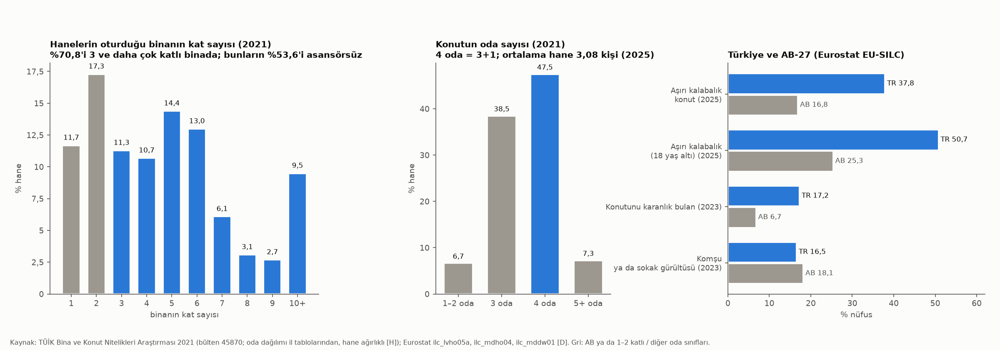
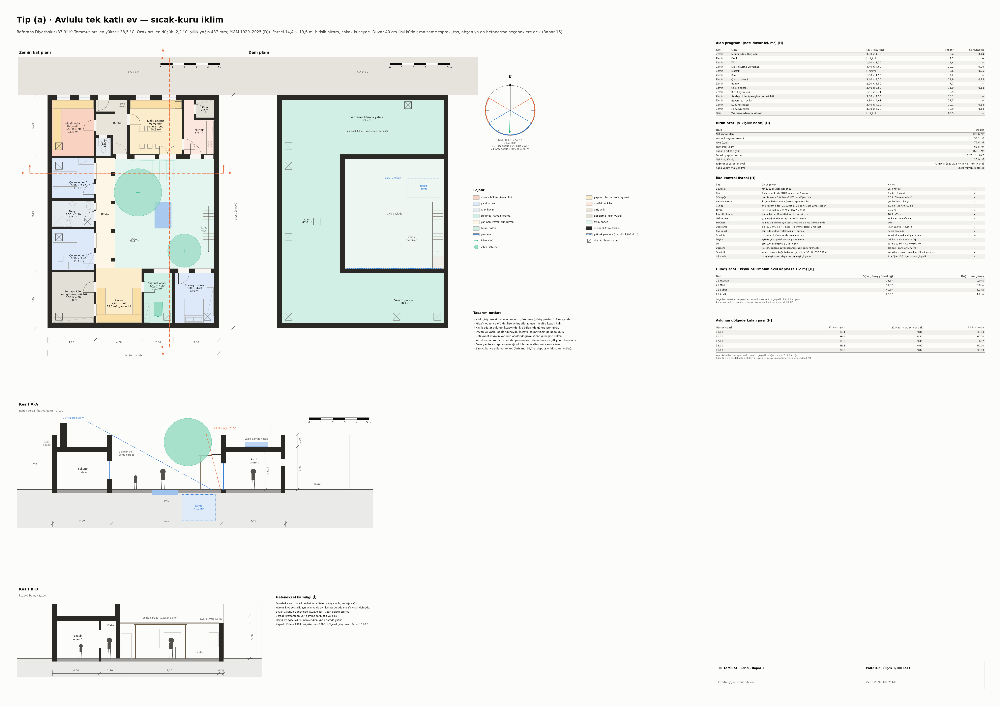
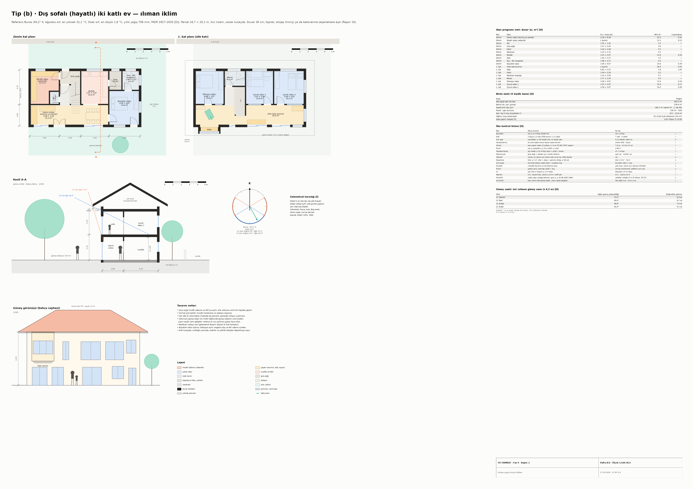
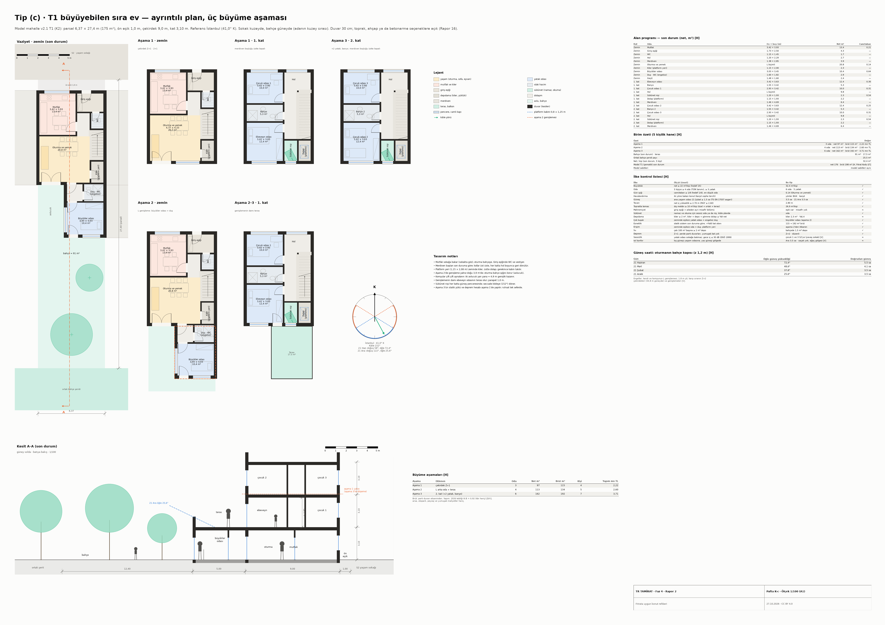
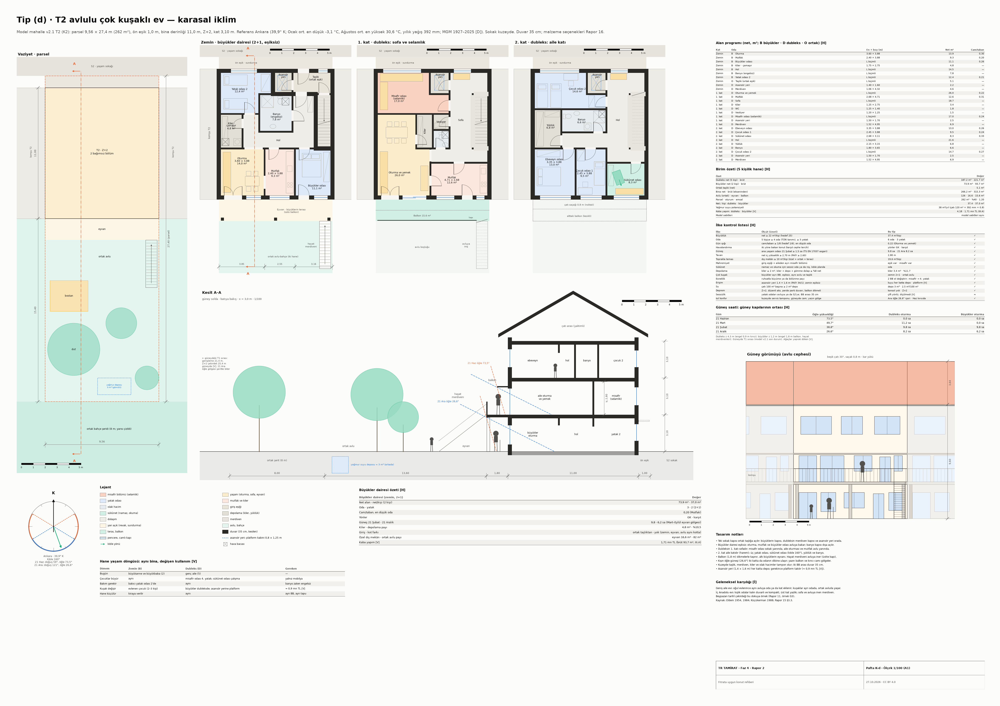
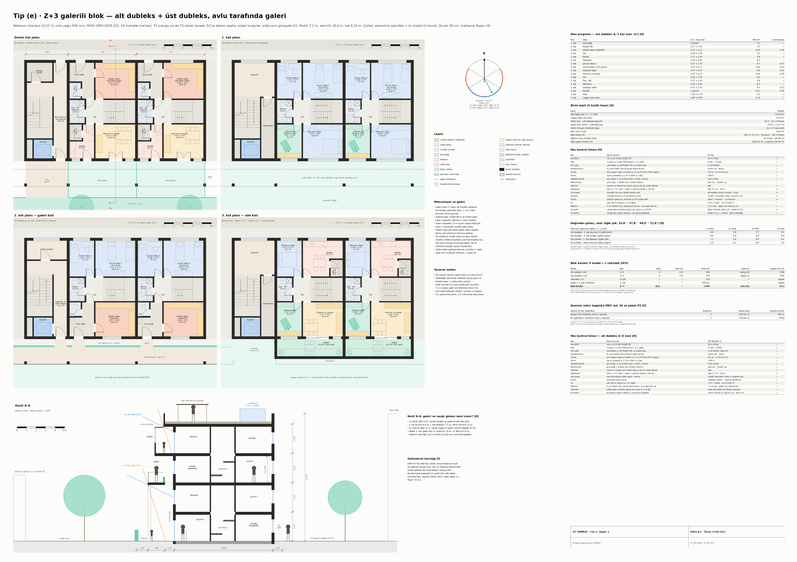
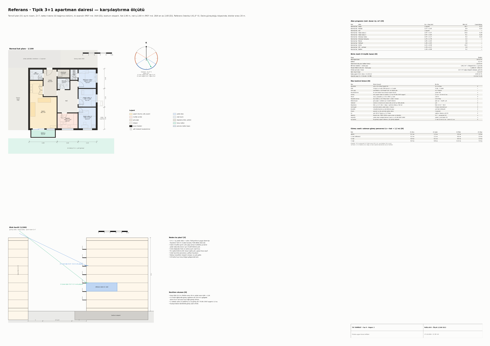
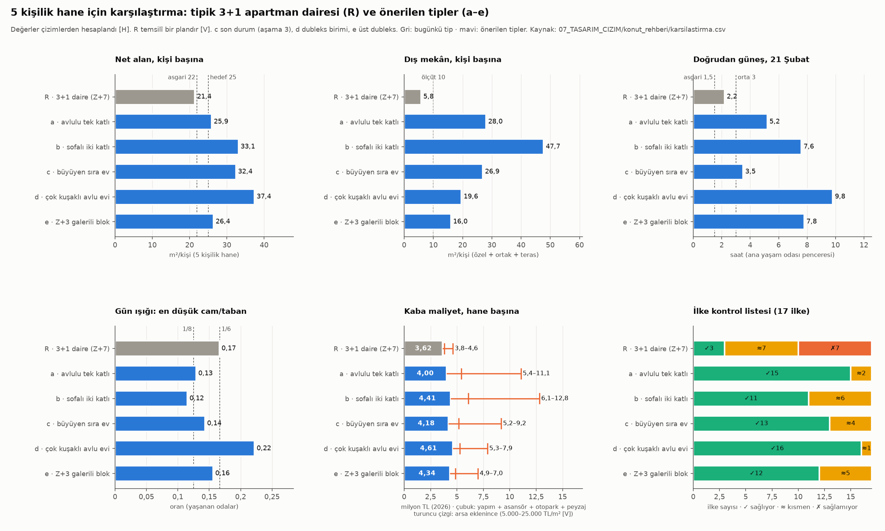
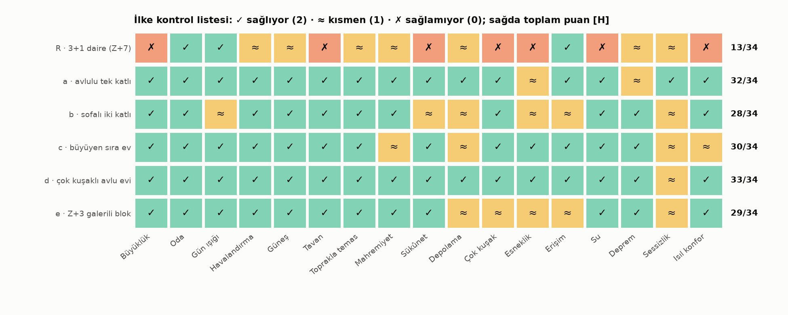

# Faz 4 · Rapor 2 — Fıtrata Uygun Konut: Evler Nasıl Olmalıdır?

*27 Ekim 2026 · Sürüm 1.0*

| Ne | Nerede |
|---|---|
| Tek komut (bütün paftalar, grafikler, tablolar; ≈ 25 sn) | [07_TASARIM_CIZIM/konut_rehberi/kod/uret.py](../07_TASARIM_CIZIM/konut_rehberi/kod/uret.py) |
| Teknik çizimler, A1 pafta, 1/100 (PNG, SVG, DXF) | `konut_rehberi/tip_a_avlulu_ev` · `tip_b_sofali_ev` · `tip_c_buyuyen_sira_ev` · `tip_d_cok_kusakli_avlu_evi` · `tip_e_galerili_blok` · `referans_3+1_daire` |
| Karşılaştırma | [karsilastirma.png](../07_TASARIM_CIZIM/konut_rehberi/karsilastirma.png) · [karsilastirma_ilke_matrisi.png](../07_TASARIM_CIZIM/konut_rehberi/karsilastirma_ilke_matrisi.png) · `karsilastirma.csv` |
| Türkiye'de bugün | [turkiye_konut_durumu.png](../07_TASARIM_CIZIM/konut_rehberi/turkiye_konut_durumu.png) · `turkiye_konut_durumu.csv` |
| Oda listesi ve ölçüt tablosu | `konut_alan_programi.csv` (bütün odalar: net m², en × boy, cam/taban, pencere yönü) · `konut_olcutleri.csv` (tip × ilke × değer × durum) |
| Kod | `veri.py` (iklim, güneş, kıble, mevzuat eşikleri, maliyet) · `cizim.py` (plan, kesit, pafta, DXF, etiket denetimi) · `degerlendirme.py` (ölçütler) · `tip_*.py` · `referans_daire.py` · `karsilastirma.py` · `turkiye_durumu.py` |

İşaretler: **[D]** doğrulandı · **[İ]** ikincil kaynak · **[DY]** doğrulanmadı · **[V]** bu çalışmanın varsayımı · **[H]** bu çalışmada hesaplandı.

Bütün alanlar plan poligonlarından hesaplandı. Elle girilmiş toplam yok. Güneş saatleri, pencere ortasından güneşe atılan ışınların engel kutularına çarpıp çarpmadığına bakılarak bulundu (5 dakikalık adım, güneş 5°'nin üstünde). Maliyetler 2026 fiyatıdır ve kabadır.

---

## Özet

**Soru:** Fıtrata uygun bir şehirde evler nasıl olmalı? Hangi ölçülerle denetlenmeli? Bugün yaygın olan 3+1 daireden ne kadar farklı ve ne kadar pahalı?

**Kısa cevap:**

1. **On yedi ilke, her biri ölçülebilir.** Ev; aileyi misafirden, yatağı sokaktan ayırmalı. İki karşıt cepheden ışık ve hava almalı. Kışın güneş, yazın gölge vermeli. Kuşakları bir arada tutabilmeli ve büyüyebilmeli. Toprağa, avluya ya da terasa açılmalı. Bunlar için ölçüt önerildi:
   - net ≥ 22 m²/kişi (hedef 25),
   - 5 kişiye en az 4 oda ve 3 yatak odası,
   - net tavan ≥ 2,70 m,
   - cam/taban ≥ 1/8 (hedef 1/6),
   - ana yaşam odasında 21 Şubat'ta ≥ 1,5 saat doğrudan güneş (TS EN 17037 asgari),
   - dış mekân ≥ 10 m²/kişi,
   - yatak odasında gece ≤ 30 dB (DSÖ),
   - kiler ≥ 2 m², toplam depolama ≥ net alanın %8'i,
   - çatı 100 m²'ye ≥ 2 m³ yağmur deposu.
2. **Türkiye'de bugün.**
   - Hanelerin %70,8'i 3 ve daha çok katlı binada oturuyor; bunların %53,6'sı asansörsüz (2021) [D/H].
   - Hanelerin %47,5'i 4 odalı, yani 3+1 konutta (2021) [D].
   - Nüfusun %37,8'i aşırı kalabalık konutta; AB'de %16,8. Çocuklarda oran %50,7 (2025) [D].
   - Konutunu fazla karanlık bulanlar %17,2; AB'de %6,7 (2023) [D].
3. **Beş tip çizildi (A1, 1/100; plan, kesit, alan programı, ölçek çubuğu, kuzey oku, DXF).**
   - (a) avlulu tek katlı ev, Diyarbakır,
   - (b) dış sofalı iki katlı ev, Bursa,
   - (c) büyüyebilen sıra ev, üç aşama, İstanbul,
   - (d) çok kuşaklı avlu evi, Ankara,
   - (e) Z+3 galerili blok, İstanbul.
4. **Karşılaştırmanın sonucu (5 kişilik hane).**
   - Tipik 3+1 daire (temsilî plan, Z+7) ölçütlerin çoğunu tutturamıyor: 17 ilkede 34 puandan 13 alıyor. Önerilen tipler 28–33 puan alıyor [H].
   - Dairede net 21,4 m²/kişi ve 5,8 m²/kişi dış mekân var. Karşıt cephe yok. 2. kattaki salon 21 Aralık'ta 0,2 saat güneş görüyor.
   - Önerilen tiplerde net 25,9–37,4 m²/kişi, dış mekân 16–48 m²/kişi ve 21 Şubat'ta 3,5–9,8 saat güneş var [H].
5. **Bedel arsada.**
   - Arsa hariç kaba maliyet: daire 3,62 milyon TL, önerilen tipler 4,00–4,61 milyon TL (%10–27 fazla) [H/V].
   - Net m² başına maliyet b, c ve d'de daireden düşük. Bu tipler daha büyük, ama asansör ve bodrum otoparkı yok.
   - Fark arsada açılıyor: hane başına arsa dairede 40 m², a ve b tipinde 280–340 m². Büyükşehir arsasında (25.000 TL/m² [V]) a ve b 11–13 milyon TL'yi buluyor; e ve d 7–8 milyon TL'de kalıyor.
   - Kentte gerçekçi olanlar **c, d ve e**. **a ve b** ucuz arsalı Anadolu kentinin ve kent çeperinin tipleri.
6. **Fıtrat Kodu'na öneri.** Koda bir "konut içi standartlar" bölümü eklenmeli (§5). Tek yönlü daire yasaklanmalı. Galeri ile cephe arasında ışık boşluğu istenmeli. Balkon derinliği ve depolama tanımlanmalı. a ve b tipleri bölgesel varyant olarak kataloğa girmeli.

---

## 1. İlkeler ve ölçütler

### 1.1 İlke tablosu

Ölçütler bu rehberin önerisidir. Mevzuattaki karşılığı olanlar ayrıca yazıldı. Her paftanın sağ sütununda aynı listeyle bir kontrol tablosu var (✓ sağlıyor, ≈ kısmen, ✗ sağlamıyor).

| # | İlke | Neden | Ölçüt (öneri) | Mevzuat ya da kaynak |
|---|---|---|---|---|
| 1 | **Büyüklük** | Kalabalık konut çocuğun ruh sağlığıyla ilişkili (Rapor 14) [D] | Net ≥ 22 m²/kişi, hedef 25 [V] | Paket G1 ölçüt 11: proje ortalaması ≥ 25 m²/kişi (öneri) |
| 2 | **Oda** | Her çocuğa ya da iki çocuğa bir oda; aşırı kalabalığın tanımı oda sayısına dayanır | 5 kişiye ≥ 4 oda (TÜİK tanımı: mutfak, banyo, hol hariç), ≥ 3 yatak odası [V] | Eurostat aşırı kalabalık tanımı: hane için 1 oda, her çift için 1, çocuklar yaş ve cinsiyete göre ikişer [İ] |
| 3 | **Mahremiyet** | Harem-selamlık ayrımının çağdaş karşılığı: misafir aile bölümüne girmeden ağırlanır | Giriş eşiği (kırık giriş, rüzgârlık, taşlık) + aile bölümünden ayrı misafir odası; galeri önünden yatak odası geçişi yok [V] | — |
| 4 | **Gün ışığı** | Karanlık konut bildirimi Türkiye'de AB'nin 2,6 katı (Rapor 14) [D] | Yaşanan her odada cam/taban ≥ 1/8, hedef 1/6 [V] | PAİY md. 32: oturma ve yatak odaları doğrudan dışarıdan ışık ve hava alır [D] |
| 5 | **Güneş** | Kış güneşi ısı ve sağlık; yaz güneşi ısı yükü | Ana yaşam odası 21 Şubat'ta ≥ 1,5 saat (orta düzey 3 saat) | TS EN 17037: 1 Şubat–21 Mart arası bir günde asgari 1,5, orta 3, yüksek 4 saat [İ] |
| 6 | **Havalandırma** | Çapraz hava yazın soğutur, nem ve kirliliği atar | Her konut iki yöne, tercihen iki karşıt cepheye bakar; ıslak hacim pencereli ya da bacalı [V] | — |
| 7 | **Isıl konfor** | Isı ruh sağlığı nedenli ölümü artırıyor: +1 °C → RR 1,022 (Rapor 14) [D] | Yaşam odası güneye ±30°; güney camında saçak ya da balkon (§1.2); sıcak-kuru iklimde kalın duvar, avlu, gölgelik [V] | — |
| 8 | **Sessizlik** | Karayolu gürültüsü +10 dB → iskemik kalp hastalığı RR 1,08 (Rapor 14) [D] | Yatak odası ana yola ve galeriye bakmaz; yatak odasında gece LAeq ≤ 30 dB, dışta Lnight ≤ 45 dB [V] | DSÖ 1999 (iç), DSÖ 2018 karayolu (dış) [İ] |
| 9 | **Tavan** | Hava hacmi, ışığın derine girmesi, ferahlık | Net iç yükseklik ≥ 2,70 m (kat 3,10 m) [V] | PAİY md. 28/4: en az 2,60 m; konut katı en fazla 3,60 m [D] |
| 10 | **Toprakla temas** | Yeşil ve açık alan ölümlülükle ilişkili: +0,1 NDVI → HR 0,96 (Rapor 14) [D] | Özel + ortak + teras ≥ 10 m²/kişi; üst katlarda ≥ 1,8 m derin oturulabilir balkon ya da loggia [V] | Paket G1 ölçüt 14: ≥ 10 m²/konut (öneri); Fıtrat Kodu §3.1: T1 ≥ 70 m², T2 hane başına ≥ 50 m² |
| 11 | **Çok kuşak** | 65 yaş üstünün %50,6'sı çocuğuyla aynı adres, bina ya da sokakta (2025) [D/H, TÜİK] | Zeminde eşiksiz bir yatak odası ve engelsiz duş, ya da aynı binada ayrı eşiksiz bağımsız bölüm [V] | Fıtrat Kodu §3.5; Genelge ölçüt 17 (öneri) |
| 12 | **Esneklik** | Hane büyür, küçülür; taşınmadan uyum | Ruhsatta tanımlı büyüme payı ya da birleşip bölünebilen bağımsız bölüm [V] | Fıtrat Kodu §7 (T1) |
| 13 | **Erişim (çocuk, yaşlı)** | Düşme, merdiven, eşik | Eşiksiz giriş; merdiven korkuluğu ≥ 1,0 m; asansör ya da platform yeri; basamak ≤ 0,16 m [V] | PAİY md. 34/1: 3 katta asansör yeri, ≥ 4 katta asansör; md. 31/2-a: basamak ≤ 0,16 m [D] |
| 14 | **Sükûnet ve ibadet** | Namaz, okuma, dinlenme için sessiz yer | Aile konutunda ≥ 6 m² sessiz oda ya da niş; kıble planda gösterilir [V] | — |
| 15 | **Depolama ve kiler** | Mevsimlik erzak, eşya; dağınıklık stresi | Serin kiler ≥ 2 m²; kiler + depo + gömme dolap ≥ net %8 [V] | — |
| 16 | **Su** | Kurak yaz, bahçe sulaması | Çatı 100 m²'ye ≥ 2 m³ yağmur deposu [V] | PAİY md. 57/7-a: yağmur suyu sistemi varsa depo ≥ yıllık toplanabilir suyun %6'sı [D] |
| 17 | **Deprem** | 6 Şubat 2023 | Düzenli aks, yumuşak kat yok, kısa konsol, hafif çatı; az kat [V] | TBDY 2018 (RG 18.03.2018) [D]; malzeme ve sistem için Rapor 16 |

Karşılaştırmadaki "17 ilke" bu tablonun 17 satırıdır. Sükûnet ile ibadet, erişim ile çocuk ve yaşlı güvenliği birer satırda sayıldı.

### 1.2 Yönlenme ve gölgeleme için hesap

Öğle güneşi yüksekliği [H] (Cooper yaklaşımı) ve uzun yıllar iklimi [D, MGM, 27.10.2026'da okundu]:

| Şehir | Enlem | 21 Ara öğle | 21 Haz öğle | Ocak ort. en düşük | En sıcak ay ort. en yüksek | Yıllık yağış | Kıble | Saçak/cam yüksekliği oranı (Haz öğlesi gölge) |
|---|---|---|---|---|---|---|---|---|
| Diyarbakır | 37,9° | 28,7° | 75,5° | −2,2 °C | 38,5 °C (Tem) | 487 mm | 181° | ≥ 0,26 |
| Bursa | 40,2° | 26,4° | 73,2° | 1,8 °C | 31,1 °C (Ağu) | 706 mm | 151° | ≥ 0,30 |
| İstanbul | 41,0° | 25,6° | 72,4° | 4,2 °C | 29,7 °C (Tem) | 659 mm | 152° | ≥ 0,32 |
| Ankara | 39,9° | 26,6° | 73,5° | −3,1 °C | 30,6 °C (Ağu) | 392 mm | 160° | ≥ 0,30 |

**Okuma:**
- Güney camı yüksekliğinin üçte biri kadar derin bir saçak, 21 Haziran öğlesinde camı tamamen gölgeler [H]. 21 Aralık'ta aynı saçak güneşi engellemez.
- Sabah ve öğleden sonra güneş alçaldığı için rehber 0,8–1,0 m saçak ya da 1,8 m balkon kullandı.
- Doğu ve batı camı saçakla korunamaz. Batı cephesinde revak, yaprak döken ağaç ya da servis tamponu önerilir.

---

## 2. Türkiye'de bugün



| Gösterge | Değer | Yıl | Kaynak |
|---|---|---|---|
| 3 ve daha çok katlı binada oturan hane | %70,8 | 2021 | TÜİK Bina ve Konut Nitelikleri Araştırması (BKNA) 2021, bülten 45870; hesap [D/H] |
| Bunlar içinde asansörsüz binada oturan | %53,6 | 2021 | TÜİK BKNA 2021 [D] |
| Otoparksız binada oturan hane | %57,0 | 2021 | TÜİK BKNA 2021 [D] |
| 4 odalı (3+1) konutta oturan hane | %47,5 (3 oda %38,6; 1–2 oda %6,6; 5+ oda %7,3) | 2021 | TÜİK BKNA 2021 bülten metni [İ]. İl tablolarından hane ağırlıklı hesap aynı sonucu 0,1 puan farkla veriyor: 6,7 · 38,5 · 47,5 · 7,3 [H]. Bu uyum nedeniyle değerler doğrulanmış sayılabilir |
| Ortalama oda sayısı | 3,56 | 2021 | İl tablolarından, hane ağırlıklı [H] |
| Kişi başına oda | 1,1 (AB 1,7) | 2025 | Eurostat ilc_lvho03 [D] |
| Aşırı kalabalık konutta yaşayan | %37,8 (AB 16,8); 18 yaş altı %50,7 (AB 25,3) | 2025 | Eurostat ilc_lvho05a [D] |
| Konutunu fazla karanlık bulan | %17,2 (AB 6,7) | 2023 | Eurostat ilc_mdho04 [D] |
| Komşudan ya da sokaktan gürültü sorunu | %16,5 (AB 18,1) | 2023 | Eurostat ilc_mddw01 [D] |
| Kendine ait odası olan çocuk (0–17) | %34,0 | 2022 | TÜİK Türkiye Çocuk Araştırması [D] |
| Ortalama hanehalkı büyüklüğü | 3,08 kişi | 2025 | TÜİK İstatistiklerle Aile [D] |
| Konutunun sahibi olan hane · kiracı | %60,7 · %27,6 | 2021 | TÜİK BKNA 2021 [D] |
| 2001 ve sonrası yapılmış binada oturan hane | %47,4 | 2021 | TÜİK BKNA 2021 [D] |
| Satılan dairelerin ortalama büyüklüğü | 97 m² (2010'da 121 m²) | 2025 | İstanbul Gayrimenkul Değerleme; Hürriyet Daily News 17.05.2026 [İ] |
| Yapı ruhsatı verilen daire · iskân verilen daire | 1.111.852 · 673.575 | 2025 | TÜİK Yapı İzin İstatistikleri; Posta aktarımı, 27.10.2026'da okundu [İ] |

**Ne anlatıyor?**

1. **Tip, 3+1 daire.** Hanelerin yarısına yakını 4 odalı konutta oturuyor. Ortalama hane 3,08 kişi; ama 5 kişilik bir aile de çoğu zaman aynı 3+1'e sığıyor. Aşırı kalabalığın AB'nin iki katı olması bundan.
2. **Bina, asansörsüz apartman.** Üç ve daha çok katlı binada oturan hanelerin yarısından fazlasında asansör yok. Bu, yaşlının ve küçük çocuklu annenin günlük hareketini merdivene bağlıyor.
3. **Küçülme.** Satılan dairelerin ortalaması 15 yılda 121 m²'den 97 m²'ye indi [İ]. 2025'te bir milyonu aşkın daireye ruhsat verildi [İ]. Bugün çizilen planlar onlarca yıl kalacak stoku belirliyor.
4. **Işık.** Karanlık konut bildirimi 2006'da %23,6 idi, 2023'te %17,2'ye indi. Yine de AB'nin 2,6 katı [D]. §4'teki referans kesit nedenini gösteriyor: 20 m arayla dizilen Z+7 bloklarda alt beş katın güney cephesi 21 Aralık öğlesinde gölgede [H].
5. **Veri boşluğu.** BKNA 2021'den sonra tekrarlanmadı. TÜİK yapı izin bültenlerinde daire başına ortalama alan ve oda sayısı dağılımı bulunamadı. Yeni yapılan konutun büyüklüğü için yalnız ikincil kaynak var [DY].

---

## 3. Konut tipleri

### 3.1 Geleneksel plan tipleri ve bölgesel iklim varyantları

**Plan tipleri [İ: Eldem 1954, 1984; Küçükerman 1988; Kuban 1995].** Sedad Hakkı Eldem Türk evini sofanın yerine göre dörde ayırır: sofasız, dış sofalı, iç sofalı, orta sofalı.
- **Sofa** odaların ortak önü ve günlük yaşam yeridir.
- **Odalar** sofaya açılır. Her oda kendi içinde oturma, yatma ve yıkanma (gusülhane) yeri olan bağımsız bir birimdir. Yüklük ve dolaplar duvarın içindedir.
- **Harem-selamlık.** Büyük evlerde harem ve selamlık ayrı kanat ya da ayrı avludur. Küçük evlerde ayrım, girişe yakın "baş oda" ile aile odaları arasındadır.
- **Giriş.** Taşlık ya da dehliz, sokak ile ev arasında bir eşik oluşturur.

| Bölge | Geleneksel yanıt [İ] | Bu rehberdeki karşılığı |
|---|---|---|
| Güneydoğu, sıcak-kuru (Diyarbakır, Urfa, Mardin) | Taş, kalın duvar, iç avlu, havuz, eyvan; yazlık ve kışlık odalar; serdap; damda yatma | **Tip a** |
| Marmara ve Ege, ılıman (Bursa, Birgi, Kula, Safranbolu) | Hımış, zemin taşlık, üst kat dış ya da iç sofa, çıkma ve köşk, geniş saçak | **Tip b** |
| İç Anadolu, karasal (Ankara, Konya, Kayseri) | Kompakt kütle, kalın kerpiç ya da taş, düz toprak dam ya da kırma çatı, avlu duvarı, kışlık oda ocak başında | **Tip d** (kuzeyde servis tamponu, güneyde cam) |
| İstanbul, ılıman-nemli | Bitişik nizam ahşap ev, dar parsel, çıkma, arka bahçe | **Tip c ve e** |
| Karadeniz, nemli (çizilmedi) | Ahşap çatma ya da göz dolma, yükseltilmiş zemin, geniş saçak, serender | Kod önerisi: çapraz havalandırma, yağmur için saçak ≥ 1,0 m [V] |
| Akdeniz, sıcak-nemli (çizilmedi) | Yazlık ve kışlık kat, çardak, gölgeli sofa, yüksek tavan | Kod önerisi: gölgeli sofa ya da loggia ≥ 1,8 m, gece havalandırması [V] |

Geleneksel dokunun ölçüleri ve zaafları (dar sokak, kış gölgesi, az yeşil) Rapor 11'de. Bu rehber geleneksel planı kopyalamıyor. Plan ilkelerini (eşik, sofa, avlu, kuşak) çağdaş ölçütlerle sınıyor.

### 3.2 Tip (a) — Avlulu tek katlı ev, sıcak-kuru iklim (Diyarbakır)



**Pafta K-a** (A1, 1/100): zemin ve dam planı, A–A ve B–B kesitleri, alan programı, kontrol listesi, güneş saati ve avlu gölgesi tabloları. Ayrıca: [SVG](../07_TASARIM_CIZIM/konut_rehberi/tip_a_avlulu_ev.svg) · [DXF](../07_TASARIM_CIZIM/konut_rehberi/tip_a_avlulu_ev.dxf)

- **Kurgu.** Parsel 14,4 × 19,6 m (282 m²), bitişik nizam, sokak kuzeyde.
  - Sokaktan kırık bir dehlize girilir. Görüş perdesi yüzünden sokak kapısından avlu görünmez.
  - Misafir odası (baş oda, 16,4 m²) ve WC dehlize açılır.
  - Kışlık oturma avlunun kuzeyindedir ve güneye bakar. Eyvan ve yazlık odalar güneydedir, kuzeye bakar.
  - Batı kanadı revakla korunur. Avlunun altında 12 m³ sarnıç, damda yaz terası var.
- **Sayılar [H].**
  - Net 129,6 m² (25,9 m²/kişi), 6 oda, 3 yatak odası.
  - Yarı açık 33,1 m² (eyvan, revak), avlu 76,4 m², dam terası 63,5 m².
  - Brüt 169,1 m², yapı oturumu %72.
  - Duvar 40 cm, net tavan 3,15 m.
- **Güneş [H].** Kışlık oturmanın avlu kapısı 21 Aralık'ta 4,2, 21 Şubat'ta 5,2 saat güneş alır. 21 Haziran'da 0 saat: 0,8 m'lik gölgelik camı korur.
- **Avlu gölgesi [H].** 21 Haziran öğlesinde avlunun %13'ünü yapı gölgeler; dut, nar ve asma çardağıyla bu oran %39'a çıkar. Saat 16.00'da sırasıyla %75 ve %87.
  - Kışın avlu zemini öğlede de gölgede kalır (%92–100). Kış güneşini avlu değil, kışlık odalar ve dam alır.
- **Su [H].** Çatı 202 m² × 487 mm × 0,8 ≈ 79 m³/yıl. Sarnıç bunun %15'i; PAİY'nin %6 eşiğinin üstünde [D].
- **Kısmen sağlanan ölçütler.**
  - Esneklik: kanat eklemek avluyu daraltır.
  - Deprem: dam ağır (toprak örtü); hafifletilmeli ya da taşıyıcı sistem Rapor 16'daki gibi hesaplanmalı.

### 3.3 Tip (b) — Dış sofalı (hayatlı) iki katlı ev, ılıman iklim (Bursa)



**Pafta K-b:** zemin ve 1. kat planı, A–A kesiti, güney görünüşü. Ayrıca: [SVG](../07_TASARIM_CIZIM/konut_rehberi/tip_b_sofali_ev.svg) · [DXF](../07_TASARIM_CIZIM/konut_rehberi/tip_b_sofali_ev.dxf)

- **Kurgu.** Eldem'in en eski tipi olan dış sofanın çağdaş hâli.
  - Parsel 16,7 × 20,1 m (336 m²), ikiz nizam, 10 m güney bahçesi.
  - Odalar kuzeyde bir sıra. Sofa bütün güney cephe boyunca uzanır ve camla kapalıdır.
  - Zemin: giriş eşiği, misafir odası (selamlık) ve WC. Aile sofasına camlı bir kapıdan geçilir.
  - Büyükler odası eşiksizdir, bahçeye açılır ve engelsiz duşu vardır.
  - Üst kat aile katıdır. Her oda iki yöne bakar: kuzeyde dış pencere, güneyde sofaya iç pencere.
  - Köşk 0,9 m çıkar. Kırma çatının saçağı 1,0 m.
- **Sayılar [H].**
  - Net 165,5 m² (7 kişiyle 23,6, 5 kişiyle 33,1 m²/kişi), 7 oda, 4 yatak odası.
  - Bahçe 238 m², brüt 196,7 m², oturum %29.
- **Güneş [H].** Üst sofanın güney camında 21 Aralık'ta 5,2, 21 Şubat'ta 7,6, 21 Haziran'da 0 saat. Kış öğlesinde güneş odaların içine kadar girer (kesitte görülüyor).
- **Kısmen sağlanan ölçütler.**
  - Misafir odasında cam/taban 0,12.
  - Depolama %4,4.
  - Yatak odaları sokağa bakar (3 m ön bahçe).
  - Üst kata yalnız merdivenle çıkılır.
  - Sükûnet için yalnız sofada bir niş var.

### 3.4 Tip (c) — T1 büyüyebilen sıra ev, üç aşama (İstanbul)



**Pafta K-c:** vaziyet, beş aşama planı, son durum kesiti, aşama tablosu. Model mahalle v2.1 T1 tipinin (K2) ayrıntısı. Model sabitleri dosyadan okunup denetlendi; model dosyaları değiştirilmedi. Ayrıca: [SVG](../07_TASARIM_CIZIM/konut_rehberi/tip_c_buyuyen_sira_ev.svg) · [DXF](../07_TASARIM_CIZIM/konut_rehberi/tip_c_buyuyen_sira_ev.dxf)

- **Kurgu.** Parsel 6,37 × 27,4 m (175 m²), ön eşik 1,0 m, çekirdek 9,0 m, kat 3,10 m.
  - Mutfak sokağa bakar (sokakta göz), oturma bahçeye.
  - Merdiven baştan son duruma göre yapılır.
  - Kiler ve dolap dikmesi kaldırma platformu yeridir (1,15 × 2,08 m).
  - Aşama 2'de doğu 3,9 m'de L genişleme yapılır: büyükler odası ve engelsiz duş. Oturma bahçe ışığını korur (avlucuk).
  - Aşama 3'te 2. kat eklenir. Genişlemenin damı ebeveyn odasının terası olur.

| Aşama | Eklenen | Oda | Net m² | Brüt m² | Kişi | Yapım (mn TL) [V] |
|---|---|---|---|---|---|---|
| 1 | Çekirdek Z+1 (2+1) | 3 | 97 | 115 | 4 | 2,22 |
| 2 | L arka oda + teras | 4 | 113 | 134 | 5 | 2,60 |
| 3 | 2. kat (+2 yatak, banyo) | 6 | 162 | 192 | 7 | 3,71 |

- **Sayılar [H].** Son durumda bahçe 91 m², teras 17,5 m², ortak bahçe şeridi payı 25,5 m².
- **Güneş [H].** Oturmanın bahçe kapısı 21 Aralık ve 21 Şubat'ta 3,5 saat güneş alır. Engeller: kendi ve komşunun genişlemesi, karşı sıranın Z+2 çekirdekleri.
- **Kısmen sağlanan ölçütler.**
  - Ayrı misafir odası yok; misafir oturmada ağırlanır.
  - 21 Haziran'da kapıya 5,5 saat güneş girer; saçak yok, yaprak döken ağaç önerildi.
  - Çocuk odaları S2'ye bakar. Yavaş bir sokak olduğu için kabul edildi [V].
- **5 kişilik hane için.** Aşama 2 yeterli: 4 oda, net 22,7 m²/kişi, yapım 2,60 milyon TL. Bu, dairenin yapım maliyetinin (2,94) altında.

### 3.5 Tip (d) — T2 avlulu çok kuşaklı ev (Ankara)



**Pafta K-d:** vaziyet, zemin, 1. ve 2. kat planları, A–A kesiti, güney görünüşü, büyükler dairesi özeti, hane yaşam döngüsü tablosu. Model mahalle v2.1 T2 tipinin ayrıntısı. Ayrıca: [SVG](../07_TASARIM_CIZIM/konut_rehberi/tip_d_cok_kusakli_avlu_evi.svg) · [DXF](../07_TASARIM_CIZIM/konut_rehberi/tip_d_cok_kusakli_avlu_evi.dxf)

- **Kurgu.** Parsel 9,56 × 27,4 m (262 m²), Z+2, iki bağımsız bölüm, bir avlu.
  - Tek sokak kapısı ortak taşlığa açılır. Büyüklerin kapısı, dubleksin merdiven kapısı ve asansör yeri (1,4 × 1,6 m; PAİY md. 34/1 [D]) buradadır.
  - **Zemin:** büyükler için eşiksiz 2+1. Oturma, mutfak ve büyükler odası avluya bakar.
  - **1. kat:** sofa, girişe yakın selamlık, aile oturması, mutfak. Dikmeli 1,8 m balkondan "hayat merdiveni" avluya iner. Balkonun altı büyüklerin eyvanıdır.
  - **2. kat:** aile katı; üç yatak odası, sükûnet odası (kıble 160°), banyo, yüklük.
  - Karasal iklim için kuzeyde servis tamponu (taşlık, merdiven, kiler, ıslak hacim), güneyde geniş cam ve 35 cm duvar.
- **Sayılar [H].**
  - Dubleks (5 kişi): net 187,2 m², 37,4 m²/kişi, brüt 221,7 m².
  - Büyükler dairesi: net 73,9 m², brüt 93,7 m².
  - Bina: net 266, brüt 315 m². Oturum %40, emsal 1,20. Ortak avlu 126 m².
- **Güneş [H].** Dubleks oturması 21 Aralık'ta 8,2, 21 Şubat'ta 9,8 saat güneş alır. Büyüklerin oturması kışın 6,2–9,8 saat alır; Mart–Eylül arasında eyvan gölgesinde kalır (bilinçli ödünleşim).
- **Not.** Dubleks 5 kişi için hedefin çok üstünde. Misafir odası 4. yatak odası olursa 6–7 kişiye yeter. Kuşak değişince iki bağımsız bölüm el değiştirebilir: büyükler dubleksi gençlere bırakır.

### 3.6 Tip (e) — Z+3 galerili blok (İstanbul)



**Pafta K-e:** zemin, 1., 2. (galeri) ve 3. kat planları, A–A kesiti, asansör yükü tablosu, iki birim için kontrol listesi. Ayrıca: [SVG](../07_TASARIM_CIZIM/konut_rehberi/tip_e_galerili_blok.svg) · [DXF](../07_TASARIM_CIZIM/konut_rehberi/tip_e_galerili_blok.dxf)

- **Kurgu.** K3 mahalle merkezi; T4 çubuğu ya da T3 sokak kanadı Z+3 için. Modül 7,2 × 10,4 m, kat 3,10 m. Her modülde iki dubleks üst üste durur.
  - **Alt dubleks (zemin + 1. kat):** sokaktan eşiksiz girilir. Zeminde iki kapılı misafir (büyükler) odası ve engelsiz duş var. Avluya 4 m'lik özel bahçe açılır.
  - **Üst dubleks (2. + 3. kat; 5 kişilik birim):** yalnız 2. kattaki galeriden köprüyle girilir.
    - Galeri, Fıtrat Kodu §3.5'teki "hayat"tır. Cepheden 1,0 m'lik ışık boşluğuyla ayrılır; iç kenarındaki çiçeklik bakışı keser.
    - Galeriye yalnız eşik, misafir WC'si ve misafir odası (selamlık) bakar.
    - 3. kat galerisiz aile katıdır: oturma, mutfak, ebeveyn odası ve 1,8 m'lik loggia. Loggianın üstünde 1,0 m saçak ve asma çardağı var.
  - Bir çekirdek (merdiven + asansör) galeriyle üç merdiven evi aralığına hizmet eder (paket P4).
  - Çatı ortak bahçedir. Modül başına 3 m³ yağmur deposu var.
- **Sayılar [H].**
  - Üst dubleks: net 131,8 m² (26,4 m²/kişi), 6 oda; loggia 12,4 m².
  - Brüt 178,8 m² (154,1 m² birim + 24,7 m² çekirdek ve galeri payı).
  - Avlu payı 45 m², çatı bahçesi payı 22,5 m²/hane.
  - Çizilen blok kesimi: 69,3 × 27,4 m, 18 konut, brüt 2.996 m², emsal 1,58, hane başına arsa 105 m².
- **Güneş [H].**
  - Üst dubleks oturması (3. kat): 21 Aralık'ta 8,0, 21 Şubat'ta 7,8 saat.
  - Alt dubleksin galeri altında kalan 1. kat ebeveyn odası: 21 Şubat'ta 2,8, 21 Mart'ta 0 saat. Galerinin bedeli bu.
- **Asansör [H/V].**
  - Bugünkü uygulamada her merdiven evine asansör gerekir: hane başına 433 bin TL, yapımın %11,4'ü.
  - P4 ile galeriye bağlı üç merdiven evine tek asansör yeter: 144 bin TL, %3,8.
  - Asansörün yalnız galeri katında durmasının ve açık kaçış merdiveninin yangın yönetmeliğine uyumu doğrulanmadı [DY].
- **Kısmen sağlanan ölçütler.**
  - Depolama %3,6.
  - Büyükler için yer yalnız alt dubleksin zemininde.
  - Üst dubleksin içinde merdiven var.
  - Çocuk odaları sokağa bakar.

### 3.7 Referans — tipik 3+1 apartman dairesi (İstanbul)



**Pafta K-R:** normal kat planı (1/100), blok kesiti (1/200). Plan temsilîdir [V], bir anketten gelmiyor.

- **Bina [V].** Ayrık nizam, Z+7, katta 4 daire (32 bağımsız bölüm). Bodrum otopark. İki asansör var (PAİY md. 34/4 [D]). Kat 2,90 m, net tavan 2,60 m (PAİY asgarisi [D]). Bloklar arası 20 m: 5 m ön bahçe, 10 m yol, 5 m ön bahçe.
- **Daire.**
  - Güneydoğu köşesinde, iki dik cepheye bakar. Salon, mutfak ve bir yatak odası güneye, iki yatak odası doğuya.
  - Antre doğrudan hole ve salona açılır. Islak hacimler penceresiz.
- **Sayılar [H].**
  - Net 107,0 m² (21,4 m²/kişi), 4 oda, balkon 5,2 m².
  - BB brüt 139,3 m² (Otopark Yönetmeliği Ek-1: 1 yer [D]). Parsel payı 39,6 m² (TAKS 0,40 [V]).
- **Güneş, salonun güney penceresi [H].**

| Kat | 21 Ara | 21 Şub | 21 Mar | 21 Haz |
|---|---|---|---|---|
| Zemin | 0,1 sa | 1,2 sa | 3,9 sa | 1,8 sa |
| 2. kat (karşılaştırmada kullanılan) | 0,2 sa | 2,2 sa | 6,8 sa | 1,8 sa |
| 4. kat | 0,8 sa | 8,2 sa | 6,8 sa | 1,8 sa |
| 7. kat | 8,0 sa | 9,8 sa | 11,0 sa | 7,8 sa |

Karşı blok 25,2 m yükseklikte; sokak oranı H/W ≈ 1,26. 21 Aralık öğlesinde güney cephenin alt 15,6 m'si gölgede, yani zemin ile 4. kat arası öğle güneşi almıyor [H]. Kuzeye bakan dairelerde değer sıfır.

---

## 4. Karşılaştırma: 5 kişilik hane





Birimler: R'de daire; a ve b'de bütün ev; c'de son durum (7 kişilik program, 5 kişiye bölündü); d'de dubleks; e'de üst dubleks. Hepsi [H]; R'nin planı ve bina bağlamı [V].

| | R · 3+1 daire | a · avlulu | b · sofalı | c · sıra ev | d · çok kuşaklı | e · galerili |
|---|---|---|---|---|---|---|
| Kat · hane | Z+7 · 32 | Z · 1 | Z+1 · 1 | Z+1 → Z+2 · 1 | Z+2 · 2 | Z+3 · 18 |
| Net alan | 107,0 m² | 129,6 | 165,5 | 161,9 (aşama 2: 113) | 187,2 | 131,8 |
| Net / kişi | **21,4** | 25,9 | 33,1 | 32,4 | 37,4 | 26,4 |
| Oda · yatak odası | 4 · 3 | 6 · 3 | 7 · 4 | 6 · 5 | 6 · 3 | 6 · 3 |
| Dış mekân / kişi (özel + ortak + teras) | **5,8** | 28,0 | 47,7 | 26,9 | 19,6 | 16,0 |
| Güneş, 21 Şub · 21 Ara (sa) | 2,2 · **0,2** | 5,2 · 4,2 | 7,6 · 5,2 | 3,5 · 3,5 | 9,8 · 8,2 | 7,8 · 8,0 |
| En düşük cam/taban | 0,17 | 0,13 | 0,12 | 0,14 | 0,22 | 0,16 |
| Karşıt cephe | **yok** | var | var | var | var | var |
| Net tavan | **2,60** | 3,15 | 2,80 | 2,80 | 2,80 | 2,80 |
| Eşik · misafir bölümü · sükûnet | var · **yok** · **yok** | var · var · oda | var · var · niş | var · yok · oda | var · var · oda | var · var · oda |
| Esneklik | yok | ≈ (avluya kanat) | ≈ (çatı arası, zemin ayrı daire) | ✓ (3 aşama, +%67 brüt) | ✓ (2 BB el değiştirir) | ≈ (misafir → büyükler) |
| Depolama (net %) | 6,0 | 16,0 | 4,4 | 6,4 | 11,7 | 3,6 |
| Hane başına arsa | 39,6 m² | 282,2 | 335,7 | 200,0 | 130,9 | 105,5 |
| Net parsel yoğunluğu (hane/ha) | 253 | 35 | 30 | 57 | 76 | 95 |
| Yapım (mn TL) | 2,94 (III.C) | 3,60 | 3,81 | 3,71 | 4,18 (III.A) | 3,80 |
| + asansör + otopark + peyzaj | 3,62 | 4,00 | 4,41 | 4,18 | 4,61 | 4,34 |
| Net m² başına (bin TL, arsa hariç) | 33,9 | 30,9 | 26,6 | 25,8 | 24,6 | 32,9 |
| + arsa 5.000 TL/m² | 3,82 | 5,41 | 6,09 | 5,18 | 5,26 | 4,86 |
| + arsa 25.000 TL/m² | 4,61 | 11,05 | 12,80 | 9,18 | 7,88 | 6,97 |
| İlke puanı (34 üzerinden) | **13** | 32 | 28 | 30 | 33 | 29 |

**Maliyet varsayımları.**
- Yapım: 2026 Yapı Yaklaşık Birim Maliyetleri Tebliği (RG 03.02.2026/33157) [D]; %10 yüklenici kârı çıkarıldı (× 0,92), M6 modeli ve model mahalle v2 ile aynı.
- Sınıflar: III.A 19.800 · III.B 21.050 · III.C 23.400 TL/m². Yarı açık alan yarı fiyatla [V].
- Asansör 1,3 milyon TL + ek durak başına 100 bin TL [V].
- Otopark: dairede 1 yer, bodrumda (Ek-1 [D]); önerilen tiplerde 0,57 yer/hane, bölgesel otoparkta (model mahalle v2.1). Bir yer 30 m² × III.A [V].
- Peyzaj 1.200 TL/m² [V]. KDV, proje, harç ve finansman yok.
- Malzeme seçimi maliyeti değiştirir: Rapor 16'ya göre toprak duvarlı ev betonarmeden %8,1–10,2 pahalı. Malzeme ayrıntısı oradadır.

**Okuma.**

1. **Ölçütlerde fark büyük, maliyette küçük.** Daire 17 ilkenin 3'ünü tam sağlıyor; önerilen tipler 11–16'sını. Arsa hariç önerilen tipler daireden %10–27 pahalı. Ama net m² başına b, c ve d daireden %21–27 ucuz. Asansör, bodrum otoparkı ve III.C sınıfı yüksek bina maliyeti burada yok.
2. **Asıl ödünleşim arsa.** Az katlı tip daha çok arsa ister. Hane başına arsa dairede 40 m², galerili blokta 105, çok kuşaklı evde 131, sıra evde 200, avlulu ve sofalı evde 280–340 m².
   - 5.000 TL/m²'lik arsada önerilen tiplerin hepsi 4,9–6,1 milyon TL'de kalıyor.
   - 25.000 TL/m²'de a ve b 11–13 milyon TL'ye çıkıyor. e (7,0) ve d (7,9) dairenin 1,5–1,7 katında kalıyor.
3. **Kent içinde e, d ve c.** Galerili blok (95 hane/ha net) ve çok kuşaklı ev (76) dairenin (253) yoğunluğuna yaklaşmıyor. Ama mahalle ölçeğinde yoğunluk yollar, donatı ve yeşille birlikte okunmalı. Model mahalle v2.1 bu tiplerle 60 ha'da 2.164 konut taşıyor (model_mahalle_v2.md).
4. **Daire en çok güneşte ve dış mekânda kaybediyor.** 20 m arayla dizilen Z+7 bloklarda alt katlar kış güneşi görmüyor. Dış mekân, 5 m²'lik balkon ile otopark rampasına giden bahçe mesafesinden ibaret.
5. **Önerilen tiplerin zaafları da ölçüldü.**
   - b'nin misafir odası ışıkta (0,12) sınırın altında.
   - b, c ve e'de depolama hedefin altında.
   - c'de ayrı misafir odası yok.
   - e'de galeri altındaki oda Mart'ta güneş görmüyor.
   - d'nin dubleksi 5 kişi için büyük.
   - Bu zaaflar plan düzeyinde giderilebilir; tiplerin kuruluşunu değiştirmiyor.

---

## 5. Fıtrat Kodu'na öneriler

Bu raporda Fıtrat Kodu ve model mahalle dosyaları değiştirilmedi. Öneriler sürüm 0.3 için:

1. **Yeni §3.7 "Konut içi standartlar" (aile konutu, ≥ 3 yatak odası).** §1.1'deki ölçütler tablo olarak eklensin:
   - net ≥ 22 m²/kişi (hedef 25),
   - 5 kişiye ≥ 4 oda, net tavan ≥ 2,70 m,
   - yaşanan odada cam/taban ≥ 1/8,
   - ana yaşam odasında 21 Şubat ≥ 1,5 saat güneş,
   - kiler ≥ 2 m² ve depolama ≥ net %8,
   - ≥ 6 m² sükûnet odası ya da niş.

   Uygunluk, bu rehberdeki gibi plandan hesaplanan bir kontrol listesiyle gösterilsin (`degerlendirme.py`).
2. **Tek yönlü konut yasağı.** Her konut iki yöne, aile konutu iki karşıt cepheye baksın. Köşe dairesindeki gibi dik iki cephe "kısmen" sayılsın. Islak hacimde pencere ya da doğal çekişli baca istensin.
3. **Galeri ("hayat") koşulları (§3.5 ve P4'e ek).**
   - Galeri yalnız bir katta olsun.
   - Galeri ile cephe arasında ≥ 1,0 m ışık boşluğu bırakılsın; kapılara köprüyle ulaşılsın.
   - Galeriye yatak odası penceresi açılmasın; bakan odalar eşik, misafir odası ve ıslak hacim olsun.
   - Galerinin altındaki odanın kış güneşi kesitle gösterilsin.
4. **Balkon ve loggia.** K3–K4'teki "her daireye ≥ 6 m² balkon" kuralı "≥ 1,8 m derin ve ≥ 8 m² oturulabilir balkon ya da loggia" olsun. Dış mekân ölçütü konut başına değil kişi başına (≥ 10 m²) yazılsın.
5. **Mahremiyet.** Aile konutunda giriş eşiği (kırık giriş, rüzgârlık ya da taşlık) ve aile bölümünden geçmeden ulaşılan bir misafir odası istensin. T1'de misafir odası aşama 2'de zorunlu olabilir.
6. **Güneş ve gölgeleme.**
   - Yaşam odası güneye ±30° baksın.
   - Güney camında saçak ya da balkon derinliği ≥ cam yüksekliğinin 0,3'ü olsun (§1.2). Batı camına revak ya da ağaç gelsin.
   - Sıcak-kuru bölgede avlu kesiti ve yaz gölgesi hesabı ruhsata eklensin (tip a'daki tablo gibi).
7. **Sessizlik.** Yatak odaları S0 ve S1'e ve galeriye bakmasın. Bağımsız bölümler arasındaki duvar ağır ve iki katmanlı olsun (≥ 30–35 cm) [V]. Ses yalıtım değeri ayrıca belirlenmeli [DY].
8. **Su.** Çatı 100 m²'ye ≥ 2 m³ yağmur deposu istensin (PAİY md. 57/7-a'daki %6'nın üstünde). T2 ve avlulu tiplerde avlu altında sarnıç.
9. **Çok kuşak ve esneklik.** Bütün aile konutlarında zeminde eşiksiz bir yatak odası ve engelsiz duş istensin, ya da aynı parselde ayrı eşiksiz bağımsız bölüm. T2'de iki bağımsız bölümün el değiştirmesi tapuda kolaylaştırılsın (aile içi devir) [DY].
10. **Tip kataloğu (§7).**
    - Tip a (avlulu tek katlı, sıcak-kuru) ve tip b (dış sofalı Z+1, ılıman) K1 ve kırsal-kent çeperi için bölgesel varyant olarak eklensin.
    - Tip e (Z+3 galerili blok) K3 için P4'e bağlı alternatif olarak eklensin.
    - T1 ve T2'nin ayrıntılı planları (tip c ve d) "ön onaylı proje" olarak kataloğa bağlansın.
11. **Model mahalle v3 için.**
    - T2 dubleksi 5 kişi için büyük; 6–7 kişilik hane ya da 3. bir bağımsız bölüm için kullanılsın.
    - T1 aşama 2'nin damına güneş kırıcı eklensin (21 Haziran'da kapıya 5,5 saat güneş).
    - Galerili blokta galeri altındaki odalar için kış güneşi sınaması yapılsın.

---

## 6. Sınırlılıklar

1. **Planlar tasarım çalışmasıdır.** Statik ve deprem hesabı, tesisat ve yangın projesi yok. Deprem satırı yalnız biçim ilkelerini (düzenli aks, yumuşak kat yok) denetliyor. Malzeme ve sistem Rapor 16'da.
2. **Gün ışığı yalnız geometriyle ölçüldü.** Güneş saati basit engel kutularıyla hesaplandı; ağaç tacı düz disk sayıldı. Gün ışığı faktörü ve TS EN 17037'nin ışık düzeyi yöntemi uygulanmadı. Cam/taban oranında kasa payı varsayımdır (pencerede 0,85, kapıda 0,75).
3. **Gürültü ölçülmedi.** Sessizlik satırı yatak odasının neye baktığına göre verildi. Akustik hesap ve duvar ses yalıtımı değeri yok [DY].
4. **Maliyet kabadır.**
   - 2026 tebliği yıl içinde güncellenmedi. Ekim 2026'ya taşımak için yaklaşık 1,15 ile çarpılır [V, Rapor 16]. Oranlar değişmez.
   - Rapor 16 tebliğ fiyatını kâr dahil kullanıyor; burada M6 ve model mahalle ile tutarlı olarak kâr hariç kullanıldı.
   - Asansör, otopark, peyzaj ve arsa birim fiyatları varsayımdır.
5. **Referans daire temsilîdir.** Türkiye'de 3+1 dairelerin büyüklüğü, cephesi ve bina aralığı çok değişken. Seçilen daire güneydoğu köşesinde olduğu için dairelerin iyi tarafını temsil ediyor. Kuzeye bakan dairelerde güneş sıfır.
6. **Hane varsayımı.** Karşılaştırma 5 kişilik hane (2 yetişkin, 3 çocuk) içindir. Türkiye ortalaması 3,08 kişi. c ve d'de program 7 kişiliktir ve 5'e bölündü; bu, kişi başı alanı büyütüyor.
7. **Türkiye verisi eski.** TÜİK BKNA 2021'den sonra tekrarlanmadı. Yapı izin verisi ikincil kaynaktan [İ]. Yeni dairelerin oda ve alan dağılımı için resmî tablo bulunamadı [DY]. Satılan daire büyüklüğü bir değerleme şirketinin basına yansıyan verisi [İ].
8. **Geleneksel plan bilgisi ikincildir.** Eldem, Küçükerman ve Kuban bu çalışmada yeniden okunmadı [İ]. Karadeniz ve Akdeniz varyantları çizilmedi.
9. **Mevzuat metni.** PAİY eşikleri 01.07.2026 tarihli birleştirilmiş metnin bir kopyasından okundu (alomaliye.com) [D]. Resmî Gazete'deki asıl metinle karşılaştırılması önerilir.
10. **Yoğunluk.** Hane/ha değerleri net parsel üzerindendir. Mahalle ölçeğinde yollar ve donatıyla birlikte ayrıca hesaplanmalı (model mahalle v2).

---

## Yeniden üretim

```
cd "07_TASARIM_CIZIM/konut_rehberi/kod"
PYTHONIOENCODING=utf-8 python uret.py
```

- Python 3.11; matplotlib, shapely, ezdxf (ezdxf yoksa DXF atlanır).
- Her pafta kaydedilmeden önce etiket çakışması ve sayfa taşması denetlenir. Son çalıştırmada altı paftanın hiçbirinde sorun çıkmadı.
- Dosyaların hepsi 1,3 MB'ın altında.
- Model mahalle dosyaları yalnız okunur. c ve d tipleri model sabitlerinin aynı olduğunu denetler.

## Kaynaklar

- TÜİK, Bina ve Konut Nitelikleri Araştırması 2021, bülten 45870: https://veriportali.tuik.gov.tr/tr/press/45870 · il tabloları `03_VERI/ham/tuik/il_paneli_ham_2025.csv` (25.10.2026).
- TÜİK, İstatistiklerle Aile 2025 (bülten 58137); Türkiye Çocuk Araştırması 2022 (bülten 49744).
- TÜİK Yapı İzin İstatistikleri 2025, aktaran Posta: https://www.posta.com.tr/galeri/-ev-sahibi-olmak-isteyenler-dikkat-piyasada-dengeleri-degistirecek-1-1-milyon-detayi-2975865 (27.10.2026) [İ].
- Eurostat EU-SILC: ilc_lvho03, ilc_lvho05a, ilc_mdho04, ilc_mddw01 (Rapor 14, `05_ANALIZ/sonuclar/stres_turkiye_ab.csv`).
- MGM, İl ve ilçelerimize ait istatistiki veriler (Diyarbakır, Bursa, İstanbul, Ankara): https://www.mgm.gov.tr/veridegerlendirme/il-ve-ilceler-istatistik.aspx (Diyarbakır değerleri 27.10.2026'da yeniden okundu) [D].
- Planlı Alanlar İmar Yönetmeliği, 01.07.2026 birleştirilmiş metin: md. 23, 28, 29, 31, 32, 34, 57 [D].
- Otopark Yönetmeliği Ek-1 (RG 22.02.2018/30340; değişik RG 25.03.2021/31434) [D].
- 2026 Yapı Yaklaşık Birim Maliyetleri Tebliği, RG 03.02.2026/33157 [D].
- Türkiye Bina Deprem Yönetmeliği, RG 18.03.2018/30364 [D].
- CEN, EN 17037:2018 *Daylight in buildings* (TS EN 17037) [İ].
- DSÖ (1999), *Guidelines for Community Noise*; DSÖ (2018), *Environmental Noise Guidelines for the European Region* [İ].
- Eldem, S. H. (1954), *Türk Evi Plan Tipleri*, İTÜ; Eldem, S. H. (1984–87), *Türk Evi: Osmanlı Dönemi* I–III [İ].
- Küçükerman, Ö. (1988), *Kendi Mekânının Arayışı İçinde Türk Evi* [İ]; Kuban, D. (1995), *Türk "Hayat"lı Evi* [İ].
- İstanbul Gayrimenkul Değerleme, ortalama konut büyüklüğü; Hürriyet Daily News, 17.05.2026 [İ].
- Proje içi: Rapor 11 (geleneksel doku), Rapor 12 (Faz 3 sentezi), Rapor 13 (FUE, uydu), Rapor 14 (kentsel stres), Rapor 16 (malzeme), `07_TASARIM_CIZIM/model_mahalle_v2.md`, `tasarim_parametreleri.md`, `fitrat_kodu_taslak_v2.md`, `08_MEVZUAT_POLITIKA/degisiklik_paketi_v1.md` (P4, P5, G1).
