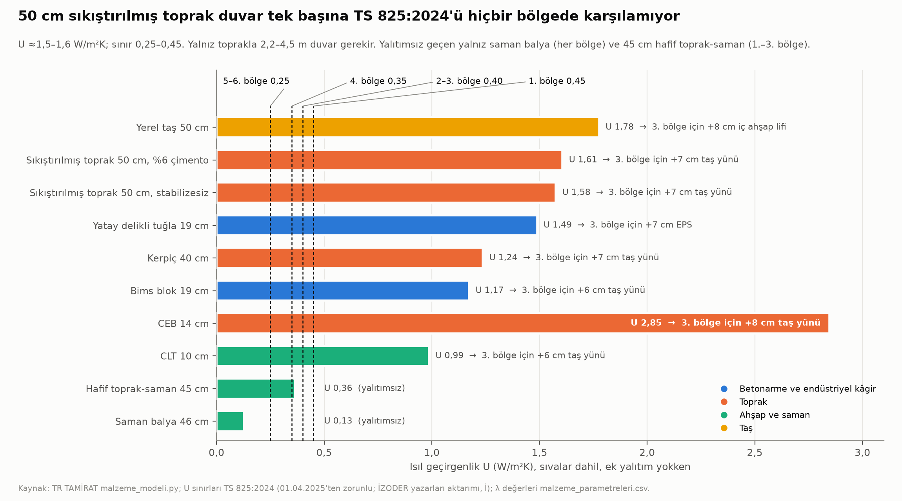
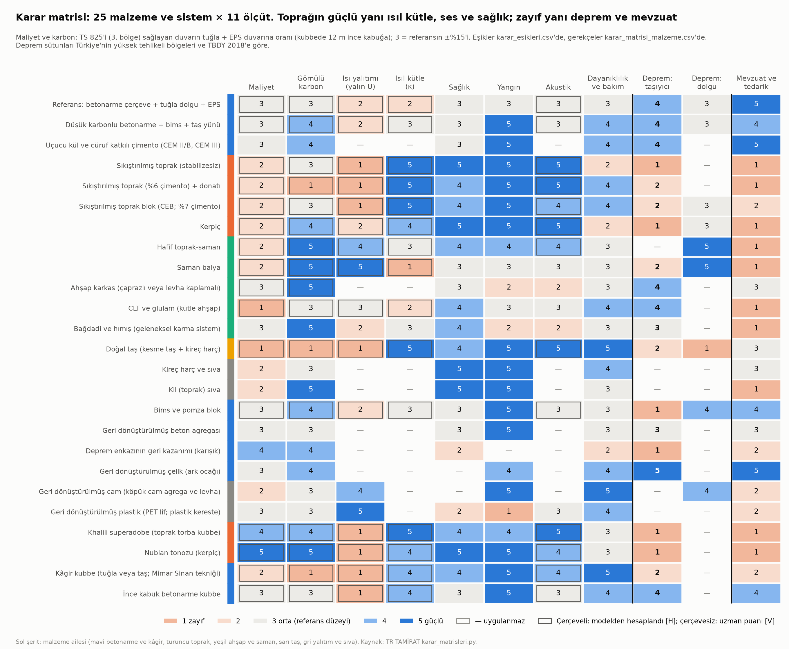
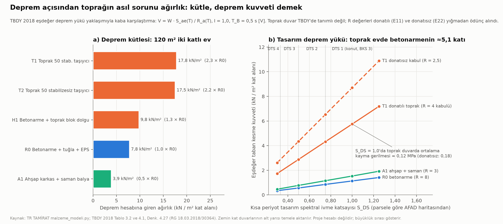
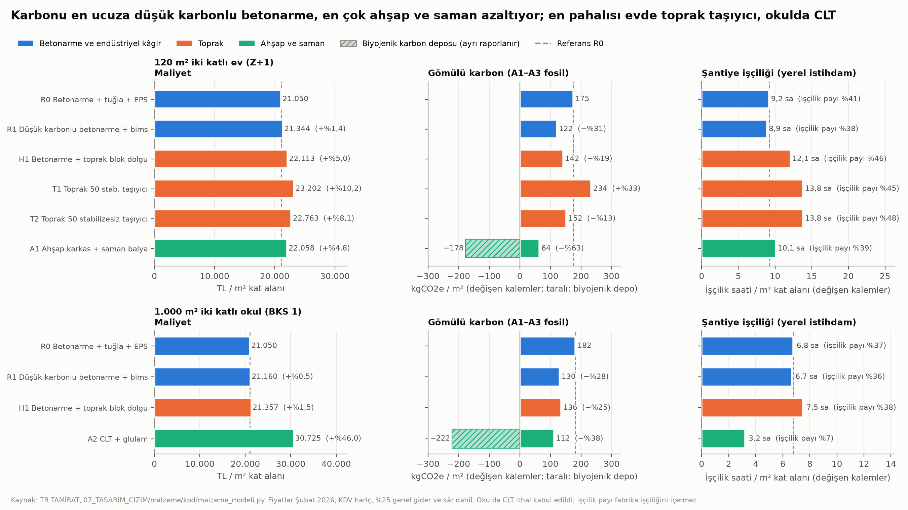
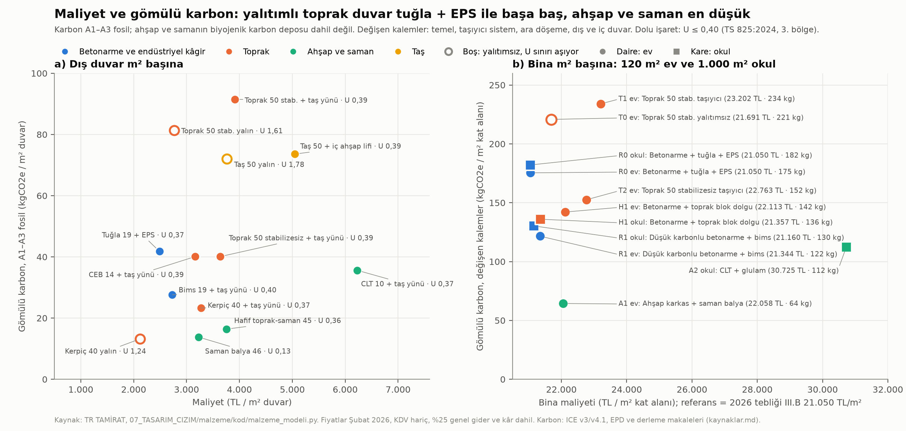
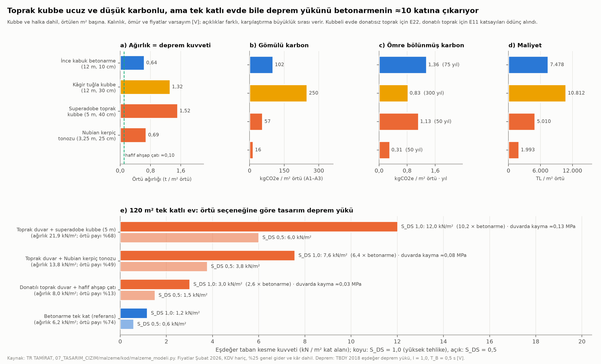
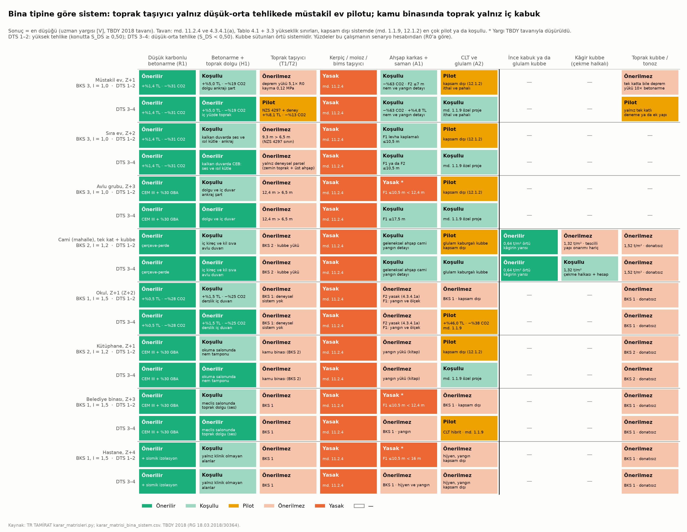

# Faz 4 · Rapor 3 — Doğal ve Geri Dönüştürülmüş Yapı Malzemeleri: Maliyet, Çevre, Sağlık ve Deprem

*27 Ekim 2026 · Sürüm 1.0*

| Ne | Nerede |
|---|---|
| Tek komut (bütün zincir) | [07_TASARIM_CIZIM/malzeme/kod/hepsini_calistir.py](../07_TASARIM_CIZIM/malzeme/kod/hepsini_calistir.py) |
| Kod: senaryo hesabı (duvar, bina, enerji, deprem, kubbe, kubbeli ev, enkaz, duyarlılık) | [malzeme_modeli.py](../07_TASARIM_CIZIM/malzeme/kod/malzeme_modeli.py) |
| Kod: karar matrisleri | [karar_matrisleri.py](../07_TASARIM_CIZIM/malzeme/kod/karar_matrisleri.py) |
| Kod: grafikler | [grafikler.py](../07_TASARIM_CIZIM/malzeme/kod/grafikler.py) |
| Varsayım tabloları (girdi) | `genel_varsayimlar.csv` (70 satır), `malzeme_parametreleri.csv` (30 malzeme), `duvar_katmanlari.csv` (13 dış, 6 iç duvar), `bina_geometrisi.csv`, `bina_elemanlari.csv` (11 sistem), `kubbe_sistemleri.csv`, `karar_esikleri.csv`, `karar_girdi_*.csv` (4 dosya) |
| Sonuç tabloları | `sonuc_duvar_sistemleri.csv`, `sonuc_u_bolge.csv`, `sonuc_u_yalniz_malzeme.csv`, `sonuc_bina_senaryolari.csv`, `sonuc_bina_elemanlari.csv`, `sonuc_enerji.csv`, `sonuc_deprem_talebi.csv`, `sonuc_kubbe.csv`, `sonuc_kubbeli_ev.csv`, `sonuc_enkaz.csv`, `sonuc_duyarlilik.csv` |
| Karar matrisleri | [karar_matrisi_malzeme.csv](../07_TASARIM_CIZIM/malzeme/karar_matrisi_malzeme.csv) (25 malzeme × 11 ölçüt) · [karar_matrisi_bina_sistem.csv](../07_TASARIM_CIZIM/malzeme/karar_matrisi_bina_sistem.csv) (8 bina tipi × 9 sistem × 2 deprem sınıfı) · [karar_matrisi_bina_tipi.csv](../07_TASARIM_CIZIM/malzeme/karar_matrisi_bina_tipi.csv) (bina tipi başına gerekçe) · [karar_matrisi_denetim.csv](../07_TASARIM_CIZIM/malzeme/karar_matrisi_denetim.csv) |
| Grafikler (PNG ve SVG) | [maliyet_karbon_dagilim](../07_TASARIM_CIZIM/malzeme/maliyet_karbon_dagilim.png) · [sistem_karsilastirma](../07_TASARIM_CIZIM/malzeme/sistem_karsilastirma.png) · [u_degeri_bolge](../07_TASARIM_CIZIM/malzeme/u_degeri_bolge.png) · [deprem_talebi](../07_TASARIM_CIZIM/malzeme/deprem_talebi.png) · [kubbe_karsilastirma](../07_TASARIM_CIZIM/malzeme/kubbe_karsilastirma.png) · [karar_matrisi](../07_TASARIM_CIZIM/malzeme/karar_matrisi.png) · [karar_matrisi_bina_tipi](../07_TASARIM_CIZIM/malzeme/karar_matrisi_bina_tipi.png) |
| Kaynaklar ve doğrulama notu | [07_TASARIM_CIZIM/malzeme/kaynaklar.md](../07_TASARIM_CIZIM/malzeme/kaynaklar.md) |

İşaretler projedeki gibidir: **[D]** doğrulandı · **[İ]** ikincil · **[DY]** doğrulanmadı · **[V]** bu çalışmanın varsayımı · **[H]** bu çalışmada hesaplandı.

- **Fiyat.** Şubat 2026 düzeyinde, KDV hariç, tebliğdeki gibi %25 genel gider ve kâr dahil. Ekim 2026'ya taşımak için kabaca 1,15 ile çarpılır [V]: referans 21.050 TL/m² ≈ 24.200 TL/m² olur. Oransal karşılaştırmalar değişmez.
- **Karbon.** A1–A3 (üretim aşaması) fosil karbon. Ahşap ve samanın biyojenik karbon deposu ayrıca verilir ve fosil karbondan düşülmez.

**Sürüm 1.0'da neler değişti (0.1 taslağına göre)?**

1. **Karar matrisleri kurallı oldu.** Maliyet, karbon, ısı yalıtımı, ısıl kütle ve ses puanları artık modelden ve açık eşiklerden hesaplanıyor. Önceki elle verilmiş puanlardan 30 hücre değişti (`karar_matrisi_denetim.csv`). "Isıl performans" ikiye ayrıldı: yalın U ve ısıl kütle.
2. **Bina tipi × sistem matrisi eklendi.** 144 hücre. Uzman yargısı TBDY 2018'den kurallı türetilen bir tavanla sınırlanıyor.
3. **Deprem kütlesi düzeltildi.** Zemin kat duvarlarının alt yarısı doğrudan temele aktarılır; taslak bunu deprem kütlesine katıyordu. Toprak evin tasarım deprem yükü betonarmenin 5,6 katından **5,1 katına**, kütlesi 2,5 katından **2,3 katına** indi. Sonuç değişmedi.
4. **TBDY 2018 metni yeniden okundu [D].** İki yeni bulgu:
   - CLT ve glulam yönetmeliğin ahşap bölümünün kapsamında değil (md. 12.1.2).
   - Kütüphane Tablo 3.1'de yok. Taslaktaki "konut gibi BKS 3" yorumu yerine ihtiyatla BKS 2 kabul edildi.
5. **Toprak duvar donatısı TBDY asgarisine çıkarıldı.** Taslak 3 kg/m² kabul ediyordu; donatılı yığmanın asgari oranları (düşey %0,08, yatay %0,05; md. 11.5.7–11.5.8) 50 cm duvarda 5,1 kg/m² istiyor. Toprak evin maliyet farkı +%7,5–9,5'ten **+%8,1–10,2**'ye çıktı.
6. **Yeni senaryo: tek katlı kubbeli toprak ev** (§4.4).
7. **Taslak içi tutarsızlıklar giderildi.**
   - DTS 2'de toprak taşıyıcı: §3.5'te "yok", MZ2'de "özel projeyle var" deniyordu. Artık ilk aşamada yok, deney sonrasına bırakıldı.
   - Mescitte toprak duvar pilotu, BKS 2 ilkesiyle çelişiyordu; kaldırıldı.
   - Yalıtımsız toprak evin 50 yıllık fazla CO2'si: ≈100 t değil ≈102 t.
   - Düşük karbonlu betonarmenin karbon kazancı: %25–32 değil %20–32.

---

## Özet

**Soru:** Sıkıştırılmış toprak (50 cm duvarlı evler), toprak kubbeli evler, kamu binaları ve doğal ya da geri dönüştürülmüş malzemeler maliyet, çevre ve sağlık açısından nasıl? Türkiye'de uygulanabilir mi?

**Kısa cevap:**

- Toprak, Türkiye'de **taşıyıcı olarak dar bir alanda**, **iç duvar, dolgu ve sıva olarak geniş bir alanda** kullanılabilir.
- Toprak kubbe, konut ve kamu binasında **önerilmez**.
- En büyük ve en ucuz karbon kazancı toprakta değil, **çimentoda ve ahşapta**.

1. **Bugünkü mevzuat toprak taşıyıcı duvara izin vermiyor.**
   - TBDY 2018 md. 11.2.4 kerpici, moloz taşı, ponzayı ve dolgu tuğlasını "hiçbir zaman taşıyıcı duvar malzemesi olarak" kabul etmiyor [D].
   - Sıkıştırılmış toprak ve sıkıştırılmış toprak blok (CEB) yönetmeliğin kapsamında hiç yok. Tek yol md. 1.1.9: kapsam dışı yapılar için "uluslararası geçerliliği kabul edilen eşdeğer" standart [D].
   - Okul, hastane ve belediye binası BKS 1 (I = 1,5). Bu sınıfta süneklik düzeyi sınırlı sistemler, yani donatısız ve kuşatılmış yığma ile çaprazlı ahşap yasak (md. 4.3.4.1a) [D].
2. **Asıl deprem sorunu ağırlık.**
   - 120 m² iki katlı evde 50 cm toprak duvarlı sistemin deprem hesabına giren ağırlığı **17,8 kN/m²**. Betonarme referansta 7,8, ahşap ve samanda 3,9 kN/m² [H].
   - Kütle 2,3 kat, süneklik düşük. Bu yüzden tasarım deprem kuvveti betonarmenin **≈5,1 katı**, donatısız kabulle **≈7,7 katı** [H].
   - Yeni Zelanda'nın donatılı toprak standardı da bu yüzden duvarı 6,5 m ile, proje gerektirmeyen evi tek kat ve hafif çatıyla sınırlıyor [İ].
3. **Toprak kubbe deprem yükünü en çok artıran seçenek.**
   - 120 m² tek katlı evde superadobe kubbeler toplam ağırlığın %68'i. Tasarım deprem yükü tek katlı betonarme evin **≈10 katı** [H].
   - Donatılı toprak duvar ve hafif ahşap çatıyla yük 2,6 kat; duvarda ortalama kayma gerilmesi 0,03 MPa [H]. Toprak evin en az riskli biçimi **tek katlı, hafif çatılı, donatılı** ev; bu da deneyle doğrulanmadan güvenli sayılamaz.
4. **50 cm toprak duvar tek başına TS 825:2024'ü hiçbir bölgede karşılamıyor.**
   - U ≈ **1,5–1,6 W/m²K**; sınır 0,25–0,45 [H; sınırlar İ].
   - Yalnız toprakla sınırı tutturmak için 2,2–4,5 m duvar gerekir [H]. Bölgeye göre 6–13 cm taş yünü şart.
   - Yalıtımsız toprak evin dış duvarları 50 yılda referanstan **≈102 t** (3. bölge) ile 149 t (4. bölge) fazla CO2 yayar. Yalıtımın kendi karbonu 1,6 t [H].
5. **Toprak her zaman düşük karbonlu değil.**
   - Yalıtımlı 50 cm stabilizesiz toprak duvar 40,1 kgCO2e/m², tuğla + EPS 41,8: **başa baş** [H].
   - %6 çimentolu toprak duvar **91,5 kgCO2e/m²**: tuğla + EPS'nin **2,2 katı** [H].
   - Bina ölçeğinde çimentolu toprak ev **%33 daha fazla**, stabilizesiz toprak ev **%13 daha az** karbonlu [H].
6. **En büyük kazanç tanıdık yöntemde.**
   - Cüruflu çimento (CEM III) ve %30 geri dönüştürülmüş agregalı beton + bims + taş yünü:
     - evde **−%31 karbon, +%1,4 maliyet**,
     - okulda **−%28 karbon, +%0,5 maliyet** [H].
   - Ahşap karkas + saman balya evde **−%63 karbon** sağlıyor (biyojenik depo hariç). Maliyeti +%4,8, ağırlığı betonarmenin yarısı [H].
7. **Toprağın güçlü yanları sağlık, ses ve yerel emek.**
   - İç yüze bağlı ısı kapasitesi tuğla + EPS'de 78, toprak duvarda **200–205 kJ/m²K**. Yaz konforu için en önemli ölçü bu [H].
   - Ses yalıtımı (kütle kuralı) 43 dB yerine **64 dB** [H; yöntem DY].
   - Kil sıva nem tamponunda "iyi–mükemmel" sınıfında; VOC salmaz [DY].
   - Toprak ev aynı bina için **%50 daha fazla şantiye işçiliği** istiyor: 1.000 evde ≈310 kişi-yıl ek iş [H].
8. **Maliyet.**
   - Toprak taşıyıcı ev Türkiye fiyatlarıyla referanstan **%8,1–10,2 pahalı**. Öz-yapım ya da imeceyle fark %3–5'e iner [H].
   - Duvar m² başına toprak, saman ve CEB referanstan %27–57 pahalı. Malzeme bedava, emek değil [H].
   - CLT'li okul ithal malzemeyle **%46 pahalı**. CLT fiyatı ±%30 değişse de %27,5–64 pahalı kalıyor [H].
9. **Kubbe.**
   - 12 m'lik ince kabuk betonarme kubbe, kâgir tuğla kubbenin **yarı ağırlığında** (0,64'e karşı 1,32 t/m²) ve **%31 ucuz** [H].
   - Kâgir kubbe uzun ömrüyle yıllık karbonda öne geçiyor: 0,83'e karşı 1,36 kgCO2e/m²·yıl (300 ve 75 yıl ömür [V]).
   - Superadobe ve Nubian tonozu ucuz ve düşük karbonlu, ama ağır ve donatısız.
10. **6 Şubat enkazı.**
    - ≈200 Mt enkazın yalnız **%2,6**'sı yeniden yapımın yapısal betonuna girebilir [H].
    - Hatay ölçekli tek tesisle işlemek **167 yıl** sürer. Beş yılda bitirmek ≈33 tesis eşdeğeri kapasite ister [H].
    - Enkazın asıl kullanım yeri yol, dolgu ve blok üretimi. Asbest taraması bütün zincirin ön şartı.

**Bina tipine göre tek cümlelik öneri** (ayrıntı: §5):

| Bina tipi | Öneri |
|---|---|
| Müstakil ev (Z+1) | Her yerde düşük karbonlu betonarme ya da ahşap + saman. Düşük ve orta tehlikeli bölgede (DTS 3–4) donatılı toprak taşıyıcı yalnız **pilot**; önce tek katlı ve hafif çatılı |
| Sıra ev (Z+2) ve avlu grubu (Z+3) | Toprak yalnız dolgu, kalkan duvar, iç duvar ve sıva olarak |
| Cami | Düşük karbonlu betonarme + ince kabuk ya da glulam kubbe; kâgir kubbe yalnız düşük-orta tehlikede, çekme halkası ve hesapla |
| Okul, belediye binası, hastane | Taşıyıcı toprak yok. Düşük karbonlu betonarme; içte toprak duvar ve kil sıva (hastanede yalnız klinik olmayan alanlar) |
| Kütüphane | Nem tamponu için toprak iç duvar ve kil sıvanın en çok işe yaradığı bina |

---

## 1. Malzemeler ve sistemler

### 1.1 Duvar ve taşıyıcı sistemler

Sayılar `sonuc_duvar_sistemleri.csv`'den. Yalıtımlı duvarlarda kalınlık U ≤ 0,40 (TS 825:2024, 3. bölge) sağlanacak biçimde seçildi [H].

| Malzeme / sistem | Ne | Türkiye'de durum | Güçlü yanı (sayıyla) | Zayıf yanı (sayıyla) |
|---|---|---|---|---|
| **Referans:** betonarme çerçeve + yatay delikli tuğla 19 cm + 7 cm EPS | Bugünkü konut | Yaygın; tebliğ III.B 21.050 TL/m² [D] | Duvar 2.487 TL/m², en ucuz yalıtımlı duvar | 41,8 kgCO2e/m² duvar; EPS yangında E sınıfı [DY]; ısı kapasitesi 78 kJ/m²K |
| **Sıkıştırılmış toprak, stabilizesiz** (rammed earth) | Kalıp içinde katman katman sıkıştırılmış nemli toprak | Çağdaş uygulama yok denecek kadar az; standart yok | 0,024 kgCO2e/kg [İ]; 64 dB; ömür sonunda toprağa döner | U 1,58 (50 cm); yalıtımla 40,1 kgCO2e/m², tuğla + EPS ile başa baş; suya karşı korunmalı; 1 t/m² |
| **Sıkıştırılmış toprak, %6 çimento** | Çimentoyla dayanımı ve su direnci artırılmış toprak | Aynı | Dayanım ve dayanıklılık | 91,5 kgCO2e/m² duvar (yalıtımlı); karbonun çoğu çimentodan |
| **CEB** (sıkıştırılmış toprak blok) | Preste sıkıştırılmış, %5–8 çimentolu blok | TS EN 771 birim listesinde yok | 14 cm dolguda ısı kapasitesi 185 kJ/m²K | 3.164 TL/m² (yalıtımlı); tuğladan ağır (266 kg/m²) |
| **Kerpiç** | Güneşte kurutulmuş, saman katkılı blok | Geleneksel stokta yaygın; TBDY taşıyıcı olarak yasaklıyor [D] | Yalıtımla 23,3 kgCO2e/m² (40 cm + 7 cm taş yünü); yalın 2.121 TL/m² | U 1,24 (yalın); deprem; TS 2514/2515 (1977) eski [DY] |
| **Hafif toprak-saman** (leichtlehm) | Kil bulamacıyla kaplanmış saman, ahşap karkas içinde | Neredeyse yok | 45 cm'de U 0,36 (yalıtımsız); 16 kgCO2e/m²; −77 kgCO2/m² biyojenik | 8,2 sa/m² işçilik; ıslak yerleştirme, uzun kuruma |
| **Saman balya** | Buğday sapı balyası, ahşap karkas içinde | Hammadde bol; uygulama yok | U 0,13 (her bölge); 14 kgCO2e/m²; −93 biyojenik | Nem ≤%20 [DY]; yangın sigortası; kemirgen; ısıl kütle düşük (43 kJ/m²K) |
| **Ahşap karkas** (çaprazlı ya da levha kaplamalı) | Hafif ahşap iskelet | TBDY Bölüm 12 kapsamında: yalnız kaplamalı panel (F1) ve çaprazlı panel (F2) [D] | Hafif (evde 3,9 kN/m²) ve sünek | Yangın, böcek, nem; OSB'de formaldehit sınıfı |
| **CLT ve glulam** | Fabrikada üretilen kütle ahşap | TBDY Bölüm 12 kapsamı dışında (md. 12.1.2) [D]. Üretim yapan yerli tesis doğrulanamadı; Kastamonu ve Yozgat için 2021 ön fizibilite raporları var [İ] | Okulda −%38 karbon, −222 kgCO2/m² biyojenik | Okulda +%46 maliyet; işçilik payı %7 (yerel emek az) |
| **Bağdadi ve hımış** | Ahşap iskelet + tuğla, kerpiç ya da taş dolgu; bağdadide çıta-sıva | Tescilli ve geleneksel stokta | Hafif dolgulu ahşap iskelet; düşük karbon | TBDY tanımlamıyor; tescilli yapılar kapsam dışı (md. 1.1.8) [D]; sayısal deprem kanıtı sınırlı [DY] |
| **Taş** (kesme taş + kireç harç) | Yerel kireçtaşı | Moloz taş taşıyıcı olarak yasak [D]; kesme taş donatısız yığmada sınırlı | 66 dB; yanmaz; çok dayanıklı | U 1,78 (50 cm); 72–74 kgCO2e/m²; 1,1 t/m² |
| **Kireç harç ve sıva** | Söndürülmüş ya da hidrolik kireç | TS EN 459-1, TS EN 998-1 [İ] | Buhar geçirgen, alkali | Saf kireç harcı TBDY'nin ≥5 MPa harç şartını (md. 11.2.6) genellikle karşılamaz [V] |
| **Bims ve pomza** | Volkanik hafif agregalı blok | Nevşehir'de yaygın; taşıyıcı olarak yasak [D] | Bims 19 + taş yünü 27,6 kgCO2e/m²: U sınırını karşılayan mineral duvarların en düşüğü | Doğal radyoaktivite ölçülmeli [DY] |
| **Geri dönüştürülmüş beton agregası** | Kırılmış beton | TS 706 EN 12620 kapsamında [İ] | Ocak ve depolama alanı kazancı | Karbon etkisi küçük (betonun %1–2'si) [H] |
| **2023 enkazı** | Karışık yıkıntı | ≈200 Mt [İ]; iki UNDP tesisi | Yol, dolgu, blok için büyük stok | Asbest [İ]; kalite değişken |
| **Geri dönüştürülmüş çelik** | Hurdadan ark ocağında üretim | Ham çeliğin %72,2'si [İ] | ≈0,45 kgCO2e/kg (dünya ortalaması 1,99) [İ/DY] | Kalan iş: EPD ve hurda kalitesi |
| **Geri dönüştürülmüş cam ve plastik** | Köpük cam agrega; rPET lif, plastik kereste | Sınırlı | Köpük cam çürümez, yanmaz | Plastik yanıcı, mikroplastik; taşıyıcı ve iç mekân için değil |
| **Uçucu kül ve cüruf katkılı çimento** (CEM II/B, CEM III) | Klinkerin bir kısmının yerine sanayi yan ürünü | TS EN 197-1 kapsamında; yeşil çimento tebliği [İ] | Beton 0,13 → 0,085 kgCO2e/kg [İ/DY] | Erken dayanım düşük; kür süresi |

### 1.2 Kubbe ve tonoz sistemleri

| Sistem | Açıklık | Kütle (t/m² örtü) | Karbon (kgCO2e/m²) | Maliyet (TL/m²) | Kabuk U (W/m²K) | Not |
|---|---|---|---|---|---|---|
| İnce kabuk betonarme kubbe (10 cm) | 12 m | **0,64** | 102 | 7.478 | 5,5 | Hafif ve sünek; çift eğrilikli kalıp pahalı |
| Kâgir tuğla kubbe (30 cm, kireç harç; Mimar Sinan tekniği) | 12 m | 1,32 | 250 | 10.812 | 1,8 | Çekme halkası ve payanda şart; uzun ömür |
| Khalili superadobe (40 cm, stabilizesiz) | 5 m | **1,52** | 57 | 5.010 | 1,7 | En ağır; TBDY kapsamı dışında |
| Nubian tonozu (kerpiç, 25 cm, kalıpsız) | 3,25 m | 0,69 | **16** | **1.993** | 1,9 | Sahel'in kuru ve düşük deprem tehlikeli iklimi için |

Bütün sayılar [H], kalınlık ve fiyatlar [V] (`kubbe_sistemleri.csv`). Kubbe ve halka dahil, örtülen alan başına. Karşılaştırma için hafif ahşap çatı ≈0,10 t/m² [V].

- **Hiçbir kubbe kabuğu tek başına yalıtmaz.** U 1,7–5,5 W/m²K; çatı sınırı bunun çok altında. Kubbe de ayrıca yalıtılmalı.
- **Türkiye'deki örnek.** Harran'ın (Şanlıurfa) konik kerpiç kubbeli evleri kurak iklimin geleneksel çözümü [DY]. Yöre görece düşük tehlikeli; örnek, yüksek tehlikeli bölgelere taşınamaz.

---

## 2. Ölçütler

### 2.1 Maliyet

**Yöntem.**

- **Bina maliyeti.** Resmî tebliğin III.B birim maliyetiyle (21.050 TL/m²) başlar [D].
- **Değişen kalemler.** Temel, taşıyıcı sistem, ara döşeme, dış ve iç duvar her sistem için malzeme ve işçilikten ayrı ayrı hesaplanır. Referanstaki değişen kalemler çıkarılır, alternatifinki eklenir [H].
- **Sabit kalan kalemler.** Çatı, doğrama, tesisat ve bitişler bütün sistemlerde aynıdır.
- **Kalibrasyon.** Beton ve donatı fiyatları ÇŞİDB Şubat 2026 pozlarına, tuğla ve mantolama Eylül 2026 pozlarına kalibre edildi. Eylül pozları Şubat'a 1,15 ile indirildi [İ/H].
- **İşçilik ücretleri.** Usta 310, düz işçi 205 TL/saat (ÇŞİDB Şubat 2026 rayiçleri) [İ].

**Duvar m² başına:**

| Duvar (3. bölgeye göre yalıtımlı) | TL/m² | Referansa oran | İşçilik sa/m² | İşçilik payı |
|---|---|---|---|---|
| Tuğla 19 + 7 cm EPS (referans) | **2.487** | 1,00 | 3,2 | %42 |
| Bims 19 + 6 cm taş yünü | 2.729 | 1,10 | 3,0 | %36 |
| CEB 14 + 8 cm taş yünü + iç kil sıva | 3.164 | 1,27 | 4,8 | %48 |
| Saman balya 46 (yalıtımsız yeterli) | 3.225 | 1,30 | 4,4 | %43 |
| Kerpiç 40 + 7 cm taş yünü + iç kil sıva | 3.272 | 1,32 | 5,8 | %55 |
| Toprak 50 stabilizesiz + 7 cm taş yünü | 3.639 | 1,46 | 6,2 | %52 |
| Hafif toprak-saman 45 (yalıtımsız yeterli) | 3.758 | 1,51 | 8,2 | %67 |
| Toprak 50 %6 çimento + 7 cm taş yünü | 3.916 | 1,57 | 6,2 | %48 |
| Taş 50 + 8 cm iç ahşap lifi | 5.050 | 2,03 | 8,0 | %51 |
| CLT 10 + 6 cm taş yünü | 6.229 | 2,50 | 1,7 | %9 |
| *Yalıtımsız (TS 825'i karşılamaz):* kerpiç 40 · toprak 50 %6 çimento · taş 50 | 2.121 · 2.765 · 3.763 | 0,85 · 1,11 · 1,51 | 5,6 · 6,0 · 8,0 | %81 · %66 · %69 |

**Bina m² başına:** bkz. §4. Kısaca:

- **120 m² ev.** Toprak taşıyıcı sistemler %8,1–10,2, hibrit toprak dolgu %5,0, ahşap + saman %4,8, düşük karbonlu betonarme %1,4 pahalı.
- **Okul.** CLT %46 pahalı, diğerleri %0,5–1,5 pahalı.
- Duvar farkı binada küçülüyor, çünkü duvar bina maliyetinin küçük bir parçası.

**Neden toprak Türkiye'de pahalı?**

- **Malzeme bedava, emek değil.** 50 cm duvar m² başına 5 saat sıkıştırma işçiliği istiyor (10 sa/m³ [V]). Tuğla duvar 1,4 saat istiyor.
- **Ücretler düşük ama betonarme zincir çok verimli.** Türkiye'deki ücret düzeyi ve verimli betonarme zinciri, emek yoğun yöntemi cezalandırıyor.
- **Avrupa'da da durum benzer.** Sıkıştırılmış toprak duvar orada da "pahalı" yapı tekniği: €250–600/m² [DY].

**Yerel istihdam.**

- **Ev.** Toprak taşıyıcı ev, değişen kalemlerde **13,8 sa/m²** işçilik istiyor; referans 9,2 sa/m². 1.000 evde 922 kişi-yıl iş demek; referansta 613 [H].
- **Yerelde kalan para.** İşçilik ve yerel toprak yerelde kalır. Çimento, çelik ve EPS ise sanayiye gider.
- **CLT tersini yapıyor.** Okulda şantiye işçiliği payı %7. Para fabrikaya, büyük olasılıkla yurt dışına gider.

### 2.2 Çevre: gömülü karbon, kaynak, ömür sonu

**Duvar m² başına (A1–A3 fosil):**

| Duvar | kgCO2e/m² | Referansa oran | Biyojenik depo (kgCO2/m²) | Kütle (kg/m²) |
|---|---|---|---|---|
| Saman balya 46 | **13,8** | 0,33 | −92,8 | 148 |
| Kerpiç 40 (yalıtımsız) | 13,2 | 0,32 | −19,2 | 723 |
| Hafif toprak-saman 45 | 16,4 | 0,39 | −77,0 | 367 |
| Kerpiç 40 + taş yünü | 23,3 | 0,56 | −19,2 | 706 |
| Bims 19 + taş yünü | 27,6 | 0,66 | 0 | 198 |
| CLT 10 + taş yünü | 35,6 | 0,85 | −76,8 | 70 |
| CEB 14 + taş yünü | 40,1 | 0,96 | 0 | 333 |
| Toprak 50 stabilizesiz + taş yünü | 40,1 | 0,96 | 0 | 1.023 |
| Tuğla 19 + EPS (referans) | 41,8 | 1,00 | 0 | 183 |
| Taş 50 (yalıtımsız) | 72,0 | 1,72 | 0 | 1.140 |
| Toprak 50 %6 çimento + taş yünü | **91,5** | 2,19 | 0 | 1.048 |

**Üç ders.**

1. **Çimento toprağın karbon avantajını siler.**
   - 50 cm duvarda %6 çimento m² başına ≈62 kg çimento demek. Bu ≈52 kgCO2e eder; 19 cm tuğla duvarın tamamı ≈29 kgCO2e [H].
   - Toprak duvarı "yeşil" yapan şey toprak değil, **stabilizatörün azlığı**.
   - Literatür %5–10 çimentolu toprak için 0,04–0,05 kgCO2e/kg veriyor [İ]. Bu çalışmanın hesabı (Türkiye çimentosu 0,85 ile) 0,074 [H]. Çimento payı %4'e inerse evdeki fark +%33'ten +%18'e düşüyor (§4.5).
2. **Kalınlık karbonu çoğaltır.** Taş 0,06 kgCO2e/kg ile çok düşük faktörlü [DY]. Ama 50 cm taş duvar 1,1 t/m² olduğu için 72 kgCO2e/m² taşıyor.
3. **Biyojenik malzemeler hem düşük fosil karbonlu hem karbon deposu.** Bu depo ancak ahşap ve saman uzun süre bina içinde kalır ve ömür sonunda yakılmazsa kalıcıdır. Bu yüzden ayrı raporlandı.

**Bina ölçeğinde kaynak ve ömür sonu (120 m² ev, kütle payı) [H; kategoriler V]:**

| Sistem | Kütle t/m² | Toprağa dönebilir | Yeniden kullanılır (taş) | Geri dönüşür (çelik) | Aşağı dönüşür (kırma dolgu) | Biyolojik | Depolama |
|---|---|---|---|---|---|---|---|
| R0 referans | 1,02 | %0 | %0 | %3 | %90 | %0 | %7 |
| T1 toprak %6 çimento | 2,58 | %0 | %6 | %1 | %92 | %0 | %1 |
| **T2 toprak stabilizesiz** | 2,54 | **%62** | %6 | %1 | %29 | %0 | %1 |
| A1 ahşap + saman | 0,64 | %17 | %18 | %1 | %46 | %18 | %1 |

Çimentosuz toprak, ömür sonunda bahçe toprağına dönebilen tek yapı malzemesi. Çimento eklenince bu özellik kaybolur.

### 2.3 Sağlık

| Konu | Toprak ve kil sıva | Referans (beton, tuğla, alçı, EPS) | Kanıt |
|---|---|---|---|
| **Nem tamponu** (MBV, g/m²·%RH) | Kil sıva ≈1,0–2,5: "iyi–mükemmel" | Alçı ≈0,6–1,0; çimento ≈0,3–0,5 | DY (NORDTEST sınıfları; McGregor vd. 2014) |
| **VOC** | Katkısız toprak ve kireç VOC salmaz | EPS'de eski HBCD alev geciktiricisi 2013'ten beri yasak [İ]; OSB ve yonga levhada formaldehit (AB sınırı Ağustos 2026'dan sonra 0,062 mg/m³ [DY]) | İ/DY |
| **Radon** | Toprak, yerel toprağın radyumuna bağlı. Salım beton düzeyinde (≈0,1–3 Bq/m²h) [DY]. Kil sıvadan toron salımı bildirilmiş [İ] | Beton ve pomza da kaynak olabilir | WHO başvuru düzeyi 100 Bq/m³ [D]; Türkiye ortalaması ≈81 Bq/m³ [DY] |
| **Küf** | Toprak kuru kalırsa küfe dayanıklı ve alkali kireçle korunur. Saman ve hafif toprak-saman ıslanırsa risk yüksek (balya nemi ≤%20 [DY]) | Yoğuşan soğuk köprü yüzeyleri | DY |
| **Isıl kütle ve yaz konforu** | İç yüze bağlı ısı kapasitesi: toprak 50 cm 200–205, CEB + kil sıva 185, kerpiç 162 kJ/m²K | Tuğla + EPS 78, bims 88, CLT 64, saman 43, taş + iç yalıtım 43 kJ/m²K | H (EN ISO 13786 basitleştirmesi) |

**Yorum.**

- **Toprağın en güçlü sağlık yanı iç yüzeyde.** Bağıl nemi dengeler, VOC salmaz, kütlesiyle yaz sıcağını geciktirir. 35 cm toprak duvarda ısı yaklaşık 12 saatte geçer [İ].
- **Bunun için taşıyıcı olmak gerekmez.** Betonarme çerçevede iç yüze CEB ya da kil sıva aynı faydanın çoğunu verir (H1: 185 kJ/m²K).
- **İçten yalıtım ısıl kütleyi öldürür.** Taş ev içten yalıtılınca ısı kapasitesi 205'ten 43'e düşer. Geleneksel taş evlerin onarımında dikkat edilmeli.
- **Ölçüm.** Türkiye'de toprak evlerde ölçülmüş yaz konforu çalışması bu çalışmada bulunamadı [DY]. Pilotta ölçülmeli.

### 2.4 Enerji performansı: 50 cm toprak duvar TS 825'i karşılar mı?

**Hayır.**

- **U değeri.** 50 cm sıkıştırılmış toprağın λ'sı 1,1–1,2 W/mK [DY]. İki yüz sıvayla U = **1,45** (stabilizesiz) ve **1,53** (%6 çimento) W/m²K. Mineral sıvalı yalın duvarda 1,58–1,61 [H].
- **Sınır.** TS 825:2024 dış duvar sınırı 0,25–0,45 W/m²K. 01.04.2025'ten beri zorunlu [İ].



**Yalnız malzemeyle sınırı tutturmak için gereken duvar kalınlığı (iki yüz 2,5 cm sıva dahil) [H]:**

| Malzeme (λ) | 1. bölge (0,45) | 2–3. bölge (0,40) | 4. bölge (0,35) | 5–6. bölge (0,25) | 50 cm'de U |
|---|---|---|---|---|---|
| Sıkıştırılmış toprak, stabilizesiz (1,1) | 2,18 m | 2,49 m | 2,88 m | 4,14 m | 1,45 |
| Sıkıştırılmış toprak, %6 çimento (1,2) | 2,38 m | 2,72 m | 3,14 m | 4,52 m | 1,53 |
| Kerpiç (0,7) | 1,39 m | 1,58 m | 1,83 m | 2,63 m | 1,05 |
| Yerel taş (1,4) | 2,78 m | 3,17 m | 3,67 m | 5,27 m | 1,68 |
| Hafif toprak-saman (0,18) | 36 cm | 41 cm | 47 cm | 68 cm | 0,33 |
| Saman balya (0,06) | 12 cm | 14 cm | 16 cm | 23 cm | 0,12 |

**50 cm toprak duvara gereken taş yünü** (λ 0,036): 1. bölgede 6, 2. ve 3. bölgede 7, 4. bölgede 9, 5. ve 6. bölgede **13 cm** [H].

**Yalıtımın değeri (120 m² ev, 158 m² opak dış duvar) [H]:**

| | Duvar U | Duvardan ısı kaybı (kWh/yıl) 3. / 4. bölge | 50 yılda işletme CO2 (t) 3. / 4. bölge | Gömülü karbon, değişen kalemler (t) |
|---|---|---|---|---|
| R0 referans | 0,37 | 2.829 / 4.102 | 31 / 45 | 21,1 |
| T1 toprak + taş yünü | 0,39 | 2.981 / 4.322 | 33 / 47 | 28,1 |
| **T0 toprak, yalıtımsız** | **1,61** | **12.157 / 17.627** | **134 / 194** | 26,5 |
| A1 ahşap + saman | 0,13 | 961 / 1.393 | 11 / 15 | 7,7 |

- **Karbon dengesi.** Yalıtım 1,6 t gömülü karbon ekliyor ve 50 yılda **≈101 t** (3. bölge) işletme CO2'sini önlüyor; oran ≈60 kat. Yalıtımsız toprak ev referanstan 102 t (3. bölge) ve 149 t (4. bölge) fazla yayar.
- **Maliyet dengesi.** Yalıtımın maliyeti ≈181 bin TL. Yakıt tasarrufu yılda ≈10.000 TL (3. bölge) ile 14.500 TL (4. bölge). Basit geri ödeme 12–18 yıl (yakıt 1 TL/kWh [V]).
- **Kuralın sınırı.** TS 825 yalnız U'ya bakar; ısıl kütlenin kazancını saymaz. Kütle, büyük gece-gündüz farkı olan İç Anadolu yazında gerçek bir fayda sağlar. Ama kışın yalıtımın yerini tutmaz.

### 2.5 Yangın, akustik, dayanıklılık, bakım

| Konu | Toprak ve taş | Ahşap ve saman | Referans |
|---|---|---|---|
| **Yangın** | Katkısız toprak yanmaz (DIN 4102 "yanmaz" [İ]; Euroclass A1 [DY]). Hafif toprak-saman B1/B2 [İ] | Sıvalı saman duvar F30–F90 (Almanya, Avusturya deneyleri) [İ]; balya E sınıfı. CLT 0,65–0,7 mm/dk kömürleşir [DY] | EPS E sınıfı [DY]; taş yünü yanmaz |
| **Akustik** (kütle kuralı R'w = 28·log m' − 20) | Toprak 50: 64–65 dB; kerpiç 40: 60 dB; taş 50: 66 dB; CEB 14: 51 dB | Çok katmanlı: ölçüm gerekir | Tuğla + EPS: 43 dB (EPS rezonansla düşürebilir) |
| **Dayanıklılık** | Toprak "iyi çizme ve iyi şapka" ister: ≥30–50 cm subasman ve geniş saçak. Korunmazsa yağmurla aşınır. Taş çok dayanıklı | Nem, böcek, UV; bakım sıklığı yüksek | Betonarmede donatı korozyonu ve 2023'te açıkça görülen uygulama kalitesi |
| **Bakım** | Kil sıva onarımı kolay ve ucuz; kireç sıvanın periyodik badanası | Saman ve hafif toprak-saman: sızıntı hemen onarılmalı | Mantolama 25–30 yılda yenilenir [DY] |

Akustik değerler [H] (yöntem DY).

### 2.6 Karar matrisi: malzeme × ölçüt



**Nasıl puanlandı?** Her ölçütte 5 en iyi, 1 en zayıf.

- **Modelden hesaplanan beş ölçüt [H].** Eşikler `karar_esikleri.csv`'de.
  - **Maliyet ve karbon.** TS 825'i (3. bölge) sağlayan duvarın tuğla + EPS duvarına oranı. Kubbede 12 m ince kabuğa oran. 3 = referansın ±%15'i; 4 = %15–50 iyi; 5 = yarısından iyi; 2 = %15–60 kötü; 1 = %60'tan kötü.
  - **Isı yalıtımı.** Yalın duvarın U değeri: 5 ≤0,25; 4 ≤0,45; 3 ≤1,0; 2 ≤1,5; 1 >1,5 W/m²K.
  - **Isıl kütle.** İç yüze bağlı ısı kapasitesi: 5 ≥180; 4 ≥120; 3 ≥80; 2 ≥50 kJ/m²K.
  - **Ses.** Kütle kuralı: 5 ≥58; 4 ≥50; 3 ≥43; 2 ≥38 dB.
- **Uzman puanı olan altı ölçüt [V].** Sağlık, yangın, dayanıklılık, deprem (taşıyıcı ve dolgu), mevzuat ve tedarik. Gerekçeleri `karar_matrisi_malzeme.csv`'de, satır satır.
- **Modelde karşılığı olmayan malzemeler** (çimento, agrega, enkaz, çelik, cam, plastik, sıvalar, hımış): bütün puanlar uzman puanı.

**Matristen beş okuma.**

1. **Toprak iki uçlu bir malzeme.** Isıl kütle 4–5, ses 4–5, yangın 5, sağlık 4–5. Ama ısı yalıtımı 1–2, deprem taşıyıcı 1–2, mevzuat 1–2, yalıtımlı duvarda maliyet 2.
2. **Stabilizesiz toprak karbonda "orta" (3), çimentolu toprak "zayıf" (1).** Yalıtımlı duvarda referansa oran 0,96 ve 2,19.
3. **Saman ve hafif toprak-saman karbonda ve yalıtımda en iyi, ısıl kütlede zayıf.** Saman: karbon 5, yalıtım 5, ısıl kütle 1. İç yüzde kalın kil sıva bu açığı kapatır.
4. **Düşük karbonlu betonarmenin tek zayıf yanı yalın duvarın U değeri** (2); taş yünü bunu kapatıyor. Maliyet 3, karbon 4, yangın 5, deprem 4, mevzuat 4.
5. **Toprak kubbeler maliyette ve karbonda en iyi, depremde en zayıf.** Superadobe ve Nubian tonozu: maliyet 4–5, karbon 4–5, deprem taşıyıcı 1, mevzuat 1.

**Taslağa göre değişen puanlar** (`karar_matrisi_denetim.csv`, 30 hücre). Önemlileri:

- Stabilizesiz toprak karbonda 4'ten 3'e. Yalıtımla tuğla + EPS ile başa baş.
- Çimentolu toprak karbonda 2'den 1'e.
- Taş karbonda 3'ten 1'e, maliyette 2'den 1'e. TS 825'i sağlayan taş duvar referansın 1,8 katı karbonlu, 2 katı pahalı.
- CLT karbonda 4'ten 3'e (duvar ölçeğinde oran 0,85; bina ölçeğinde −%38).
- Kubbelerin ısı yalıtımı 1'e indi: hiçbir kabuk tek başına yalıtmıyor.
- Referans ve düşük karbonlu betonarmede değişikliklerin çoğu ölçek değişikliğinden. Referans artık maliyette ve karbonda 3 ("orta").

---

## 3. Deprem

### 3.1 TBDY 2018 ne diyor?

Maddeler Resmî Gazete ek metninden okundu [D]. Tablo 3.1, 3.2, 3.3 ve 4.1 ile md. 1.1.8, 1.1.9, 4.3.4.1, 4.7.3.4, 11.1.2, 11.2.2–11.2.6, 11.3.7, 11.5.7–11.5.8 ve 12.1.2, 27.10.2026'da yeniden doğrulandı.

| Konu | Hüküm | Toprak ve doğal malzeme için anlamı |
|---|---|---|
| Kapsam (md. 1.1.2, 1.1.8, 1.1.9) | Betonarme, çelik, hafif çelik, yığma ve ahşap. Tescilli yapılar kapsam dışı. Kapsam dışı yapılar, kendi yönetmelikleri çıkana kadar TS ve "uluslararası geçerliliği kabul edilen eşdeğer" standartlara göre | Sıkıştırılmış toprak, CEB ve saman kapsam dışı. NZS 4297 gibi bir standartla proje yapma yolu teorik olarak açık |
| **md. 11.2.4** | "Boşluklu beton briketler, dolgu duvarları için üretilmiş diğer tuğlalar, kerpiç, moloz taş, ponza taşı ve benzeri biçim verilmiş bloklar" **hiçbir zaman taşıyıcı duvar malzemesi olarak kullanılmayacaktır** | Kerpiç, bims ve yatay delikli tuğla taşıyıcı olamaz. CEB "benzeri biçim verilmiş blok" sayılabilir (yorum). Çağdaş toprak sistemleri için açık bir madde gerekir |
| md. 11.2.2, 11.2.3, 11.2.6 | Yığma birimleri TS EN 771-1/3/4/5/6. Birim ≥5,0 MPa (yatay derzlere dik). Harç ≥5 MPa (donatısız, kuşatılmış), ≥10 MPa (donatılı) | CEB ve sıkıştırılmış toprak listede yok. Stabilizesiz toprak (NZS 4297 standart sınıf 0,5 MPa tasarım dayanımı [İ]) bu eşiğin çok altında |
| md. 11.1.2 | Donatısız ve kuşatılmış yığma "süneklik düzeyi sınırlı", donatılı yığma "süneklik düzeyi yüksek" | Donatı, toprak duvarı da sınırlı sınıftan çıkarmanın tek yolu |
| Tablo 4.1 ve 3.3 | Donatısız yığma (E22) R 2,5, D 1,5, BYS = 8. Kuşatılmış (E21) R 3, D 2, BYS = 8. Donatılı yığma (E11) R 4, D 2, BYS ≥ 7. Ahşap F1 (kaplamalı panel) R 4, D 2, BYS ≥ 7; F2 (çaprazlı) R 3, D 2, BYS = 8. BYS 8: H ≤ 7 m (DTS 1–2), ≤ 10,5 m (DTS 3–4). BYS 7: ≤ 10,5 m / ≤ 17,5 m | Z+1 ev (6,2 m) sınır içinde. Z+2 (9,3 m) yüksek tehlikede donatısız yığma ve F2 ahşap için fazla. Z+3 (12,4 m) yüksek tehlikede ahşap için de fazla |
| md. 4.3.4.1(a) | Süneklik düzeyi sınırlı sistemler DTS 1a, 2a, 3a, 4a'da (yani **BKS 1**) kullanılamaz | Okul, hastane, belediye binası ve müzede donatısız ya da kuşatılmış yığma ve F2 ahşap yok |
| md. 12.1.2 | Ahşap binaların yatay yük taşıyıcı sistemi "sadece kaplamalı panellerden veya sadece ahşap çaprazlı panellerden" oluşabilir | **CLT ve glulam çerçeve Bölüm 12'nin kapsamında değil.** Ancak md. 1.1.9 ile Eurocode'a göre özel proje |
| Tablo 3.1 | BKS 1 (I = 1,5): deprem sonrası kullanılması gereken binalar (hastane, itfaiye, vilayet, kaymakamlık, **belediye yönetim binaları**), **okullar**, yurtlar, **değerli eşyanın saklandığı binalar** (müzeler). BKS 2 (I = 1,2): insanların kısa süreli ve yoğun bulunduğu binalar (AVM, spor tesisi, sinema, **ibadethaneler**). BKS 3 (I = 1,0): **konut**, işyeri, otel | **Kütüphane listede yok.** Değerli koleksiyon saklıyorsa BKS 1'e, halka açık okuma salonu BKS 2'ye yakın; okulun parçasıysa BKS 1. Bu çalışma BKS 2 kabul etti (yorum) |
| Tablo 3.2 | BKS 2–3 için S_DS <0,33 → DTS 4; 0,33–0,50 → 3; 0,50–0,75 → 2; ≥0,75 → 1 | Parselin S_DS değeri AFAD haritasından okunur |
| md. 4.7.3.4 (Denk. 4.27) | Ampirik periyot T = Ct·H^0,75; Ct = 0,1 (betonarme çerçeve), 0,07 (diğer) | §3.2'deki hesapta kullanıldı |
| Diğer yığma kuralları (md. 11.3.7, Şekil 11.3, md. 11.5.7–11.5.8) | Betonarme döşeme ≥100 mm; yatay hatıl ≥300 mm, 6φ12, düşey aralık ≤4 m. Mesnetlenmemiş duvar boyu <5,5 m (DTS 1–2), <7,5 m (DTS 3–4). Donatılı yığmada yatay donatı ≥%0,05, düşey ≥%0,08, aralık ≤600 mm | Toprak evde betonarme hatıl ve döşeme zorunlu kabul edildi; duvar donatısı bu asgari oranlarla hesaplandı (50 cm duvarda 5,1 kg/m²) |
| DBYBHY 2007 (karşılaştırma) | Kerpiç her bölgede en çok 1 kat, kat yüksekliği ≤2,70 m; 1. ve 2. bölgede toprak dam yasak | 2018'de kerpiç bölümü tamamen kalktı |

### 3.2 Kütle ve deprem talebi (120 m² iki katlı ev)

TBDY 2018'in eşdeğer deprem yükü yaklaşımıyla kaba bir karşılaştırma yapıldı [H]:

- **Taban kesme kuvveti.** V = W · S_ae(T) / R_a(T); en az 0,04 · W · I · S_DS.
- **Kabuller.** I = 1,0, T_B = 0,5 s [V].
- **Periyot.** T = Ct·H^0,75 [D].
- **R değerleri.** Toprak duvar TBDY'de tanımlı olmadığı için donatılı yığmadan (E11, R 4) ve donatısız yığmadan (E22, R 2,5) ödünç alındı [V].
- **Ağırlık.** Model elemanlarının kütlesinden hesaplandı. Zemin kat duvarlarının alt yarısı temele aktarıldığı için duvar kütlesinin %75'i, kolonların %90'ı sayıldı [V]. Ortak ölü yük ve hareketli yükün %30'u eklendi.



| Sistem | Ağırlık (kN/m²) | R0'a oran | V/W (S_DS = 1,0) | V (kN), S_DS = 0,5 · 1,0 | V'nin R0'a oranı | Toprak duvarda ortalama kayma gerilmesi (MPa), S_DS = 0,3 · 0,5 · 1,0 |
|---|---|---|---|---|---|---|
| R0 betonarme (R 8) | 7,8 | 1,0 | 0,14 | 68 · 135 | 1,0 | — |
| H1 betonarme + CEB dolgu | 9,8 | 1,3 | 0,14 | 85 · 170 | 1,3 | — |
| A1 ahşap + saman (F2, R 3) | **3,9** | 0,5 | 0,39 | 92 · 184 | 1,4 | — |
| T2 donatılı toprak, stabilizesiz (R 4 kabulü) | 17,5 | 2,2 | 0,32 | 340 · 679 | 5,0 | 0,035 · 0,058 · 0,117 |
| T1 donatılı toprak, %6 çimento (R 4 kabulü) | **17,8** | 2,3 | 0,32 | 345 · 690 | **5,1** | 0,036 · 0,059 · **0,119** |
| T1, donatısız kabul (R 2,5) | 17,8 | 2,3 | 0,49 | 522 · 1.044 | **7,7** | 0,054 · 0,090 · **0,180** |

**Okuma.**

- **Talep nereden geliyor?** Toprak evin deprem talebi iki nedenle büyük: kütle 2,3 kat ve süneklik düşük.
  - Ahşap evin V/W oranı da yüksek, ama kütlesi küçük olduğu için toplam kuvvet betonarmeye yakın.
  - Betonarme çerçeve kâğıt üstünde en düşük talebi alıyor. 6 Şubat bunun ancak tasarım ve denetim doğruysa geçerli olduğunu gösterdi.
- **Kayma gerilmesi ne anlama geliyor?**
  - Yüksek tehlikeli bir parselde (S_DS = 1,0) iki katlı toprak evin duvarı ortalama 0,12 (donatılı) ile 0,18 MPa (donatısız) kayma gerilmesi taşımalı.
  - Bu, sıkıştırılmış toprak için literatürde görülen 0,1–0,5 MPa aralığının (stabilizasyona ve donatıya göre) alt-orta kısmı [DY]. Ortalama değerdir; köşe, boşluk kenarı ve bağlantılarda gerilme birkaç kat büyür. Türk toprakları için deney verisi yok.
  - S_DS = 0,3–0,5'te talep 0,04–0,09 MPa'ya iniyor. Donatılı ve stabilize toprak için gerçekçi.
- **Sonuç.** Bu hesap proje hesabı değildir; büyüklük sırası gösterir. Gerçek tasarım deney verisi ve doğrusal olmayan analiz ister.

### 3.3 Saha kanıtı

| Olay | Ne oldu | Ders | Kanıt |
|---|---|---|---|
| **Bam, İran, 26.12.2003, Mw 6,6** | 26.271 can kaybı. Konutların ≈%70'i tamamen yıkıldı, ≈25.000 bina. Arg-e Bam kalesi neredeyse tamamen yıkıldı | Ağır, donatısız kerpiç ve toprak çatılar, yakın kaynaklı depremde ölümcül | İ |
| **Pisco, Peru, 15.08.2007, Mw 8,0** | 595 can kaybı, 58.581 konut yıkıldı. PUCP'nin geogrid donatılı kerpiç evleri az hasar gördü | Donatı ve hafif çatı farkı belirliyor | İ / DY |
| **Yeni Zelanda, 2010–2016** | Darfield'de 14, Christchurch'te 26, Kaikōura'da 42 toprak ve saman yapı incelendi. 1990'lardan sonra donatılı yapılanlar iyi davrandı; 1998 standartlarıyla yapılanlarda göçme bildirilmedi. Donatısız preslenmiş blok kötü; eski kerpiç (cob) MMI 7'de ağır hasarlı. Saman balya MMI 8–9'da sorunsuz | Standarda uygun, donatılı, tek katlı toprak ev orta-yüksek şiddette ayakta kalabiliyor | D (makale) |
| **Kahramanmaraş, 06.02.2023, Mw 7,7 ve 7,6** | Türkiye'de 53.537 can kaybı; 518.009 konut yıkık ya da ağır hasarlı. Ölümlerin çoğu betonarme stokta. Habib-i Neccar Camii yıkıldı, Malatya Yeni Cami kısmen göçtü. Kırsal kerpiç, moloz taş ve toprak damlı evlerde yaygın ağır hasar gözlendi; sayısal döküm bulunamadı | Betonarme ancak doğru yapılırsa güvenli. Ağır toprak dam ve donatısız kâgir yüksek tehlikede kabul edilemez | İ / DY |
| **Osmanlı kubbeleri** | Fatih Camii 1509, 1557 ve 1754'te hasar gördü, 1766'da yıkıldı. Süleymaniye ve Selimiye yüzyıllardır ayakta; onarım ve çekme demirleriyle | Kâgir kubbe uzun ömürlü olabilir ama bakım ve onarım tarihinin parçası | İ / DY |

**Sonuç.**

- **Taşıyıcı toprak için kanıt dar ama olumlu.** Kanıt, toprak taşıyıcı duvarı yalnız şu durumda destekliyor: **donatılı, tek katlı ya da hafif üst katlı, hafif çatılı, mühendislik tasarımlı ve deneyle doğrulanmış** yapı.
- **Kerpiç ve toprak dam olmaz.** Donatısız kerpiç ve toprak dam Türkiye'nin yüksek tehlikeli bölgelerinde olmaz.

### 3.4 Kubbeler

Kubbenin deprem davranışını üç şey belirler:

- ağırlığı,
- yanal itkisini taşıyan halka ya da payanda,
- mesnetle bağlantısı.

**Karşılaştırma [H].**

- **Ağırlık.** İnce kabuk betonarme 0,64 t/m², kâgir tuğla 1,32 t/m². Kâgir kubbe aynı açıklıkta iki kat deprem kuvveti üretir.
- **Superadobe ve Nubian tonozu.** Superadobe 5 m'de 1,52 t/m² ile en ağır. İkisi de donatısızdır, TBDY kapsamı dışındadır.
- **Tek katlı toprak kubbeli ev.** Kubbe ağırlığı evin toplam deprem ağırlığının %68'i. Tasarım deprem yükü tek katlı betonarme evin ≈10 katı (§4.4).
- **Bunlar nereye uyar?** Yalnız bahçe yapısı, depo ya da düşük tehlikeli bölgede tek katlı deneme yapısı için.

**Cami için öneri.** Düşük karbonlu betonarme çerçeve-perde + ince kabuk betonarme ya da glulam kaburgalı kubbe. Kâgir kubbe ancak çekme halkası, payanda ve hesapla, düşük-orta tehlikede ya da tescilli yapının onarımında.

### 3.5 Sonuç: hangi rolde?

| Rol | Uygun toprak ve doğal malzeme | Koşul |
|---|---|---|
| **Taşıyıcı** | Donatılı sıkıştırılmış toprak (stabilizesiz ya da ≤%4 çimento); ahşap karkas (TBDY Bölüm 12, F1/F2) | Toprak: yalnız BKS 3, Z+1 (duvar ≤6,5 m), hafif çatı, DTS 3–4 (S_DS <0,50), mühendislik projesi ve deney. DTS 1–2'de ve BKS 1–2'de toprak taşıyıcı yok. DTS 2'ye genişleme ancak deney programından (MZ3) sonra |
| **Dolgu** | CEB, hafif toprak-saman, saman balya, bims | Betonarme ya da ahşap çerçevede; çerçeveye ankraj ve düzlem dışı devrilmeye karşı detay. Ağır dolgu çerçevenin kütlesini artırır (H1: ×1,3) |
| **Yalıtım** | Saman balya, hafif toprak-saman, ahşap lifi, köpük cam | Nem denetimi |
| **İç duvar** | Sıkıştırılmış toprak, CEB, kerpiç | Taşıyıcı değilse tavana ve döşemeye bağlanmalı |
| **Sıva** | Kil sıva (iç), kireç sıva (dış ve iç) | Her bina tipinde. Hastanede yalnız klinik olmayan alanlar |
| **Örtü** | Hafif ahşap çatı; kamu binasında ince kabuk ya da glulam kubbe | Toprak kubbe ve tonoz yalnız düşük tehlikede tek katlı deneme ve ek yapı |

---

## 4. Senaryo hesapları

### 4.1 Yöntem

| Adım | Ne yapıldı | İşaret |
|---|---|---|
| Duvar | Katman katman: kalınlık, yoğunluk, λ, ısı kapasitesi, karbon faktörü, fiyat, işçilik saati. U = 1 / (Rsi + Σ d/λ + Rse). Yalıtım kalınlığı hedef U'ya göre 1 cm adımla seçilir | H |
| Bina | Eleman miktarları geometri ifadeleriyle (`bina_elemanlari.csv`): temel, kolon-kiriş ya da hatıl, döşeme, dış ve iç duvar, duvar donatısı, subasman | V (miktarlar), H (toplam) |
| Maliyet | Tebliğ BM × alan − referansın değişen kalemleri + sistemin değişen kalemleri | D + H |
| Karbon | Değişen kalemlerin A1–A3 fosil karbonu. Ortak kalemler için 150 kgCO2e/m² eklenebilir; bütün sistemlerde aynı | H; ortak kalem V |
| Enerji | Yalnız dış duvar iletim kaybı: U × A × derece-gün × 24; doğalgaz 0,202 kgCO2/kWh, kazan verimi 0,92 | H; derece-gün V |
| Deprem | §3.2; tek katlı kubbeli ev §4.4 | H |
| Karar matrisleri | §2.6 ve §5 | H + V |

**Geometri.**

- **Ev.** 7,75 × 7,75 m taban, iki kat, kat yüksekliği 3,1 m (model mahalle v2.1 ile aynı). Taban 60 m²; v2.1'deki T1 çekirdeğine (57 m²) yakın. 158 m² opak dış duvar, %18 pencere [V].
- **Okul.** 20 × 25 m taban, iki kat, kat yüksekliği 3,6 m. 454 m² opak dış duvar, %30 pencere [V].
- **Kubbeli ev.** 10 × 12 m, tek kat, duvar yüksekliği 3,0 m; kubbeleri taşımak için iki doğrultuda birer iç duvar (açıklık ≤5 m) [V].

### 4.2 120 m² iki katlı ev



| Sistem | TL/m² bina | Fark | kgCO2e/m² (değişen kalemler) | Fark | Biyojenik depo | İşçilik sa/m² | Kişi-yıl / 1.000 ev | Duvar U |
|---|---|---|---|---|---|---|---|---|
| R0 betonarme + tuğla + EPS | 21.050 | — | 175 | — | 0 | 9,2 | 613 | 0,37 |
| R1 düşük karbonlu betonarme + bims + taş yünü | 21.344 | +%1,4 | **122** | **−%31** | 0 | 8,9 | 593 | 0,40 |
| H1 düşük karbonlu betonarme + CEB dolgu + kil sıva | 22.113 | +%5,0 | 142 | −%19 | 0 | 12,1 | 808 | 0,39 |
| T1 toprak 50 (%6 çimento) taşıyıcı + taş yünü | 23.202 | +%10,2 | **234** | **+%33** | 0 | 13,8 | 922 | 0,39 |
| T2 toprak 50 stabilizesiz taşıyıcı + taş yünü | 22.763 | +%8,1 | 152 | −%13 | 0 | 13,8 | 922 | 0,39 |
| A1 ahşap çaprazlı karkas + saman balya | 22.058 | +%4,8 | **64** | **−%63** | −178 | 10,1 | 675 | 0,13 |
| *T0: T1 yalıtımsız (kıyas)* | *21.691* | *+%3,0* | *221* | *+%26* | *0* | *13,6* | *904* | *1,61* |

Ortak kalemler (150 kgCO2e/m² [V]) eklenince bina toplamı R0'da ≈325, A1'de ≈214 kgCO2e/m².



### 4.3 1.000 m² iki katlı okul (BKS 1)

Toprak taşıyıcı bu bina tipinde zaten önerilmiyor. Dört sistem karşılaştırıldı [H]:

| Sistem | TL/m² | Fark | kgCO2e/m² (değişen kalemler) | Fark | Biyojenik depo | İşçilik sa/m² | İşçilik payı |
|---|---|---|---|---|---|---|---|
| R0 betonarme + tuğla + EPS | 21.050 | — | 182 | — | 0 | 6,8 | %37 |
| R1 düşük karbonlu betonarme + bims + taş yünü | 21.160 | +%0,5 | **130** | **−%28** | 0 | 6,7 | %36 |
| H1 düşük karbonlu betonarme + CEB dolgu + kil sıva | 21.357 | +%1,5 | 136 | −%25 | 0 | 7,5 | %38 |
| A2 CLT + glulam, düşük karbonlu beton temel | 30.725 | **+%46** | 112 | −%38 | −222 | 3,2 | %7 |

**Okul için en iyi oran H1'de.**

- **Ne kazandırıyor?** Yalnız %1,5 ek maliyetle karbonda −%25 ve derslik iç yüzeyinde toprağın sağlık kazancı: ısı kapasitesi 185 kJ/m²K, nem tamponu.
- **CLT'nin sorunu ne?** CLT daha çok karbon azaltıyor ama Türkiye'de üretim olmadığı için pahalı. TBDY'nin ahşap bölümünün kapsamında da değil (md. 12.1.2). Yerel istihdam katkısı en düşük.

### 4.4 Kubbe ve kubbeli ev



**Cami kubbesi (12 m):**

| | İnce kabuk betonarme | Kâgir tuğla | Fark |
|---|---|---|---|
| Kütle (t/m²) | 0,64 | 1,32 | kâgir 2,1 kat |
| Karbon (kgCO2e/m²) | 102 | 250 | kâgir 2,5 kat |
| Maliyet (TL/m²) | 7.478 | 10.812 | kâgir %45 pahalı |
| İşçilik (sa/m²) | 12,6 | 19,0 | kâgir %51 fazla (usta ağırlıklı) |
| Yıllık karbon (ömre bölünmüş) | 1,36 (75 yıl) | 0,83 (300 yıl) | kâgir %39 düşük |

Ömür varsayımı [V] sonucu belirliyor. Kâgirin üstünlüğü ancak yüzyıllık bakım kültürü sürerse gerçekleşir.

**120 m² tek katlı ev: örtü seçeneğine göre deprem yükü** (`sonuc_kubbeli_ev.csv`) [H]:

| Seçenek | Ağırlık (kN/m²) | Örtünün payı | V (kN/m²), S_DS = 0,5 · 1,0 | Tek katlı betonarmeye oran | Duvarda ortalama kayma (MPa), S_DS = 1,0 |
|---|---|---|---|---|---|
| KE1 toprak duvar + superadobe kubbeler (5 m), donatısız (R 2,5) | **21,9** | %68 | 6,0 · **12,0** | **10,2** | 0,13 |
| KE2 toprak duvar + Nubian kerpiç tonozları, donatısız (R 2,5) | 13,8 | %49 | 3,8 · 7,6 | 6,4 | 0,08 |
| KE3 donatılı toprak duvar + hafif ahşap çatı (R 4) | 8,0 | %13 | 1,5 · 3,0 | 2,6 | **0,03** |
| KE4 betonarme tek kat + tuğla + betonarme çatı (R 8; referans) | 6,2 | %74 | 0,6 · 1,2 | 1,0 | — |

**Okuma.**

- **Toprak kubbe, toprak evin deprem yükünü dört katına çıkarıyor.** Aynı toprak duvarlarla hafif çatılı ev 3,0, superadobe kubbeli ev 12,0 kN/m² yük alıyor. Farkın 2,7 katı ağırlıktan, gerisi kubbenin donatısız (daha az sünek) kabul edilmesinden.
- **Tek katlı, hafif çatılı, donatılı toprak ev depremde yönetilebilir.** Duvarda ortalama kayma 0,03 MPa; iki katlı toprak evin dörtte biri. Yeni Zelanda'nın proje gerektirmeyen standardı (NZS 4299) da bu biçimle sınırlı [İ].
- **Sonuç.** "Sıkıştırılmış topraktan kubbeli ev" Türkiye'nin yüksek tehlikeli bölgelerinde önerilmez. Düşük tehlikede yalnız tek katlı deneme ya da ek yapı olabilir.
- **Sınır.** Nubian tonozu 3,25 m açıklıkla daha sık duvar ister; burada aynı duvar düzeni kabul edildi [V].

### 4.5 Duyarlılık (`sonuc_duyarlilik.csv`)

**Ev, maliyet farkı (R0'a göre, %):**

| Durum | H1 | T1 | T2 | A1 |
|---|---|---|---|---|
| Taban | +5,0 | +10,2 | +8,1 | +4,8 |
| Toprak duvar işçiliği 6 sa/m³ (makineli ekip) | +5,0 | **+5,8** | **+3,7** | +4,8 |
| Toprak duvar işçiliği 16 sa/m³ (el tokmağı) | +5,0 | +16,9 | +14,8 | +4,8 |
| Öz-yapım: toprak ve saman işinde işçiliğin yarısı hanece | +0,4 | +4,7 | +2,6 | +0,7 |
| Bütün ücretler +%30 | +6,2 | +12,0 | +9,9 | +5,2 |
| Tasarım bölgesi 5 (U ≤ 0,25) | +7,9 | +13,0 | +10,9 | +3,6 |

**Ev, karbon farkı (R0'a göre, %):**

| Durum | R1 | H1 | T1 | T2 | A1 |
|---|---|---|---|---|---|
| Taban | −31 | −19 | +33 | −13 | −63 |
| Stabilizasyon %4 (CEB %5) | −31 | −23 | **+18** | −13 | −63 |
| Stabilizasyon %8 (CEB %9) | −31 | −15 | +49 | −13 | −63 |
| Donatı 0,45 (hurdadan ark ocağı) | −32 | −20 | +35 | −14 | −63 |
| Donatı 1,99 (dünya ortalaması) | −25 | −16 | +28 | −10 | −65 |
| Beton C25/30 0,11 (referans daha temiz) | −25 | −12 | +45 | −5 | −60 |

**Okul.** CLT fiyatı ±%30 → A2 maliyet farkı +%27,5 ile +%64,4 arasında. Karbon farkı donatı faktörüne göre −%36 ile −%48 arasında. Referans beton daha temiz kabul edilirse (0,11) R1'in kazancı okulda −%20'ye iner.

**Sağlam sonuçlar** (her durumda aynı yönde):

- Düşük karbonlu betonarme ≈%20–32 karbon azaltır ve ≤%1,5 pahalıdır.
- Ahşap + saman en düşük karbonlu sistemdir.
- %6 ve üstü çimentolu toprak taşıyıcı referanstan fazla karbonludur.
- Toprak taşıyıcı ancak işçilik verimli ya da öz-yapımla maliyette referansa yaklaşır.
- Deprem: zemin kat duvar kütlesinin tamamı sayılsa da (taslak kabulü) sonuç aynı yönde; toprak evin talebi 5,1 yerine 5,6 kat.

### 4.6 2023 deprem enkazının geri kazanımı (`sonuc_enkaz.csv`)

| Gösterge | Değer | İşaret |
|---|---|---|
| Enkaz | ≈200 Mt (≈100 milyon m³); ilk tahmin 116–210 Mt | İ (UNDP) |
| Hatay ölçekli bir tesisin kapasitesi | 4.000 t/gün → ≈1,2 Mt/yıl | İ + H |
| Tek tesisle işlenme süresi | **167 yıl** | H |
| Beş yılda bitirmek için gereken kapasite | ≈**33 tesis** eşdeğeri | H |
| Sınıflandırılmış agrega potansiyeli (%80 mineral × %70 verim) | ≈112 Mt | H (V) |
| Yeniden yapımın betonu (450 bin konut × 100 m² × 0,35 m³/m²) | ≈15,7 milyon m³; agrega ihtiyacı ≈29 Mt | H (konut sayısı DY) |
| Yapısal betonda kullanılabilecek geri dönüştürülmüş iri agrega (%30 ikame) | ≈5,2 Mt = enkazın **%2,6**'sı | H (ikame sınırı DY) |
| Yol, dolgu ve blok üretimine kalan | ≈107 Mt | H |

**Ders.**

- **Kullanım yeri.** Enkazın değeri yapısal betonda değil:
  - yol alt temeli,
  - kazı dolgusu,
  - peyzaj,
  - beton blok ve parke.
- **Kapasite ve güvenlik.** Bugünkü kapasiteyle iş yüzyıllar sürer. Asbest riski bütün zincirin önünde: bağımsız ölçümlerde örneklerin yaklaşık yarısında asbest bulundu [İ].

---

## 5. Bina tipine göre öneri



**Nasıl kuruldu?** 8 bina tipi × 9 sistem × 2 deprem tasarım sınıfı = 144 hücre (`karar_matrisi_bina_sistem.csv`).

- **Uzman yargısı [V].** Hücre başına bir durum: önerilir, koşullu, pilot, önerilmez, yasak.
- **TBDY tavanı [H].** Kod, TBDY 2018'den kurallı bir tavan türetir:
  - md. 11.2.4 (kerpiç, moloz taş, ponza, dolgu tuğlası) → yasak;
  - md. 4.3.4.1(a) (BKS 1'de süneklik düzeyi sınırlı sistem) → yasak;
  - Tablo 4.1'in izinli yüksekliği aşılırsa → yasak;
  - kapsam dışı sistem → en çok pilot (toprak) ya da koşullu (CLT, kâgir kubbe); NZS 4297'nin 6,5 m sınırını aşan toprak → önerilmez.
- **Sonuç.** İkisinin düşüğü. Üç hücrede yargı tavanla düşürüldü: avlu grubu, belediye binası ve hastanede ahşap karkas, yüksek tehlikede yükseklik sınırını aşıyor.

| Bina tipi (BKS, I) | Tebliğ sınıfı | Yüksek tehlike (DTS 1–2) | Düşük-orta tehlike (DTS 3–4) | Toprağın ve doğal malzemenin rolü | Kaçınılacak |
|---|---|---|---|---|---|
| **Müstakil ev, Z+1** (3; 1,0) | III.B 21.050 | Düşük karbonlu betonarme (R1: +%1,4, −%31). Koşullu: ahşap karkas + saman (A1: +%4,8, −%63), CEB dolgu (ankrajla) | **Pilot:** donatılı sıkıştırılmış toprak 50 cm (stabilizesiz ya da ≤%4 çimento), betonarme hatıl ve döşeme, hafif çatı; NZS 4297'ye göre proje ve deney (T2: +%8,1, −%13). Önce tek katlı örnekler | Taşıyıcı (yalnız pilot), dolgu, iç duvar, kil sıva, taş subasman, bahçe duvarı | Yalıtımsız toprak duvar; toprak dam; donatısız kerpiç; toprak kubbe (yüksek tehlikede) |
| **Sıra ev, Z+2** (3; 1,0) | III.B / III.A | Düşük karbonlu betonarme ya da ahşap F1 (levha kaplamalı, ≤10,5 m) | Aynı; zemin katta toprak, üstte ahşap yalnız deneysel parsel | Kalkan duvarda CEB ya da sıkıştırılmış toprak dolgu: ses (51–64 dB) ve ısıl kütle; iç kil sıva | Üç katlı toprak taşıyıcı |
| **Avlu grubu, Z+3** (3; 1,0) | III.A / III.B | Düşük karbonlu betonarme çerçeve-perde. Ahşap yasak (F1 ≤10,5 m) | Betonarme ya da ahşap F1 (≤17,5 m); CLT özel proje | Dolgu, iç duvar, sıva; avlu ve bahçe duvarı | Toprak taşıyıcı; ankrajsız ağır dolgu |
| **Cami** (2; 1,2) | III.B (<500 kişi) / IV.B | Düşük karbonlu betonarme + ince kabuk ya da glulam kubbe | Aynı; kâgir kubbe çekme halkası ve hesapla (koşullu) | İç kireç ve kil sıva (nem, akustik), taş kaplama, ahşap; avlu duvarı | Toprak taşıyıcı duvar; donatısız kerpiç ya da superadobe kubbe; halkasız kâgir kubbe |
| **Okul** (1; 1,5) | III.B 21.050 | Düşük karbonlu betonarme (R1: +%0,5, −%28) | Aynı; CLT/glulam yalnız pilot (bugün +%46) | Taşıyıcı değil. Derslik iç duvarında CEB + kil sıva (H1: +%1,5, −%25); uygulama atölyesi | Toprak taşıyıcı; saman dolgu; kaçış yollarında yanıcı yalıtım |
| **Kütüphane** (2 yorum, okulda 1; 1,2–1,5) | III.B / IV.C | Düşük karbonlu betonarme; CLT yalnız pilot | Aynı; CLT/glulam koşullu | Okuma salonu ve depoda toprak iç duvar ve kil sıva: bağıl nemi dengeler (kitap koruma), ısıl kütle, sessizlik | Nem kaynağı yanında kil sıva; arşivde iklimlendirmenin yerine koymak; saman dolgu (yangın yükü) |
| **Belediye binası** (1; 1,5) | IV.A / IV.C | Düşük karbonlu betonarme ya da çelik | Aynı; CLT hibrit yalnız pilot | Meclis salonunda toprak dolgu duvar (ses), kil sıva, yerel taş: yerel malzemenin vitrini | Toprak taşıyıcı |
| **Hastane** (1; 1,5) | IV.C / V.B / V.C | Düşük karbonlu betonarme ya da çelik + sismik izolasyon (1. ve 2. derece deprem bölgelerinde 100 yatak ve üstünde zorunlu; Sağlık Bakanlığı genelgesi 2012 ya da 2013, künye DY [İ]) | Aynı | Yalnız klinik olmayan alanlarda kireç sıva, ahşap, CEB iç duvar (koşullu) | Klinik alanlarda gözenekli, silinemeyen yüzey |

**Model mahalle v2.1 için (`07_TASARIM_CIZIM/model_mahalle_v2.md`):**

- **T1 büyüyebilen sıra ev** Z+1 çekirdekle başlıyor. Sonra Z+2'ye büyüyor: çekirdek toprak, üst kat ahşap. Bu karma sistemin TBDY'de karşılığı yok; v3'te ancak deneysel parsel olarak çizilebilir.
- **Bütün tipolojiler.** T2, T3 ve T4'te R1 + H1 karışımı (düşük karbonlu betonarme + CEB iç kabuk + kil sıva) bugünkü mevzuatla uygulanabilir. Maliyet farkı ≤%5, karbon farkı −%19 ile −%31 arası.
- **Mahallenin donatıları.** İki ilkokul, konak ve mescitler H1 iç kabuğu için doğal pilot yerler.

---

## 6. Mevzuat ve politika önerileri

Kodlar `08_MEVZUAT_POLITIKA/degisiklik_paketi_v1.md`'deki 28 öneriye eklenmek üzere **MZ** ile başlar. Öncelik: **1** = 2027, mevcut yetkiyle · **2** = 2027–2028 · **3** = kanun ya da yönetmelik değişikliği. Taslaktır; hukukçu ve kurum incelemesinden geçmelidir.

| # | Araç | Öneri | Gerekçe (bu rapordan) | Öncelik |
|---|---|---|---|---|
| **MZ1** | TSE standart paketi | **Toprak yapı standardı.** Üç parça, Yeni Zelanda modeli: (a) malzeme ve deney (sıkıştırılmış toprak, CEB, kerpiç, kil ve kireç sıva; basınç, kayma, erozyon, büzülme, radyoaktivite); (b) mühendislik tasarımı (NZS 4297 karşılığı); (c) proje gerektirmeyen küçük yapı (NZS 4299 karşılığı: tek kat, hafif çatı, ≤600 m², BKS 3, donatılı, DTS 3–4). TS 2514 ve TS 2515 (1977) güncellenir ya da kaldırılır. Almanya'daki DIN 18945–18948 ve DIN 18940 örnek alınabilir [DY] | TBDY md. 1.1.9'un "eşdeğer standart" yolu bugün belirsiz. Türk toprakları için deney verisi yok (§3.2). Tek katlı, hafif çatılı toprak evde duvar kayması 0,03 MPa (§4.4) | 2 |
| **MZ2** | TBDY 2018 değişikliği ya da ÇŞİDB genelgesi | **Toprak ve doğal malzemeli binalar eki.** İlk aşamada izinli kapsam: BKS 3, en çok Z+1, duvar ≤6,5 m, hafif çatı, donatılı, stabilizasyon ve dayanım deneyle belgelenmiş, S_DS <0,50 (DTS 3–4). DTS 2'ye genişleme ancak MZ3 deney sonuçlarıyla, özel proje ve bağımsız denetimle. DTS 1'de ve BKS 1–2'de taşıyıcı olarak yok. Toprak kubbe ve tonoz yalnız tek katlı ek yapıda. md. 11.2.4'ün kerpiç ve moloz taş yasağı korunur; "donatılı ve deneyle doğrulanmış toprak" ayrı madde olur. Bölüm 12'ye saman ve hafif toprak dolgu tanımı | Kütle 2,3 kat, talep 5,1 kat (§3.2); kubbeli evde 10 kat (§4.4); NZ kanıtı (§3.3) | 3 |
| **MZ3** | AFAD, TÜBİTAK 1007, üniversite | **Deney ve pilot programı (2027–2029).** Sarsma masası ve duvar deneyleri: en az üç toprak türü × stabilizasyon (%0, %4, %6) × donatı. 30–50 pilot ev, önce tek katlı; Kayseri, Konya, Beypazarı ve Safranbolu çevresinde, S_DS <0,50 parseller (il seçimi örnektir; her parselin S_DS'si AFAD haritasından doğrulanmalı [DY]). Bir okulda H1 iç kabuk. İzleme: maliyet, iç sıcaklık ve nem, radon, hasar | §2.3'teki yaz konforu ve §3.2'deki dayanım verisi Türkiye için yok | 1 |
| **MZ4** | ÇŞİDB Yüksek Fen Kurulu | **Birim fiyat pozları.** Kil sıva, kireç sıva (üç kat), CEB duvar, sıkıştırılmış toprak duvar, hafif toprak-saman, saman balya, ahşap lifi yalıtım, CLT ve glulam pozları; düşük karbonlu beton için ayrı poz (CEM III, geri dönüştürülmüş agrega) | Fiyatı olmayan malzeme kamu ihalesine giremez. Bu çalışmanın fiyatları bu yüzden [V] | 1 |
| **MZ5** | Yeşil çimento tebliğinin genişletilmesi + yeni yönetmelik | **Gömülü karbon beyanı ve sınırı.** Klinker/çimento oranını kamu, TOKİ ve deprem konutlarında 2028'den ≤0,75, 2030'dan ≤0,70'e indirmek. 1.000 m² üstü kamu binalarında A1–A3 gömülü karbon beyanı (2028). Sınır değer 2030'dan; ilk hedef değişen kalemlerde referansın %30 altı. Çimento, donatı ve yalıtımda EPD şartı (Türk üreticilerin EPD'leri var [D]) | R1: −%28–31 karbon, ≤+%1,5 maliyet (§4.2–4.3). En ucuz kaldıraç | 1–2 |
| **MZ6** | Yerel malzeme ve emek teşviki | (a) "Yarısı Bizden"e ek hibe puanı (paket Bölüm 10). Ölçü malzemenin "doğal" olması değil, **karbon eşiği** olsun: yüksek çimentolu toprağı ödüllendirmemek için (T1 +%33). (b) Paketteki D3 (az katlı ada projelerine harç ve ücret muafiyeti) ve F1 (aile konutunda tapu harcı indirimi) için karbon eşiği ek koşul ya da ek indirim olarak. (c) MYK ulusal meslek standardı "Toprak yapı ustası" ve deprem bölgesinde İŞKUR kursları | Toprak ev 1.000 evde ≈310 kişi-yıl ek iş (§2.1); öz-yapımla maliyet farkı %3–5 (§4.5) | 2 |
| **MZ7** | Deprem enkazı geri kazanım protokolü (Mart 2026 taslak yönetmeliğine ek ve AFAD genelgesi) | 1) Yıkımdan önce asbest taraması ve söküm. 2) Yerinde ayrıştırma: metal, ahşap, beton ve tuğla, karışık, tehlikeli. 3) Parti bazında kayıt: köken, ton, analiz; izlenebilirlik. 4) Kapasite: beş yılda ≈33 Hatay ölçekli tesis eşdeğeri (sabit + mobil kırıcı). 5) Ürün sınıfları: yol alt temeli ve dolgu (TS EN 13242), blok ve parke, yapısal betonda iri agreganın ≤%30'u (TS 706 EN 12620 + TS EN 206 Ek E). 6) Deprem bölgesindeki kamu yol ve dolgu işlerinde ≥%50 geri dönüştürülmüş agrega şartı. 7) Çelik hurdası doğrudan ark ocaklarına | 167 yıllık iş; enkazın yalnız %2,6'sı yapısal betona girebilir (§4.6); asbest | 1 |
| **MZ8** | Sağlık: MEB, Sağlık Bakanlığı, TENMAK | Okul, kreş ve kütüphanede iç yüzeyde düşük VOC sınıfı ve nem tamponlu sıva seçeneği (tip projede). Pomza, tüf ve yerel toprakta doğal radyoaktivite ölçümü. Okullarda radon ölçümü (WHO 100 Bq/m³) | §2.3 | 2 |
| **MZ9** | TS 825 revizyonu | U sınırının yanına **yaz ısıl korunumu** kanıtı ekle: iç yüze bağlı ısı kapasitesi ya da genlik azaltma (TS EN ISO 13786). Isıl kütleye kredi; içten yalıtımda uyarı | Toprak 205, tuğla + EPS 78 kJ/m²K; içten yalıtım 43 (§2.3) | 2 |
| **MZ10** | TBDY 2018 değişikliği (Bölüm 12 ve Tablo 3.1) | (a) **Kütle ahşap eki:** CLT ve glulam çerçeve için R, D ve yükseklik sınırları (EN 1998-1 Bölüm 8 ve EN 1995 temelinde); bugün md. 12.1.2 bunları kapsam dışı bırakıyor. (b) **Tablo 3.1'e kütüphane ve arşiv:** halka açık kütüphane BKS 2, değerli koleksiyon ve arşiv BKS 1 diye açıkça yazılsın | CLT okulda −%38 karbon ama her projede md. 1.1.9 belirsizliği (§3.1, §4.3); kütüphanenin BKS'si bugün yoruma kalmış | 3 |

**Paketle bağlantı.**

- **Tip proje kataloğu.** Paketin Bölüm 10'undaki "Z+2 ve Z+3 avlulu tipler için önceden onaylı statik projeler" önerisine R1 ve H1 seçenekleri eklenmeli. TOKİ tip proje revizyonu (T1) için de aynısı.
- **Teşvik hedefi.** MZ6'nın karbon eşiği, D3 ve F1'deki az katlı yapı teşvikleriyle birleştirilebilir.

---

## 7. Sınırlılıklar

1. **Fiyatlar çoğunlukla varsayım.**
   - Kesin olanlar: tebliğ BM'leri [D], beton ve donatı pozları [İ].
   - Toprak, saman, CLT, kireç ve kil sıva fiyatları ile işçilik verimleri [V]. Türkiye'de bu işler için piyasa ve poz yok.
   - Duyarlılık analizi en kritik varsayımın toprak işçiliği olduğunu gösteriyor (6–16 sa/m³ → +%4 ile +%17).
   - Fiyatlar Şubat 2026 düzeyinde; Ekim 2026 çarpanı (1,15) kaba [V].
2. **Karbon faktörlerinin çoğu ikincil ya da doğrulanmamış.**
   - ICE tabloları açılamadı. ICE'nin eğitim dışı kullanımı 30.09.2026'dan sonra serbest değil [D].
   - Türk EPD'lerinin (tuğla, gazbeton) var olduğu doğrulandı ama değerleri okunamadı. Ticari ya da resmî kullanımda EPD değerleri kullanılmalı.
3. **Deprem hesabı büyüklük sırası gösterir.**
   - Toprak duvar için R katsayısı yoktur; yığmadan ödünç alındı [V].
   - Dayanım karşılaştırması [DY] literatür aralığına dayanıyor. Ortalama kayma gerilmesi yerel gerilme yığılmalarını göstermez.
   - 2023'teki kerpiç, moloz taş ve hımış hasarının sayısal dökümü bulunamadı (ODTÜ ve SBB raporları okunamadı; 27.10.2026 aramasında da çıkmadı).
4. **Karar matrisleri yarı kurallı.**
   - Beş ölçüt modelden ve açık eşiklerden hesaplanıyor. Eşiklerin kendisi bir seçimdir [V]; değiştirmek için `karar_esikleri.csv` düzenlenir.
   - Sağlık, yangın, dayanıklılık, deprem ve mevzuat puanları uzman yargısıdır [V]. Bina tipi matrisinde yalnız TBDY tavanı kurallı.
   - Kubbelerin maliyet ve karbon oranı farklı açıklıklar arasında; büyüklük sırası verir.
5. **Enerji yalnız dış duvar iletimini kapsar.**
   - Pencere, çatı, döşeme, havalandırma ve ısıl köprüler yok.
   - Derece-gün değerleri temsilîdir [V].
   - Isıl kütlenin dinamik etkisi hesaplanmadı; yalnız ısı kapasitesi verildi.
6. **TS 825:2024 sınırları ikincil kaynaktan** ve tablo kısmen bozuk [İ]. Konya, Hatay ve Kahramanmaraş'ın yeni bölgeleri doğrulanmadı.
7. **Okul modeli kaba.** İç duvarlar ortak kabul edildi; CLT okulda iç perdeler bölmelerin bir kısmının yerini tutar (küçük çift sayım).
8. **Kubbe ve kubbeli ev hesabı kaba.** Kalınlıklar, ömürler ve duvar düzeni [V]. Akustik ve iklimlendirme yok.
9. **Kütle kuralı.** Ses değerleri ölçüm değildir [DY]. Çok katmanlı ahşap ve saman duvarlar için verilmedi.
10. **Sağlık.** Nem tamponu, radon ve küf için Türkiye'den ölçüm yok; değerler uluslararası aralıklardır [DY].
11. **Ne söylemiyoruz?**
    - "Toprak ev her yerde güvenli ve ucuzdur" demiyoruz. Değildir.
    - "Betonarme kötüdür" de demiyoruz. Doğru tasarlanıp denetlenen düşük karbonlu betonarme, bugün Türkiye'nin kamu binaları için en gerçekçi seçenek.
    - Toprağın yeri, sağlığa, sese ve yerel emeğe en çok katkı verdiği iç kabuk ve küçük konut.

---

## 8. Yeniden üretim

```
cd "TR TAMIRAT"
PYTHONIOENCODING=utf-8 python 07_TASARIM_CIZIM/malzeme/kod/hepsini_calistir.py
```

Bu tek komut sırayla `malzeme_modeli.py` (11 sonuç CSV'si), `karar_matrisleri.py` (3 karar matrisi CSV'si) ve `grafikler.py` (7 grafik, PNG + SVG) çalıştırır. Python 3.11, pandas, numpy, matplotlib. Rastgelelik yok; zincir birkaç saniyede biter.

Bir varsayımı değiştirmek için ilgili CSV satırı düzenlenir ve komut yeniden çalıştırılır. Duyarlılık durumları `malzeme_modeli.py` içindeki `duyarlilik()` işlevinde tanımlı. Karar eşikleri `karar_esikleri.csv`'de, uzman yargıları `karar_girdi_malzeme.csv` ve `karar_girdi_bina_sistem.csv`'de.
