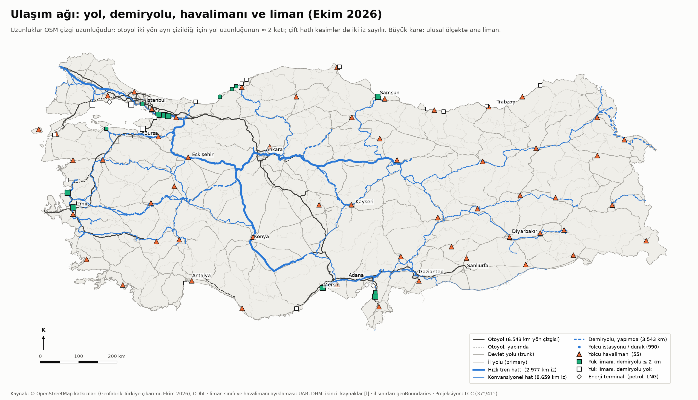
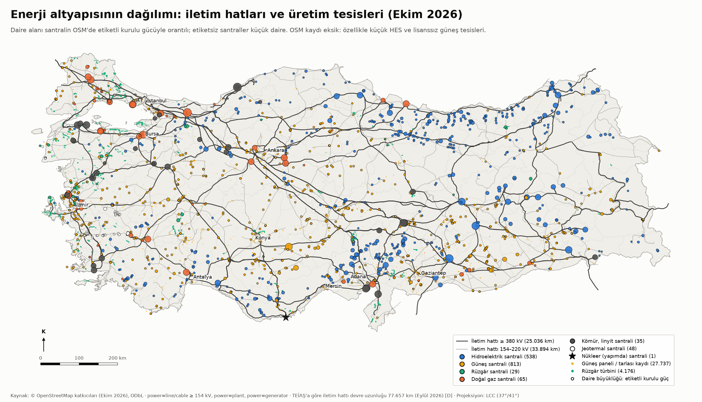
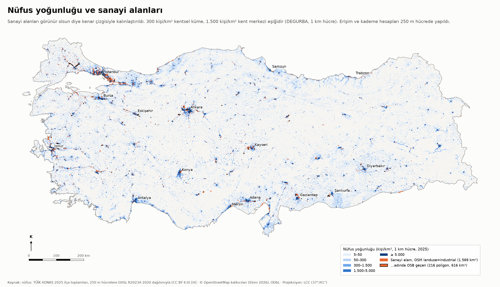
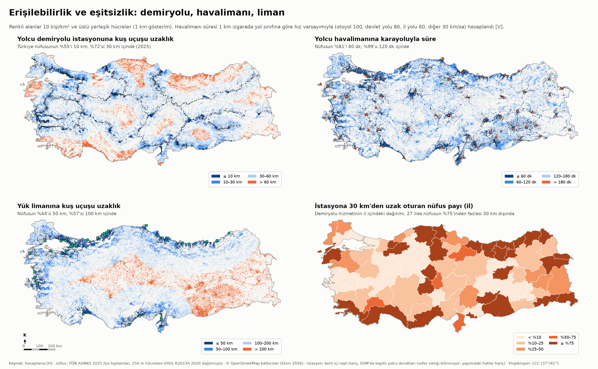
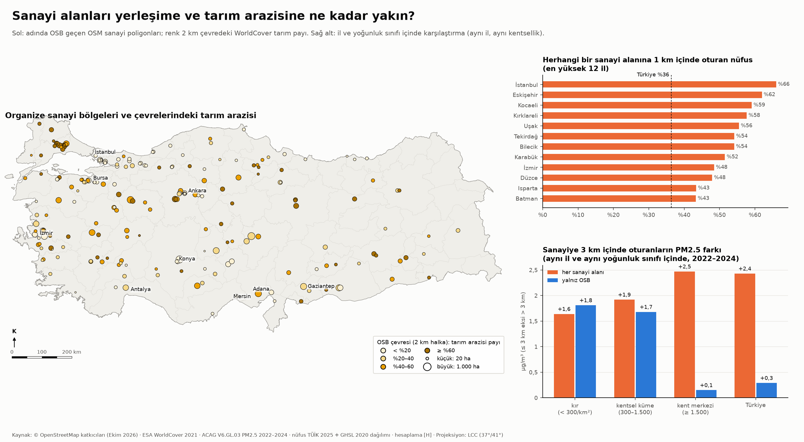
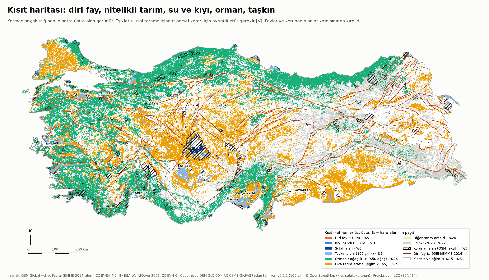
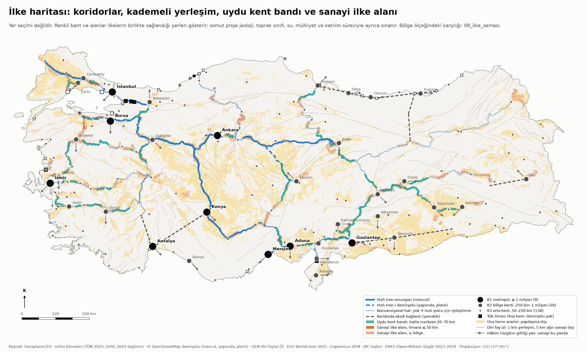
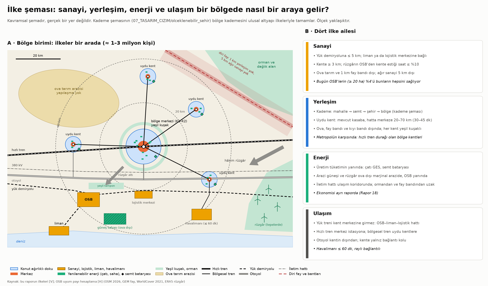

# Faz 4 · Rapor 4 — Ulusal Mekânsal Çerçeve: Sanayi, Yerleşim, Enerji ve Ulaşım

*27 Ekim 2026 · Sürüm 0.1*

| Ne | Nerede |
|---|---|
| OSM katmanları (yol, demiryolu, istasyon, havalimanı, liman, iletim hattı, santral, sanayi, kıyı, korunan ve sulak alan) | `03_VERI/islenmis/ulusal_altyapi/*.gpkg` · kod `03_VERI/kod/ulusal_altyapi_osm.py` |
| Ulusal 250 m ızgara (nüfus, örtü, yükselti, eğim, taşkın, PM2.5, ilçe) | `03_VERI/islenmis/ulusal_altyapi/izgara_*.tif` · kod `05_ANALIZ/kod/ulusal_plan_izgara.py`, `ulusal_plan_nufus.py` |
| Analiz katmanları, kısıt, erişim, şema | `05_ANALIZ/kod/ulusal_plan_katmanlar.py` → `ulusal_plan_kisit.py` → `ulusal_plan_erisim.py` → `ulusal_plan_sema.py` |
| Sonuç tabloları | `05_ANALIZ/sonuclar/ulusal_plan_*.csv` (il erişim tablosu: `ulusal_plan_erisim_il.csv`) |
| Haritalar ve şema | [04_HARITA/ulusal_plan/](../04_HARITA/ulusal_plan/) · kod `05_ANALIZ/kod/ulusal_plan_haritalar.py` |
| İlgili raporlar | [Rapor 13: PM2.5 ve ölümlülük](13_fue_uydu_cevre.md) · [Rapor 19: arazi israfı ve enerji kayıpları](19_israf_fire_kacak.md) · [kademe şeması](../07_TASARIM_CIZIM/olceklenebilir_sehir/kademe_semasi.png) · enerji ekonomisi Rapor 18'de |

**İşaretler:** [D] doğrulandı · [İ] ikincil kaynak · [DY] doğrulanmadı · [V] varsayım · [H] hesaplandı.
**Nüfus:** Aksi yazılmadıkça kişi sayıları TÜİK ADNKS 2025 ilçe nüfuslarıdır [D]. İlçe içindeki dağılım GHSL 2020'den gelir (§1.4).

---

## Özet

**Soru:** Türkiye'de sanayi, yerleşim, enerji ve ulaşım bugün nasıl dağılmış? İnsanlar demiryoluna, havalimanına ve limana ne kadar yakın? Sanayi yerleşime ve tarım arazisine ne kadar yakın? Yeni sanayi bölgeleri ve yeni yerleşimler hangi ilkelere göre yerleşmeli?

**Kısa cevap:**

1. **Demiryolu erişimi yarım kalmış.**
   - Nüfusun %54,9'u bir yolcu istasyonuna 10 km, %72,5'i 30 km içinde oturuyor (2025) [H].
   - 14 ilde 30 km içinde hiç istasyon yok. Bunların en büyükleri Antalya (2,78 milyon) ve Muğla (1,10 milyon). Doğu Karadeniz kıyısının tamamı da bu grupta [H].
   - Hızlı tren durağına 60 km içinde oturan nüfus %37,8 [H].
2. **Havalimanı erişimi iyi, liman erişimi kıyıya sıkışmış.**
   - Nüfusun %81,3'ü bir yolcu havalimanına 60 dakika, %98,7'si 120 dakika içinde [H, hız varsayımıyla].
   - Yük limanına 100 km içinde oturanlar %56,8 [H].
   - Ana sınıftaki 11 limandan 3'ünün demiryolu bağlantısı yok: Ambarlı, Gemlik ve Tekirdağ (Asyaport) [H, OSM; sınıf İ].
3. **Sanayi yerleşimin içinde.**
   - Nüfusun %36,3'ü herhangi bir sanayi alanına 1 km, %74,1'i 3 km içinde oturuyor [H].
   - Aynı il ve aynı kentsellik düzeyinde, sanayiye 3 km içinde oturanların soluduğu PM2.5 2,4 µg/m³ daha yüksek [H].
   - Rapor 13'ün katsayısıyla bu fark yaklaşık %1 daha yüksek ölümlülüğe karşılık gelir [H/V].
4. **OSB'ler tarım arazisinin içinde ve demiryolundan uzak.**
   - OSB'lerin (≥ 20 ha, 202 poligon) 2 km çevresindeki tarım payının medyanı %40. Türkiye karasının ortalaması %25 [H].
   - OSB'lerin yalnız %45,5'i demiryoluna 5 km içinde [H].
   - Bu raporun beş sanayi ilkesini birlikte sağlayan OSB yalnız **%3,5** [H].
5. **Yapılaşmaya elverişli arazi az ama nüfusun çoğu orada.**
   - Mutlak kısıtlar (1 km fay bandı, su, sulak alan, kıyı bandı, orman, taşkın, korunan alan) kara alanının %35,9'unu kaplıyor.
   - Ova tarım arazisi ve dik yamaç da çıkınca elverişli alan %31,2'ye iniyor. Nüfusun %74,5'i bu alanda yaşıyor [H].
   - 5,3 milyon kişi (%6,2) bir diri fay izine 1 km içinde oturuyor [H, GEM fay izleri].
6. **Otoyol kentin içinden geçiyor.** Otoyol çizgilerinin 581 km'si (%8,9), devlet yollarının 5.590 km'si (%12,1) yoğun kent dokusundan geçiyor. Nüfusun %32,3'ü bu yollara 500 m içinde oturuyor [H].

**Öneri şemasının özü:**
- Ülke, demiryolu omurgasına dizilmiş **bölge birimlerinden** oluşur. Her birim ≈ 1–3 milyon kişidir ve kademe şemasının "bölge" kademesine karşılık gelir.
- **Yerleşim:**
  - Büyüme, merkeze 20–70 km uzaktaki mevcut kasabalara verilir. Bu kasabalar hatta olmalı ve merkeze 30–45 dakikada bağlanmalı.
  - Ova, fay bandı ve kıyı bandı yapılaşmaya kapalı tutulur.
- **Sanayi:**
  - Yük demiryoluna ve limana bağlanır.
  - Kentin rüzgâr altında, kente en az 3 km uzakta kurulur.
  - Tarım ve fay alanlarının dışında kalır.
- **Enerji:** Üretim tüketimin yanında yapılır: çatı GES, semt bataryası, marjinal arazide güneş ve rüzgâr. İletim hattı ulaşım koridorunu izler.
- **Ulaşım:**
  - Yük treni kent merkezine girmez. Hızlı tren merkez istasyona gelir.
  - Otoyol kentin dışından geçer.
  - 11 eksik koridor bağlantısı (1.206 km kuş uçuşu) var: Karadeniz kıyısı, Antalya, Gaziantep–Mardin, Trabzon–Erzincan ve Van Gölü geçişi.
- İlke haritası yer seçimi yapmaz. İlkelerin birlikte sağlandığı alanları gösterir:
  - Sanayi için 5.093 km², kara alanının %0,6'sı. 27 ilde böyle bir alan yok.
  - Uydu kent için 2.898 km'lik hat bandı var. Bantta bütün koşulları sağlayan 30 istasyon bulunuyor. 35 büyük kentin 21'inin çevresinde ise koşulları sağlayan istasyon yok. İstanbul, İzmir, Antalya ve Mersin bunların arasında.

---

## 1. Mevcut durum

### 1.1 Ulaşım



| Gösterge | OSM (Ekim 2026) | Resmî kaynak |
|---|---|---|
| Otoyol | 6.543 km yön çizgisi; iki yön ayrı çizildiği için yol uzunluğu ≈ 3.270 km [H] | 3.796 km, 1 Ocak 2026 [D: KGM yol ağı sayfası] |
| Devlet yolu / il yolu | OSM sınıfları KGM sınıflarıyla birebir örtüşmez | 30.789 / 33.932 km, 1 Ocak 2026 [D: KGM] |
| Hızlı tren hattı | 2.977 km iz (çift hat iki iz sayılabilir) [H] | 2.251 km YHT/HT; toplam ağ 13.919 km [İ: Bakan açıklaması, İHA, 5 Nisan 2026] |
| Konvansiyonel hat / yapımdaki hat | 8.659 km iz / 3.543 km [H] | 2053 hedefi 28.590 km raylı ağ [İ: aynı haber] |
| Yolcu istasyonu ve durağı | 990; 32'si hızlı tren durağı, 43'ü yalnız yapımdaki hatlarda [H] | — |
| Yolcu havalimanı | 55 [H] | DHMİ listesi 56 kayıt, Ekim 2026 [D]. Fark: İstanbul Atatürk ve Adana Şakirpaşa (tarifeli sefer yok [İ]) çıkarıldı; Eskişehir Hasan Polatkan eklendi |
| Yük limanı | 31 liman + 3 enerji terminali; konum OSM, sınıf ikincil kaynak [İ] | Tonaj doğrulanmadı [DY] |

**Okuma:**
- **Hızlı tren omurgası bir "T" biçiminde.** Hat İstanbul'dan Ankara'ya, Ankara'dan Sivas'a ve Konya–Karaman'a uzanıyor; Edirne kolu da ekleniyor. Ege, Akdeniz, Karadeniz ve Güneydoğu bu omurgaya bağlı değil.
- **Liman–demiryolu bağlantısı eksik.**
  - Yük limanlarından 14'ü demiryoluna 2 km içinde.
  - Ana limanlardan bağlantısız üçü: Ambarlı (en yakın hat 8,6 km), Gemlik (14,5 km) ve Tekirdağ Asyaport (6,2 km) [H, OSM].
  - Trabzon, Antalya, Çanakkale, Giresun, Ordu, Rize, Hopa ve Sinop limanlarının 100 km çevresinde hiç demiryolu yok [H].

### 1.2 Enerji iletimi ve üretim



| Gösterge | Değer | Kaynak |
|---|---|---|
| İletim hattı ≥ 380 kV / 154–220 kV (OSM çizgi uzunluğu) | 25.036 / 33.894 km | [H] OSM, Ekim 2026 |
| İletim hattı devre uzunluğu (resmî) · trafo merkezi · kurulu güç | 77.657 km · 1.534 · 127.355,2 MW | [D] TEİAŞ, Eylül 2026 sonu |
| OSM santral kaydı | HES 538 · güneş 813 · doğal gaz 65 · kömür ve linyit 35 · jeotermal 48 · rüzgâr 29 santral + 4.176 türbin · nükleer 1 (Akkuyu, yapımda) | [H] OSM |
| Güneş paneli / tarlası kaydı | 27.737; %75'i Güneydoğu Anadolu'da (TRC) | [H] OSM. Bu yoğunluk büyük olasılıkla çizim alışkanlığından geliyor (tek tek panel kaydı) [DY] |
| 380 kV hatların demiryolu ya da otoyol / devlet yoluna 2 km içinde olan payı | %31,7 | [H] |
| 380 kV hatların orman hücrelerinden geçen payı / 1 km fay bandından geçen payı | %23,6 / %7,1 | [H] |
| OSB'lerin 380 kV hatta 10 km içinde olan payı | %65,7 | [H] |
| 380 kV hatta 1 km içinde oturan nüfus | %8,0 | [H] |

**Okuma:**
- **Üretim coğrafi olarak ayrışmış.**
  - Su gücü Doğu Karadeniz'de, Fırat–Dicle'de ve Seyhan–Ceyhan havzasında toplanıyor.
  - Kömür santralleri Ege, Trakya ve Zonguldak'ta; doğal gaz santralleri Marmara'da.
  - Rüzgâr Ege ve Marmara kıyısında, güneş İç Anadolu ve Güneydoğu'da.
  - Tüketimin büyük kısmı ise Marmara'da. Bu yüzden 380 kV omurga doğudan batıya uzun mesafe taşıyor.
- **İletim kaybı küçük, dağıtım kaybı büyük.**
  - Rapor 19'a göre iletim kaybı %1,96 [D: EPDK 2025]. Dağıtım kayıp-kaçağı %8,76 [H].
  - Mekânsal planın asıl kaldıracı iletim hattından çok dağıtım ve yerel üretim. Enerji ekonomisi Rapor 18'de ele alınıyor.
- **Hatlar ulaşım koridorlarıyla buluşmuyor.**
  - 380 kV hatların yalnız üçte biri bir ulaşım koridorunu izliyor.
  - Hatların dörtte biri ormandan geçiyor.
  - Ayrı geçen koridorlar arazide ikinci bir parçalanma yaratıyor.

### 1.3 Sanayi



- **Kayıtlı sanayi alanı.** OSM'de 9.129 sanayi poligonu var; toplam alanları 1.569 km². Adında "OSB" geçenler 216 poligon ve 616 km² [H].
- **Resmî OSB sayısı 371** (Ekim–Kasım 2025) [İ: Sanayi ve Teknoloji Bakanı açıklaması, basın]. OSM'de adıyla tanınan OSB'ler bunun bir kısmı. Bu yüzden OSB ölçüleri bir örneklem olarak okunmalı.
- **Sanayi kentin içinde.** Sanayi alanlarının büyük kısmı kent dokusunun içinde ya da hemen bitişiğinde. İstanbul–Kocaeli hattı, Bursa, İzmir, Manisa, Kayseri, Gaziantep, Adana ve Denizli öne çıkıyor.

### 1.4 Nüfus ve kademeli yerleşim

**Nüfus verisi düzeltildi.** GHSL R2023A 2020 nüfus katmanı bazı ilçelerde nüfusu yanlış yere koyuyor:
- Adana'da Yumurtalık'a ≈ 357 bin kişi düşüyor; TÜİK'e göre 18 bin.
- Sarıçam'a ≈ 22 bin kişi düşüyor; TÜİK'e göre 263 bin.
- 973 ilçede nüfus ağırlıklı mutlak sapma %24,5 [H].

Bu yüzden ızgara nüfusu her ilçede TÜİK ADNKS 2025 toplamına ölçeklendi [H]:
- 917 ilçede GHSL dağılımı korundu.
- 56 ilçede GHSL toplamı TÜİK'in 0,5–2 katı aralığının dışındaydı. Bu ilçelerde nüfus, WorldCover 2021 yapılı alanına göre dağıtıldı.

Bu düzeltme olmadan Adana bir milyonun altında görünüyordu. Düzeltmeyle K1 kademesine geçti.

**Kademeler.** Yoğunluğu ≥ 300 kişi/km² olan bitişik hücreler kentsel küme sayıldı (2025):

| Kademe | Küme sayısı | Nüfus | Pay |
|---|---|---|---|
| K1 metropol (≥ 1 milyon) | 9 | 34,4 milyon | %40,0 |
| K2 bölge kenti (250 bin–1 milyon) | 26 | 13,3 milyon | %15,5 |
| K3 orta kent (50–250 bin) | 138 | 15,3 milyon | %17,7 |
| K4 kasaba (10–50 bin) | 312 | 6,4 milyon | %7,5 |
| K5 küçük kasaba (2–10 bin) | 1.046 | 4,2 milyon | %4,9 |
| Küme dışı (kır, dağınık) | — | 12,4 milyon | %14,4 |

Kaynak: [H] TÜİK 2025 ve GHSL 2020 dağılımı; eşikler [V]. K1 kümeleri: İstanbul–Kocaeli (17,4 milyon, tek küme), Ankara, İzmir, Bursa, Gaziantep, Adana, Antalya, Mersin, Konya.

- **Kademe yapısı tepeye yığılmış.** Nüfusun %40'ı dokuz metropolde, yarısından fazlası (%55,5) K1–K2 kentlerinde.
- **K4 kasabaları zayıf.** Kademeli yerleşimin taşıyıcısı olabilecek K4 kasabaları nüfusun yalnız %7,5'ini barındırıyor.
- **Rapor 19 ile bağlantı.** Rapor 19'a göre yapılı alan 2000–2020 arasında %41,7, nüfus %31,4 büyüdü [D/H: GHSL]. Yayılma nüfustan hızlı; boşalan kır ile yayılan kasaba birlikte görülüyor.

---

## 2. Erişilebilirlik



**Yöntem:**
- **İstasyon ve liman.** Mesafe 250 m ızgarada kuş uçuşu ölçüldü.
- **Havalimanı.** Süre 1 km ızgarada en kısa yolla hesaplandı. Hız varsayımları: otoyol 100, devlet yolu 80, il yolu 60, diğer 30 km/sa [V]. Bekleme ve trafik eklenmedi.
- **İstasyon tanımı.** Kent içi raylı sistem (metro, tramvay, hafif raylı) dahil değil. Sefer sıklığı bilinmiyor [DY].
- **Yapımdaki hatlar.** Ana ölçüye girmedi; duyarlılık olarak ayrıca verildi.

### 2.1 Ulusal tablo (2025 nüfusu)

| Erişim | Türkiye | Yoğun kent (≥ 1.500 kişi/km²) | Yoğun kent dışı |
|---|---|---|---|
| Yolcu istasyonuna ≤ 10 km | %54,9 | %59,4 | %27,7 |
| Yolcu istasyonuna ≤ 30 km | %72,5 | %75,5 | %54,4 |
| … yapımdaki hatlar açılınca ≤ 30 km | %75,3 | — | — |
| Hızlı tren durağına ≤ 60 km | %37,8 | %40,6 | %21,2 |
| Yolcu havalimanına ≤ 60 dk | %81,3 | %85,3 | %57,6 |
| Yolcu havalimanına ≤ 120 dk | %98,7 | %99,2 | %95,6 |
| Yük limanına ≤ 50 km | %44,5 | %47,4 | %27,4 |
| Yük limanına ≤ 100 km | %56,8 | %58,4 | %47,5 |
| Demiryolu bağlantılı yük limanına ≤ 100 km | %49,0 | %51,4 | %34,3 |

Kaynak: [H] `ulusal_plan_erisim_ozet.csv`. Nüfus ağırlıklı ortalamalar: istasyona 25,2 km, havalimanına 36,4 dk, limana 108,0 km.

### 2.2 İl tablosu

Bütün iller `05_ANALIZ/sonuclar/ulusal_plan_erisim_il.csv` dosyasında. Aşağıda en kalabalık 16 il var (nüfusun yüzdesi, 2025):

| İl | Nüfus | İstasyon ≤ 10 km | İstasyon ≤ 30 km | Hızlı tren ≤ 60 km | Havalimanı ≤ 60 dk | Yük limanı ≤ 100 km |
|---|---|---|---|---|---|---|
| İstanbul | 15,75 milyon | 82,7 | 99,7 | 100,0 | 100,0 | 100,0 |
| Ankara | 5,91 milyon | 85,1 | 95,6 | 98,1 | 93,8 | 0,0 |
| İzmir | 4,50 milyon | 84,5 | 94,2 | 0,0 | 90,3 | 99,7 |
| Bursa | 3,26 milyon | 13,1 | 83,8 | 19,7 | 96,0 | 100,0 |
| Antalya | 2,78 milyon | 0,0 | 0,0 | 0,0 | 88,1 | 82,2 |
| Konya | 2,34 milyon | 63,5 | 78,2 | 68,2 | 64,0 | 5,8 |
| Adana | 2,28 milyon | 9,6 | 80,6 | 0,0 | 81,1 | 97,3 |
| Şanlıurfa | 2,27 milyon | 11,4 | 24,6 | 0,0 | 68,3 | 0,0 |
| Gaziantep | 2,22 milyon | 89,6 | 99,0 | 0,0 | 97,5 | 6,2 |
| Kocaeli | 2,16 milyon | 94,9 | 98,2 | 100,0 | 99,9 | 100,0 |
| Mersin | 1,96 milyon | 7,0 | 21,2 (yapımdaki hatla 76,2) | 0,3 | 76,4 | 99,1 |
| Diyarbakır | 1,85 milyon | 69,2 | 91,1 | 0,0 | 89,3 | 0,0 |
| Kayseri | 1,46 milyon | 77,8 | 90,0 | 0,0 | 92,0 | 0,0 |
| Samsun | 1,39 milyon | 49,2 | 68,8 | 0,0 | 84,8 | 99,8 |
| Van | 1,11 milyon | 57,7 | 69,0 | 0,0 | 68,5 | 0,0 |
| Trabzon | 0,82 milyon | 0,0 | 0,0 | 0,0 | 94,8 | 100,0 |

**Okuma:**
- **Demiryolu açığı.**
  - 14 ilde istasyona 30 km içinde oturan kimse yok: Antalya, Muğla, Çanakkale, Düzce, Sinop, Ordu, Giresun, Trabzon, Rize, Artvin, Aksaray, Iğdır, Hakkari ve Şırnak.
  - 27 ilde bu pay %25'in altında [H].
  - Bu 14 ilin toplam nüfusu ≈ 9,2 milyon [H].
- **Mersin ve Adana.** İki ilin düşük değeri OSM'deki bir etiketten geliyor. Mersin–Adana–Gaziantep hattı yüksek standarda dönüştürülüyor ve OSM'de "yapımda" görünüyor. Hat açıldığında Mersin %21'den %76'ya çıkıyor [H]. Bugün yolcu treninin işleyip işlemediği doğrulanmadı [DY].
- **Havalimanı açığı.**
  - 19 ilde nüfusun yarısından azı 60 dk içinde. Bunlar çoğunlukla büyük bir havalimanının gölgesindeki iller: Edirne, Kırklareli, Karaman, Niğde, Aksaray, Yozgat, Kırıkkale, Bolu, Düzce, Çankırı, Çorum, Karabük, Osmaniye, Bayburt, Gümüşhane, Tunceli, Bitlis, Ardahan, Artvin.
  - Nüfusun %90'ından azının 120 dk içinde olduğu yalnız üç il var: Yozgat, Karaman, Osmaniye [H].
  - Sonuç: Yeni havalimanından çok, mevcut havalimanlarına raylı bağlantı ve hızlı tren gerekiyor.
- **Liman.** Ankara, Konya, Kayseri, Diyarbakır, Şanlıurfa ve Van'ın 100 km çevresinde yük limanı yok. İç Anadolu ve Güneydoğu sanayisinin limana tek yolu karayolu ya da uzun bir demiryolu hattı.

### 2.3 Sanayinin yerleşime ve tarım arazisine yakınlığı



| Ölçü | Değer | Kaynak |
|---|---|---|
| Herhangi bir sanayi alanına 1 km / 3 km içinde oturan nüfus | %36,3 / %74,1 | [H] |
| OSB'ye 1 km / 3 km içinde oturan nüfus | %3,6 / %8,9 | [H] |
| OSB (≥ 20 ha, n = 202) 2 km çevresinde nüfus, medyan | 9.767 kişi | [H] |
| OSB 2 km çevresinde tarım arazisi payı, medyan (Türkiye karası ortalaması) | %40 (%25) | [H] WorldCover 2021 |
| OSB 2 km çevresinde ova tarım arazisi payı, medyan (Türkiye karası) | %29 (%19) | [H] |
| OSB merkezinin demiryoluna ≤ 2 km / ≤ 10 km olan payı | %30 / %59 | [H] |
| Sanayi alanına 1 km içinde en çok nüfus | İstanbul %66, Eskişehir %62, Kocaeli %59, Kırklareli %58, Uşak %56 | [H] |

**Okuma:**
- **"Sanayi alanı" geniş bir tanım.** OSM'deki sanayi alanının çoğu küçük sanayi sitesi, depo ve atölye; bunlar kent içinde. Nüfusun üçte biri böyle bir alana 1 km içinde oturuyor.
- **OSB'ler kentten daha ayrık.** Ama OSB'ler ovada kurulmuş. Çevrelerindeki tarım payı Türkiye ortalamasının 1,6 katı, ova tarım payı 1,5 katı.
- **Seçim mantığı.** Düz, ucuz ve yola yakın arazi seçilmiş; bu arazi çoğunlukla nitelikli tarım arazisi. Rapor 19'daki arazi israfının sanayi tarafı bu.

### 2.4 Sanayi çevresinde PM2.5

**Karşılaştırma:** Aynı il ve aynı yoğunluk sınıfında, sanayiye 3 km içinde oturanların PM2.5 düzeyi 3 km dışındakilerle karşılaştırıldı (ACAG 2022–2024 ortalaması, nüfus ağırlıklı) [H].

| Yoğunluk sınıfı | Herhangi bir sanayi alanı | Yalnız OSB |
|---|---|---|
| Kır (< 300 kişi/km²) | +1,6 µg/m³ (79 il) | +1,8 (43 il) |
| Kentsel küme (300–1.500) | +1,9 (81 il) | +1,7 (64 il) |
| Kent merkezi (≥ 1.500) | +2,5 (81 il) | +0,15 (66 il) |
| Türkiye | **+2,4** | **+0,3** |

**Okuma:**
- **Fark gerçek ama küçük.** Sanayinin yakınında hava belirgin biçimde daha kirli değil; fark birkaç µg/m³.
  - DSÖ'nün yıllık kılavuz değeri 5 µg/m³. Türkiye nüfus ortalaması ise ≈ 23 µg/m³ [H].
  - Fark, sanayinin tek başına değil, trafik ve ısınmayla birlikte geldiğini düşündürüyor.
- **Sağlık karşılığı.**
  - Rapor 13'te +10 µg/m³ PM2.5, ilçe ölümlülüğünde ≈ %4,2 artışla ilişkili [H].
  - Doğrusal aktarılırsa +2,4 µg/m³ ≈ %1 daha yüksek ölümlülük demek [H/V]. Bu ilişki nedensel kanıt değildir.
- **OSB'ler kent merkezinde neredeyse fark yaratmıyor.**
  - Kent merkezinde fark yalnız +0,15. Kır ve kasabada ise +1,7–1,8.
  - Olası açıklama: Kent merkezinde kirliliği trafik ve ısınma belirliyor. Kırda ise OSB görece tek kaynak.
- **Ölçek sınırı.** PM2.5 ≈ 1 km çözünürlüklü, modelle üretilmiş bir alan. Baca yakınındaki yerel zirveleri yakalamaz [D: Rapor 13].
- **İl farkları.** En büyük il içi farklar Batman (+13,6), Denizli (+8,4), Iğdır (+7,6), Osmaniye (+6,8) ve Gaziantep'te (+5,8). Bunlar küçük örneklemli il hesaplarıdır [H].

### 2.5 Otoyol ve kent

| Ölçü | Değer | Kaynak |
|---|---|---|
| Otoyol çizgisinin yoğun kent hücrelerinden (≥ 1.500 kişi/km², 250 m) geçen kısmı | 581 km / 6.527 km (%8,9) | [H] OSM |
| Devlet yolunun yoğun kentten geçen kısmı | 5.590 km / 46.303 km (%12,1) | [H] |
| Otoyol ya da devlet yoluna 500 m içinde oturan nüfus | %32,3 | [H] |
| Kentten geçen otoyolun en uzun olduğu iller | İstanbul 188 km, Kocaeli 76, İzmir 74, Bursa 70, Adana 45, Mersin 39 | [H] |

- **Etki.** Kentin içinden geçen otoyol gürültü, PM2.5 ve kopukluk getirir. Faz 3'te "ana yoldan uzaklık" çevre-ölçek ekseninin bir göstergesiydi.
- **Bugünkü düzen.** Türkiye'de otoyol çoğu zaman kentin içinden ya da çeperinden geçirilmiş. Kent zamanla otoyolun iki yanına büyümüş.

---

## 3. Kısıtlar



**Eşikler ulusal tarama içindir; parsel kararı için kullanılamaz [V].** Katmanlar ve kaynakları:

| Katman | Tanım | Kara alanının payı | Nüfus 2025 (pay) | Sanayi alanının payı |
|---|---|---|---|---|
| Diri fay ±1 km | GEM izine ≤ 1 km | %4,9 | 5,33 milyon (%6,2) | %7,0 |
| Diri fay ±5 km | ağır sanayi için dikkat bandı | %23,3 | 23,56 milyon (%27,4) | %32,6 |
| Ova tarım arazisi | WorldCover tarım ≥ %50 ve eğim < %5 | %19,0 | %3,4 | %7,9 |
| Bütün tarım arazisi | WorldCover tarım ≥ %50 | %24,5 | %3,9 | %9,1 |
| Orman / ağaçlık | ağaç ≥ %50 | %24,4 | %5,2 | %2,1 |
| Taşkın | JRC 100 yıllık taşkın alanı ≥ hücrenin %25'i | %4,6 | 3,24 milyon (%3,8) | %5,7 |
| Kıyı bandı | OSM kıyı çizgisine ≤ 500 m | %1,0 | 5,45 milyon (%6,3) | %3,7 |
| Sulak alan / su | WorldCover + OSM | %0,4 / %2,7 | ≈ 0 | ≈ 0 |
| Korunan alan | OSM (eksik) | %4,8 | %1,4 | %0,9 |
| Eğim > %20 | 250 m'de | %22,4 | %1,5 | %0,5 |
| **Mutlak kısıt** (fay 1 km, sulak, su, kıyı, orman, taşkın, korunan) | | **%35,9** | %20,5 | %17,3 |
| **Güçlü kısıt** (ova tarım, dik yamaç) | | %41,4 | %4,8 | %8,4 |
| **Elverişli** (kısıtsız, eğim ≤ %15) | | **%31,2** | **%74,5** | %74,3 |

Kaynak: [H] `ulusal_plan_kisit_ozet.csv`, `ulusal_plan_kisit_il.csv`.

**Okuma:**
- **Elverişli alan az ama yeterli.**
  - Türkiye'nin üçte birinden azı yapılaşmaya gerçekten elverişli. Bugünkü nüfusun dörtte üçü zaten orada yaşıyor.
  - Yeni yerleşim ve sanayi için yer daralmıyor: Elverişli alan 246 bin km². Türkiye'nin bütün yapılı alanı ise ≈ 3.400 km² (GHSL 2020, Rapor 19) [D/H].
  - Sorun yerin kendisinde değil, nitelikli arazinin ilk tüketilmesinde.
- **Fay.**
  - 5,3 milyon kişi bir diri fay izine 1 km içinde oturuyor.
  - İl nüfusuna oranla en yüksek iller: Bayburt %46, Aksaray %32, Bilecik %30, Aydın %29, Burdur %28, Manisa %26, İzmir %21 [H].
  - Sanayi alanlarının %7'si 1 km bandında, üçte biri 5 km bandında.
- **Kıyı.** Kıyıya 500 m içinde 5,45 milyon kişi oturuyor. Kıyı bandı, yerleşimin en yoğun kısıtla buluştuğu yer.
- **Karadeniz illeri.** Elverişli arazi Rize'de %2, Trabzon'da %5, Düzce, Artvin, Bartın ve Zonguldak'ta %6–7. Bu illerde yeni yapılaşma ancak mevcut dokunun içinde düşünülebilir [H].

**Diri fay verisi.**
- **MTA haritası kullanılamadı.**
  - MTA'nın yenilenmiş diri fay haritası 2026 tarihli ve 1:25.000 hassasiyetli; shp ve kmz biçiminde hazırlanmış.
  - Ancak kullanım koşulları değişiklik yapmayı, çoğaltmayı ve yeniden dağıtımı yazılı izne bağlıyor. Doğrudan indirme bağlantısı da yok [D: MTA sayfası, 27.10.2026].
  - Bu yüzden kullanılmadı.
- **Yerine kullanılan veri:** GEM Küresel Diri Faylar Veritabanı. Türkiye ve 50 km çevresinde 483 iz, 31.644 km. İzler EMME 2014 ve SHARE kataloglarından [İ].
- **Konum belirsizliği.** Bu izler 1:1 milyon ölçeklidir; konum belirsizliği ≈ 0,5–1 km [V].
- **Karşılaştırma yapılamadı.** MTA haritasıyla karşılaştırma yapılamadı [DY].

**Tarım verisi.** 5403 sayılı Toprak Koruma ve Arazi Kullanımı Kanunu'nun arazi sınıfları açık veri değil. "Ova tarım arazisi" bunun yerine kullanılan bir vekil göstergedir [V].

---

## 4. İlkeler

Her ilke bir **kural**, bir **gerekçe** ve bugünkü durumu gösteren bir **ölçü** ile verildi. Eşikler ulusal ölçekte çalışmak için seçildi [V]. Bölge ve parsel ölçeğinde ayrıntılı etütle sınanmalı.

### 4.1 Sanayi

| Kural | Gerekçe | Bugün |
|---|---|---|
| Yük demiryoluna ≤ 5 km; mümkünse limana ≤ 50 km ya da lojistik merkezine bağlı | Ağır yükün karayolundan alınması; liman–demiryolu zinciri | OSB'lerin %45,5'i (alanın %48'i) ≤ 5 km [H] |
| Ova tarım arazisinin dışında (2 km çevresinin < %25'i ova) | Nitelikli toprak yenilenemez; Rapor 19'daki arazi israfı | OSB'lerin %44,1'i [H] |
| Diri faya > 1 km; ağır ve tehlikeli madde içeren sanayi > 5 km | Deprem sırasında yangın, sızıntı ve zincirleme kaza (Kocaeli 1999 deneyimi [DY]) | > 1 km: %90,6; > 5 km: %64,9 [H] |
| K1–K3 kent dokusuna ≥ 3 km; her yerleşime ≥ 1 km; araya yeşil tampon | Gürültü, koku, PM2.5; §2.4'teki +2,4 µg/m³ | %51,0 [H] |
| Rüzgârın sanayiden kente doğru estiği saat ≤ %10 (hâkim rüzgârın alt yönü) | Bacadan çıkan kirliliğin kente taşınmaması | %65,8 [H, ERA5 2023–2024] |
| **Beşi birden** | | **%3,5 (202 OSB'den 7'si)** [H] |

**Rüzgâr verisi.**
- 81 il merkezinde, rüzgârın en sık geldiği yön kuzey (21 il) ve kuzeydoğu (18 il).
- Hâkim yönün saat payı il merkezlerinde %15–58 arasında; medyanı %29,5. Sakin saatlerin payının medyanı %13,4 [H: ERA5, Open-Meteo, 2023–2024].
- Yön kararlılığı düşük (medyan 0,23). Bu yüzden "rüzgâr altı" ilkesi her yer için yerel rüzgâr gülüyle ayrıca sınanmalı.

### 4.2 Yerleşim

| Kural | Gerekçe | Bugün |
|---|---|---|
| Kademe: mahalle → semt → şehir → bölge (kademe şeması). Her kademenin kendi merkezi ve günlük ihtiyacı kendi içinde | Faz 3: erişim (E) ile çevre-ölçek (Ç) birlikte ancak sınırlı ölçekte sağlanıyor | Nüfusun %40'ı 9 metropolde, %7,5'i K4 kasabalarında [H] |
| Uydu kent: yeni kent değil, **mevcut kasabanın** büyütülmesi. Koridor hattında, merkeze 20–70 km uzakta (≥ 3 milyonluk metropolde hızlı trenle 110 km), istasyona yürüme mesafesinde | Merkeze 30–45 dk raylı bağlantı; otomobil bağımlılığı olmadan büyüme | Bantta 227 istasyon; bütün koşulları sağlayan 30 [H] |
| Ova, 1 km fay bandı, 500 m kıyı bandı ve taşkın alanı dışında | Toprak, can güvenliği, kıyının kamusallığı (3621 s. Kıyı Kanunu, 100 m sahil şeridi [İ]) | Nüfusun %20,5'i mutlak kısıt alanında [H] |
| Her kentin çevresinde yeşil kuşak; yayılma yerine iç alanda dolgu | Rapor 13: ağaç ve az sert yüzey sağlıkla ilişkili; Rapor 19: yayılma | Yapılı alan nüfustan hızlı büyüdü (2000–2020) [D/H] |
| Metropolün karşısında "karşı mıknatıs": hızlı tren durağı olan, metropole 40–250 km uzaktaki K2–K4 kentleri | Metropolün büyümesini yakın bölge kentlerine yöneltmek | 12 kent: Kırıkkale, Polatlı, Sorgun (Ankara); Bilecik, Bozüyük, Pamukova, Eskişehir (Bursa); Karaman (Konya); Çerkezköy, Lüleburgaz, Babaeski, Edirne (İstanbul) [H] |

### 4.3 Enerji

| Kural | Gerekçe | Bugün |
|---|---|---|
| Üretim tüketimin yanında: her mahallede çatı GES, semtte batarya ve trafo ölçümü | Dağıtım kaybının (%8,76) ve iletim yükünün azalması; Rapor 19 | 27.737 güneş üreteci kaydı; dağılım büyük ölçüde kayıt yoğunluğuna bağlı [H/DY] |
| Arazi güneşi ve rüzgâr ova dışında, marjinal arazide; mümkünse OSB'nin yanında (öz tüketim) | Toprak koruma; sanayinin büyük yükünün yerinde karşılanması | OSB'lerin %65,7'si 380 kV hatta ≤ 10 km [H] |
| İletim hattı ulaşım koridorunu izler; orman, fay bandı ve korunan alandan kaçınır | Arazi parçalanmasının ve yangın riskinin azalması | 380 kV hatların %31,7'si ulaşım koridorunda, %23,6'sı ormanda [H] |
| Enerji ekonomisi, karma ve maliyet | — | Rapor 18'de |

### 4.4 Ulaşım

| Kural | Gerekçe | Bugün |
|---|---|---|
| Yük demiryolu kent merkezine girmez. OSB, liman ve lojistik merkezini kentin dışından bağlar | Gürültü, güvenlik, hat kapasitesinin yolcuya kalması | Ana limanlardan 3'ü demiryolsuz; OSB'lerin %30'u demiryoluna ≤ 2 km [H] |
| Hızlı tren merkez istasyona gelir; bölgesel tren uydu kentlere iner | Merkezin yaya erişimiyle buluşması; kademeli sistem | Hızlı tren durağına ≤ 60 km: %37,8 [H] |
| Otoyol kentin dışından geçer; kente yalnız bağlantı kolu girer. Otoyol, yük hattı ve iletim hattı tek koridorda toplanır | Rapor 10–13: ana yol yakınlığı ve PM2.5 Ç ekseninde | Nüfusun %32,3'ü otoyol / devlet yoluna ≤ 500 m; otoyolun %8,9'u yoğun kentte [H] |
| Her yerleşim yolcu havalimanına ≤ 60 dk; büyük havalimanlarına raylı bağlantı | Yeni havalimanı yerine bağlantı | %81,3 ≤ 60 dk; 19 ilde nüfusun yarısından azı [H] |

---

## 5. Öneri şeması (ilke haritası)

### 5.1 Ulusal ilke haritası



**Bu harita bir yer seçimi değildir.** Ne gösterdiği:
- İlkelerin ulusal ölçekte **nerede birlikte sağlandığı**.
- **Hangi koridor bağlantısının eksik olduğu**.
- Hiçbir alan sıralanmadı ya da numaralandırılmadı.
- Somut bir proje için jeoloji, toprak sınıfı, su, mülkiyet ve katılım süreci ayrıca gerekir.

**Koridor sistemi.**
- 16 koridor, il merkezleri arasında OSM demiryolu ağı üzerinde çizildi.
- Toplam 9.678 km. Bazı kesimler iki koridorda sayıldığı için bu toplamda tekrar var.

| Durum | Uzunluk | Anlamı |
|---|---|---|
| Hızlı tren (mevcut) | 1.716 km | Omurga |
| Konvansiyonel | 6.016 km | Yük ve hızlı yolcu (≥ 160 km/sa) için iyileştirme |
| Yapımda / planlı | 704 / 36 km | Tamamlanması öncelikli |
| Eksik bağlantı (kuş uçuşu, şematik) | 1.206 km, 11 bağlantı | Yeni hat gerekiyor |

Kaynak: [H] `ulusal_plan_koridorlar.csv`.

**Eksik bağlantılar:**
- **Doğu Karadeniz kıyısı:** Samsun–Ordu–Giresun–Trabzon–Rize, 358 km.
- **Trabzon–Gümüşhane–Erzincan:** 143 km. Liman–iç bölge bağlantısı.
- **Gaziantep–Şanlıurfa–Mardin:** 299 km.
- **Antalya–Burdur ve Antalya–Konya:** 293 km.
- **Bitlis–Van:** 113 km. Bugün Van Gölü'nü feribot geçiyor.

**Resmî planla ilişkisi.** Bu bağlantıların bir kısmı resmî plan ve projelerde zaten yer alıyor [İ]. Proje durumları tek tek doğrulanmadı [DY].

**OSM veri hatası.** Adana–Osmaniye kesimi OSM'de "Mersin–Adana–Gaziantep yüksek standartlı demiryolu, yapımda" olarak parçalı görünüyor. Hat sahada var olduğu için "yapımda" sayıldı [İ].

**Uydu kent bandı.**
- **Tanım.** Koridor hattının, bir K1–K2 merkezine 20–70 km uzaklıktaki ve büyük kent dokusuna ≥ 5 km uzaklıktaki kesimleri.
- **Sonuçlar** [H] (`ulusal_plan_uydu_kentler.csv`):
  - Bant toplam 2.898 km hat.
  - Bantta 227 istasyon var. 30'u bütün koşulları sağlıyor: mevcut kasabaya ≤ 2 km, 3 km çevresinde ≥ 5 km² elverişli arazi, fay dışı, ova payı < %50.
  - En çok uygun istasyon Ankara (5), Denizli ve Aydın (4'er), Adapazarı (3) çevresinde.
- **Büyük metropollerin çevresinde bant yok.**
  - 35 büyük kentin 21'inde koşulları sağlayan istasyon yok.
  - İstanbul–Kocaeli'de bant hiç oluşmuyor. 110 km'lik yarıçapın içi ya kesintisiz kent dokusu ya da başka bir büyük kentin dokusu.
  - Antalya, Mersin, Trabzon, Şanlıurfa ve Van'da koridor hattı yok. İzmir'de hat var ama bant 2 km.
- **Anlamı.** En büyük kentlerde "raylı uydu kent" ilkesi bugünkü ağla uygulanamıyor. Önce koridor hattı, ya da metropolde iç dolgu ve karşı mıknatıs kentler gerekiyor.

**Sanayi ilke alanı.**
- **Tanım.** §4.1'deki kuralların hepsini birlikte sağlayan hücreler; ek olarak eğim ≤ %8 ve en yakın K1–K3 kentine 8–40 km.
- **Toplam** [H] (`ulusal_plan_sanayi_ilke_alani.csv`):
  - 5.093 km², kara alanının %0,6'sı.
  - %9,1'i limana ≤ 50 km. %76,7'si 5 km fay bandının dışında.
  - ≥ 4 km²'lik 217 bitişik parça var.
- **Bölgelere göre (İBBS-1):**

  | Bölge | Ege | Orta Anadolu | Ortadoğu Anadolu | Güneydoğu | Batı Anadolu | Batı Marmara | Batı Karadeniz | Kuzeydoğu | Akdeniz | Doğu Marmara | İstanbul | Doğu Karadeniz |
  |---|---|---|---|---|---|---|---|---|---|---|---|---|
  | km² | 862 | 761 | 742 | 568 | 487 | 451 | 357 | 342 | 216 | 182 | 124 | 0 |

- **27 ilde ilke alanı yok.**
- **Liman ve sanayi bölgeleri dar.**
  - Limana yakın ilke alanı yalnız 462 km².
  - Marmara, Ege kıyısı ve Çukurova'da sanayi ile tarım ve fay aynı ovayı paylaşıyor.
  - Bu bölgelerde yeni sanayi ancak mevcut OSB'lerin içinde yoğunlaşarak ve demiryoluna bağlanarak büyüyebilir.

### 5.2 Bölge biriminde ilkeler



Şema kavramsaldır; ölçek yaklaşıktır. Kademe şemasının (mahalle → semt → şehir → bölge) "bölge" kademesini ulusal altyapıyla tamamlar.
- **Merkez.** Bölge merkezi yeşil kuşakla çevrilidir. Hızlı tren merkez istasyona gelir.
- **Uydu kentler.** 20–40 km halkasında, bölgesel trenle merkeze bağlanır. Her biri mevcut bir kasabanın büyümesidir.
- **Altyapı koridoru.** Otoyol, yük demiryolu ve 380 kV hat güneyde tek bir koridorda toplanır. Kente yalnız bağlantı kolları girer.
- **OSB.**
  - Yük hattının üzerinde, limana bağlı ve hâkim rüzgârın alt yönündedir.
  - Kentle arasında yeşil tampon vardır.
  - Ova ve fay bandının dışında kalır.
- **Enerji.** Her yerleşimde çatı GES ve semt bataryası bulunur. Güneş sahası ova dışında, rüzgâr tepelerde kurulur.
- **Havalimanı.** Merkeze ≤ 60 dk uzaklıktadır ve raylı bağlantısı vardır.

---

## 6. Sınırlılıklar ve veri boşlukları

1. **OSM kaydı eşit değil.**
   - Sanayi alanı, santral, güneş paneli ve korunan alan kayıtları bölgeden bölgeye değişiyor.
   - OSB'lerin yalnız adında "OSB" geçenleri tanınabildi: 216 poligon. Resmî sayı 371 [İ].
   - OSB sınırlarının resmî listesi (Sanayi ve Teknoloji Bakanlığı OSBBS) açık veri olarak bulunamadı [DY].
2. **Diri fay.** MTA'nın 1:25.000 haritası lisans nedeniyle kullanılamadı. GEM izleri 1:1 milyon ölçekli [İ]. Fay bandı hesapları kaba bir tarama olarak okunmalı.
3. **Tarım arazisi sınıfı yok.** 5403 sayılı Kanun'un mutlak tarım, özel ürün ve dikili tarım arazisi sınıfları açık veri değil [DY]. "Ova tarım" vekildir [V]. Orman için de OGM'nin yasal orman sınırı yerine WorldCover ağaç örtüsü kullanıldı.
4. **Hizmet bilgisi yok.**
   - İstasyonlar için sefer sıklığı, limanlar için tonaj ve havalimanları için yolcu sayısı kullanılmadı [DY].
   - Erişim "altyapıya yakınlık" ölçüyor, "hizmete erişim" ölçmüyor.
   - TCDD sefer tarifesi (GTFS) ve UAB liman istatistikleri bu boşluğu kapatır.
5. **Havalimanı süresi bir model.** Sabit hız varsayımına dayanıyor [V]. Trafik, kavşak, feribot ve terminal süresi yok. Kentsel alanlarda süre muhtemelen düşük tahmin ediliyor.
6. **Nüfus dağılımı.** İlçe toplamları TÜİK 2025'e ölçeklendi. İlçe içi dağılım ise GHSL 2020 ya da yapılı alan. 56 ilçede GHSL güvenilmez bulundu ve yapılı alan ağırlığı kullanıldı; bu ilçelerde 250 m ölçeğindeki dağılım kaba.
7. **Rüzgâr.** Rüzgâr verisi il merkezlerindeki ERA5 0,25° ızgarasından geliyor. Vadi ve kıyı rüzgârlarını yakalamaz. İlçe ve OSB ölçeğinde yerel ölçüm gerekir.
8. **PM2.5.** Model alanıdır (≈ 1 km). İl ve yoğunluk içi karşılaştırma ilişkiyi gösterir, nedenselliği göstermez. Trafik ve ısınma gibi kaynaklar ayrıştırılmadı.
9. **Koridorlar ve eksik bağlantılar şematik.** Proje durumları (planlı, ihale, yapım) UAB ve TCDD kaynaklarıyla tek tek doğrulanmadı [DY]. OSM'de yapımda görünen bazı hatlarda tren işliyor olabilir.
10. **Eşikler varsayım.** 1 ve 5 km fay bandı, 3 km kent tamponu, %10 rüzgâr payı, 20–70 km uydu bandı ve 8–40 km sanayi uzaklığı birer varsayım [V]. Duyarlılık sınaması bir sonraki sürüme bırakıldı.
11. **Arazi kullanımı ve mülkiyet yok.** İmar planları, hazine arazisi, maden ruhsatları ve askerî alanlar hesaba katılmadı.

---

## 7. Yeniden üretim

```
PYTHONIOENCODING=utf-8 python 03_VERI/kod/ulusal_altyapi_osm.py        # PBF tek geçiş (~3 dk, ~6 GB bellek)
PYTHONIOENCODING=utf-8 python 05_ANALIZ/kod/ulusal_plan_izgara.py       # 250 m ızgara; WorldCover, DEM, JRC taşkın uzaktan (~6 dk)
PYTHONIOENCODING=utf-8 python 05_ANALIZ/kod/ulusal_plan_nufus.py        # TÜİK 2025 ilçe nüfusuna ölçekleme
PYTHONIOENCODING=utf-8 python 05_ANALIZ/kod/ulusal_plan_katmanlar.py    # havalimanı, liman, istasyon ayıklama; GEM fay; ERA5 rüzgâr (önbellekli)
PYTHONIOENCODING=utf-8 python 05_ANALIZ/kod/ulusal_plan_kisit.py
PYTHONIOENCODING=utf-8 python 05_ANALIZ/kod/ulusal_plan_erisim.py
PYTHONIOENCODING=utf-8 python 05_ANALIZ/kod/ulusal_plan_sema.py
PYTHONIOENCODING=utf-8 python 05_ANALIZ/kod/ulusal_plan_haritalar.py
```

**Uzak kaynaklar (anonim; dosya indirilmez, yalnız gereken pencereler okunur):**
- ESA WorldCover 2021 v200: 8× genel bakış (≈ 80 m).
- Copernicus DEM GLO-90.
- JRC CEMS-GloFAS taşkın tehlikesi v2.1.2 (100 yıl).
- GEM Global Active Faults: GitHub, CC BY-SA 4.0.
- Open-Meteo ERA5 arşivi: 2023–2024, saatlik 10 m rüzgâr.

**Yerel kaynaklar:**
- OSM Türkiye çıkarımı (Geofabrik, Ekim 2026, ODbL).
- GHSL R2023A POP 2020.
- ACAG V6.GL.03 PM2.5 (2022–2024).
- İlçe paneli (TÜİK ADNKS 2024–2025).

**Resmî karşılaştırma sayıları:**
- KGM yol ağı (1 Ocak 2026) [D].
- TEİAŞ "Sayılarla Elektrik İletimi" (Eylül 2026) [D].
- DHMİ havalimanı listesi (Ekim 2026) [D].
- MTA diri fay haritası kullanım koşulları [D].
- Demiryolu uzunluğu ve OSB sayısı bakan açıklamalarının basındaki aktarımı [İ].
