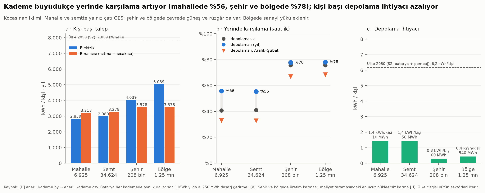
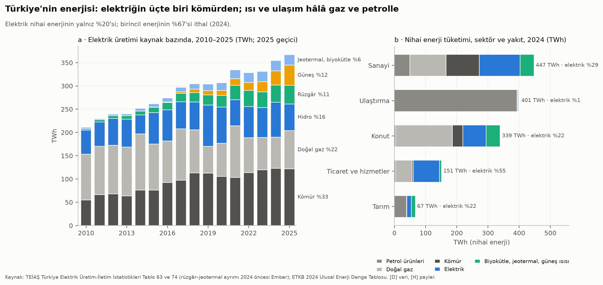
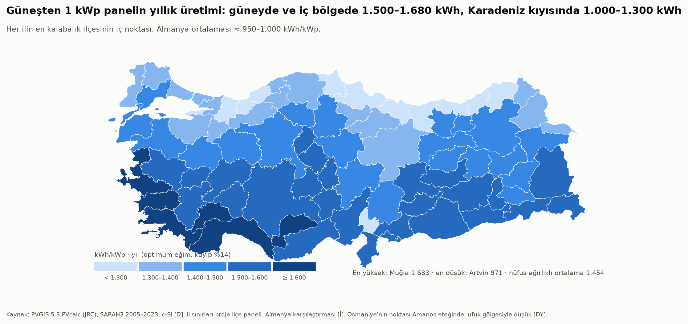
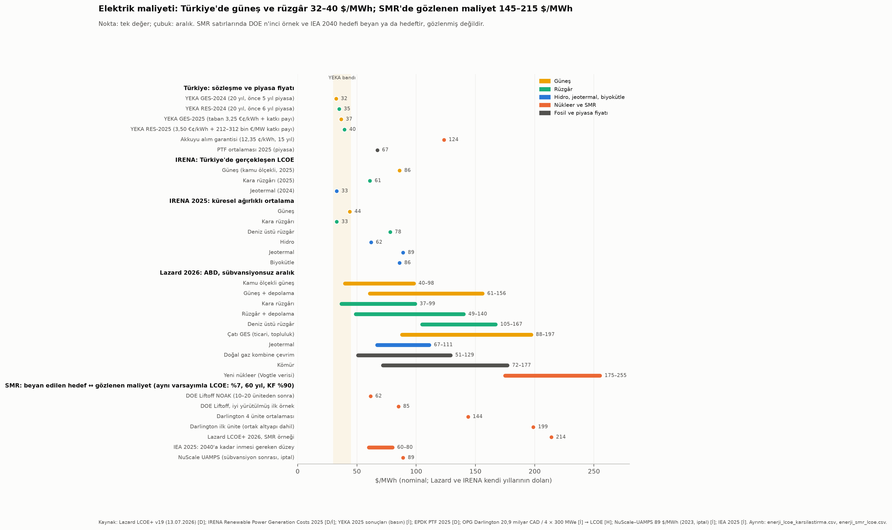
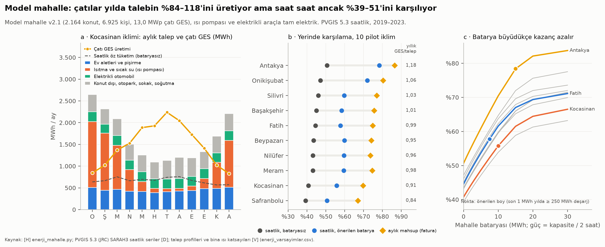
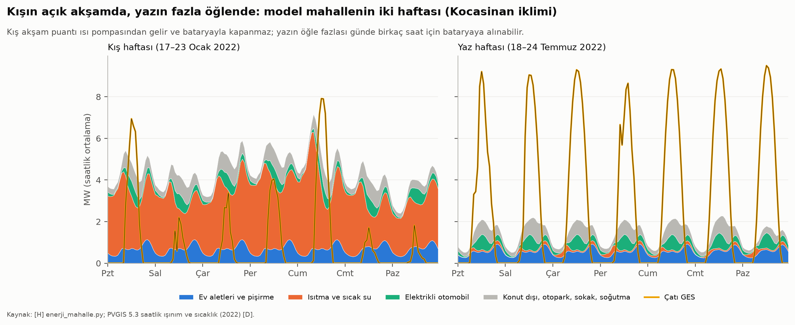
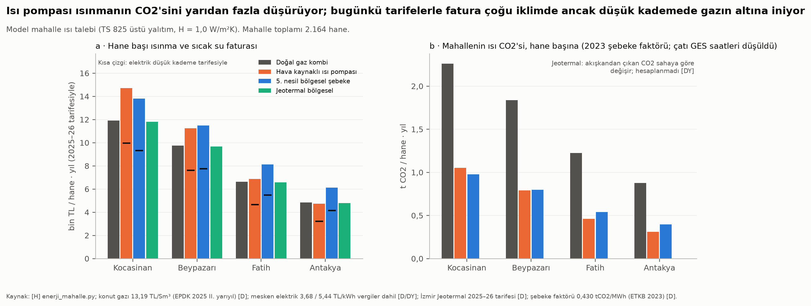
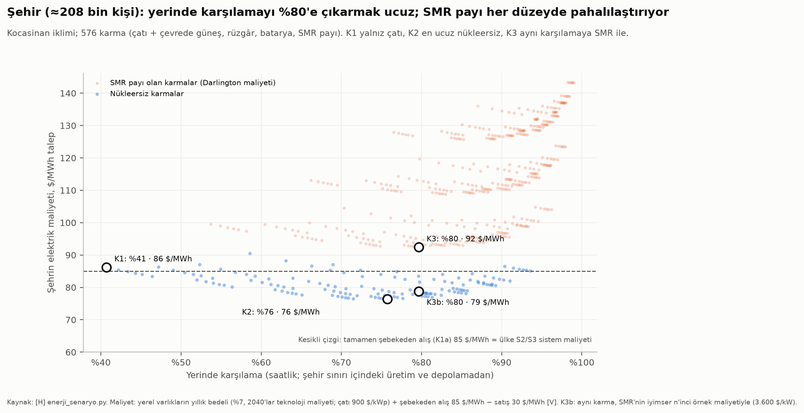
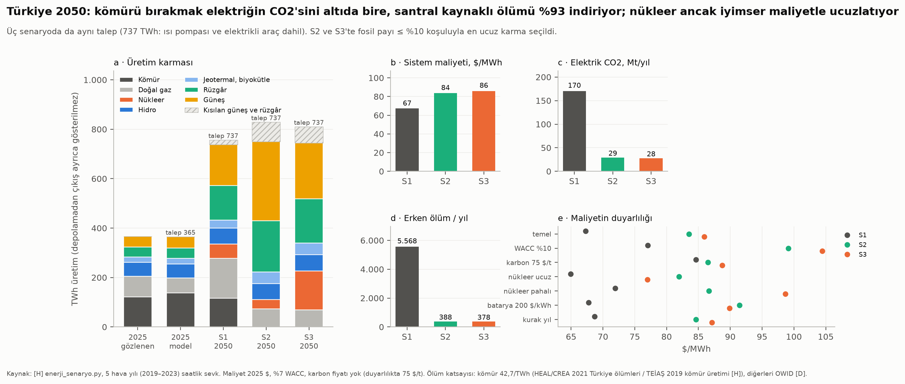
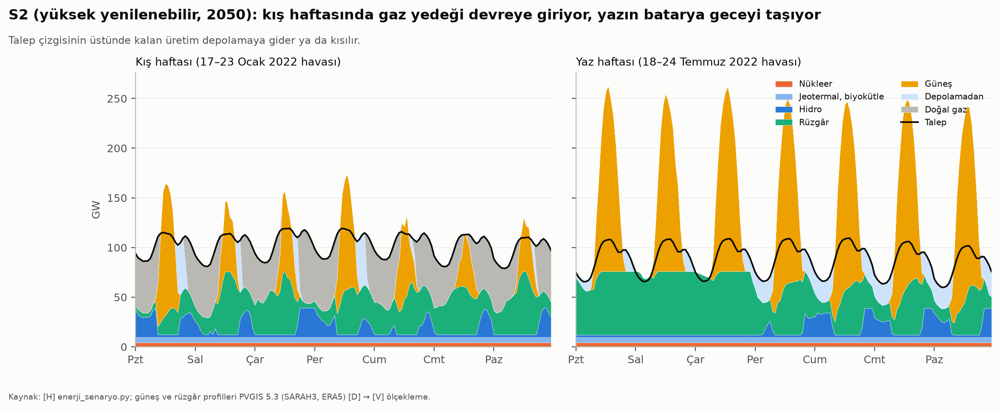

# Faz 4 · Rapor 5 — Enerji: Güneş, Rüzgâr, Hidro, SMR ve Ölçeklenebilir Şehrin Enerji Dengesi

*27 Ekim 2026 · Sürüm 0.1*

| Ne | Nerede |
|---|---|
| Kaynak notu (erişim, doğrulama, bulunamayanlar) | [03_VERI/ham/enerji/kaynaklar.md](../03_VERI/ham/enerji/kaynaklar.md) |
| Ham veri | `03_VERI/ham/enerji/` → TEİAŞ tabloları `teias/`, ETKB denge tablosu ve emisyon faktörü `etkb/`, Ember `ember/`, PVGIS önbelleği `pvgis/` (≈ 250 yanıt) |
| Kod (sırayla) | `05_ANALIZ/kod/enerji_veri.py` → `enerji_mahalle.py` → `enerji_senaryo.py` → `enerji_kademe.py` → `enerji_grafikler.py` (ortak: `enerji_ortak.py`) |
| Ana tablo (ölçeklenebilir şehir modeline girdi) | **`05_ANALIZ/sonuclar/enerji_kademe.csv`** |
| Diğer sonuç tabloları | `enerji_turkiye_*.csv` · `enerji_lcoe_karsilastirma.csv` · `enerji_smr_lcoe.csv` · `enerji_mahalle_*.csv` · `enerji_kent_*.csv` · `enerji_ulke_2050*.csv` · `enerji_saglik_ucgenleme.csv` · `enerji_varsayimlar.csv` · `enerji_maliyet_varsayim.csv` |
| Grafikler | `05_ANALIZ/grafikler/enerji_*.png` (10 grafik, her biri SVG ile) |
| İlgili raporlar | [Rapor 13: PM2.5 ve ölümlülük](13_fue_uydu_cevre.md) · [Rapor 17: iletim, santral ve koridor haritaları](17_ulusal_mekansal_cerceve.md) · [Rapor 19: kayıp-kaçak, yalıtım, atık ısı](19_israf_fire_kacak.md) · [Model mahalle v2](../07_TASARIM_CIZIM/model_mahalle_v2.md) · [Kademe şeması](../07_TASARIM_CIZIM/olceklenebilir_sehir/kademe_semasi.png) |

**İşaretler:** [D] birincil kaynakta doğrulandı · [İ] ikincil aktarım · [DY] doğrulanamadı · [V] varsayım · [H] bu çalışmada hesaplandı.

**Kısaltma uyarısı:** Bu raporda "SMR" yalnız *küçük modüler reaktör* demektir. Rapor 13'teki "SMR" ise *standartlaştırılmış ölüm oranıdır*; karışmasın diye burada ona "ölüm oranı" denir.

---

## Özet

**Soru:** Fıtrata uygun, ölçeklenebilir bir şehir ve ülke enerjisini nereden almalı? Küçük modüler reaktörler (SMR), rüzgâr, hidro, güneş ve diğer kaynaklar bu soruda nerede duruyor?

**Kısa cevap:**

1. **Bugün Türkiye'nin enerjisi ithal ve fosil.** 2025'te elektrik üretimi 366,9 TWh; kömür %33, doğal gaz %22, hidro %16, güneş %12, rüzgâr %11 [D: TEİAŞ]. Birincil enerjinin **%67'si ithal**; gazın yalnız %4'ü yerli [H: ETKB 2024]. Elektrik nihai enerjinin yalnız %20'si; ısı gazda (konutun %54'ü), ulaşım petrolde (%98) [H]. Kişi başı net elektrik 3.717 kWh [D].
2. **En ucuz yeni elektrik güneş ve rüzgâr.** YEKA sözleşmeleri 32–40 $/MWh; 2025 piyasa ortalaması 67, Akkuyu alım garantisi 123,5 $/MWh [D/İ]. 1 kWp panel Türkiye'de yılda ortalama 1.454 kWh üretiyor (971–1.683) [H: PVGIS, 81 il].
3. **Model mahallenin çatıları yıllık talebi karşılıyor, saatlik talebi karşılamıyor.**
   - 2.164 konutun çatısına 13,0 MWp GES sığıyor (hane başına 6 kWp). Bu, ısınma ve elektrikli otomobil dahil yıllık elektriğin **%84–118'i** [H].
   - Saat saat karşılama %39–51; mahalle bataryasıyla (hane başına 3,5–7 kWh) **%51–78**; fatura düzeyinde (aylık mahsup) %67–86 [H].
   - Kış akşamı açığı bataryayla kapanmıyor. Tam elektrikle mahallenin trafo yükü bugünkünün **2–4 katına** çıkıyor; en büyük yük öğle fazlası [H].
   - Isı pompası ısınmanın CO2'sini bugünkü şebekeyle bile **%53–65** düşürüyor; ama sübvansiyonlu gaz yüzünden soğuk iklimde fatura ancak düşük kademede gazın altına iniyor [H].
4. **Kademe büyüdükçe yerinde karşılama artıyor, depolama ihtiyacı azalıyor** (Kocasinan iklimi) [H]:
   - Mahalle %56 · semt %55 · şehir %78 · bölge %78 (kışın %33 → %68).
   - Kişi başı elektrik 2.840 → 2.990 → 4.040 → 5.040 kWh; bina ısısı 3.200–3.600 kWh.
   - Kişi başı batarya 1,4 → 1,4 → 0,3 → 0,4 kWh. Ama ülke fosili %10'a indirmek isteyince 6,2 kWh/kişi gerekiyor.
   - Ana tablo: `enerji_kademe.csv` (§5.1).
5. **Şehir (≈ 208 bin kişi):** En ucuz karma (çatı + çevrede güneş ve rüzgâr) elektriğin **dörtte üçünü** şehir sınırında üretiyor ve şebekeden almaktan %3–11 ucuz [H]. Tam elektrik + temiz şebekeyle kişi başı CO2 2,2 t'dan 0,04 t'ya iniyor [H].
6. **SMR bugün pahalı ve geç; ölçeği şehre değil bölgeye uyuyor.**
   - Gözlenen maliyet (Darlington BWRX-300) 144–199 $/MWh, Lazard örneği 214 $/MWh; satıcı ve DOE hedefi 62–85 $/MWh [H/D/İ]. NuScale'in ilk projesi 89 $/MWh'te alıcı bulamayıp 2023'te iptal edildi [İ].
   - Bir 300 MWe SMR, 1,25 milyonluk bir bölgenin ortalama yükünün %42–47'si. Bölgeye bir SMR eklemek yerinde karşılamayı %84–90'a çıkarıyor ama elektriği ≈ %45 pahalılaştırıyor; aynı karşılamaya nükleersiz karmayla 73–79 $/MWh'e ulaşılıyor [H].
   - Türkiye'de ilk SMR 2035'ten önce zor [V]. Öneri: bugün yatırım değil **seçenek tutma** (mevzuat hazırlığı); karar 2030'ların başında, gerçekleşen maliyetle.
7. **Ülke 2050 (talep 737 TWh):**
   - **S1 kömür sürer:** 67 $/MWh, 170 Mt CO2, santral kaynaklı ≈ 5.570 erken ölüm/yıl.
   - **S2 yüksek yenilenebilir:** 84 $/MWh, 29 Mt, ≈ 390 ölüm. 210 GW güneş, 80 GW rüzgâr, 580 GWh depolama, %10 gaz yedeği.
   - **S3 yenilenebilir + 20 GW nükleer (5 GW SMR):** 86 $/MWh, 28 Mt, ≈ 380 ölüm [H].
   - 75 $/t karbon fiyatıyla S1 ile S2 arasındaki fark 2 $/MWh'e iniyor. Nükleerin karmaya katkısı tümüyle inşaat maliyetine bağlı: ucuzsa S3 S2'den 5 $/MWh ucuz, pahalıysa 12 $/MWh pahalı [H].
8. **Sağlık:** Kömür santralleri yılda ≈ 4.800–5.200 erken ölüme yol açıyor; bu, nüfus ağırlıklı PM2.5'te ≈ 1,3–2,4 µg/m³ demek [D/H]. Ama birincil PM2.5'in %54'ü evlerde yakılan kömür ve odundan [D]. **En sağlıklı enerji kararı evdeki sobayı ısı pompasıyla değiştirmek** (§5.5).
9. **Mevzuatın yedi darboğazı** (§6.2): üretimin bina sınırına bağlı olması, fazla üretimin tavanı, trafo kapasitesi, ortak çatı mülkiyeti, mahalle bataryasının tanımsızlığı, düz tarife ve konut gazı sübvansiyonu. İlk çözüm **mahalle enerji topluluğu** ve **ısıya (yakıta değil) verilen sübvansiyon**.



---

## 1. Bugünkü durum (2024–2025)



### 1.1 Elektrik: üretim ve kurulu güç

| Gösterge | Değer | Yıl | Kaynak |
|---|---|---|---|
| Brüt üretim | **366,9 TWh** (2024: 354,6) | 2025 (geçici) | TEİAŞ Tablo 63 [D] |
| Kömür | 122,0 TWh, **%33,3** (ithal kömür %20,9, linyit %10,8, taşkömürü %1,6) | 2025 | TEİAŞ [D], pay [H] |
| Doğal gaz | 81,9 TWh, **%22,3** (2024: %18,9) | 2025 | TEİAŞ [D] |
| Hidro | 57,4 TWh, %15,7 (2024: 74,9 TWh, %21,1) | 2025 | TEİAŞ [D] |
| Güneş | 43,5 TWh, %11,9 | 2025 | TEİAŞ [D] |
| Rüzgâr | 39,8 TWh, %10,8 | 2025 | TEİAŞ Tablo 74 [D] |
| Jeotermal / biyokütle ve atık | 11,3 / 10,6 TWh (%3,1 / %2,9) | 2025 | TEİAŞ [D] |
| Kurulu güç (yıl sonu) | **123,3 GW**; 31.08.2026'da 126,9 GW | 2025 / 2026 | TEİAŞ Tablo 9; ETKB [D] |
| Kurulu güçte güneş / rüzgâr / hidro | 25,9 (lisanssız 23,4) / 14,8 / 32,3 GW | 2025 | TEİAŞ [D] |
| Kurulu güçte gaz / ithal ve taşkömürü / linyit | 20,0 / 11,1 / 10,1 GW (+ çok yakıtlı 4,8 GW) | 2025 | TEİAŞ [D] |
| 2025'te eklenen güneş / rüzgâr | 5,7 / 1,9 GW | 2025 | TEİAŞ farkı [H] |
| Anlık puant | 60,4 GW (28.07.2025, 15:00) | 2025 | TEİAŞ Tablo 26 [D] |
| Ortalama piyasa fiyatı (PTF) | 2.651,81 TL/MWh ≈ 67 $/MWh | 2025 | EPDK [D]; kur TCMB [H] |
| Şebeke emisyon faktörü | 0,430 tCO2/MWh | 2023 | ETKB-EVÇED [D] |

- **2025 kurak bir yıldı.** Hidro üretimi 2024'e göre 17 TWh düştü; açığı doğal gaz kapattı (+15 TWh). Son on yılda hidro 55,9 TWh (2021) ile 88,8 TWh (2019) arasında oynadı [D]. Bu oynaklık, karmanın en büyük doğal riskidir.
- **Güneş hızla büyüyor ama çoğu lisanssız.** 25,9 GW güneşin 23,4 GW'ı lisanssız tesis [D]. Yani güneşin büyük kısmı zaten dağıtım şebekesinde; çatı ve arazi GES'inin kuralları (§6) artık ulusal karmanın kuralları.
- **Kayıplar ve santral haritası** burada tekrar edilmiyor: dağıtım kayıp-kaçağı %8,8 (20,6 TWh) ve bölgesel dağılımı için [Rapor 19 §2.1](19_israf_fire_kacak.md); iletim hatları ve santral konumları için [Rapor 17 §1.2](17_ulusal_mekansal_cerceve.md).

### 1.2 İthalat bağımlılığı

- **Birincil enerjinin üçte ikisi ithal.** 2024'te birincil enerji arzı 165,2 Mtep (1.921 TWh). Yerli üretim 55,0 Mtep. Bağımlılık: 1 − yerli/arz = **%66,7** [H: ETKB 2024 denge tablosu; SBB de %67 veriyor].
- **Yakıta göre** (yerli üretim / arz, 2024) [H]:
  - Doğal gaz: **%4,4** yerli. Gazın %95'i ithal.
  - Petrol: %11,6 yerli.
  - Kömür: %39,5 yerli (linyit yerli, taşkömürünün çoğu ithal).
  - Hidro, rüzgâr, güneş, jeotermal: tamamı yerli.
- **Para olarak:** Türkiye son on yılda net enerji ithalatına yılda ortalama **≈ 42 milyar $** ödedi; 2022'de 80 milyar $'ı aştı [İ: Ember, Haziran 2026]. Aynı çalışma, 28 Şubat 2026'da başlayan İran savaşı ve Hürmüz Boğazı'nın kapanmasının 2026 faturasını 14 milyar $'dan fazla artırabileceğini tahmin ediyor [İ]. 2025'in fasıl 27 yıllık toplamı bu oturumda bulunamadı [DY].
- **Elektrikte bağımlılık iki kanaldan:** ithal kömür (%20,9) ve doğal gaz (%22,3). Yani 2025 elektriğinin **%43'ü ithal yakıttan** [H].

### 1.3 Isınma ve ulaşım enerjisi

| Gösterge | Değer | Yıl | Kaynak |
|---|---|---|---|
| Konutun nihai enerjisi | 339 TWh: gaz %53,6 · elektrik %22,0 · kömür %9,9 · biyokütle (odun) %5,6 · jeotermal %4,4 · güneş ısısı %3,3 | 2024 | ETKB denge tablosu [H] |
| Doğal gaz tüketimi; konut payı | 59,07 milyar Sm³; konut %35,3 (20,86 milyar Sm³) | 2025 | EPDK [D] |
| Gaz verilen yerleşim | 81 il, 840 ilçe, 142 belde | 2025 | EPDK [D] |
| Konut gaz fiyatı (vergiler dahil) | 13,19 TL/Sm³ (sanayi 19,29) | 2025 II. yarıyıl | EPDK [D] |
| Ulaştırmanın nihai enerjisi | 401 TWh: **petrol %98,2** · elektrik %0,6 · karayolu %94 | 2024 | ETKB [H] |
| Motorin / benzin / otogaz satışı | 27,08 / 5,70 / 3,28 milyon ton | 2025 | EPDK [D] |
| Elektrikli otomobilin yeni kayıt payı | %18,6 | Ocak–Eylül 2026 | TÜİK [D] |
| Şarj noktası | 45.871 | 2026 | SBB 2027 Programı [D] |
| Birincil PM2.5 emisyonunda konut yanmasının payı | **%54,0** (kamu elektrik ve ısı üretimi %6,2) | 2022 | ÇŞİDB IIR 2024 [D] |

- **Isının gaz kilidi.** Konutun enerjisinin yarısından fazlası ithal gaz. Bugünkü gaz fiyatı sanayinin üçte ikisi; konut sübvansiyonlu [D: EPDK fiyat tablosu]. Bu, ısı pompasının bugün faturada zor rekabet etmesinin nedeni (§4.5).
- **Isı aynı zamanda bir hava kirliliği sorunu.** Birincil PM2.5'in yarısından fazlası evlerde yakılan kömür ve odundan geliyor; santrallerin payı %6 [D]. Rapor 13'te PM2.5'teki her 10 µg/m³ artış ilçe ölüm oranını ≈ %4 yükseltiyordu [H]. Bu yüzden ısının elektriğe geçmesi hem dışa bağımlılık hem sağlık kararıdır (§5.4).
- **Ulaşım tümüyle petrole bağlı.** Elektrik payı binde 6. Yeni otomobillerde elektrik payının %19'a çıkması dönüşümün başladığını gösteriyor [D].
- Yalıtımsız konutların fazladan yaktığı gaz (yılda 2,2–6,6 milyar Sm³) ve sanayi atık ısısı [Rapor 19 §2.6 ve §2.9](19_israf_fire_kacak.md)'da hesaplandı; burada tekrar edilmiyor.

### 1.4 Kişi başı tüketim

| Gösterge | Kişi başı | Yıl | Kaynak |
|---|---|---|---|
| Brüt elektrik talebi | 4.241 kWh | 2025 | TEİAŞ Tablo 58 [D] |
| Net elektrik tüketimi | 3.717 kWh | 2025 | TEİAŞ Tablo 58 [D] |
| — sanayi / ticaret-hizmet / konut / tarım | 1.528 / 977 / 872 / 171 kWh | 2024 | ETKB denge [H] |
| Hane başı mesken elektriği | 2.899 kWh | 2025 | 78.197 GWh / 26,98 milyon hane [H] |
| Toplam nihai enerji | 17.459 kWh (elektrik %20,5) | 2024 | ETKB denge [H] |
| Konut nihai enerjisi | 3.957 kWh | 2024 | ETKB denge [H] |

- Elektrik bugün nihai enerjinin yalnız beşte biri. Isınma ve ulaşım elektriğe geçerse kişi başı elektrik **iki katına** yaklaşır (§5). Bu, birincil enerjinin azalması demektir: ısı pompası 1 kWh elektrikle 3–4 kWh ısı, elektrikli araç benzinlinin üçte biri enerjiyle aynı yolu verir.
- Ulusal plan (ETKB, 2022) 2035 için 510,5 TWh tüketim, 189,7 GW kurulu güç (52,9 GW güneş, 29,6 GW rüzgâr, 7,2 GW nükleer, 7,5 GW batarya) öngörüyor [D].

---

## 2. Kaynaklar ve maliyetler

### 2.1 Güneş



- **Kaynak bol.** 1 kWp panel optimum eğimle yılda 971 kWh (Artvin) ile 1.683 kWh (Muğla) üretiyor; nüfus ağırlıklı ortalama **1.454 kWh/kWp** [H: PVGIS 5.3, 81 il]. Almanya'nın ≈ 950–1.000 kWh/kWp değerinin yarı katı fazlası [İ].
- **10 pilot noktada** PVGIS `PVcalc` (peakpower=1, loss=14) optimum eğimle 1.354 (Safranbolu) ile 1.596 kWh/kWp (Antakya) veriyor [D]. Çatıya bitişik montajın saatlik serisi bunun %3–5 altında; model bunu kullanıyor (`enerji_pilot_noktalar.csv`).
- **Mevsim farkı büyük.** Aralık–Ocak üretimi Haziran–Temmuz'un üçte biri kadar [H: `enerji_il_gunes.csv`]. Isıtma talebi ise tersine kışta. Güneşin sınırı kaynakta değil, **zamanlamada**.
- **Fiyat:** YEKA GES-2025'te taban fiyat 3,25 €¢/kWh; teklifler tabanda kalıp üstüne katkı payı verildi [İ]. Yani bu fiyatın altında bile kâr bekleniyor.
- **Uyarı:** Osmaniye'nin noktası Amanos eteğine düştü; ufuk gölgesiyle 1.226 kWh/kWp çıktı. Kent merkezi daha yüksek olmalı [DY].

### 2.2 Rüzgâr

- **Kurulu 14,8 GW**, 2025 üretimi 39,8 TWh; ortalama kapasite faktörü **%32,8** [H: TEİAŞ]. Filonun çoğu Ege ve Marmara'da (Rapor 17 santral haritası).
- **Mevsim:** Rüzgâr Temmuz–Ağustos'ta en yüksek (meltem). Bu, yazın klima yükünü karşılar ama kış akşamına yardımı sınırlıdır [D: TEİAŞ aylık].
- **Fiyat:** YEKA RES-2025'te (09.12.2025) 1.150 MW, 3,50 €¢/kWh'ten verildi; kazananlar ayrıca MW başına 212–312 bin € katkı payı ödedi [İ]. 2024 turunda ≈ 35 $/MWh [İ].
- **Model notu:** Ulusal rüzgâr profili altı sahanın (Ege–Marmara ağırlıklı, Hatay) ERA5 rüzgârından türetildi; filo çıkışı kurulu gücün %80'inde sınırlandı [V]. Doğu ve Karadeniz'deki olası sahalar profili çeşitlendirirdi.

### 2.3 Hidro

- 32,3 GW kurulu; üretim 56–89 TWh arasında oynuyor (2015–2025) [D]. Ortalama ≈ 67 TWh [H].
- Hidronun asıl değeri artık **esneklik**: barajlı santraller aylık su bütçesi içinde puanta kaydırılabiliyor. Model bunu aylık su bütçesiyle sevk ediyor (`enerji_senaryo.py`).
- Yeni büyük baraj, ekolojik maliyeti ve kuraklık riski yüzünden bu raporda önerilmiyor [V]. Mevcut barajlara **pompaj** eklemek ise 2050 senaryolarında yer alıyor.

### 2.4 Jeotermal

- Elektrik: 1,76 GW, 11,3 TWh (kapasite faktörü ≈ %73) [D/H]. Çoğu Aydın, Denizli, Manisa'da.
- **Doğrudan ısı kullanımında Türkiye güçlü:** 2024'te konut 14,9 TWh, ticaret-hizmet 5,5 TWh, tarım (sera) 12,5 TWh jeotermal ısı kullandı [H: ETKB denge]. Jeotermal bölgesel ısıtma, uygun sahadaki şehir için en ucuz temiz ısı (§4.5).
- **Uyarı:** Bazı Türk sahalarının akışkanı yüksek CO2 içeriyor; jeotermal elektriğin emisyonu sahaya göre çok değişiyor [DY]. Model jeotermali emisyonsuz saydı.

### 2.5 Biyokütle

- 2,4 GW, 10,6 TWh (kapasite faktörü ≈ %50) [D/H]. Konutta odun nihai enerjinin %5,6'sı [H].
- Biyokütle yakmak PM2.5 üretir. Konutta odun sobası, ısı pompasına geçişte ilk çıkması gereken yakıt. Santral ölçeğinde atık ve tarım artığı için sınırlı rol [V].

### 2.6 Depolama

- **Bugün çok az.** 2025 sonunda işletmede batarya ölçeği küçük; model 0,4 GWh varsaydı [V].
- **Boru hattında çok.** 2022 yasa değişikliğinden sonra yaklaşık **33 GW** "depolamalı" RES ve GES projesine kapasite tahsis edildi [İ: EPDK Başkanı]. EPDK, 2035'te ≈ 35 GW batarya kurulabileceğini söylüyor [İ]. Depolamalı tesis kuralları 19.10.2026'da yeniden düzenlendi [İ].
- **Maliyet:** Anahtar teslim batarya ≈ 117 $/kWh (IRENA 2025) [D]; modelde 2040'lar için 110 $/kWh [V], duyarlılıkta 200 $/kWh.
- **Sınır:** Batarya günü taşır, mevsimi taşımaz. Kış açığını ancak rüzgâr, hidro, pompaj, jeotermal, ithalat ya da gaz yedeği kapatır (§4.4, §5.3).

### 2.7 Maliyet karşılaştırması (LCOE)



| Teknoloji | $/MWh | Yıl | Kaynak |
|---|---|---|---|
| YEKA GES / RES sözleşmeleri | 32–40 | 2024–2025 | [İ] |
| Piyasa ortalaması (PTF) | 67 | 2025 | EPDK [D] |
| Akkuyu alım garantisi (15 yıl) | 123,5 | 2010 anlaşması | WNA [D] |
| IRENA küresel ortalama: güneş / kara rüzgârı / hidro / jeotermal | 44 / 33 / 62 / 89 | 2025 | IRENA [D] |
| IRENA Türkiye: güneş / kara rüzgârı / jeotermal | 86 / 61 / 33 | 2024–2025 | IRENA [D] |
| Lazard ABD: kamu ölçekli güneş / kara rüzgârı | 40–98 / 37–99 | 2026 | Lazard v19 [D] |
| Lazard ABD: güneş + depolama / rüzgâr + depolama | 61–156 / 49–140 | 2026 | Lazard v19 [D] |
| Lazard ABD: çatı GES (ticari, topluluk) | 88–197 | 2026 | Lazard v19 [D] |
| Lazard ABD: doğal gaz kombine çevrim / kömür | 51–129 / 72–177 | 2026 | Lazard v19 [D] |
| Lazard ABD: yeni nükleer (Vogtle) | 175–255 | 2026 | Lazard v19 [D] |

- **Türkiye'deki güneş ve rüzgâr sözleşmeleri, piyasa fiyatının yarısı.** IRENA'nın Türkiye güneş değeri (86 $/MWh) YEKA fiyatlarından çok yüksek. Fark büyük olasılıkla IRENA'nın sermaye maliyeti varsayımından ve YEKA'daki piyasa döneminden geliyor [V]. Bu raporda karar verdiren sayı **gerçek sözleşme fiyatı**.
- **Depolamalı yenilenebilir bile yeni nükleerden ucuz.** Lazard'ın güneş + depolama aralığının üst ucu (156 $/MWh) yeni büyük nükleerin alt ucunun (175 $/MWh) altında [D].
- Model maliyetleri karşılaştırmak için LCOE yerine **sistem maliyeti** kullanıyor: her senaryoda yatırımın yıllık bedeli, işletme gideri, yakıt, gaz yedeği ve şebeke eki birlikte hesaplanıyor (`enerji_maliyet_varsayim.csv`). Varsayımlar 2040'lar teknolojisi, 2025 doları, %7 sermaye maliyeti [V].

---

## 3. Nükleer ve SMR

### 3.1 Akkuyu

- **Ne?** Mersin'de 4 × 1.200 MWe VVER-1200, toplam 4,8 GW. Rosatom'un sahip olduğu ve işlettiği model; elektrik 15 yıl boyunca 12,35 ¢/kWh'ten alınacak [D: hükümetlerarası anlaşma, WNA].
- **Durum (27.10.2026):** 1. ünitede temsili yakıt yüklemesi yapıldı. Bakan, ilk elektriği **2026 sonu** için hedefliyor [İ]. Gerçek yakıt yüklemesi bu tarih itibarıyla doğrulanamadı [DY]. Daha önce 2023, 2024 ve 2025 hedefleri kaçtı [İ].
- **Ölçek:** Dört ünite tam çalışınca yılda ≈ 35 TWh üretir [H: %85 kapasite faktörü]. Bu, 2025 üretiminin ≈ %10'u [H].
- **Fiyat:** 123,5 $/MWh, 2025 piyasa ortalamasının (67 $/MWh) neredeyse iki katı ve YEKA fiyatlarının üç katı [H].

### 3.2 SMR seçenekleri

| Tasarım | Güç | Durum (Ekim 2026) | Kaynak |
|---|---|---|---|
| GE-Hitachi **BWRX-300** (Ontario Darlington) | 300 MWe; sahada 4 ünite (1.200 MWe) | İnşaat lisansı Nisan 2025, yatırım kararı Mayıs 2025. İlk ünite 2030'da hizmette hedefleniyor (önceki hedef 2028–2029) | [İ: WNN, Neutronbytes] |
| **NuScale** VOYGR (77 MWe modül) | 6 × 77 = 462 MWe (UAMPS projesi) | UAMPS projesi Kasım 2023'te iptal (§3.5). 77 MWe tasarımın 2025'te ABD onayı aldığı bildiriliyor | [İ]; onay [DY] |
| **Rolls-Royce SMR** | ≈ 470 MWe (bazı kaynaklar 480) | İngiltere Kasım 2025'te Wylfa için 3 ünite seçti; sözleşme Nisan 2026. Tasarım değerlendirmesi (GDA) 2026 sonu–2027'de bitmesi bekleniyor; ilk ticari işletme ≈ 2033 | [İ: Neutronbytes, SMR Intel] |

- Üçü de **hafif sulu reaktör**. Yakıt, atık ve güvenlik sorunları büyük reaktörlerle aynı türden. Fark ölçekte ve fabrikada üretim vaadinde.
- Rolls-Royce ünitesi "küçük" sayılsa da 470 MWe; ≈ 1,3 milyonluk bir bölgenin ortalama yükünün üçte ikisinden fazlası (§5.3).

### 3.3 Maliyet: beyan edilen ↔ gözlenen


Aynı finansman varsayımıyla (%7, 60 yıl, kapasite faktörü %90, sabit gider 150 $/kW·yıl, yakıt 10 $/MWh) hesaplanan LCOE [H: `enerji_smr_lcoe.csv`]:

| Durum | Yatırım ($/kW) | LCOE ($/MWh) | Nitelik |
|---|---|---|---|
| DOE "n'inci örnek" (10–20 üniteden sonra) | 3.600 | **62** | Hedef [İ] |
| DOE "iyi yürütülmüş ilk örnek" | 6.200 | 85 | Hedef [İ] |
| IEA: yaygınlaşmak için 2040'a kadar inmesi gereken düzey | — | 60–80 | Hedef [İ] |
| NuScale–UAMPS (sübvansiyon sonrası, iptal) | ≈ 20.100 | 89 | İptal edilen teklif [İ] |
| **Darlington, 4 ünite ortalaması** | ≈ 12.700 | **144** | Gözlenen bütçe [H] |
| **Darlington, ilk ünite** (ortak altyapı dahil) | ≈ 18.800 | **199** | Gözlenen bütçe [H] |
| Lazard 2026 SMR örneği (Clinch River, Darlington, Natrium) | — | **214** | "Örnek niteliğinde" [D] |

- **Darlington hesabı:** 20,9 milyar CAD (2024 doları, faiz ve beklenmedik gider dahil) / 1.200 MWe = 17.400 CAD/kW ≈ 12.700 $/kW (0,73 $/CAD [V]) [H]. İlk ünite 7,7 milyar CAD / 300 MWe [İ → H].
- **Gözlenen maliyet hedefin 2–3,5 katı.** Bugün gerçekten inşa edilen tek Batı SMR'sinin bütçesi, n'inci örnek hedefinin 3,5 katı. Hedefe inmek için 10–20 ünitelik bir seri ve öğrenme gerekiyor; bu seri henüz hiçbir yerde yok.
- **Bu yüzden model iyimser rakamı temel almıyor.** Şehir ve bölge senaryolarında SMR **Darlington ortalamasıyla** (12.700 $/kW) fiyatlandı; DOE n'inci örneği yalnız duyarlılık olarak gösterildi (K3b; bölge tablosunda "iyimser maliyetle" satırı).

### 3.4 Takvim belirsizliği

- **Darlington:** ilk hedef 2028–2029, şimdi 2030 sonu [İ].
- **Rolls-Royce:** GDA'nın 2026'da bitmesi bekleniyordu, şimdi 2026 sonu–2027 [İ]; ilk ticari işletme ≈ 2033 [İ].
- **Akkuyu:** inşaat 2018'de başladı; ilk elektrik hedefi 2023'ten 2026 sonuna kaydı [İ].
- **Türkiye'nin ilk SMR'si:** Bakan "2030'ların ilk yarısı" diyor [İ]. Henüz teknoloji ve ortak seçilmedi; ABD'li dört tasarım için USTDA hibesiyle fizibilite çalışması Eylül 2026'da imzalandı [İ]. Kore ile bir sanayi işbirliği var [İ].
- **Sonuç:** Türkiye'de bir SMR'nin şebekeye 2035'ten önce elektrik vermesi zor görünüyor [V]. Aynı sürede YEKA ihalesiyle kurulan bir GES 1–2 yılda devreye giriyor.

### 3.5 NuScale–UAMPS dersi

- **Ne oldu?** Utah'taki belediye elektrik birliği UAMPS, Idaho'da 6 × 77 MWe NuScale santrali kuracaktı. Hedef fiyat 2023 başında 58'den **89 $/MWh**'e çıktı; bu fiyat bile ABD'nin enflasyonla mücadele yasasındaki büyük sübvansiyonlardan sonraydı [İ]. Proje maliyetinin 5,3'ten 9,3 milyar $'a çıktığı bildirildi [İ: IEEFA].
- **Neden iptal?** Projenin sürmesi için elektriğin %80'ine alıcı gerekiyordu; belediyeler bu oranı tamamlamadı. Kasım 2023'te proje iptal edildi; NuScale UAMPS'e 49,8 milyon $ fesih bedeli ödedi [İ].
- **Ders 1 — ilk örnek riski alıcıya kalıyor.** Küçük belediyeler, maliyet artışını taşıyamayacaklarını görünce çekildi.
- **Ders 2 — "küçük" maliyeti küçültmüyor.** Kilovat başına maliyet büyük reaktörden düşük değil.
- **Ders 3 — alternatif hızla ucuzluyor.** Bekleme süresince güneş, rüzgâr ve batarya fiyatları düştü; alıcının elinde ucuz seçenek vardı.

### 3.6 Türkiye mevzuatı

- **7381 sayılı Nükleer Düzenleme Kanunu** (RG 08.03.2022, 31772) ve aynı gün yayımlanan 95 sayılı Cumhurbaşkanlığı Kararnamesi, bağımsız düzenleyici olarak **Nükleer Düzenleme Kurumu**'nu (NDK) kurdu [İ].
- Lisanslama büyük reaktörler için tasarlandı. SMR'ye özgü (seri üretim, tip onayı, küçük acil durum bölgesi) bir düzenleme bu oturumda bulunamadı [DY].
- Hedef: 2050'ye kadar en az **20 GW nükleer** (12 büyük reaktör: Akkuyu, Sinop, Trakya; + 5 GW SMR) [İ].
- **Model sorusu:** 5 GW SMR, 300 MWe'lik ≈ 17 ünite demek. Bu, DOE'nin "n'inci örnek" maliyetine inmesi için gereken seri sayısının alt sınırına denk geliyor. Seri Türkiye'de kurulursa iyimser maliyete yaklaşılabilir; ama ilk 5–10 ünite Darlington'a yakın maliyette olur [V].

### 3.7 Değerlendirme: SMR fıtrata uygun şehirde nereye oturur?

- **Ölçek.** SMR'nin "küçük"ü, mahalleye ve şehre göre değil, büyük reaktöre göre küçük. 300 MWe'lik bir ünite bir mahallenin ortalama yükünün **130–165 katı**, bir şehrinkinin üç katından fazlası, bir bölgeninkinin yarısı kadar [H]. Fıtrata uygun şehrin ilkesi "üretim tüketimin yanında" (Rapor 17 §4.3); SMR bu ilkeye mahalle ve şehir ölçeğinde değil, ancak **bölge ve ülke** ölçeğinde girebilir.
- **Maliyet.** Bugün gözlenen maliyetle (Darlington) SMR elektriği 144–199 $/MWh; Lazard'ın örneği 214 $/MWh. Model şehirde SMR payının elektriği ≈ 16 $/MWh (%19–21), bölgede ≈ 32–35 $/MWh (≈ %45) pahalılaştırdığını buluyor (§5.2–5.3). İyimser seri maliyetinde fark 2–4 $/MWh'e iniyor.
- **Takvim.** Türkiye'de SMR'nin 2035'ten önce şebekeye girmesi zor; aynı sürede güneş, rüzgâr, batarya ve yalıtımla CO2'nin çoğu düşürülebilir (S2).
- **Değeri nerede?** Ülke ölçeğinde nükleer (S3), aynı fosil payına S2'den **60 GW daha az güneş, 10 GW daha az rüzgâr ve 240 GWh daha az bataryayla** ulaşıyor; gaz yedeği 15 GW daha küçük [H]. Yani nükleerin katkısı arazi, kış güvencesi ve kuraklık sigortası. Bu değer inşaat maliyeti düşükse anlamlı (nükleer ucuzsa S3 S2'den 5 $/MWh ucuz; pahalıysa 12 $/MWh pahalı).
- **Riskler.** İlk örnek riskinin alıcıya kalması (UAMPS dersi), yakıt ve teknoloji bağımlılığı (Akkuyu'da Rusya), deprem ve fay bandı (Rapor 17 kısıt haritası), soğutma suyu, atık. SMR bu sorunları küçültmüyor, dağıtıyor.
- **Öneri.**
  1. Bugün **SMR yatırım kararı değil, seçenek tutma**: NDK'da SMR'ye özgü tip onayı ve saha ölçütleri hazırlığı; 2030'ların başında Darlington ve Wylfa'nın gerçekleşen maliyetiyle yeniden değerlendirme [V].
  2. O zamana kadar karar verilecek iş: **yalıtım, ısı pompası, şebeke, depolama, rüzgâr ve güneş**. Bu kalemler SMR seçilse de seçilmese de gerekli.
  3. SMR'ler seçilirse **bölge ölçeğinde**, sanayi ve atık ısı kullanımıyla (OSB'ye ısı) birlikte, büyük kentlerden uzak ve fay bandı dışında planlanmalı.

---

## 4. Model mahalle enerji dengesi



**Ne hesaplandı?** Model mahalle v2.1 (2.164 konut, 6.925 kişi, 60 ha) planındaki her bina ve donatı için çatı alanı, yönelim ve kat alanı **çizim kodundan** okundu (`plan_modeli.py`). Mahalle tam elektrikli: ısıtma ve sıcak su ısı pompasıyla, pişirme indüksiyonla, otomobiller elektrikli. Hesap saatlik ve 10 pilot ilçenin iklimiyle (PVGIS 5.3, 2019–2023) yapıldı.

### 4.1 Talep

| Bileşen (yıllık, MWh) | Kocasinan (soğuk) | Fatih (ılıman) | Antakya (sıcak) | Dayanak |
|---|---|---|---|---|
| Ev aletleri, aydınlatma, pişirme | 5.410 | 5.410 | 5.410 | 2.500 kWh/hane [V]; Türkiye mesken ort. 2.899 [H] |
| Isıtma (ısı pompası) | 5.427 | 1.942 | 1.121 | H = 1,0 W/m²K [V] |
| Sıcak su (ısı pompası) | 1.377 | 1.129 | 958 | 40 L/kişi·gün [V] |
| Soğutma | 399 | 328 | 1.207 | EER 3,5 [V] |
| Konut dışı (dükkân, okul, konak, sağlık) | 3.838 | 3.838 | 3.838 | 70 kWh/m² [V] |
| Otopark, sokak, pompa | 545 | 545 | 545 | [V] |
| Elektrikli otomobil (1.233 araç) | 2.663 | 2.663 | 2.663 | 12.000 km × 0,18 kWh/km [V] |
| **Toplam** | **19.660** | **15.856** | **15.743** | [H] |
| Kişi başı | 2.839 kWh | 2.290 kWh | 2.273 kWh | [H] |
| Isı talebi (ısıtma + sıcak su, ısı olarak) | 22.282 MWh | 12.050 MWh | 8.624 MWh | [H] |

- 10 pilotta toplam elektrik talebi 15.567–19.660 MWh; kişi başı **2.250–2.840 kWh** [H]. Bu, ısınma ve otomobil dahil olduğu halde bugünkü ulusal kişi başı net tüketimin (3.717 kWh, sanayi dahil) altında.
- Isıtma ihtiyacı (net alan başına) 15 kWh/m² (Antakya) ile 57 kWh/m² (Kocasinan) arasında [H]. Mevsimlik ısı pompası verimi (SCOP) 3,3–4,3 [H].

### 4.2 Çatı GES

- **Çatıdan ne çıkıyor?** Uygun çatıların tamamı (eğimli çatıda güney yüzü ya da doğu–batı yüzleri, düz çatıda doğu–batı 10° dizi; camilerde GES yok [V]): **12,96 MWp**, yani hane başına 6,0 kWp, kişi başına 1,9 kWp [H]. Bina tabanı 13,1 ha.
- **Yıllık üretim:** 15.279 MWh (Safranbolu) – 18.591 MWh (Antakya); 1.179–1.434 kWh/kWp [H].
- **Üretim / talep:** **0,84–1,18**. Yani 10 iklimin 5'inde mahalle çatıları yıl toplamında mahallenin bütün elektriğini (ısınma ve otomobil dahil) üretiyor [H].
- Bu yüksek oran, düşük katlı ve geniş çatılı dokunun sonucu (ortalama 2,7 kat, yapı oturumu %24). Aynı nüfusu 10 katlı bloklarda barındıran bir mahallenin çatısı talebin ancak üçte birini karşılardı [V: kat sayısıyla ters orantı].

### 4.3 Aylık ve saatlik denge



- **Yazın fazla, kışın açık.** Kocasinan iklimiyle Temmuz'da GES talebin 2 katı, Ocak'ta üçte biri [H].
- **Saat saat karşılama (bataryasız): %39–51** [H]. Yıl toplamında üretim talebe eşit olsa da güneş gece ve kış akşamı yok.
- **Fatura düzeyinde (aylık mahsup): %67–86** [H]. Bugünkü mesken mahsuplaşması aylık olduğu için hane faturada saatlik değerden çok daha yüksek bir öz yeterlilik görür.
- **Parsel ↔ mahalle:** Her bina yalnız kendi çatısıyla kendini besleseydi saatlik karşılama %35–46'ya düşerdi; mahalle ölçeğinde paylaşım 4–5 puan kazandırıyor [H]. Asıl kazanç paylaşımdan değil, **zaman kaydırmadan** (batarya, akıllı şarj) geliyor.

### 4.4 Batarya

| İlçe | Önerilen mahalle bataryası | Hane başı | Saatlik karşılama: bataryasız → bataryalı | Yılda döngü |
|---|---|---|---|---|
| Kocasinan | 10 MWh / 5 MW | 4,6 kWh | %41 → **%56** | 295 |
| Fatih | 7,5 MWh / 3,75 MW | 3,5 kWh | %45 → **%58** | 279 |
| Antakya | 15 MWh / 7,5 MW | 6,9 kWh | %51 → **%78** | 291 |
| 10 pilot | 7,5–15 MWh | 3,5–6,9 kWh | %39–51 → **%51–78** | 276–304 |

*Önerilen boy: son eklenen 1 MWh'nin yılda en az 250 MWh ek deşarj getirdiği (≈ 0,7 döngü/gün) en büyük boy [V]. Batarya gücü kapasitenin yarısı (2 saatlik) [V].*

- **Batarya kazancı hızla doyuyor.** 30 MWh'lik bir batarya (önerilenin 2–4 katı) karşılamayı yalnız 5–13 puan daha artırıyor [H].
- **Batarya kış puantını düşürmüyor.** Kış akşamında batarya boş; şebekeden en yüksek alış, bataryayla da aynı kalıyor (Kocasinan 7,1 MW) [H]. Kış açığı ancak üst kademeden (rüzgâr, hidro, gaz yedeği) gelir.

### 4.5 Isıtma seçenekleri



| Seçenek (hane başı, yıllık) | Kocasinan | Fatih | Antakya |
|---|---|---|---|
| Isı ihtiyacı (ısıtma + sıcak su) | 8.848 kWh | 4.924 kWh | 3.592 kWh |
| Doğal gaz kombi: fatura | 11.923 TL | 6.634 TL | 4.840 TL |
| Hava kaynaklı ısı pompası: fatura (yüksek / düşük kademe) | 14.723 / 9.960 TL | 6.867 / 4.645 TL | 4.734 / 3.202 TL |
| 5. nesil toprak kaynaklı bölgesel şebeke: fatura (yüksek / düşük kademe) | 13.798 / 9.334 TL | 8.115 / 5.490 TL | 6.132 / 4.148 TL |
| Jeotermal bölgesel ısıtma (İzmir tarifesi) | 11.799 TL | 6.566 TL | 4.790 TL |
| CO2 (mahallenin ısısı, hane başına): gaz → ısı pompası | 2,26 → 1,05 t | 1,22 → 0,46 t | 0,87 → 0,31 t |

*Fiyatlar: konut gazı 13,19 TL/Sm³ (EPDK 2025) [D]; elektrik 3,68 / 5,44 TL/kWh vergiler dahil [D/DY]; jeotermal 1,33 TL/kWh [D]. CO2: 2023 şebeke faktörü, çatı GES'in karşıladığı saatler düşülerek [H].*

- **CO2 yarıdan fazla düşüyor**, bugünkü kirli şebekeyle bile (10 pilotta %53–65) [H]. Şebeke 2050'de temizlendikçe ısı pompasının CO2'si sıfıra yaklaşır.
- **Fatura bugün eşit değil.** Konut gazı sübvansiyonlu olduğu için soğuk iklimde ısı pompası yüksek kademe tarifesiyle gazdan %24 pahalı; düşük kademede %16 ucuz. Sıcak iklimde (Antakya) ısı pompası her kademede ucuz [H].
- **5. nesil şebeke** (toprak kaynaklı, düşük sıcaklıklı ortak ısı halkası) soğuk iklimde bireysel ısı pompasından verimli (SCOP 3,5 ↔ 3,3) ve kış puantını %30 düşürüyor (§4.7). Bedeli alan: Kocasinan'da 1.697 sondaj (150 m), ≈ 8,3 ha; mahallenin parklarının altına sığar [H/V].
- **Jeotermal sahası yakındaysa** (Ege, Kızılcahamam, Afyon gibi) bölgesel jeotermal ısıtma en ucuz ve en temiz seçenek [H].

### 4.6 Puant ve trafo

| Gösterge (MW) | Bugünkü kullanım (gazla ısınma, benzinli araç) | Tam elektrik | Tam elektrik + çatı GES |
|---|---|---|---|
| Kış puantı (şebekeden alış) | 2,2–3,6 | 4,0–7,2 | 3,7–7,1 |
| Öğle fazlası (şebekeye veriş) | — | — | **7,7–8,6** |

- **Mahallenin trafo gücü ikiye üçe katlanmalı.** Tam elektrikle kış puantı bugünkünün 1,2–2,7 katı; öğle fazlası bugünkü puantın 2,2–3,7 katı [H].
- **En büyük yük öğle fazlası.** Bataryalı bile öğle verişi düşmüyor, çünkü yazın batarya öğleden önce doluyor [H]. Trafo boyutu ya fazlaya göre seçilmeli ya da üretim kısılabilmeli (§6).

### 4.7 Duyarlılık

| Durum (10 pilot aralığı) | Talep (MWh) | Saatlik karşılama | Kış puantı (MW) |
|---|---|---|---|
| Temel (H 1,0; akıllı şarj) | 15.567–19.660 | %39–51 | 4,0–7,2 |
| Yüksek yalıtım (H 0,6; ısı geri kazanımlı havalandırma) | 14.900–17.489 | %42–52 | 3,5–5,2 |
| TS 825'in asgarisi (H 1,5) | 16.303–22.374 | %36–49 | 4,6–9,8 |
| Yalıtımsız stok (H 2,0) | 16.864–25.088 | %33–48 | 5,4–12,5 |
| Denetimsiz akşam şarjı | aynı | %33–42 | 4,4–7,2 |
| Çatı payı −%30 | aynı | %36–48 | aynı |
| 5. nesil bölgesel şebeke | 16.127–19.168 | %40–50 | 3,8–5,0 |

- **En güçlü kaldıraç yalıtım.** Soğuk iklimde yalıtımsız bir mahallenin kış puantı, iyi yalıtılmış mahallenin **2,4 katı** (12,5 ↔ 5,2 MW, Kocasinan) [H]. Isı pompasına geçişten önce yalıtım gelmeli; aksi halde şebeke yatırımı katlanır. Bu, Rapor 19'daki yalıtım bulgusunu şebeke tarafından doğruluyor.
- **Şarj saati ikinci kaldıraç.** Otomobiller akşam eve gelince şarj edilirse saatlik karşılama 6–9 puan düşüyor. Gündüz işyerinde ve mobilite noktasında şarj, mahalle bataryasının yapacağı işin bir kısmını bedavaya yapıyor [H].

---

## 5. Kademe, şehir ve ülke senaryoları

### 5.1 Kademe tablosu


**Kurgu.** Kademeler [kademe şemasına](../07_TASARIM_CIZIM/olceklenebilir_sehir/kademe_semasi.png) göre: mahalle (1 model mahalle) → semt (5 mahalle + semt merkezi) → şehir (6 semt = 30 mahalle + şehir hizmetleri ve OSB'de hafif sanayi) → bölge (6 şehir eşdeğeri + ağır sanayi, liman, havalimanı) → ülke. Her kademe kendi sınırı içinde, saatlik ve aynı hava yıllarıyla hesaplandı. "Yerinde karşılama" = talebin, kademe sınırı içindeki üretim ve depolamadan karşılanan payı; kalan üst kademeden (ulusal şebekeden) gelir.

- **Yerel kaynak:** Mahalle ve semtte yalnız çatı GES. Şehir ve bölgede ayrıca çevrede güneş ve rüzgâr (karma, maliyet taramasında en ucuz nükleersiz bileşim).
- **Depolama:** Her kademede aynı kural: son eklenen 1 MWh'lik batarya yılda en az 250 MWh ek deşarj getirmeli [V]. Bu, "fiziksel olarak işe yarayan" en büyük batarya.

**Referans iklim Kocasinan (Kayseri; soğuk iç bölge):**

| Kademe | Nüfus | Elektrik (kişi başı · toplam) | Bina ısısı (kişi başı) | Puant (kişi başı) | Yerel kurulu güç | Üretim / talep | Yerinde karşılama: depolamasız → depolamalı (kış) | Depolama (kişi başı · toplam) | Maliyet |
|---|---|---|---|---|---|---|---|---|---|
| **Mahalle** | 6.925 | 2.839 kWh · 19,7 GWh | 3.218 kWh | 1,04 kW | çatı 13,0 MWp | 0,91 | %41 → **%56** (%33) | **1,4 kWh** · 10 MWh | 95 $/MWh |
| **Semt** | 34.624 | 2.989 kWh · 103 GWh | 3.278 kWh | 1,06 kW | çatı 66,8 MWp | 0,89 | %41 → **%55** (%33) | **1,4 kWh** · 50 MWh | 94 $/MWh |
| **Şehir** | 207.744 | 4.039 kWh · 839 GWh | 3.578 kWh | 1,24 kW | çatı 401 MWp + güneş 287 MW + rüzgâr 191 MW | 1,97 | %76 → **%78** (%67) | **0,3 kWh** · 60 MWh | 76 $/MWh |
| Şehir (yalnız çatı) | 207.744 | 4.039 kWh | 3.578 kWh | 1,24 kW | çatı 401 MWp | 0,66 | %41 → %48 (%28) | 1,1 kWh · 225 MWh | 86 $/MWh |
| **Bölge** | 1.246.464 | 5.039 kWh · 6,28 TWh | 3.578 kWh (+ sanayi proses ısısı ≈ 3.695 kWh) | 1,37 kW | çatı 2,4 GWp + güneş 2,15 GW + rüzgâr 1,43 GW | 1,84 | %76 → **%78** (%68) | **0,4 kWh** · 540 MWh | 72 $/MWh |
| Bölge (1 SMR seçeneği) | 1.246.464 | aynı | aynı | aynı | çatı + güneş 2,15 GW + rüzgâr 0,72 GW + **300 MWe SMR** | 1,88 | %84 (%73) | — | **105 $/MWh** |
| **Ülke 2050 (S2)** | 93,8 milyon | 7.859 kWh · 737 TWh (bütün sektörler) | — | 1,38 kW | güneş 210 GW + rüzgâr 80 GW + … | — | yenilenebilir %85 · fosil %10 | **6,2 kWh** · 580 GWh | 84 $/MWh |
| Ülke 2050 (S3) | 93,8 milyon | aynı | — | 1,38 kW | güneş 150 + rüzgâr 70 + nükleer 20 GW | — | yenilenebilir %69 · nükleer %21 | 3,1 kWh · 290 GWh | 86 $/MWh |

*Kaynak: [H] `enerji_kademe.csv`. Maliyet: yerel varlıkların yıllık bedeli + şebekeden alış 85 $/MWh − satış 30 $/MWh [V]; ülkede sistem maliyeti.*

**Üç iklimin aralığı (Fatih ılıman kıyı, Antakya sıcak güney, Kocasinan soğuk iç bölge):**

| Kademe | Elektrik, kişi başı | Bina ısısı, kişi başı | Yerinde karşılama (depolamalı) | Kışın (Aralık–Şubat) | Depolama, kişi başı |
|---|---|---|---|---|---|
| Mahalle | 2.273–2.839 kWh | 1.245–3.218 kWh | %56–78 | %33–51 | 1,1–2,2 kWh |
| Semt | 2.423–2.989 kWh | 1.305–3.278 kWh | %55–77 | %33–50 | 1,1–2,2 kWh |
| Şehir | 3.473–4.039 kWh | 1.605–3.578 kWh | %78–81 | %67–71 | 0,3–0,4 kWh |
| Bölge | 4.473–5.039 kWh | 1.605–3.578 kWh | %77–80 | %68–71 | 0,3–0,7 kWh |

**Ne söylüyor?**
- **Kişi başı elektrik kademe büyüdükçe artıyor** (2.840 → 5.040 kWh), çünkü üst kademede hizmet, sanayi ve ulaşım eklenir. Bina ısısı kişi başı 3.200–3.600 kWh'te kalıyor; soğuk iklimde elektrikten fazla, sıcak iklimde yarısı [H].
- **Yerinde karşılama mahalleden şehre sıçrıyor (%56 → %78), şehirden bölgeye artmıyor.** Sıçramanın nedeni rüzgâr: rüzgâr akşam ve kış saatlerini de besliyor. Şehirde kurulan karma bölgede de en ucuz karma; bölge ölçeği yeni bir kaynak getirmedikçe (hidro, pompaj, jeotermal) karşılamayı artırmıyor [H].
- **Kışın karşılama yarı yarıya düşüyor.** Mahallede kışın talebin ancak üçte biri yerinde karşılanıyor; şehirde ve bölgede üçte ikisi. Kalan kış açığını ulusal şebeke (rüzgâr, hidro, gaz yedeği) kapatıyor. **Hiçbir kademe kışın kendine yetmiyor.**
- **Depolama ihtiyacı kişi başına düşüyor.** Mahallede 1,1–2,2 kWh/kişi; şehir ve bölgede rüzgârla birlikte 0,3–0,7 kWh/kişi yetiyor [H]. Ama ulusal sistem fosil payını %10'a indirmek isteyince depolama 3–6 kWh/kişiye çıkıyor: yerel kademe açığını şebekeye bırakabilir, ülke bırakamaz.
- **Şehir ve bölge net üretici.** En ucuz karmada şehir ve bölge yılda talebin 1,2–2,0 katını üretip fazlasını satıyor [H]. Bu, düşük katlı ve çevresinde arazi olan Anadolu şehirleri için anlamlı; arazisi az büyük metropolleri bu şehirler besler. Herkes aynı anda fazla üretirse satış fiyatı 30 $/MWh'in altına düşer (Sınırlılık 7).
- **Arazi bedeli:** Şehir başına 287 MW çevre güneşi ≈ 430 ha (≈ 1,5 ha/MW [V]); bu, şehrin 30 mahallesinin (1.800 ha) dörtte biri kadar. Kademe şemasındaki "güneş ve rüzgâr alanı" bu büyüklükte olmalı; verimli tarım arazisinde değil, marjinal arazide ve mümkünse tarımla birlikte (agrivoltaik) [V].

**Ölçeklenebilir şehir modeline girecek planlama değerleri (kişi başı)** [H/V]:

| Değer | Mahalle | + Semt | + Şehir | + Bölge |
|---|---|---|---|---|
| Elektrik talebi | 2.270–2.840 kWh | +150 kWh | +1.050 kWh | +1.000 kWh |
| Bina ısısı (ısı) | 1.250–3.220 kWh | +60 kWh | +300 kWh | — (sanayi proses ısısı ayrı, ≈ 3.700 kWh) |
| Puant | 0,6–1,0 kW | ≈ aynı | 0,8–1,2 kW | 0,9–1,4 kW |
| Çatı GES | 1,9 kWp | 1,9 kWp | 1,9 kWp | 1,9 kWp |
| Çevrede güneş / rüzgâr | — | — | 0–1,4 kW / 0,6–0,9 kW | 0–1,7 kW / 0,8–1,2 kW |
| Batarya | 1,1–2,2 kWh | 1,1–2,2 kWh | 0,3–0,4 kWh | 0,3–0,7 kWh |
| Trafo ve teknik altyapı | Tam elektrik + öğle fazlasına göre (bugünkünün 2–4 katı) | semt trafo merkezi | 154 kV merkez | 380 kV halka |

### 5.2 Şehir (≈ 208 bin kişi): kaynak karması senaryoları



**Kurgu.** Şehir = 30 model mahalle (6 semt) + semt merkezleri + şehir hizmetleri (hastane, üniversite, büro, AVM, su arıtma, raylı sistem, OSB'de hafif sanayi; toplam 1.200 kWh/kişi [V]). Şehir ulusal şebekeye bağlı. Yerel karma için 576 bileşim tarandı: çevrede güneş (ortalama yükün 0–3 katı), rüzgâr (0–3 katı), batarya (0–8 saat), bölgesel bir SMR'den pay (0–0,6 katı). Maliyet = yerel varlıkların yıllık bedeli + şebekeden alış (85 $/MWh) − şebekeye satış (30 $/MWh) [V]. SMR Darlington ortalamasıyla (12.700 $/kW) fiyatlandı.

| Senaryo | Kocasinan (soğuk) | Fatih (ılıman) | Antakya (sıcak) |
|---|---|---|---|
| Elektrik talebi (TWh/yıl): bugün → tam elektrik | 0,54 → **0,84** | 0,53 → 0,73 | 0,56 → 0,72 |
| Puant (MW): bugün → tam elektrik | 126 → **257** | 111 → 169 | 153 → 176 |
| **K0 Bugünkü yol** (gaz ısınma, benzinli araç): CO2, kişi başı | **2,17 t** | 1,85 t | 1,79 t |
| **K1a Tam elektrik, yerel üretim yok**: CO2 (2023 şebekesi) | 1,74 t | 1,50 t | 1,49 t |
| **K1 + çatı GES** (400 MWp): yerinde karşılama · maliyet | %41 · 86 $/MWh | %42 · 92 $/MWh | %49 · 85 $/MWh |
| **K2 En ucuz nükleersiz karma**: güneş / rüzgâr | 287 / 191 MW | 0 / 165 MW | 247 / 123 MW |
| K2: yerinde karşılama (yıl · Aralık–Şubat) · maliyet | **%76 · %65 · 76 $/MWh** | %76 · %67 · 82 $/MWh | %77 · %67 · 76 $/MWh |
| K2: CO2 kişi başı (2023 şebekesi · 2050 S2 şebekesi) | 0,42 · 0,04 t | 0,36 · 0,03 t | 0,34 · 0,03 t |
| **K3 Aynı karşılamaya SMR payıyla** (16–19 MW pay) | %80 · **92 $/MWh** | %81 · 98 $/MWh | %87 · 92 $/MWh |
| K3b Aynı karma, SMR iyimser maliyetle (3.600 $/kW) | %80 · 79 $/MWh | %81 · 84 $/MWh | %87 · 78 $/MWh |

*Kaynak: [H] `enerji_kent_senaryolar.csv`, `enerji_kent_tarama.csv`. CO2 yalnız elektrik, ısınma yakıtı ve otomobil benzini; sanayi hariç.*

- **Tam elektriğe geçiş talebi %29–57, puantı %15–104 artırıyor.** En büyük artış soğuk iklimde, ısı pompası yüzünden [H].
- **Çatı GES kendi başına şebeke fiyatına denk.** K1'in maliyeti tamamen şebekeden almakla (85 $/MWh) neredeyse aynı (85–92). Çatı GES'in değeri ucuz elektrik değil, **yerel üretim ve CO2**: kişi başı CO2'yi tam elektriğe göre %41–49 düşürüyor [H].
- **En ucuz karma (K2) şehrin elektriğinin dörtte üçünü şehir sınırında üretiyor** ve şebekeden almaktan **%3–11 ucuz**. Kışın karşılama %65–67'ye iniyor; açık ulusal şebekeden geliyor [H].
- **Batarya şehir ölçeğinde maliyetle seçilmiyor.** Şebeke fiyatı düz (85 $/MWh) varsayıldığı için batarya kendini ödemiyor. Saatlik fiyat olursa durum değişir (Sınırlılık 7). Kademe tablosundaki depolama bu yüzden "fiziksel yarar" kuralıyla seçildi (§5.1).
- **SMR payı her iklimde karşılamayı 4–10 puan artırıyor ama elektriği ≈ 16 $/MWh (%19–21) pahalılaştırıyor** [H]. Aynı artışı nükleersiz karma (biraz daha fazla rüzgâr ve batarya) daha ucuza sağlıyor (tarama grafiğindeki mavi noktalar). SMR ancak iyimser n'inci örnek maliyetinde K2'ye yaklaşıyor (79 ↔ 76 $/MWh).
- **Kişi başı CO2: 2,2 t'dan 0,04 t'ya.** Bugünkü yolda şehir kişi başı 1,8–2,2 t CO2 salıyor (elektrik, ısı, otomobil). Tam elektrik + yerel karma + 2050'nin temiz şebekesiyle bu 0,03–0,04 t'ya iniyor [H].

### 5.3 Bölge (≈ 1,25 milyon kişi) ve SMR seçeneği

**Kurgu.** Bölge = 6 şehir eşdeğeri + ağır sanayi, liman, havalimanı ve bölgesel tren (1.000 kWh/kişi, gündüz ağırlıklı düz yük [V]). Yerel karma için 432 bileşim tarandı: çevrede güneş ve rüzgâr (ortalama yükün 0–3 katı), batarya (0–8 saat), **0, 1 ya da 2 adet 300 MWe SMR** (BWRX-300 ölçeği). SMR Darlington ortalamasıyla fiyatlandı.

| | Kocasinan | Fatih | Antakya |
|---|---|---|---|
| Bölgenin ortalama yükü | 717 MW | 638 MW | 636 MW |
| Bir SMR (300 MWe), ortalama yükün | %42 | %47 | %47 |
| **B2 En ucuz nükleersiz karma** (bataryasız): yerinde karşılama · maliyet | %76 · **72 $/MWh** | %75 · 76 $/MWh | %76 · 70 $/MWh |
| **B3 Bir SMR'li en ucuz karma**: yerinde karşılama · maliyet | %84 · **105 $/MWh** | %87 · 113 $/MWh | %90 · 108 $/MWh |
| B3, SMR iyimser maliyetle (3.600 $/kW) | 77 $/MWh | 81 $/MWh | 76 $/MWh |
| **Aynı karşılamaya nükleersiz ulaşan en ucuz karma** | **73 $/MWh** | 79 $/MWh | 74 $/MWh |

*Kaynak: [H] `enerji_kademe.csv`, `enerji_kademe_tarama.csv`.*

- **SMR ölçeği bölgeye uyuyor, şehre uymuyor.** Bir BWRX-300, 1,25 milyonluk bir bölgenin ortalama yükünün %42–47'sini karşılıyor; 210 binlik bir şehrin ortalama yükünün (83–96 MW) üç katı. Rolls-Royce'un 470 MWe'lik ünitesi bölge ortalamasının üçte ikisinden fazlası [H].
- **Bir SMR bölgenin yerinde karşılamasını %84–90'a çıkarıyor, ama elektriği ≈ %45 pahalılaştırıyor.** Aynı karşılamaya daha fazla güneş, rüzgâr ve 4–8 saatlik bataryayla ulaşmak 73–79 $/MWh; SMR'li yol 105–113 $/MWh [H].
- **İyimser SMR maliyetinde bile fark kapanmıyor, daralıyor:** 76–81 ↔ 73–79 $/MWh. SMR'nin ancak seri üretim gerçekleşirse ve rüzgâr–güneş arazisi kısıtlıysa rekabetçi olabileceği görülüyor [H/V].

### 5.4 Ülke 2050: üç senaryo



**Kurgu.** Talep 2050'de **737 TWh**: Ulusal Enerji Planı'nın 2035 tüketimi (510,5 TWh) yılda %1,5 büyütülerek 637 TWh [V], üstüne ısı pompası 40 TWh ve elektrikli taşıt 60 TWh [V]. Üç senaryoda talep aynı. Saatlik sevk, 5 hava yılı (2019–2023). Maliyet 2025 $, %7 sermaye maliyeti, karbon fiyatı yok (duyarlılıkta 75 $/t) [V]. Kişi başı 2050 elektriği 7.860 kWh (TÜİK 2050 nüfus projeksiyonu 93,8 milyon [İ]).

| | **S1 Mevcut eğilim** | **S2 Yüksek yenilenebilir** | **S3 Yenilenebilir + nükleer/SMR** |
|---|---|---|---|
| Kurgu | Ulusal plan 2035 eğilimi sürer; kömür 20 GW kalır | Kömür 2035'te biter; nükleer yalnız Akkuyu (4,8 GW) | 20 GW nükleer: 15 GW büyük (Akkuyu dahil) + 5 GW SMR; kömür biter |
| Güneş / rüzgâr | 100 / 50 GW | **210 / 80 GW** | 150 / 70 GW |
| Batarya / pompaj | 30 / 0 GWh | **480 / 100 GWh** | 240 / 50 GWh |
| Gaz yedeği (gereken güç) | 71 GW | 88 GW | 73 GW |
| Fosil payı (kömür + gaz) | %37,7 (%15,7 + %22,0) | **%9,9** | %9,4 |
| Nükleer payı | %7,7 | %5,1 | **%21,4** |
| Yenilenebilir payı | %54,6 | **%85,0** | %69,2 |
| Kısıntı (güneş + rüzgârın) | %5,9 | %13,1 | %14,1 |
| **Sistem maliyeti** | **67 $/MWh** (49,6 milyar $/yıl) | **84 $/MWh** (61,6 milyar $) | **86 $/MWh** (63,3 milyar $) |
| **Elektrik CO2** | **170 Mt** (231 g/kWh) | **29 Mt** (40 g/kWh) | 28 Mt (38 g/kWh) |
| **Santral kaynaklı erken ölüm** | **≈ 5.570/yıl** | ≈ 390/yıl | ≈ 380/yıl |
| Gaz yakıtı (elektrik için) | 162 TWh elektrik | 73 TWh | 69 TWh |

*Kaynak: [H] `enerji_ulke_2050.csv`. S2 ve S3'te güneş, rüzgâr ve batarya, fosil payı ≤ %10 koşuluyla en ucuz bileşim olarak tarandı (150 bileşim). Ölüm: kömür 42,7/TWh [H: HEAL/CREA 2021 ÷ TEİAŞ 2019], diğerleri OWID [D].*

**Duyarlılık ($/MWh):**

| Durum | S1 | S2 | S3 |
|---|---|---|---|
| Temel | 67 | 84 | 86 |
| Sermaye maliyeti %10 | 77 | 99 | 105 |
| Karbon 75 $/t | **85** | **87** | 89 |
| Gaz 14 $/MMBtu (temel 10) | 73 | 86 | 89 |
| Batarya 200 $/kWh (temel 110) | 68 | 91 | 90 |
| Nükleer ucuz (büyük 4.500, SMR 3.600 $/kW) | 65 | 82 | **77** |
| Nükleer pahalı (büyük 12.000, SMR 18.800 $/kW) | 72 | 87 | 99 |
| Kurak yıl (su 50 TWh): fosil payı | %39,7 | %11,3 | %11,0 |

- **Kömürlü yol doğrudan maliyette ucuz görünüyor, ama yalnız karbon ve sağlık sayılmazsa.** S1, S2'den 16 $/MWh ucuz. 75 $/t karbon fiyatıyla fark 2 $/MWh'e iniyor. S1 ayrıca yılda 141 Mt daha fazla CO2 ve **≈ 5.180 daha fazla erken ölüm** demek [H]. Türkiye'nin 2053 net sıfır hedefiyle S1 uyumlu değil.
- **S1 ithalatı artırıyor.** S1'de elektrik için yakılan gaz 2025'in iki katı (162 ↔ 82 TWh elektrik), kömür hâlâ 116 TWh. S2'de gaz 73 TWh ve çoğunlukla kış akşamlarında yedek olarak çalışıyor [H].
- **Nükleer (S3) ile yenilenebilir (S2) maliyette başa baş.** Temel varsayımla S3, S2'den 2 $/MWh pahalı; nükleer ucuz olursa 5 $/MWh ucuz, pahalı olursa 12 $/MWh pahalı. Yani **nükleerin karmadaki değeri tümüyle inşaat maliyetine bağlı** [H]. S3, daha az batarya ve güneşle aynı fosil payına ulaşıyor; arazi açısından avantajlı, kısıntı benzer (%14 ↔ %13).
- **İki temiz senaryoda da kışın gaz yedeği gerekiyor.** S2'de 88 GW gaz gücü yılın küçük bir kısmında çalışıyor (fosil payı %10). Kurak yılda fosil payı %11'e çıkıyor. Bu, kış haftası grafiğinde görülüyor: batarya günü taşıyor, mevsimi taşımıyor.



### 5.5 Kömür santralleri ve PM2.5

| Gösterge | Değer | İşaret |
|---|---|---|
| Kömür santrallerine bağlı erken ölüm (2019 emisyonları) | 4.818 / yıl | [D] HEAL/CREA 2021 |
| Aynı yıl kömür üretimi → ölüm katsayısı | 112,9 TWh → **42,7 ölüm/TWh** (OWID küresel: 24,6) | [H] |
| PM2.5'e bağlı toplam erken ölüm (2024) | 62.644 / yıl → kömür santrallerinin payı ≈ %7,7 | [D] Kara Rapor 2025; [H] |
| Bu ölümlere denk gelen nüfus ağırlıklı PM2.5 katkısı | **1,3–2,4 µg/m³** (ulusal ortalama 22,9 µg/m³) | [H]: Rapor 13 katsayısı (+%4,2 / 10 µg/m³) ile 2,4; literatür (RR 1,08) ile 1,3 [DY] |
| 2025'te kömür santrali kaynaklı ölüm | ≈ 5.200 / yıl (122 TWh × 42,7; model kömürü fazla çalıştırdığı için 6.150 veriyor) | [H] |
| 2050: S1 ↔ S2 | 5.570 ↔ 390 / yıl | [H] |
| Evsel katı yakıtın 2 µg/m³'lük katkısı kalkarsa önlenen ölüm | **4.000–7.500 / yıl** | [V/H] |

- **Kömür santrallerini kapatmak yılda ≈ 5.000 erken ölümü önlüyor** [H]. Bu, Rapor 13'ün ilçe katsayısıyla ülke ortalamasında ≈ 2 µg/m³ PM2.5 düşüşüne denk.
- **Ama evdeki kömür ve odun daha büyük kaldıraç.** Birincil PM2.5'in %54'ü konut yanmasından, %6'sı santrallerden geliyor [D]. Evsel katı yakıtın nüfus ağırlıklı katkısı yalnız 2 µg/m³ olsa bile kaldırılması yılda 4.000–7.500 ölümü önler [V/H]. Isı pompası ve bölgesel ısı, bu yüzden enerji politikasının en sağlıklı kalemi.
- Kömür santrallerinin çoğu Ege, Trakya ve Zonguldak'ta (Rapor 17 santral haritası). Etki bu bölgelerde ve rüzgâr altındaki şehirlerde yoğun; ulusal ortalama bu yerel yükü sulandırıyor.

---

## 6. Dağıtım ilkeleri ve mevzuat

### 6.1 Kademe başına ilkeler

| Kademe | Üretim | Depolama ve esneklik | Şebeke |
|---|---|---|---|
| **Bina** | Bütün uygun çatılarda GES; güney ya da doğu–batı yüzlü çatı biçimi plan notunda | Akıllı sıcak su deposu (ısı depolama); gündüz şarj | Sayaç saatlik; ısı pompası düşük sıcaklıklı |
| **Mahalle (≈7 bin)** | Çatı GES ≈ 6 kWp/hane | Mahalle bataryası 3,5–7 kWh/hane; mobilite noktasında gündüz şarj | Trafo gücü tam elektrik + öğle fazlasına göre; teknik altyapı alanında yer (model mahallede 0,75 ha) |
| **Semt (≈35 bin)** | Semt merkezi, okul, otopark çatıları | Semt bataryası ya da mahalle bataryalarının ortak yönetimi; 5. nesil ısı halkası | Semt trafo merkezi; ölçüm ve dengeleme |
| **Şehir (≈210 bin)** | Şehir çevresinde, tarım kuşağının verimsiz kesiminde güneş; tepelerde rüzgâr (kademe şemasındaki "güneş ve rüzgâr alanı") | Jeotermal ya da atık ısı varsa bölgesel ısı şebekesi | 154 kV indirici merkez; iletim koridoru ulaşım koridorunu izler (Rapor 17 §4.3) |
| **Bölge (≈1,3 milyon)** | YEKA ölçeğinde güneş ve rüzgâr; hidro ve pompaj; varsa jeotermal | Gaz yedeği (kış); büyük batarya; ileride SMR seçeneği | 380 kV halka; OSB atık ısısı ve endüstriyel simbiyoz (Rapor 19 §2.9) |

**Beş ilke:**
1. **Önce yalıtım, sonra ısı pompası, sonra GES.** Yalıtım kış puantını ikiye bölüyor (§4.7). Aynı parayla en çok puant düşüren önlem bu.
2. **Üretim tüketimin yanında, ama mevsim üst kademede.** Mahalle günü (güneş + batarya), bölge mevsimi (rüzgâr, hidro, gaz yedeği) dengeler. Hiçbir kademe tek başına kendine yetmez; bunu hedeflemek pahalı.
3. **Ortak sayaç ve topluluk.** Mahalle ölçeğinde paylaşım (enerji topluluğu, kooperatif) çatıları birbirine bağlar; yaşlı ve kiracı haneler de çatı GES'ten pay alır.
4. **Zamana göre fiyat.** Saatlik tarife olmadan ne batarya ne akıllı şarj kendini öder (§5.2).
5. **Kömür önce evden çıkar.** Hava kalitesi için ilk adım evdeki kömür ve odun sobasının ısı pompasıyla değişmesi (§5.5).

### 6.2 Lisanssız üretim mevzuatının darboğazları

**Çerçeve:** Elektrik Piyasasında Lisanssız Elektrik Üretim Yönetmeliği (RG 12.05.2019, 30772) ve değişiklikleri [İ]. Ana kurallar:
- Lisanssız üretim bir **tüketim tesisiyle ilişkilendirilmek** zorunda. 2022 değişikliğinden sonra satışa konu edilebilecek üretim, ilişkili tüketim tesisinin tüketimini aşamaz [İ].
- Mesken abonelerinde mahsuplaşma **aylık** [V: model varsayımı; EPDK'nın 30.04.2026 tarihli mahsuplaşma usul ve esasları yeniden düzenledi, metnin tamamı okunmadı] [İ/DY].
- 25.11.2025 değişikliği (RG 33088) devir, öncelik ve bağlantı sürelerini sıkılaştırdı; devredilen tesisin tüketim tesisi için yeniden başvuru yapılamıyor [İ].

**Model mahalleye göre darboğazlar:**

| # | Darboğaz | Model mahallede etkisi | Öneri |
|---|---|---|---|
| 1 | **Bina sınırı.** Çatı üretimi yalnız aynı binanın ya da aynı kişinin tüketimine bağlanıyor | Saatlik karşılama mahalle ölçeğinde %41, bina ölçeğinde %37 (Kocasinan); ama asıl kayıp, çatısı küçük ya da gölgeli binaların hiç pay alamaması [H] | **Mahalle enerji topluluğu:** aynı trafo bölgesindeki çatıların ortak sayaçla paylaşımı; AB'nin yenilenebilir enerji toplulukları modeli |
| 2 | **Fazlanın tavanı.** Satılabilir üretim yıllık tüketimi geçemez | Model mahallede 10 iklimin 5'inde çatılar yıllık talepten fazla üretiyor; bu fazlanın değeri sıfıra iniyor [H] | Topluluk içinde paylaşım; fazlanın saatlik piyasa fiyatıyla alınması |
| 3 | **Trafo kapasitesi.** Bağlantı, dağıtım şirketinin trafo bazında açıkladığı kapasiteye bağlı | Öğle fazlası bugünkü puantın 2,2–3,7 katı (§4.6) [H] | Yeni mahallelerde trafo gücünün planda tam elektrik + GES'e göre ayrılması; kısılabilir bağlantı (esnek bağlantı anlaşması) |
| 4 | **Ortak mülkiyet.** Apartman çatısı kat maliklerinin ortak malı; karar ve gelir paylaşımı zor | T3 avlu gruplarında ve T4 adalarında çatı ortak [V] | Yapı grubu ya da kooperatif tüzüğüne çatı GES maddesi; model mahallenin %30'u zaten kooperatif (metrikler.csv) |
| 5 | **Depolamanın yeri yok.** Lisanssız tarafta mahalle bataryasının kimin olacağı, nasıl ölçüleceği tanımlı değil [DY] | Önerilen batarya 7,5–15 MWh/mahalle | Dağıtım şirketine ya da topluluğa ait **şebeke bataryası** tanımı; trafo alanında yer |
| 6 | **Düz tarife.** Mesken tarifesi saat ayrımsız (çok zamanlı tarife isteğe bağlı) | Bataryanın ve akıllı şarjın değeri faturaya yansımıyor | Isı pompası ve elektrikli araç sahipleri için varsayılan çok zamanlı tarife |
| 7 | **Gaz sübvansiyonu.** Konut gazı sanayinin üçte ikisi fiyatla satılıyor | Soğuk iklimde ısı pompası faturası gazdan %24 yüksek (§4.5) [H] | Sübvansiyonun gaz yerine **ısıya** (yakıttan bağımsız) verilmesi; ısı pompasına düşük kademe |

---

## 7. Sınırlılıklar

1. **Talep varsayımları kalibre edilmedi.** Hane elektriği (2.500 kWh), konut dışı yük (70 kWh/m²), saatlik profiller ve bina ısı katsayısı (H = 1,0 W/m²K) varsayım [V]. Türkiye'de saatlik konut yük ölçümü bulunamadı. Ulusal yük biçimi yalnız TEİAŞ aylık üretimine ve sıcaklığa kalibre edildi; model 2025'te puant/ortalama oranını 1,55 veriyor (gözlenen 1,45) [H]. Model puantı %7 fazla tahmin ediyor.
2. **Isı katsayısı iyimser olabilir.** H = 1,0 W/m²K iyi yalıtılmış yeni bina demek. TS 825'in asgarisiyle yapılan bina (H 1,5) Kocasinan'da kış puantını 7,2'den 9,8 MW'a çıkarıyor (§4.7). Sonuçlar "plan hedefine uyulursa" okunmalı.
3. **Hava yılları 2019–2023.** Beş yıl, en kötü kış haftasını ya da çok yıllık kuraklığı tam temsil etmez. Kurak yıl duyarlılığı yalnız ulusal hidro için yapıldı.
4. **Rüzgâr profili tek kuşaktan.** Altı saha Ege–Marmara ve Hatay'da; ERA5 10 m rüzgârından genel bir güç eğrisiyle türetildi ve filo çıkışı %80'de kesildi [V]. Karadeniz ve Doğu Anadolu sahaları kışı daha iyi karşılayabilir; bu, rüzgârın değerini düşük gösteriyor olabilir.
5. **Sevk basit.** Ulusal model tek düğüm (iletim kısıtı yok), kömür ve gaz için kalkış-duruş ve rampa kısıtı yok; batarya açgözlü, ileriyi görmüyor. 2025 doğrulamasında model kömürü fazla (137 ↔ 122 TWh), gazı az (61 ↔ 82 TWh) çalıştırıyor; fosil toplamı yakın (198 ↔ 204 TWh) [H]. Gerçek bir kapasite genişleme modeli (ör. PyPSA) bölgesel iletimi ve yatırım zamanlamasını birlikte çözer.
6. **Maliyetler 2040'lar için varsayım.** Teknoloji maliyetleri (güneş 550 $/kW, batarya 110 $/kWh, büyük nükleer 7.000 $/kW, SMR 12.700 $/kW) tek değer; belirsizlik duyarlılık satırlarında. Çatı GES için Türkiye fiyat serisi yok; 900 $/kWp varsayıldı [V/DY]. Şebeke güçlendirme maliyeti kaba (8 $/MWh) [V].
7. **Şehir ve bölge maliyetinde şebeke fiyatı düz.** Yerel kademeler şebekeden 85 $/MWh'ten alıp 30 $/MWh'ten satıyor [V]. Saatlik fiyat olsaydı batarya ve akıllı şarj daha değerli, öğle fazlası daha değersiz çıkardı. Bu yüzden şehir ve bölge taramasında batarya maliyet açısından seçilmiyor; kademe tablosunda depolama "fiziksel yarar" kuralıyla seçildi.
8. **Sağlık katsayıları ikincil.** Kömür ölüm katsayısı (42,7 ölüm/TWh) Türkiye için tek bir çalışmadan (HEAL/CREA 2021, 2019 emisyonları) türetildi; OWID'in küresel değeri (24,6) duyarlılıkta. PM2.5 katkısının µg/m³ karşılığı Rapor 13'ün ilçe katsayısıyla ve literatür değeriyle üçgenlendi; ikisi arasında ≈ 2 kat fark var [H/DY].
9. **Jeotermal ve biyokütle emisyonu sıfır alındı.** Bazı Türk jeotermal sahalarının akışkan CO2'si yüksek [DY]; biyokütle yakmanın PM2.5'i santral ölümleri içinde OWID katsayısıyla sayıldı, evsel odun ayrıca sayılmadı.
10. **Mevzuat ayrıntısı ikincil kaynaklardan.** Lisanssız yönetmeliğin 2025 değişikliği ve EPDK'nın 2026 mahsuplaşma esasları hukuk bürosu özetlerinden okundu; tam metin okunmadı [İ/DY]. SMR'ye özgü bir lisans düzenlemesi bulunamadı [DY].
11. **SMR değerlendirmesi bugünkü bilgiyle.** Batı'da işletmede ticari SMR yok; Darlington bütçesi bir inşaat başlangıcı bütçesi, kesin maliyet değil. Seri üretimin maliyeti düşürüp düşürmeyeceği 2030'ların başında Darlington ve Wylfa ile görülecek. Rapor bu yüzden SMR'yi dışlamıyor, **zamanlamasını** sorguluyor.
12. **Sanayi ve ağır taşımacılık kapsam dışı.** Bölge kademesinde sanayi elektriği ulusal ortalamadan bir eklentiyle (1.000 kWh/kişi) temsil edildi; sanayinin proses ısısı (kişi başı ≈ 3.700 kWh, 2024) yalnız tabloda gösterildi, modele girmedi. Havacılık, denizcilik ve kamyon yakıtı için çözüm (hidrojen, biyoyakıt) bu raporun konusu değil.
13. **Tek kişi başı hane büyüklüğü.** Model mahallede 3,2 kişi/hane; Türkiye ortalaması da ≈ 3,2 (2025 nüfusu / 26,98 milyon hane) [H] ve düşüyor. Hane küçüldükçe kişi başı elektrik artar.

---

## Yeniden üretim

```bash
export PYTHONIOENCODING=utf-8
python 05_ANALIZ/kod/enerji_veri.py       # TEİAŞ, ETKB, Ember, PVGIS (ilk çalıştırma ≈ 15 dk; sonra önbellekten)
python 05_ANALIZ/kod/enerji_mahalle.py    # model mahalle, 10 pilot (≈ 20 sn)
python 05_ANALIZ/kod/enerji_senaryo.py    # ülke 2050 ve şehir taraması (≈ 2–3 dk)
python 05_ANALIZ/kod/enerji_kademe.py     # kademe tablosu (≈ 4–5 dk)
python 05_ANALIZ/kod/enerji_grafikler.py  # 10 grafik
```

Python 3.11; pandas, numpy, matplotlib, geopandas, requests. PVGIS anahtarsız; yanıtlar `03_VERI/ham/enerji/pvgis/` altında önbellekte. Bütün varsayımlar `enerji_varsayimlar.csv` ve `enerji_maliyet_varsayim.csv` içinde; bir varsayımı değiştirmek için `enerji_ortak.py` → `VARSAYIM` ya da `enerji_senaryo.py` → `TEK` düzenlenir.
