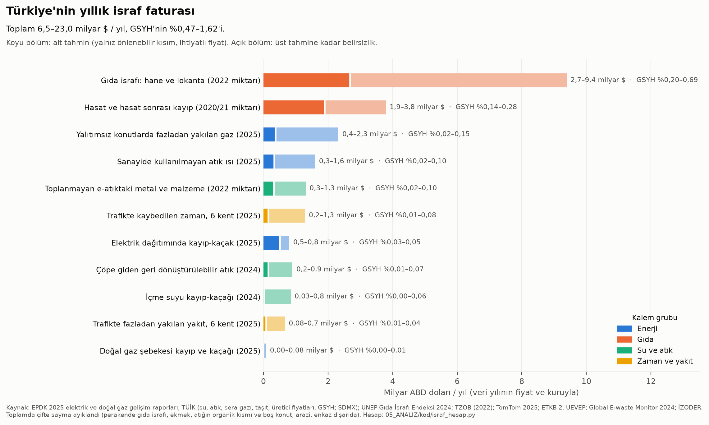
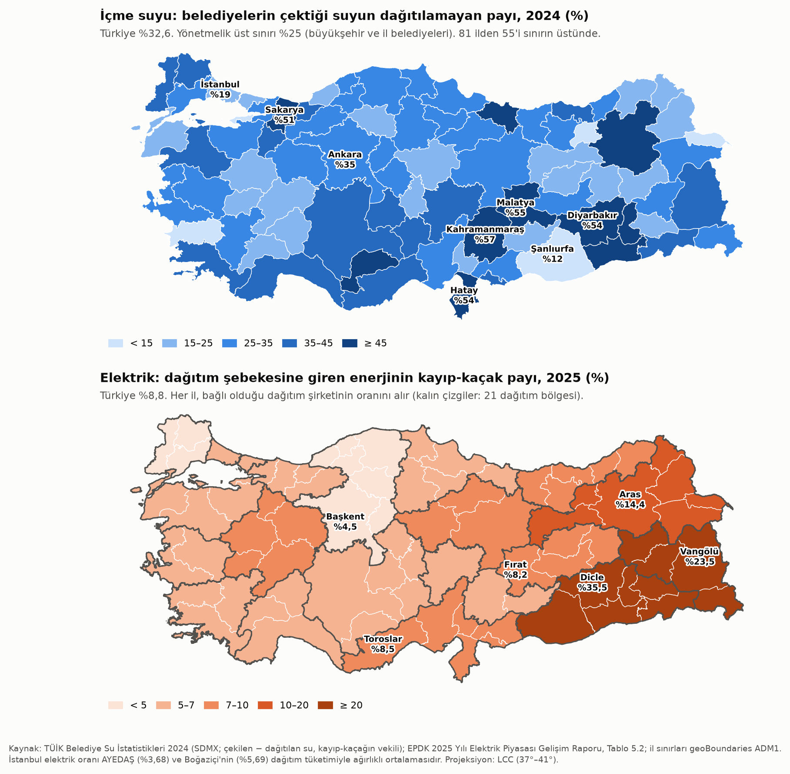
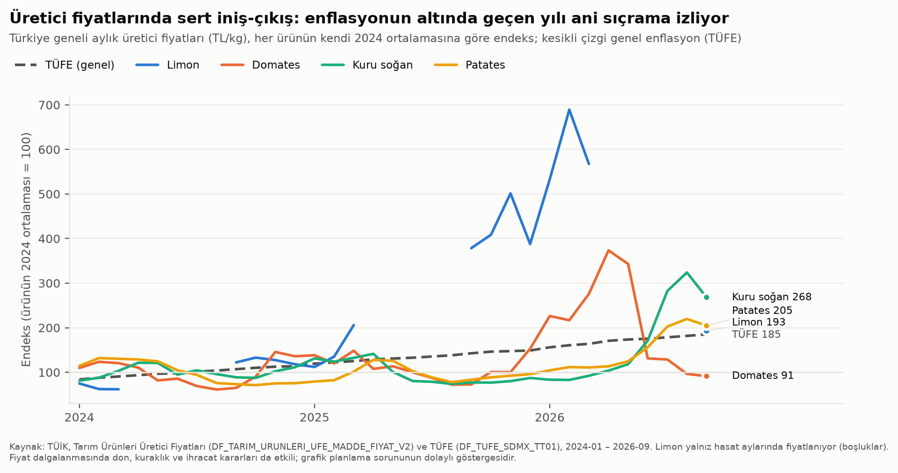

# Faz 4 · Rapor 6 — İsraf, Fire ve Kaçak: Türkiye'nin Yıllık İsraf Faturası

*27 Ekim 2026 · Sürüm 0.1*

| Ne | Nerede |
|---|---|
| Kaynak notu (erişim, tanımlar, bulunamayanlar) | [03_VERI/ham/israf/kaynaklar.md](../03_VERI/ham/israf/kaynaklar.md) |
| Bütün girdi sayıları (değer, yıl, kaynak, işaret) | `03_VERI/ham/israf/israf_parametreler.csv` · EPDK tablosu `epdk_elektrik_dagitim_kayip.csv` · TÜİK SDMX yanıtları `sdmx/` |
| Kod | `05_ANALIZ/kod/israf_veri_indir.py` → `israf_ghsl_arazi.py` → `israf_hesap.py` → `israf_grafikler.py` |
| Sonuç tabloları | `05_ANALIZ/sonuclar/israf_fatura.csv` (ana tablo) · `israf_elektrik_bolge.csv` · `israf_elektrik_il.csv` · `israf_su_il.csv` · `israf_atik_il.csv` · `israf_trafik_sehir.csv` · `israf_arazi_il.csv` · `israf_firsat_maliyeti.csv` · `israf_tarim_fiyat_*.csv` · `israf_ek_gostergeler.csv` |
| Grafik ve harita | [israf_fatura.png](../05_ANALIZ/grafikler/israf_fatura.png) · [israf_kayip_kacak_haritalari.png](../04_HARITA/israf_kayip_kacak_haritalari.png) · [israf_tarim_fiyat.png](../05_ANALIZ/grafikler/israf_tarim_fiyat.png) |

**İşaretler:** [D] birincil kaynakta doğrulandı · [İ] ikincil aktarım · [DY] doğrulanamadı · [V] varsayım · [H] bu çalışmada hesaplandı.

---

## Özet

**Soru:** Kullanıcının tezi şu: "Kendi kendine yeten bir ekonomide hiçbir şey israf olmaz. Geri dönüştürülebilir pek çok malzeme var. Tarım ve sanayi plansız; yakıt ve yiyecek gibi israflar oluyor." Bu israf Türkiye verisiyle ölçülebilir mi, büyüklüğü ne?

**Kısa cevap:**

1. **Ölçülebilen yıllık israf 6,5 ile 23,0 milyar dolar arasında.** Bu, GSYH'nin **%0,47–1,62**'sine, kişi başı yılda 76–268 dolara denk geliyor [H].
   - Toplam 11 akış kaleminden oluşuyor. Her kalemde alt ve üst tahmin var: alt tahmin yalnızca teknik olarak kaçınılmaz düzeyin üstündeki kısmı ihtiyatlı fiyatla sayıyor.
   - Boş konut, arazi yayılması ve deprem enkazı yıllık akış değil. Bunlar toplama katılmadı, ayrıca verildi (§3.3).
2. **Faturanın en büyük kalemi gıda.** Alt tahminin %70'i, üst tahminin %57'si gıdadan geliyor.
   - Evlerde ve lokantalarda yılda **11,2 milyon ton** gıda atılıyor (kişi başı 131 kg; UNEP 2024, 2022 verisi) [D]. Değeri 2,7–9,4 milyar dolar [H].
   - Hasatta ve hasattan sonra, tüketiciye ulaşmadan **8,5 milyon ton** tahıl, sebze ve meyve kayboluyor (TZOB, 2020/21) [İ]. Değeri 1,9–3,8 milyar dolar [H].
   - Türkiye'nin kendi gıda israfı ölçümü yok. UNEP tahmini başka ülkelerden türetilmiş ve "düşük güvenli" [D].
3. **Kayıp-kaçak birkaç bölgede yoğunlaşıyor.**
   - **Elektrik:** Dağıtım şebekesine giren enerjinin %8,8'i (20,6 TWh) kayboluyor (2025) [H]. Kaybın üçte biri (%33) tek bir bölgede, Dicle'de [H]; bölgenin kayıp oranı %35,5 [D]. Dicle, Vangölü ve Aras birlikte kaybın %39'unu oluşturuyor.
   - **Su:** Belediyelerin çektiği suyun **%32,6**'sı (2,4 milyar m³) dağıtılamıyor (2024) [H]. Bu, İstanbul'un bir yılda çektiği suyun iki katı. 81 ilin 55'i yönetmelikteki %25 sınırının üstünde. Deprem illerinde oran 2022'den 2024'e sıçradı: Hatay %30'dan %55'e, Malatya %36'dan %55'e.
   - **Doğal gaz:** Şebeke kaybı küçük, tüketimin %0,01 ile %0,4'ü arasında [H].
4. **"Geri dönüştürülebilir pek çok malzeme var" tezi doğrulanıyor.**
   - Belediye atığının (34,4 milyon ton, 2024) yalnızca **%13**'ü malzeme olarak geri dönüşüyor (OECD tanımı, 2021) [D]. Bakanlığın açıkladığı %36 daha geniş bir tanıma dayanıyor [İ].
   - Toplanan atığın %11'i hâlâ düzensiz belediye çöplüklerine gidiyor. Diyarbakır, Batman, Adıyaman ve Şırnak'ta bu pay %99–100 [D].
   - Bütün Türkiye'de yalnızca 9 kompost tesisi var. Bunlar yılda 124 bin ton işliyor; bu, belediye atığının binde 4'ü [D].
   - E-atığın %83'ü kayıtlı yoldan toplanmıyor (2022) [D].
5. **"Tarım plansız" tezi için kanıt dolaylı.**
   - Üretici fiyatları sert iniş-çıkış gösteriyor [D]. Limonun kilosu 2024'te 4,7 TL'ye kadar düştü, 2026 başında 51,9 TL'ye çıktı. Patates ve kuru soğan iki yıl enflasyonun altında kaldı, 2026'da fiyatları iki-üç katına çıktı.
   - Fiyat çöktüğü yıl ürünün tarlada bırakıldığına dair sayısal bir ölçüm bulunamadı [DY].
   - Planlama, 2023 yönetmeliğiyle 2027 üretim yılından itibaren izne bağlanıyor [İ].
6. **"Yakıt israfı" iki yerde ölçüldü.**
   - **Yalıtımsız konutlar:** Yılda 2,2–6,6 milyar m³ gaz fazladan yakılıyor. Bu, 2025 ulusal gaz tüketiminin %4–11'i [H/V].
   - **Trafik sıkışıklığı:** Altı büyük kentte yılda 75–477 milyon litre yakıt boşa gidiyor; 124–397 milyon araç-saat kayboluyor [H/V].
7. **En etkili üç çözüm (faturadaki payına göre):**
   - **Gıda:** Ölçüm, gıda bankacılığı, kısa tedarik zinciri, soğuk zincir ve sözleşmeli üretim.
   - **Isı:** Deprem dönüşümüne bağlanmış yalıtım ve sanayideki atık ısının organize sanayi bölgesi hatlarıyla kullanılması.
   - **Şebeke kayıpları:** Suda bölge ölçümlü alanlar (DMA) ve akıllı sayaç; elektrikte Dicle, Vangölü ve Aras odaklı sayaçlandırma ve sulama dönüşümü.



---

## 1. Yöntem: fatura nasıl kuruldu?

- **Kapsam:** Fiziksel olarak ölçülebilen ve yıllık tekrarlanan kayıplar.
  - Kapsam dışı kalanlar: Sanayide proses verimsizliği, kamyonlarda boş sefer ve tarlada bırakılan ürün. Bunlar için veri bulunamadı [DY].
  - Bu yüzden fatura, toplumdaki bütün israfın **alt sınırı** sayılmalı.
- **İki tahmin:**
  - **Alt:** Yalnızca teknik referansın üstündeki kısım, ihtiyatlı (maliyete yakın, düşük) fiyatla. Örnek: elektrikte %6'nın üstü, suda %25 hedefinin üstü.
  - **Üst:** Daha sıkı referans (elektrikte en iyi bölge %3,68, suda %10), yüksek ama yine maliyete yakın fiyat.
- **Fiyat ve yıl:** Her kalem kendi veri yılının fiyatıyla değerlendi (2024 ya da 2025). Dolar karşılığı o yılın ortalama kuruyla (2024: 32,82 TL; 2025: 39,51 TL; TCMB) [D]. GSYH payı o yılın GSYH'siyle (2024: 44,59 trilyon TL [D]; 2025: 63,02 trilyon TL [İ]) hesaplandı.
  - Gıda miktarları 2022, TZOB kayıpları 2020/21, e-atık 2022 yılına ait. Bu kalemler 2024 fiyatlarıyla değerlendi.
- **Çifte saymayı önleme:**

  | Örtüşme riski | Ne yapıldı |
  |---|---|
  | Evlerdeki gıda israfı belediye atığının organik kısmıdır | Atık kaleminde yalnızca kuru geri dönüştürülebilirler (kâğıt, plastik, cam, metal) değerlendi. Organik kısım gıda kaleminde |
  | UNEP'in perakende israfı (2,7 Mt) TZOB'un "son tüketiciye ulaşmadan" kaybıyla örtüşebilir | Perakende israfı toplama katılmadı |
  | Ekmek israfı hane ve lokanta israfının içinde | Ekmek ayrıca eklenmedi (§2.4) |
  | Su şebekesinin pompaj elektriği | Yalnızca su kaleminde değerlendi; elektrik kalemi yalnızca dağıtım kaybı |
  | Doğal gaz iletiminde kompresörlerin yaktığı gaz (317 milyon m³) | İsraf sayılmadı. Sistemin çalışma maliyeti |
  | Konut ısınması ile sanayi atık ısısı | Ayrı sektörler; ikisi de gaz eşdeğeriyle değerlendi, örtüşme yok |
  | Trafikte zaman ve yakıt | Ayrı kalemler; zaman yalnızca sürücü (alt) ve yolcular (üst) için |
  | Boş konut, arazi, enkaz | Stok veya tek seferlik. Yıllık toplama katılmadı |

---

## 2. Kalem kalem bulgular

### 2.1 Elektrik dağıtımında kayıp-kaçak

| Gösterge | Değer | Yıl | Kaynak |
|---|---|---|---|
| Dağıtım kayıp oranı, Türkiye | **%8,76** (20.612 GWh) | 2025 | [H] EPDK Tablo 1.11 ve 5.2'den |
| İletim kayıp oranı | %1,96 (toplama katılmadı) | 2025 | [D] EPDK |
| En yüksek: Dicle / Vangölü / Aras | %35,48 / %23,54 / %14,39 | 2025 | [D] EPDK |
| En düşük: AYEDAŞ / Başkent / Trakya | %3,68 / %4,47 / %4,65 | 2025 | [D] EPDK |
| Dicle'nin Türkiye dağıtım kaybındaki payı | **%33,2** (6.839 GWh) | 2025 | [H] |
| Brüt kaybın değeri (PTF 2.651,81 TL/MWh) | 54,7 milyar TL ≈ 1,38 milyar $ | 2025 | [H] |
| **Önlenebilir kısım** | 7.540–11.951 GWh → **0,51–0,80 milyar $** (GSYH %0,03–0,05) | 2025 | [H] |

**Okuma:**
- **Kaybın yeri.** Toplam kaybın yaklaşık üçte ikisi, %6 eşiğinin altında kalan "normal" teknik kayıp. %6'nın üstündeki önlenebilir kaybın (7.540 GWh) **%87**'si güneydoğu ve doğudaki üç bölgede: Dicle, Vangölü ve Aras.
- **Üç bölgenin potansiyeli.** Dicle, Vangölü ve Aras %6'ya inse yılda **6.574 GWh** kazanılır; değeri ≈0,44 milyar $ [H].
- **Hedefler gevşek.** EPDK hedefleri bölgeye göre ayarlanıyor; Dicle'nin 2025 hedefi %42,7 [D]. 21 şirketten yalnızca Çamlıbel 2025 hedefini tutturamadı [D].
- **Yön iyi ama yavaş.** Dicle 2023'te %42,8 iken 2025'te %35,5'e indi [D].
- **Kaybın kaynağı.** Bölgede kaybın önemli kısmının tarımsal sulamadaki kayıt dışı kuyu kullanımından geldiği sıkça söyleniyor. Bu çalışmada bu iddia sayıyla doğrulanamadı [DY].
- **Kim ödüyor?** Kayıp-kaçak bedeli 2016'dan beri faturada ayrı bir satır olarak görünmüyor; dağıtım bedelinin içinde, bütün tüketicilere yayılıyor [D: EPDK]. Yani kaçak, ülke genelinde bir çapraz sübvansiyon.

### 2.2 Doğal gaz kayıpları

| Gösterge | Değer | Yıl | Kaynak |
|---|---|---|---|
| Ulusal tüketim | 59,07 milyar Sm³ (2024: 53,23) | 2025 | [D] EPDK |
| EPDK tüketim tablosunda "kayıplar" | 3,99 milyon Sm³ (%0,007) | 2025 | [D] EPDK Tablo 8.2 |
| Petrol ve gaz sistemlerinden kaçak metan (envanter 1.B.2) | 144 bin ton CH₄; toplam 4,36 Mt CO₂e | 2024 | [D] TÜİK sera gazı envanteri |
| Kaçak metanın gaz hacmi karşılığı (tamamı gazdan sayılırsa) | ≈228 milyon Sm³ (%0,43) | 2024 | [H] |
| Kaçak ve usulsüz kullanım nedeniyle yapılan gaz kesintileri | Toplam 2,16 milyon kesintinin %13,4'ü | 2025 | [D] EPDK 7.5 |
| **Değer** | **0,001–0,08 milyar $** | 2025 | [H] |

**Okuma:**
- **Parasal kayıp küçük.** Gaz şebekesi genç ve kayıp düşük.
- **İklim etkisi küçük değil.** Kaçak metan 4,4 Mt CO₂e ediyor. Bu, trafik kaleminde hesaplanan sıkışıklık kaynaklı CO₂'nin (0,18–1,1 Mt) dört katından fazla.
- **Dağıtım kaybı bilinmiyor.** EPDK raporlarında dağıtım şebekesi kayıp-kaçak oranı bulunamadı [DY].

### 2.3 İçme suyu kayıp-kaçağı

| Gösterge | Değer | Yıl | Kaynak |
|---|---|---|---|
| Belediyelerce çekilen şebeke suyu | 7,468 milyar m³ | 2024 | [D] TÜİK SDMX |
| Şebekeyle dağıtılan su | 5,033 milyar m³ | 2024 | [D] TÜİK SDMX |
| Fark (kayıp-kaçak vekili) | **2,435 milyar m³, %32,6** (2020: %33,6; 2022: %31,6) | 2024 | [H] |
| Yönetmelik üst sınırı | 9 yılda %25, ilk 5 yılda %30 (büyükşehir ve il belediyeleri); diğer belediyeler için 9 yılda %30, ardından 5 yılda %25 | 2014 | [D] RG 08.05.2014/28994, md. 9 |
| %25'in üstündeki il | **55 / 81** | 2024 | [H] |
| En yüksek | Kahramanmaraş %57,5 · Malatya %54,6 · Hatay %54,5 · Diyarbakır %54,2 · Sakarya %51,1 · Mardin %50,7 | 2024 | [H] |
| En düşük | Yalova %11,8 · Şanlıurfa %11,9 · Iğdır %12,7 · Bayburt %13,9 · Aydın %14,3 | 2024 | [H] |
| Büyük kentler | İstanbul %18,6 · İzmir %27,4 · Bursa %28,8 · Ankara %34,6 · Antalya %44,0 | 2024 | [H] |
| **Önlenebilir kısım** | 0,71 (alt, %25'in üstü) – 1,69 (üst, %10'un üstü) milyar m³ → **0,03–0,84 milyar $** | 2024 | [H/V] |

**Okuma:**
- **Mutlak kayıpta büyükşehirler önde.** En büyük kayıp İstanbul (216 milyon m³), Ankara (199) ve Antalya'da (171).
- **Deprem şebekeyi bozdu.** Hatay'da oran 2022'de %30'du, 2024'te %55'e çıktı. Kahramanmaraş %40'tan %57'ye, Malatya %36'dan %55'e yükseldi. Depremden zarar gören şebekenin yeniden kurulması, kayıp yönetimini baştan doğru yapmak için bir fırsat.
- **Şanlıurfa'ya dikkat.** Oran 2022'de %27,6 iken 2024'te %11,9'a indi. Bu kadar hızlı bir düşüş ölçüm ya da tanım değişikliğinden de kaynaklanabilir; teyit edilmeli [DY].
- **Değer aralığı neden geniş?** Belediye su tarifeleri doğrulanamadı.
  - Alt değer yalnızca suyun pompaj ve arıtma elektriği (0,6 kWh/m³ × PTF ≈ 1,36 TL/m³) [V].
  - Üst değer 0,50 $/m³ ≈ 16,4 TL/m³ [V]. Büyük kentlerin konut tarifeleri bunun üstünde olabilir [DY].
- **Kıtlık riski.** Kuraklık dönemlerinde kaybolan suyun değeri, bir sonraki barajın maliyetiyle ölçülmeli. Bu durumda değer üst tahmine yaklaşır.



### 2.4 Gıda kaybı ve israfı

| Gösterge | Değer | Yıl | Kaynak |
|---|---|---|---|
| Hanehalkı gıda israfı | 8,69 milyon ton; **102 kg/kişi** (2019: 93 kg) | 2022 | [D] UNEP FWI 2024 ve 2021; UN SDG 12.3.1 |
| Gıda hizmeti (lokanta, yemekhane) | 2,51 milyon ton; 29 kg/kişi | 2022 | [D] |
| Perakende (toplama katılmadı) | 2,69 milyon ton; 31 kg/kişi | 2022 | [D] |
| Tahminin güveni | "Düşük": Türkiye'de hane ölçümü yok, değer benzer ülkelerden türetilmiş | 2024 | [D] UNEP |
| Son tüketiciye ulaşmadan kayıp | Tahıl 2,8 · sebze 3,9 · meyve 1,8 milyon ton. Oranlar: buğday %8,3, domates %15,9, kuru soğan %8,4 | 2020/21 | [İ] TZOB (2022), TÜBA (2024) |
| FAO gıda kaybı yüzdesi (üretimden perakendeye) | Türkiye değeri yok; Batı Asya %13,8, dünya %13,3 | 2023 | [D] UN SDG 12.3.1a |
| Bakanlık açıklamaları | "Her yıl 18,8 milyon ton gıda çöpe gidiyor" (2020); 18,2 milyon ton (2023) | 2020, 2023 | [İ] Yöntem açıklanmamış; hesaba katılmadı |
| Satın alınan gıdanın tüketilmeden atılan payı | %23 | 2018 | [İ] Ticaret Bakanlığı İsraf Raporu, TÜBA aktarımı |
| Ekmek israfı | Günde 6 milyon (2012) → 4,9 milyon (2013); yılda ≈447 bin ton | 2013 | [İ] TMO ölçümü; ağırlık 250 g [V]. Daha yeni ölçüm bulunamadı |
| 2024 üretici fiyatları (TL/kg) | Buğday 9,21 · sebze ortalaması 13,39 · meyve ortalaması 25,74 · çiğ süt 14,55 | 2024 | [D] TÜİK |
| **Değer: hane ve lokanta** | Yenilebilir kısım 5,6–7,8 milyon ton → **2,7–9,4 milyar $** (GSYH %0,20–0,69) | 2024 fiyatları | [H/V] |
| **Değer: hasat ve hasat sonrası** | 4,3–8,5 milyon ton → **1,9–3,8 milyar $** (GSYH %0,14–0,28) | 2024 fiyatları | [H/V] |

**Okuma:**
- **Tezin en güçlü dayanağı gıda.** Gıda kayıplarının değeri (150–432 milyar TL, 2024) tarım, ormancılık ve balıkçılık katma değerinin (2,60 trilyon TL [D: TÜİK]) **%6–17**'sine eşit.
- **Değer neden düşük kalabilir?** Hesaplar çiftçi eline geçen fiyatla yapıldı; üst tahmin bunu 2,5 katla çarpıyor [V]. Tüketicinin ödediği fiyat, enerji, su ve emek hesaba katılırsa kaybın toplumsal maliyeti daha yüksek.
- **Ekmek.** TMO ölçümleri 2012–2013'te kaldı. Kampanyaların sonrasında israfın düşüp düşmediği bilinmiyor.
- **Planlama (dolaylı kanıt).** TÜİK üretici fiyatlarında, 2024 başından 2026 Eylül'e kadar en düşük ve en yüksek aylık fiyat arasındaki oran [D/H]:

  | Ürün | En yüksek / en düşük aylık fiyat |
  |---|---|
  | Limon | 11 kat |
  | Domates | 6 kat |
  | Kuru soğan | 4,4 kat |
  | Patates | 3,1 kat |
  | Buğday | 1,9 kat |

  Aynı dönemde genel fiyat düzeyi (TÜFE) 2026 Eylül'de 2024 ortalamasının 1,85 katına ulaştı [D].
  - Patates ve kuru soğan 2024–2025'te enflasyonun çok altında kaldı, yani reel olarak ucuzladı. 2026'da fiyatları iki-üç katına çıktı.
  - Bu, "bir yıl bol üretim ve düşük fiyat, ertesi yıl ekim azalması ve kıtlık" döngüsüyle uyumlu. Ancak don (2025 meyve fiyatları), kuraklık ve ihracat kararları da etkili.
  - Fiyat düşüşü yüzünden tarlada bırakılan ürünün miktarı ölçülmemiş [DY].



### 2.5 Yakıt ve zaman: trafik sıkışıklığı

| Kent | Yoğun saatte yıllık kayıp (sürücü başına) | Trafiğe kayıtlı otomobil, Aralık 2025 |
|---|---|---|
| İstanbul | 112 saat (2024'e göre +5 saat) | 4.059.586 |
| Ankara | 112 saat | 2.168.210 |
| İzmir | 112 saat | 1.086.293 |
| Antalya | 108 saat | 756.254 |
| Bursa | 81 saat | 720.750 |
| Adana | 76 saat | 452.772 |

*Kaynak: TomTom Traffic Index 2025 [D]; TÜİK motorlu kara taşıtları [D]. İstanbul'da 2025 sıkışıklık oranı %62, Ankara %55,8 [D].*

**Hesap (2025):**
- **Yoğun saatte işe gidip gelen araç payı:** %25 (alt) ile %40 (üst) [V]. Alt tahminde gecikmenin yalnızca yarısı önlenebilir sayıldı [V].
- **Kaybedilen zaman:** 124–397 milyon araç-saat [H].
  - Saat değeri, net asgari ücretin saatlik karşılığı (22.104,67 TL/ay [İ] ÷ 225 saat = 98,2 TL) üzerinden alındı: alt tahminde bunun yarısı, üst tahminde tamamı ve araç başına 1,3 kişi [V].
  - Değer: **0,15–1,29 milyar $** [H].
- **Fazladan yakılan yakıt:** Gecikme saati başına 0,6–1,2 litre, litresi 45–55 TL [V]. Toplam 75–477 milyon litre; değeri **0,08–0,66 milyar $**. Buna bağlı 0,18–1,1 milyon ton CO₂ [H].
- **Kapsam:** Hesap yalnızca altı kenti ve işe gidiş-gelişi kapsıyor. Yük taşımacılığı, öteki kentler ve kamyonlarda boş sefer kapsam dışı. Boş sefer oranı için Türkiye verisi bulunamadı [DY]. İBB'nin kendi maliyet tahmini ve INRIX İstanbul verisi de bulunamadı [DY].

### 2.6 Binalarda enerji israfı

| Gösterge | Değer | Yıl | Kaynak |
|---|---|---|---|
| Bina ve hizmetlerin nihai enerji tüketimi | 39,2 MTEP (toplamın %32,6'sı, en büyük pay) | 2022 | [D] 2. UEVEP |
| Bina stoku | ≈9,6 milyon bina; %87'si konut | 2022 | [D] 2. UEVEP |
| Konut doğal gaz tüketimi | 20,86 milyar Sm³ (ulusal tüketimin %35'i) | 2025 | [D] EPDK |
| Yalıtımsız bina payı | %75 (sektör derneğinin açıklaması) | 2024 | [İ] İZODER |
| Yalıtım eksikliği yüzünden ısınma sorunu yaşayan nüfus | %30,2 | 2024 | [İ] TÜİK GYKA, İZODER aktarımı |
| 2025'te yalıtım yapılan bina | ≈99 bin; tasarruf 260 bin TEP | 2025 | [D] UEVEP 2025 Gelişim Raporu |
| 2. UEVEP hedefi (2024–2030) | 37,1 MTEP kümülatif tasarruf; 20,2 milyar $ yatırım | 2024 | [D] ETKB |
| **Fazladan yakılan konut gazı** | **2,2–6,6 milyar Sm³** (ulusal tüketimin %4–11'i) → **0,37–2,32 milyar $** | 2025 | [H/V] |

**Hesap ve okuma:**
- **Formül:** Konut gazı × ısınmaya giden pay (%70–85) × yalıtımsız konut payı (%50–75) × yalıtımla tasarruf (%30–50) [V].
- **Fiyat:** Alt tahmin sübvansiyonlu konut gaz bedeliyle (6,70 TL/Sm³), üst tahmin maliyete yakın sanayi bedeliyle (13,80 TL/Sm³) hesaplandı [D: EPDK].
- **Kapsam dışı kalanlar:** Kömür ve odunla ısınan konutlar, elektrikli ısıtma ve klima dahil değil.
- **Karşılaştırma:** İZODER'in "yıllık 12–15 milyar $" tahmini [İ] bizim üst sınırımızın beş katından fazla. O tahminin yöntemi açıklanmamış.
- **Hız sorunu:** 2025'te yalıtılan 99 bin bina, stokun yaklaşık %1'i. Bu hızla yalıtımsız stok on yıllarca kalır.

### 2.7 Atık ve geri dönüşüm

| Gösterge | Değer | Yıl | Kaynak |
|---|---|---|---|
| Üretilen belediye atığı | 34,37 milyon ton; kişi başı 1,09 kg/gün | 2024 | [D] TÜİK SDMX |
| Toplanan belediye atığı | 32,28 milyon ton | 2024 | [D] |
| Toplananın gittiği yer | %88,9 atık işleme tesisi (çoğu düzenli depolama) · %10,9 belediye çöplüğü · %0,3 diğer | 2024 | [D] |
| Çöplüğe gitme payı %90'ı aşan il | 8 il: Diyarbakır, Batman, Adıyaman, Şırnak, Kars, Artvin, Tunceli, Bartın | 2024 | [H] |
| Düzenli depolamaya giden toplam atık (tüm türler) | 138,1 milyon ton | 2024 | [D] |
| Kompost | 9 tesis; 124 bin ton atık işlendi, 38 bin ton kompost üretildi | 2024 | [D] |
| Malzeme geri dönüşümü (OECD/Eurostat tanımı) | 4,32 milyon ton, **%12,8** | 2021 | [D] UN SDG 12.5.1 |
| Bakanlığın geri kazanım oranı (Sıfır Atık) | %36,08 (2024), %37,53 (2025); hedef %60 (2035) | 2024–25 | [İ] |
| Düzenli depolamadan metan (5.A) | 9,47 milyon ton CO₂e | 2024 | [D] TÜİK envanter |
| İmalat sanayi atığı | 24,35 milyon ton; 2,62'si düzenli depolamaya | 2024 | [D] |
| E-atık | 1,08 milyon ton (12,7 kg/kişi); belgelenmiş toplama 187 bin ton (%17) | 2022 | [D] GEM 2024 |
| 6 Şubat 2023 deprem enkazı | 100–120 milyon m³ (≈250–300 milyon ton); taşıma ve bertaraf 41,85 milyar TL (2,22 milyar $) | 2023 | [D] SBB |
| **Değer: depolamaya giden kuru geri dönüştürülebilir** | 2,6–6,0 milyon ton → **0,15–0,90 milyar $** | 2024 | [H/V] |
| **Değer: toplanmayan e-atık** | 890 bin ton → **0,33–1,31 milyar $** | 2022 miktarı | [H/V] |

**Okuma:**
- **İki oran arasındaki fark.** Bakanlığın %36'lık oranı ile OECD'nin %13'lük oranı arasındaki fark tanımdan geliyor. OECD yalnızca malzeme olarak geri dönüşeni sayıyor. Uluslararası kıyasta %13 kullanılmalı.
- **Değer hesabı.**
  - Kuru geri dönüştürülebilir payın %20–30 [V] olduğu kabul edildi; geri dönüştürülen 4,32 Mt düşüldü; kalan ton başına 60–150 $ [V] ile değerlendi.
  - Atık bileşimi ve hurda fiyatları doğrulanamadı [DY]. Bu kalemin güveni düşük.
- **E-atığın değeri.** Dünya ortalaması ton başına ≈1.468 $ [D: GEM]. Alt tahminde bu değerin yalnızca dörtte biri sayıldı, çünkü kayıt dışı toplayıcılar metallerin bir kısmını zaten geri kazanıyor [V].
- **Ölçülemeyenler.** Ambalaj atığı, depozito sistemi ve yıllık inşaat-yıkıntı atığı için sayı bulunamadı [DY].

### 2.8 Boş konut ve arazi israfı (fırsat maliyeti, toplama katılmadı)

| Gösterge | Değer | Yıl | Kaynak |
|---|---|---|---|
| Konut stoku | ≈31 milyon (Bakan açıklamasının aktarımı) | 2025 | [İ] |
| Hanehalkı sayısı | 26,98 milyon | 2025 | [D] TÜİK |
| Atıl konut (stok − hane − %3–5 sağlıklı boşluk; yazlıklar dahil) | **2,5–3,1 milyon** | 2025 | [H/V] |
| Kira karşılığı (100 m² × 144,09 TL/m²/ay × %30–60) | 3,9–9,8 milyar $/yıl (GSYH %0,29–0,72) | 2024 | [H/V]; birim kira [D] TCMB |
| Yapılı alan (GHSL) | 239.755 ha → 339.761 ha (**+%41,7**) | 2000–2020 | [D/H] |
| Nüfus (GHSL) | +%31,4 | 2000–2020 | [D/H] |
| Kişi başı yapılı alan | 37,9 → 40,8 m² | 2000–2020 | [H] |
| Nüfus artışını aşan yapılaşma | **24.600–34.900 ha** (20 yılda; yılda ≈1.200–1.750 ha) | 2000–2020 | [H] |

**Okuma:**
- **Boş konut verisi zayıf.** TÜİK'in 2021 Bina ve Konut Nitelikleri Araştırması hane temelli; boş konutu saymıyor [D]. Konut stoku için resmî bir sayı bulunamadı; 31 milyon ikincil bir aktarım [İ].
  - Bu yüzden atıl konut aralığı yalnızca bir büyüklük göstergesi. Tutar, faturadaki bütün akış kalemlerinin toplamıyla aynı mertebede.
  - Doğru sayı NVİ adres kaydı (UAVT) ile elektrik ve su abonelikleri eşleştirilerek bulunabilir.
- **Arazi.** Yayılma faturada parasal değer almadı, çünkü tarım arazisinin kaybını parayla ölçecek veri yok.
  - İstanbul (22,3 → 19,7 m²/kişi) ve Ankara (30,5 → 28,8) yoğunlaştı.
  - Yozgat (86 m²/kişi), Afyonkarahisar ve Konya'da nüfus azalırken ya da yavaş artarken yapılı alan %38–62 büyüdü.
  - Boşalan kırsal ile yayılan kasaba birlikte görülüyor. Bu, Faz 3'teki "boşalan çekirdek" bulgusunun ülke ölçeğindeki karşılığı.
  - **İlçe dağılımı.** İlçe panelindeki `yapili_ha` farklı bir ölçü: 2018 yükseklik katmanında bina bulunan 100 m hücrelerin alanı, yani yerleşim izi [D/H]. Türkiye toplamı 3,36 milyon ha, kişi başı ≈400 m²; çatı alanının yaklaşık 10 katı.
    - Bu ölçüye göre 2025 nüfusuyla kişi başı yerleşim izi ilçeler arasında 24 m² ile 6.294 m² arasında değişiyor; medyan 786 m² [H].
    - Bu panelde tek bir yıl olduğu için zaman içindeki değişim GHS-BUILT-S ile hesaplandı.
- **Deprem enkazı.** Enkazın %80'i agrega olarak geri kazanılırsa değeri 0,6–1,9 milyar $ olur (tek seferlik) [V]. Bu, SBB'nin taşıma ve bertaraf maliyetinin (2,22 milyar $) önemli bir kısmını karşılar.

### 2.9 Sanayi atık ısısı ve endüstriyel simbiyoz

| Gösterge | Değer | Kaynak |
|---|---|---|
| Sanayide değerlendirilebilir atık ısı | **1.600 kTEP/yıl** (≈1,9 milyar Sm³ gaz eşdeğeri); yatırım ihtiyacı 1,37 milyar $ | [D] 2. UEVEP (Dünya Bankası destekli Türkiye Atık Isı Potansiyeli Değerlendirme Projesi) |
| Kojenerasyon potansiyeli | 2.515 MWe; yatırım 2 milyar $ | [D] 2. UEVEP |
| İkisinin yıllık tasarrufu | ≈1,6 milyar $ | [D] 2. UEVEP |
| 2025'te gerçekleşen | Atık ısı geri kazanımıyla 1,1 bin TEP; 27,2 MW kojenerasyonla 5,6 bin TEP | [D] UEVEP 2025 Gelişim Raporu |
| **Değer** | **0,34–1,60 milyar $** | [H/D] |

**Okuma:**
- **Gerçekleşme çok düşük.** 2025'te geri kazanılan atık ısı, potansiyelin binde birinden az.
- **Plan var.** UEVEP, OSB'lerdeki işletmelerin atık ısısının merkezi bir hatla toplanmasını ve 20 MW üstü termik santrallerin atık ısısının bölgesel ısıtmada kullanılmasını eylem olarak yazıyor [D].
- **Simbiyozun sonuçları bilinmiyor.** İskenderun Körfezi, Bursa (BEBKA) ve OSTİM simbiyoz projelerinin sayısal sonuçları bulunamadı [DY].

---

## 3. Toplam fatura

### 3.1 Kalem tablosu

| # | Kalem | Fiziksel (alt–üst) | Milyar $ | GSYH % | Veri yılı | İşaret |
|---|---|---|---|---|---|---|
| 4 | Gıda israfı: hane ve lokanta | 5,6–7,8 Mt (yenilebilir) | 2,68–9,39 | 0,20–0,69 | 2022 miktar, 2024 fiyat | D/V |
| 5 | Hasat ve hasat sonrası kayıp | 4,3–8,5 Mt | 1,89–3,79 | 0,14–0,28 | 2020/21 miktar, 2024 fiyat | İ/D/V |
| 8 | Yalıtımsız konutlarda fazla gaz | 2,2–6,6 milyar Sm³ | 0,37–2,32 | 0,02–0,15 | 2025 | D/İ/V |
| 11 | Sanayide kullanılmayan atık ısı | 1,0–1,9 milyar Sm³ eşdeğeri | 0,34–1,60 | 0,02–0,10 | 2025 | D/V |
| 10 | Toplanmayan e-atık | 890 bin ton | 0,33–1,31 | 0,02–0,10 | 2022 miktar | D/V |
| 6 | Trafikte zaman (6 kent) | 124–397 milyon araç-saat | 0,15–1,29 | 0,01–0,08 | 2025 | D/V |
| 1 | Elektrik dağıtım kayıp-kaçağı | 7,5–12,0 TWh | 0,51–0,80 | 0,03–0,05 | 2025 | D/H |
| 9 | Depolamaya giden geri dönüştürülebilir atık | 2,6–6,0 Mt | 0,15–0,90 | 0,01–0,07 | 2024 | D/V |
| 3 | İçme suyu kayıp-kaçağı | 0,71–1,69 milyar m³ | 0,03–0,84 | 0,00–0,06 | 2024 | D/H/V |
| 7 | Trafikte yakıt (6 kent) | 75–477 milyon L | 0,08–0,66 | 0,01–0,04 | 2025 | D/V |
| 2 | Doğal gaz kayıpları | 4–228 milyon Sm³ | 0,00–0,08 | 0,00–0,01 | 2025 | D/H |
| | **Toplam** | | **6,5–23,0** | **0,47–1,62** | 2024–2025 | H |

TL olarak toplam **224–799 milyar TL**; hane başına yılda yaklaşık 8.300–29.600 TL (2024–2025 fiyatları) [H].

### 3.2 Grup bazında

| Grup | Milyar $ (alt–üst) | Alt tahmindeki payı |
|---|---|---|
| Gıda | 4,6–13,2 | %70 |
| Enerji (elektrik, gaz, bina, atık ısı) | 1,2–4,8 | %19 |
| Su ve atık | 0,5–3,0 | %8 |
| Zaman ve yakıt (trafik) | 0,2–1,9 | %4 |

### 3.3 Toplama katılmayanlar

| Kalem | Büyüklük | Neden ayrı? |
|---|---|---|
| Atıl konut | 2,5–3,1 milyon konut; kira karşılığı 3,9–9,8 milyar $/yıl | Stok. Veri ikincil ve zayıf [İ/V] |
| Nüfusu aşan yapılaşma | 24.600–34.900 ha (2000–2020) | Stok; parasal değer biçilmedi |
| Deprem enkazı | 250–300 milyon ton; geri kazanılabilir agrega 0,6–1,9 milyar $ | Tek seferlik |
| Kaçak metan ve depolama metanı | 4,4 + 9,5 milyon ton CO₂e (2024) | İklim maliyeti parasallaştırılmadı |

### 3.4 Tez açısından anlamı

- **Tezin doğrulanan yanı.** İsraf gerçek ve ölçülebilir.
  - En büyük kalem, tezin de vurguladığı gıda.
  - İkinci sırada yakıt ve ısı (yalıtımsız konut, atık ısı, trafik) geliyor.
  - Geri dönüştürülebilir malzemenin büyük kısmı gerçekten çöpe gidiyor (%13 geri dönüşüm, 9 kompost tesisi).
- **Tezin düzeltilmesi gereken yanı.**
  - "Hiçbir şey israf olmaz" bir ideal. Şebekelerde %3–5'lik teknik kayıp her ekonomide kaçınılmaz. Bu yüzden fatura yalnızca bu düzeyin üstündeki kısmı sayıyor.
  - Ölçülebilen akış israfı GSYH'nin %0,5–1,6'sı. Büyük, ama ekonominin "çöktüğü" bir düzey değil.
  - Asıl sorun mekânsal ve kurumsal yoğunlaşma: Dicle'nin elektriği, deprem illerinin suyu, güneydoğunun çöplükleri, evlerdeki gıda.
- **"Plansızlık" iddiası.** Tarımda fiyat iniş-çıkışlarıyla dolaylı olarak destekleniyor. Sanayide ise atık ısının değerlendirilmemesiyle somut biçimde görülüyor: potansiyel var, plan var, gerçekleşme binde birin altında.

---

## 4. Çözümler ve ölçek

Sıralama, faturadaki payı ve uygulanabilirliği birlikte gözetiyor. Proje ilkesi gereği çözümlerin hiçbiri zorlayıcı değil; teşvik, ölçüm ve gönüllü katılıma dayanıyor.

### 4.1 Öncelik sırası

| Sıra | Çözüm | Hedeflediği kalem | Ölçülebilir kazanç (bu raporun hesabıyla) |
|---|---|---|---|
| 1 | **Gıda israfını ölçmek ve yarıya indirmek** (SDG 12.3): hane ölçümü, gıda bankacılığı, kısa tedarik zinciri, soğuk zincir, sözleşmeli üretim | 4, 5 | Hane ve lokanta israfı yarıya inerse 1,3–4,7 milyar $/yıl |
| 2 | **Isıyı içeride tutmak:** deprem dönüşümüne bağlı yalıtım; OSB'lerde atık ısı hattı ve bölgesel ısıtma | 8, 11 | 2,2–6,6 milyar Sm³ gaz; atık ısıyla 1,0–1,9 milyar Sm³ eşdeğeri |
| 3 | **Şebeke kayıplarını kapatmak:** suda bölge ölçümlü alan (DMA), basınç yönetimi ve akıllı sayaç; elektrikte Dicle, Vangölü ve Aras'ta sayaçlandırma ve sulama dönüşümü | 1, 3 | Su: %25 hedefine inmekle 0,71 milyar m³. Elektrik: üç bölge %6'ya inerse 6,6 TWh (≈0,44 milyar $) |
| 4 | **Atığı kaynağında ayırmak:** depozito-iade sistemi, mahalle kompostu ve biyogaz, e-atık toplama noktaları | 9, 10 | 0,5–2,2 milyar $; düzenli depolama metanında azalma |
| 5 | **Yürünebilir mahalle ve otopark reformu** (Faz 3'teki E ekseni, O1–O2) | 6, 7 | Trafikte 0,2–1,9 milyar $ |
| 6 | **Atıl stoku harekete geçirmek:** boş konut envanteri, kiralama teşviki, enkazdan agrega | 3.3 | 2,5–3,1 milyon konut; 250–300 milyon ton enkaz |

### 4.2 Ölçeğe göre uygulamalar

| Kalem | Mahalle | İlçe ve belediye | Ülke |
|---|---|---|---|
| **Su** | DMA: şebekeyi sayaçlı küçük bölgelere bölmek; gece en düşük akışla kaçağı bulmak; muhtarlık ile ihbar hattı | Basınç yönetimi; akıllı sayaç; aktif kaçak arama ekibi; IWA su dengesiyle yıllık rapor. Deprem illerinde şebekeyi baştan DMA'lı kurmak | Yönetmelikteki %25 sınırının denetimi; il bazında kayıp oranlarının her yıl yayımlanması; İller Bankası kredilerinin kayıp hedefine bağlanması |
| **Elektrik** | Trafo bazında enerji dengesi (giren − faturalanan); kaçak bağlantıların trafo düzeyinde bulunması | Akıllı sayaç (AMI); tarımsal sulama aboneliklerinin sayaçlanması; güneş enerjili sulama ve kooperatif kuyu modeli (Dicle ve Vangölü) | EPDK hedeflerinin her tarife döneminde sıkılaştırılması; kayıp-kaçak bedelinin bölgesel olarak şeffaflaştırılması |
| **Doğal gaz** | Bina içi tesisat sızdırmazlık kontrolü | Dağıtım şirketlerinde metan sızıntısı tespit ve onarım programı (LDAR) | Dağıtım kayıp oranının EPDK raporlarında yayımlanması; envanterde ölçüme dayalı metan |
| **Gıda** | Mahalle gıda dolabı ve paylaşım; okul ve cami aşevi ağları; "yarım ekmek" ve porsiyon seçeneği; üretici pazarları | Belediye gıda bankaları (bağışta KDV istisnası var: 3065 s. KDV Kanunu md. 17/2-b [D]); toptancı halinde satılamayanın kurtarılması; yemekhane israf ölçümü | Ulusal hane israf ölçümü (UNEP yöntemi; şu an Türkiye verisi yok); sözleşmeli üretim ve havza bazlı üretim planlaması (2023 yönetmelikleri, 2027'den itibaren); soğuk zincir ve lisanslı depoculuk; son tüketim tarihi etiket reformu |
| **Tarım planlaması** | Köy ve mahalle ölçeğinde ürün kooperatifleri | İlçe tarım müdürlüğünde ekim beyanı ile talep tahmininin eşleştirilmesi; fiyat çöküşünde işleme tesislerine yönlendirme | Ekim alanı erken uyarı sistemi; fiyat istikrar fonu yerine sözleşme ve depolama |
| **Binalar** | Apartman ölçeğinde yalıtım ve ısı pay ölçer; ortak kazan yenileme | Kentsel dönüşümde enerji kimlik belgesi en az B sınıfı; yalıtım kredisinin belediye ve banka ortaklığıyla verilmesi | 2. UEVEP hedefleri; TS 825'in uygulanmasının denetimi; deprem dönüşümü ile enerji yenilemesinin tek pakette finanse edilmesi |
| **Atık** | Kaynağında üç ayrı kap; mahalle kompostu; atık getirme merkezi; bayat ekmek ve organik atık toplama | Biyogaz tesisi (organik atık + arıtma çamuru); çöplüklerin kapatılması (Diyarbakır, Batman, Adıyaman, Şırnak'ta pay %99–100) | Depozito-iade sistemi; genişletilmiş üretici sorumluluğu (ambalaj, e-atık); geri dönüşüm oranının OECD tanımıyla raporlanması |
| **Enkaz** | Yıkım öncesi ayrıştırma (demir, ahşap, beton) | Mobil kırma-eleme; geri kazanılmış agreganın yol altı dolgusunda kullanılması | Kamu ihalelerinde geri kazanılmış agrega payı; afet sonrası enkaz yönetim planı |
| **Sanayi** | — | OSB'de atık ısı hattı; atık borsası; endüstriyel simbiyoz koordinatörü | Atık ısıdan elektrik ve ısı satışının mevzuatı (UEVEP eylemi); termik santral atık ısısının bölgesel ısıtmaya bağlanması |
| **Konut ve arazi** | Boş dairelerin kiralanması için güvenceli kira modeli | Belediye boş konut envanteri (UAVT + abonelik); kırsalda boş evlerin onarılarak kiralanması | Boş konut sayımı; çeper yerine iç alanda yapılaşmaya öncelik (kişi başı yapılı alan göstergesi) |

### 4.3 Kendi kendine yeten mahalle: tezle bağlantı

Projenin model mahallesi (v2.1) için bu rapordan üç tasarım ölçütü çıkıyor:

1. **Döngüyü mahallede kapatmak.** Organik atığı kompost ve biyogazla mahallede değerlendirmek, kuru atığı ayrı toplamak, artan gıdayı paylaşım dolabıyla dağıtmak.
2. **Ölçülebilir şebeke.** Mahallenin kendi su ölçüm bölgesi (DMA) ve trafo ölçümü olsun. Kayıp her ay görünür olsun.
3. **Isıyı korumak.** Yalıtımlı, güney cepheli, gerektiğinde bölgesel ısıtmaya bağlanabilen bina tipolojisi.

Bu ölçütler "kendi kendine yeten" idealini bir zorlama değil, bir **ölçüm ve geri kazanım düzeni** olarak somutlaştırıyor.

---

## 5. Sınırlılıklar

1. **Gıda verisi Türkiye ölçümü değil.**
   - UNEP'in hane tahmini benzer ülkelerden türetilmiş ve "düşük güvenli" [D].
   - TZOB kayıpları 2020/21 sezonuna ait; yöntemi yayımlanmamış [İ].
   - Gıda kaleminin bütün faturanın yarısından fazlasını oluşturması, belirsizliğin de en çok burada olduğu anlamına geliyor.
2. **Su verisi bir vekil.** TÜİK'in "çekilen − dağıtılan" farkı arıtma sürecindeki kayıpları ve faturalanmayan resmî kullanımı da içeriyor. Gerçek fiziksel kaçak bundan küçük olabilir. Belediye tarifeleri doğrulanamadığı için değer aralığı geniş.
3. **Varsayımlar.** Trafikte araç payı, saat değeri ve ek yakıt; binalarda ısınma payı ve tasarruf oranı; atık bileşimi ve ikincil hammadde fiyatı [V]. Hepsi `israf_parametreler.csv` içinde tek satırda; değiştirilip yeniden hesaplanabilir.
4. **Karışık yıllar.** Miktarlar 2020/21 ile 2025 arasında. Dolar değerleri nominal, her kalem kendi yılının kuruyla. Toplam, aynı yıla ait tek bir hesap değil, "yakın yılların" toplamı.
5. **Eksik kalemler:**
   - Kamyonlarda boş sefer, sanayi proses verimsizliği, ambalaj ve depozito verisi, yıllık inşaat-yıkıntı atığı.
   - Doğal gaz dağıtım kaybı, ithal gaz maliyeti, endüstriyel simbiyoz sonuçları ve tarlada bırakılan ürün miktarı.

   Bunlar bulunamadı [DY]. Web arama kotası çalışma sırasında doldu; bu kalemler Türkiye'den bir tarayıcıyla ya da kurum başvurusuyla yeniden aranmalı.
6. **Boş konut sayısı ikincil.** Resmî konut stoku sayısı bulunamadı. Atıl konut aralığı yalnızca büyüklük göstergesi.
7. **Bölgesel elektrik verisi.** İllere atanan oran, il değil dağıtım bölgesi ortalaması. İl içindeki farkı göstermiyor.
8. **GHSL.** Yapılı alan ve nüfus uydu ve modelle üretilmiş (1 km). İl düzeyinde değişimler kabaca yorumlanmalı.
9. **Nedensellik.** Fiyat dalgalanması planlama eksikliğinin dolaylı göstergesi. Don, kuraklık ve ihracat kararları da aynı dalgalanmayı üretebilir.

---

## Yeniden üretim

```
PYTHONIOENCODING=utf-8 python 05_ANALIZ/kod/israf_veri_indir.py   # TÜİK SDMX (anahtarsız)
PYTHONIOENCODING=utf-8 python 05_ANALIZ/kod/israf_ghsl_arazi.py   # GHSL, uzaktan pencere okuma (~1 dk)
PYTHONIOENCODING=utf-8 python 05_ANALIZ/kod/israf_hesap.py        # fatura ve tablolar
PYTHONIOENCODING=utf-8 python 05_ANALIZ/kod/israf_grafikler.py    # grafik ve harita
```

Python 3.11; pandas, geopandas, rasterio, pyproj, matplotlib. EPDK tabloları PDF'ten elle aktarıldı; kaynak sayfa ve tablo numaraları `03_VERI/ham/israf/kaynaklar.md` içinde.
