# Faz 4 · Rapor 7 — Gelir Adaleti, Vergi Adaleti ve Ticareti Canlı Şehirler

*27 Ekim 2026 · Sürüm 0.1*

| Ne | Nerede |
|---|---|
| Kaynak notu (erişim, doğrulama, bulunamayanlar) | [03_VERI/ham/ekonomi/kaynaklar.md](../03_VERI/ham/ekonomi/kaynaklar.md) |
| Kod | `05_ANALIZ/kod/ekonomi_veri.py` → `ekonomi_dagilim.py` → `ekonomi_ticaret_yeterlilik.py` → `ekonomi_kademe.py` → `ekonomi_grafikler.py` |
| Ana tablolar | `05_ANALIZ/sonuclar/ekonomi_kademe.csv` (ölçeklenebilir şehir modeline girdi) · `ekonomi_kademe_parametre.csv` · `ekonomi_secenekler.csv` · `ekonomi_dagilim_*.csv` · `ekonomi_gelir_esik_2026.csv` · `ekonomi_ucret_esik_aylik.csv` · `ekonomi_vergi_*.csv` · `ekonomi_ticaret_*.csv` · `ekonomi_yeterlilik_*.csv` |
| Grafikler | `05_ANALIZ/grafikler/ekonomi_*.png` (11 grafik, her biri SVG olarak da) |
| İlgili raporlar | [04 Konut maliyeti](04_konut_maliyeti_h2.md) · [06 Politika paketi](06_politika_paketi_ozet.md) · [10 Mahalle FUE](10_fue_mahalle.md) · [19 İsraf](19_israf_fire_kacak.md) · [Toplum hedefleri](../01_KAVRAMSAL_CERCEVE/toplum_hedefleri.md) |

**İşaretler:** [D] birincil kaynakta doğrulandı · [İ] ikincil aktarım · [DY] doğrulanamadı · [V] varsayım · [H] bu çalışmada hesaplandı.

---

## Özet

**Soru:** Kullanıcının hedefi, emekliler, memurlar, işçiler ve işsizler arasındaki gelir ve vergi adaletsizliğini kökünden çözmek. Bunun için gerçek serbest piyasaya imkân veren, ticareti canlı, ölçeklenebilir ve kendi kendine yeten şehirler istiyor. Bugünkü tablo ne, hangi araç hangi ölçekte işe yarar?

**Kısa cevap:**

1. **Eşitsizlik yüksek ve 2014'ten beri yerinde sayıyor.**
   - Gini katsayısı 0,410 (TÜİK, 2025 anketi, 2024 geliri) [İ]; Eurostat'ın aynı anketten hesabıyla 0,439, AB'de 0,292 (2025) [D].
   - En zengin %20 gelirin %48'ini, en yoksul %20 %6,4'ünü alıyor (TÜİK 2025) [İ].
   - Emekli aylıkları dağılımı en çok düzelten kalem: bütün transferler hariç Gini 0,473, emekli aylıkları dahil edilince 0,420 [İ].
2. **Dört grubun taban gelirleri temel ihtiyaçların altında kalıyor (Eylül 2026).**

   | Taban gelir | Tutar (TL/ay) | 4 kişilik ailenin açlık sınırına oranı | 100 m² kiraya oranı |
   |---|---|---|---|
   | En düşük emekli aylığı (Temmuz 2026) | 23.552 [İ] | %62 | kira aylığın %117'si |
   | Net asgari ücret | 28.076 [D] | %74 | %98 |
   | Ortanca net ücret (tahmin) | ≈29.950 [H/V] | %79 | %92 |
   | En düşük memur maaşı, aile yardımı dahil | 70.224 [İ] | 1,86 kat | %39 |
   | İşsiz | işsizlik %8,4, atıl işgücü %29,7 (2025) [D] | — | — |

   - Açlık ve yoksulluk sınırı TÜRK-İŞ'in 4 kişilik aile hesabı (Eylül 2026: 37.801 ve 123.130 TL) [D]. Tek kişinin geliri bu eşiklerle karşılaştırıldı.
   - 100 m² konutun kirası 2018 başında net asgari ücretin %69'uyken 2026'nın üçüncü çeyreğinde %98'i [H]. Aynı dönemde kira reel olarak 1,95 kat, asgari ücret 1,38 kat arttı [H].
   - Ortanca ücret asgari ücretin yalnızca ≈1,1 katı (2022 tahmini) [H/V]. Ücret dağılımı asgari ücrete yığılmış durumda.
3. **Vergi yükü tüketimde, gelir ve mülkte değil.**
   - Mal ve hizmet vergileri toplam vergi ve prim gelirinin %43,6'sı (Türkiye 2024), OECD'de %31,2 (2023). Kişisel gelir vergisi %14,7'ye karşı %23,7 [D].
   - KDV ve ÖTV, gelire oranla en yoksul %20'nin yükü %15,1, en zengin %20'nin %7,8 (2025, statik hesap) [H].
   - Taşınmaz vergileri GSYH'nin %0,10'u, OECD'de %0,95 [D]. Belediyelerin emlak vergisi 2025'te 56,5 milyar TL (GSYH'nin %0,09'u); arsa vergisi yalnız 12,8 milyar TL [D].
   - Devlet 2025'te tahsil ettiği verginin %28,7'si kadarından istisna ve indirimle vazgeçti (3.170 milyar TL). Gelir vergisinde bu oran %52,7, kurumlar vergisinde %61,5 [D].
   - Aynı tutarda gelir türüne göre çok farklı vergileniyor: asgari ücretin 10 katı kazanan ücretli %25, 1,2 milyon TL kira geliri olan kişi %18,7, mevduat faizi %10–17,5 (nominal), borsa kazancı %0 [H/D].
4. **Ticaretin önündeki asıl engel ruhsat süresi değil, imar ve düzenleme yükü.**
   - Sıhhi işyerine ruhsat kâğıt üstünde aynı gün veriliyor [D]. Ama konut alanında zemin kat dükkânı ancak belediye meclisinin "yol boyu ticaret" kararı ve otopark şartıyla açılabiliyor (Planlı Alanlar İmar Yönetmeliği md. 19/1-f-1) [D].
   - OECD ürün piyasası düzenlemesinde (PMR 2023) Türkiye 38 üye içinde en kısıtlayıcı ülke: genel puan 2,52, OECD ortalaması 1,35 [D/H].
   - Hızlı tüketim perakendesinde ilk dört zincirin payı 2019'da %52, 2021'de %59 [D]. Kayıt dışı istihdam %25,5 (2025) [D].
5. **Kendi kendine yeterlilik üründen ürüne değişiyor.**
   - Sebze (%109), tavuk eti (%115), yumurta (%117), buğday (%104, 2024/25) yeterli [D/İ/H].
   - Yağlı tohum ve yemde açık sürekli: soya %4, ayçiçeği %72, mısır %73 [D/İ]. 2025'te yağlı tohum ve bitkisel yağ ithalatı 6,5 milyar dolar [D].
6. **Seçenekler (taraf tutmadan, kanıt düzeyine göre):**
   - **En güçlü kanıta sahip üç seçenek:**
     1. **İstisnaların daraltılması.** Tutarlar resmî raporda belli. Sermaye geliriyle ilgili dört kalem 2025'te ≈681 milyar TL [D]. Asgari ücret istisnası korunmalı.
     2. **Arsa değer vergisi ile KDV indirimi (gelir-nötr).** Ekonomi teorisinde büyümeye en az zarar veren vergi. GSYH'nin %0,5'i kadar arsa vergisi genel KDV oranını %20'den %15,7'ye indirmeye yetiyor [H]. Etkisi tasarıma bağlı: yalnız konut arsası vergilenirse yoksula yük olur (+%0,46), işletme arsası dahil edilip alt iki dilim muaf tutulursa yoksulun yükü gelirin %0,9'u kadar azalır [H].
     3. **Genel KDV indirimi yerine hedefli nakit destek.** Gıda KDV'sini sıfırlamanın bütçe maliyeti 52 milyar TL; en yoksul %20'nin geliri %0,37 artar. Aynı para doğrudan en yoksul %20'ye verilirse artış %2,37, yani ≈6 kat [H].
   - **Yan etkileri:** Arsa değeri vergi kadar düşer ve bugünkü sahipler bir kerelik kayıp yaşar. Geliri düşük ev sahibi emeklilerde nakit sıkışıklığı olur (çözüm: vefat ya da satışa kadar erteleme). İstisnalar daralırsa sermaye yurt dışına ya da altına kayabilir. Hedefli destek hane gelir kaydı ister ve "çalışırsam yardımı kaybederim" tuzağı kurabilir.
7. **Kademe tablosunun özü** (`ekonomi_kademe.csv`):
   - **Vergi kuralı ülkede** konur: KDV, gelir vergisi, istisnalar, arsa vergisinin oran bandı ve muafiyeti.
   - **Arsa vergisi ve değer artış payı şehirde** tahsil edilir. Bugünkü tüketim vergisi bir mahallede (≈7 bin kişi) yılda ≈323 milyon TL, emlak vergisi 4,5 milyon TL [H]. GSYH'nin %0,5'i kadar arsa vergisi her mahalleye ≈25 milyon TL yerel gelir demek [H].
   - **Semt** (≈35 bin kişi) haftalık pazarın, esnaf ortak deposunun, istihdam ve mesleki eğitim ofisinin doğal ölçeği.
   - **Mahalle** zemin kat dükkânı, atölye ve teslim noktasının ölçeği.
   - **Bölge** (≈1,25 milyon kişi) tarım kuşağı, üretici kooperatifi ve kısa tedarik zincirinin ölçeği.

---

## 1. Gelir dağılımı

### 1.1 Eşitsizliğin düzeyi ve seyri

| Gösterge | Türkiye | AB-27 / OECD | Yıl | Kaynak |
|---|---|---|---|---|
| Gini, TÜİK ulusal bülten | **0,410** (2024 anketi: 0,413) | — | 2025 anketi (2024 geliri) | [İ] TÜİK Gelir Dağılımı İstatistikleri 2025, basın aktarımı |
| Gini, Eurostat (aynı anket, AB yöntemi) | **0,439** (2014: 0,412; en yüksek 2022: 0,453) | AB-27: 0,292 | 2025 | [D] Eurostat ilc_di12 |
| Gini, Dünya Bankası | 0,437 | — | 2023 | [D] SI.POV.GINI |
| Gini, OECD: kullanılabilir / piyasa geliri | 0,427 / 0,525 | — | 2022 geliri | [D] OECD IDD |
| En zengin %20 / en yoksul %20 (S80/S20) | 7,5 (TÜİK) · 8,9 (Eurostat) | AB-27: 4,6 | 2025 | [İ] / [D] |
| En yoksul %10'un geliri / en zengin %10'un geliri | %2,2 / %34,8 | — | 2025 | [D] Eurostat ilc_di01 |
| Yoksulluk riski (medyan gelirin %60'ı) | %23,4 | AB-27: %16,3 | 2025 | [D] Eurostat ilc_li02 |
| Gini, bütün sosyal transferler hariç | 0,473 | — | 2025 | [İ] TÜİK |
| Gini, emekli ve dul-yetim aylıkları dahil, diğer transferler hariç | 0,420 | — | 2025 | [İ] TÜİK |

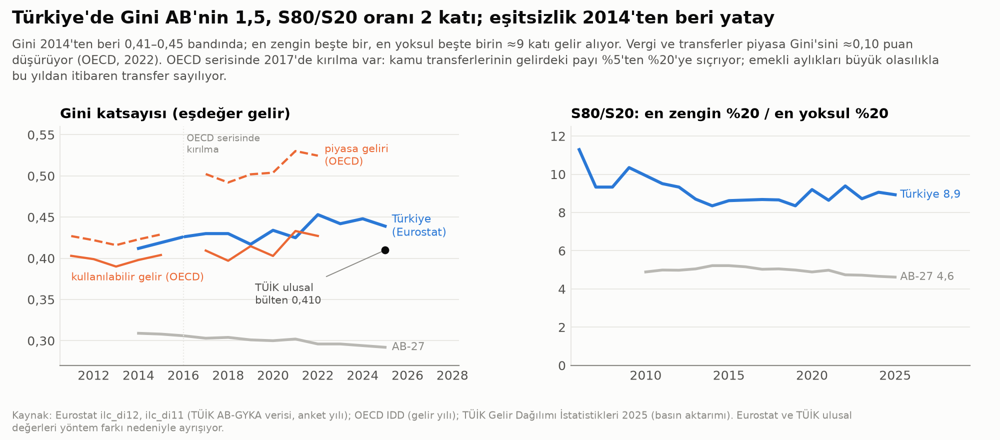

**Okuma:**
- **Düzey.** Türkiye'nin eşitsizliği AB'nin yaklaşık 1,5 katı (Gini), en zengin ile en yoksul beşte bir arasındaki fark iki katı (S80/S20).
- **Seyir.** S80/S20 2006'dan 2014'e 11,3'ten 8,4'e indi, sonra 8,4–9,4 bandında kaldı [D]. Yani eşitsizlik on yıldır azalmıyor.
- **Neden üç ayrı Gini?** TÜİK'in ulusal değeri (0,410) ile Eurostat'ın değeri (0,439) aynı ankete dayanıyor ama ayrışıyor. Farkın nedeni bu çalışmada bulunamadı [DY]. Gelir kavramı ya da ağırlıklandırma farkı olabilir. Proje hedefi (Gini ≤ 0,35, [Toplum hedefleri](../01_KAVRAMSAL_CERCEVE/toplum_hedefleri.md)) Dünya Bankası serisine göre yazılmıştı (0,437).
- **Transferlerin etkisi.** Emekli aylıkları Gini'yi 0,053 puan düşürüyor; diğer bütün sosyal yardımlar 0,010 puan [H, TÜİK değerlerinden]. Emeklilik sistemi bugün en büyük yeniden dağıtım aracı.
- **OECD serisinde kırılma.** OECD'nin piyasa Gini'si 2015'te 0,43 iken 2017'de 0,50. Aynı yıllarda kamu transferlerinin kullanılabilir gelirdeki payı %5'ten %20'ye sıçrıyor [H]. Büyük olasılıkla emekli aylıkları 2017'den itibaren piyasa geliri değil transfer sayılıyor; iki dönem karşılaştırılmamalı.

### 1.2 Gelir türleri: kim neyden kazanıyor?

| Kaynak | Ücret ve maaş | Müteşebbis / karma gelir | Mülk geliri | Sosyal transfer | Kaynak |
|---|---|---|---|---|---|
| GYKA 2025 anketi (kullanılabilir gelirin payı, 2024 geliri) | %49,7 | %18,3 | %13,8 (mülk + haneler arası, kalan) | %18,2 (bunun %89,3'ü emekli ve dul-yetim aylığı) | [İ] TÜİK |
| Ulusal hesaplar, hanehalkı sektörü 2014 | %35,8 | %25,0 | %28,7 | %10,5 | [D] TÜİK SDMX, S1M |
| Ulusal hesaplar 2025 | **%41,5** | %31,1 | **%16,9** (faiz %7,7; kâr payı %8,5) | %10,5 | [D] |

| Esas işten yıllık ortalama gelir (2024 geliri) | TL | Kaynak |
|---|---|---|
| İşveren | 1.204.791 | [İ] TÜİK GYKA 2025 |
| Ücretli ve maaşlı | 379.047 | [İ] |
| Kendi hesabına çalışan | 348.045 | [İ] |
| Yevmiyeli (gündelikçi) | 186.682 | [İ] |

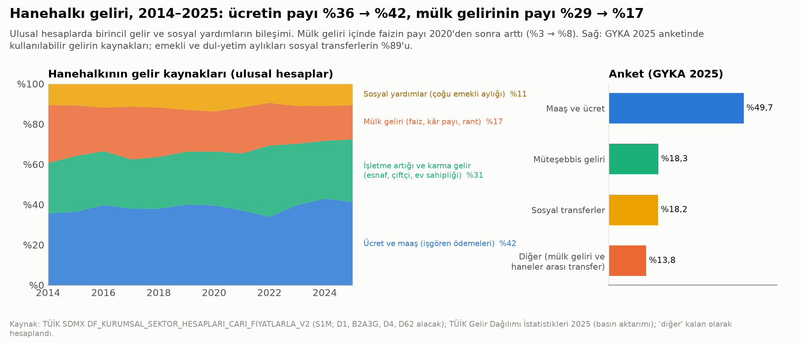

**Okuma:**
- **Ücretin payı arttı.** Ulusal hesaplarda işgören ödemelerinin hanehalkı kaynaklarındaki payı 2014–2025'te %36'dan %42'ye çıktı; mülk gelirinin payı %29'dan %17'ye indi [H]. Bu, "sermaye geliri ücreti yutuyor" tezini bu ölçüde desteklemiyor. Ama mülk geliri içinde faizin payı 2020'den sonra %3'ten %8'e çıktı; yüksek faiz döneminde birikimi olanlar kazandı [H].
- **İki seri neden farklı?** Ulusal hesaplar yükletilmiş kirayı (evinde oturanın kendine ödediği varsayılan kira) karma gelire sayıyor; anket saymıyor. Ulusal hesaplar ayrıca anketin eksik ölçtüğü üst gelirleri ve faizi daha iyi yakalıyor.
- **Gruplar arası fark.** İşverenin esas iş geliri ücretlinin 3,2 katı, yevmiyelinin 6,5 katı (2024) [H]. Yevmiyeli çalışan ortalama olarak 2024'ün açlık sınırının altında gelir elde ediyor (oran 0,83) [H].
- 2009–2013 ulusal hesap serisi 2014 sonrasıyla tanım farkı gösterebildiği için grafikten çıkarıldı [DY].

### 1.3 Emekli, memur, işçi ve işsiz: taban gelirler ve eşikler

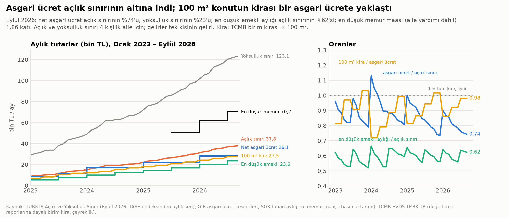

**Eylül 2026'da tek bir gelirin aile eşiklerine ve kiraya oranı** (`ekonomi_gelir_esik_2026.csv`):

| Gelir | TL/ay | Açlık sınırına oranı | Yoksulluk sınırına oranı | 100 m² kiranın bu gelire oranı | İşaret |
|---|---|---|---|---|---|
| En düşük emekli aylığı (Temmuz 2026) | 23.552 | 0,62 | 0,19 | 1,17 | [İ] |
| Net asgari ücret | 28.076 | 0,74 | 0,23 | 0,98 | [D] |
| Ortanca net ücret (tahmin) | ≈29.950 | 0,79 | 0,24 | 0,92 | [H/V] |
| Medyan 4 kişilik aile geliri (Rapor 06 tahmini) | ≈67.500 | 1,79 | 0,55 | 0,41 | [V] |
| En düşük memur maaşı, aile yardımı dahil (Temmuz 2026) | 70.224 | 1,86 | 0,57 | 0,39 | [İ] |

*Eşikler: TÜRK-İŞ, Eylül 2026; açlık sınırı 37.801 TL, yoksulluk sınırı 123.130 TL (4 kişilik aile) [D]. Kira: TCMB konut birim kirası (değerleme raporlarına dayanıyor) × 100 m², 2026'nın 3. çeyreği: 27.537 TL [D/H].*

**Gruplara göre okuma:**
- **Emekliler.**
  - En düşük emekli aylığı Ocak 2023'ten beri açlık sınırının %52–66'sı arasında dalgalanıyor. Her zam ayında %62–66'ya çıkıyor, bir sonraki zamdan önce %52–59'a iniyor [H].
  - 100 m² konutun kirası en düşük emekli aylığından fazla (1,17 kat). Kirada oturan ve yalnız taban aylık alan emekli için konut erişimi kira yardımı olmadan mümkün değil.
  - Taban aylık dosya bazında bir alt sınır; emeklilerin ne kadarının bu tutarda olduğu bulunamadı [DY].
- **İşçiler.**
  - Net asgari ücret Ocak zamlarında açlık sınırına yaklaşıyor ya da aşıyor (Ocak 2024: 1,13; Ocak 2025: 1,00; Ocak 2026: 0,90), yıl içinde geriliyor (Aralık 2025: 0,73; Eylül 2026: 0,74) [H].
  - **Ortanca ücret asgari ücrete çok yakın.** 2018 Kazanç Yapısı Araştırmasında medyan brüt kazanç brüt asgari ücretin 1,41 katıydı [H, Eurostat earn_ses_monthly]. 2022'de ≈1,08 katı (KYA 2022 ortalaması ve 2018 medyan/ortalama oranıyla tahmin) [H/V]. OECD verisinde medyan ücret en alt %10'un sınırının yalnızca 1,42 katı; OECD ortalaması 1,63 (2018) [D]. Yani çalışanların büyük kısmı asgari ücret dolayında kazanıyor.
- **Memurlar.** Dört grup içinde taban geliri en yüksek grup. En düşük memur maaşı Temmuz 2025–Eylül 2026'da açlık sınırının 1,68 (Aralık 2025) ile 1,98 (Ocak 2026) katı arasında [H]. Ancak bu tutar aile yardımını içeriyor; 2025 öncesi için tutarlı seri bulunamadı [DY].
- **İşsizler.**
  - İşsizlik oranı 2025'te %8,4, 2026'nın ikinci çeyreğinde %7,9 (mevsim etkisinden arındırılmış) [D]. 2025 ortalamasıyla 2,97 milyon işsiz [D].
  - Atıl işgücü oranı ("geniş tanımlı işsizlik") ise 2025'te %29,7, 2026'nın ilk yarısında %31,1 [D]. Bu, iş aramayan ama çalışmaya hazır olanları ve daha çok çalışmak isteyen eksik istihdamdakileri de sayıyor. Yaklaşık 10,6 milyon kişi (alt sınır) [H/V].
  - İşsizlik ödeneği alanların oranı bulunamadı [DY].

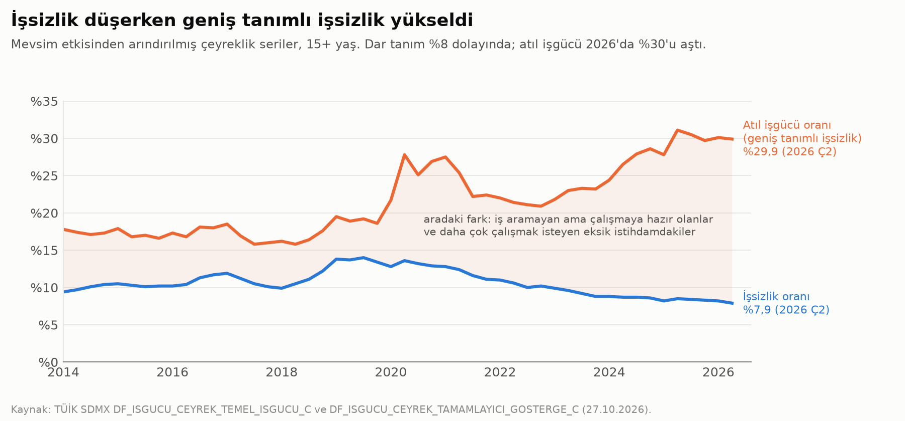

**Konut:**
- Ev sahipliği 2014'te %61,1, 2025'te %56,9; piyasa fiyatından kiracı olanlar %22,1'den %27,3'e [D, Eurostat ilc_lvho02]. Proje hedefi %65 ([Toplum hedefleri](../01_KAVRAMSAL_CERCEVE/toplum_hedefleri.md)).
- Konut maliyeti gelirinin %40'ını aşan nüfus %10,0 (2025); piyasa kiracılarında %34,4, AB'de %18,6 [D].
- Kira yükü, aile kurma ve doğurganlık bağlantısı Rapor 04'te il düzeyinde sınandı; il paneli bu bağlantıyı desteklemedi. Buradaki bulgular hane bütçesi düzeyinde.

---

## 2. Vergi yapısı

### 2.1 Dolaylı vergilerin ağırlığı

| Gösterge | Değer | Yıl | Kaynak |
|---|---|---|---|
| Dolaylı vergilerin merkezi bütçe vergi gelirindeki payı (geniş tanım: dahilde mal ve hizmet + dış ticaret + damga + harç) | %62,4 (2006: %68,4) | 2025 | [D/H] Muhasebat |
| KDV + ÖTV'nin payı | %48,0 (2006: %56,9) | 2025 | [D/H] |
| Gelir vergisinin payı; içinde stopajın payı | %25,5; %93,5 | 2025 | [D/H] |
| Üretim ve ithalat vergilerinin genel devlet vergi gelirindeki payı (sosyal katkı hariç) | %61,1 (2015: %69,0) | 2025 | [D/H] TÜİK SDMX |
| Mal ve hizmet vergileri / toplam vergi ve prim | %43,6 (OECD %31,2) | 2024 (OECD 2023) | [D] OECD Revenue Statistics |
| Kişisel gelir vergisi / toplam | %14,7 (OECD %23,7) | aynı | [D] |
| Mülk vergileri / toplam; taşınmaz vergisi / GSYH | %2,9 (OECD %5,1); %0,10 (OECD %0,95) | aynı | [D] |
| Toplam vergi ve prim / GSYH | %24,0 (OECD %34,1) | 2024 | [D] |
| Hanehalkının ödediği gelir ve servet vergisi / brüt kullanılabilir gelir | %6,9 | 2025 | [H] TÜİK S1M |
| 2026 Ocak–Eylül vergi tahsilatı, bir yıl öncesine göre | toplam +%34; gelir vergisi +%49; dahilde KDV +%37; ÖTV +%3 (akaryakıt ÖTV'si −%44) | 2026 | [D] Muhasebat; aynı dönemde TÜFE +%29,7 [D] |

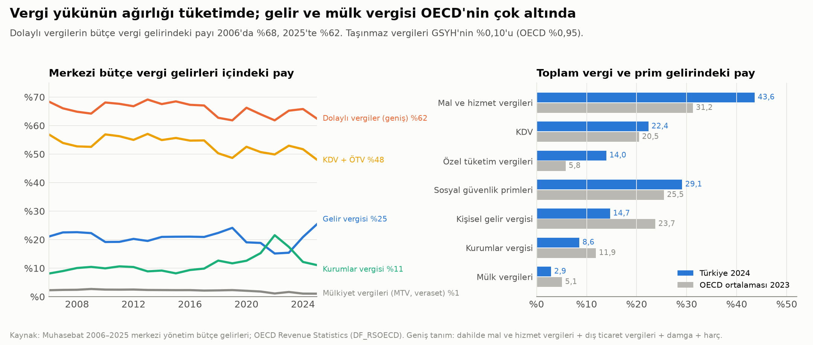

**Okuma:**
- Dolaylı vergilerin payı yavaşça azalıyor ama hâlâ OECD'nin çok üstünde. 2024–2026'da gelir vergisinin payının artması büyük ölçüde enflasyonun dilimleri aşındırmasından ve ücret artışlarından geliyor [H, yorum].
- Akaryakıt ÖTV tahsilatındaki %44'lük düşüşün nedeni bu çalışmada incelenmedi [DY].

### 2.2 KDV ve ÖTV'nin gelir gruplarına yükü

Yöntem `ekonomi_dagilim.py` başında; varsayımlar `ekonomi_dagilim_varsayimlar.csv` içinde tek tek yazılı. Özetle: Hanehalkı Bütçe Anketi 2020'nin dilimlere göre harcama yapısı [D], 2025 gelir payları [D], ulusal hesaplardan 2025 tüketim ve gelir toplamı [D], 2026 KDV oranları [D] ve 2025 KDV-ÖTV tahsilatı [D] birleştirildi. Vergilerin tamamen tüketiciye yansıdığı ve davranışın değişmediği varsayıldı [V].

| Gelir dilimi (nüfusun %20'si) | Gelir payı | Tüketim / gelir | Gıda payı (tüketim) | KDV + ÖTV / tüketim | **KDV + ÖTV / gelir** |
|---|---|---|---|---|---|
| En yoksul %20 | %5,6 | 1,70 | %30,0 | %8,8 | **%15,1** |
| 2. | %9,6 | 1,34 | %25,6 | %10,3 | %13,7 |
| 3. | %14,1 | 1,12 | %22,8 | %11,3 | %12,6 |
| 4. | %20,5 | 0,94 | %20,1 | %12,1 | %11,4 |
| En zengin %20 | %50,2 | 0,60 | %15,1 | %12,9 | **%7,8** |

**Okuma:**
- **Tüketime oranla artan, gelire oranla azalan.** Gıdadaki %1'lik oran sayesinde KDV, tüketimin yüzdesi olarak zengine daha ağır. Ama yoksul hane gelirinin tamamını (ankette fazlasını) tüketiyor; bu yüzden gelirin yüzdesi olarak yük en yoksulda iki kat [H].
- **Uyarı.** Yıllık gelire göre yük, ömür boyu gelire göre yükten daha geriye doğrudur; borçlanma ve birikimle tüketim yıllar arasında dengelenir (Poterba 1989) [İ]. En yoksul dilimin tüketiminin gelirinin 1,7 katı çıkması kısmen anketin düşük gelirleri eksik ölçmesinden kaynaklanıyor [V].

### 2.3 Ücret, sermaye ve kira gelirinin etkin vergi oranları (2026)

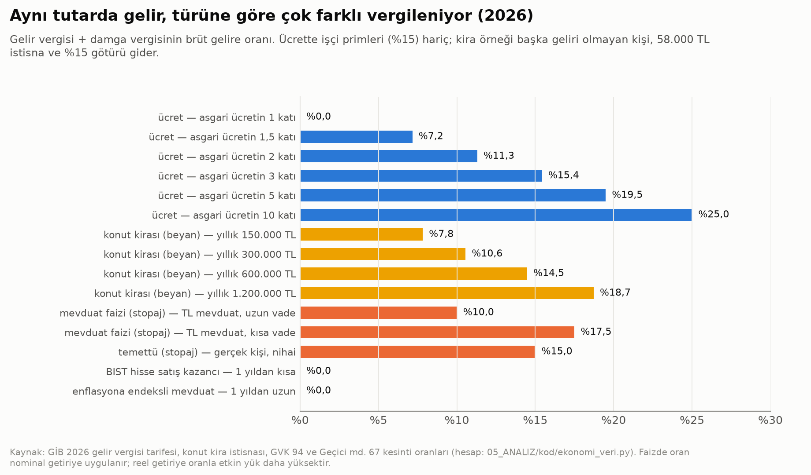

| Gelir | Etkin oran (gelir + damga vergisi / brüt gelir) | İşaret |
|---|---|---|
| Ücret: asgari ücret / 2 katı / 5 katı / 10 katı | %0 / %11,3 / %19,5 / %25,0 (+ işçi primi %15) | [H] GİB 2026 tarifesi |
| Konut kirası (başka geliri olmayan kişi, 58.000 TL istisna, %15 götürü gider): 150 bin / 1,2 milyon TL yıllık | %7,8 / %18,7 | [H] |
| TL mevduat faizi (stopaj) | %10 (uzun vade) – %17,5 (kısa vade) | [D] GVK Geçici md. 67 |
| Temettü (gerçek kişi, nihai) | %15 | [D] |
| BIST hisse satış kazancı (1 yıldan kısa); enflasyona endeksli mevduat | %0 | [D] |

**Okuma:**
- **Ücretli ilk liradan prim öder.** Ücretli, gelir vergisine ek olarak ilk liradan %15 işçi primi öder (karşılığında emeklilik ve sağlık hakkı doğar). Asgari ücretin 3 katı (yılda ≈1,19 milyon TL brüt) kazanan ücretlinin gelir vergisi ve primi birlikte %30,4 [H]. Yılda 1,2 milyon TL kira geliri olan kişinin vergisi %18,7 [H].
- **Faiz vergisi nominal getiriye uygulanıyor.** Örnek: %40 faiz, %30 enflasyon. Reel getiri %7,7'dir. %10 stopajdan sonra reel getiri %4,6'ya iner; yani reel getirinin %40'ı vergiye gider [H/V].
- **Sonuç.** Enflasyonlu ortamda küçük tasarruf sahibi (çoğu emekli) reel olarak ağır, borsa kazancı hiç vergilenmiyor.

### 2.4 Emlak vergisi ve değer artış payı

| Gösterge | Değer | Yıl | Kaynak |
|---|---|---|---|
| Emlak vergisi oranları | Mesken binde 1, diğer bina binde 2, arsa binde 3, arazi binde 1; büyükşehirde %100 artırımlı. Matrah: takdir komisyonunun asgari arsa birim değeri | 2026 | [D] 1319 s. Kanun md. 8, 18, 29 |
| Emlak vergisi tahsilatı (bina + arsa + arazi) | 56,5 milyar TL (bina 43,1; arsa 12,8; arazi 0,6) | 2025 | [D] Muhasebat |
| Emlak vergisi / GSYH | %0,09 (arsa vergisi %0,02) | 2025 | [H] Dünya Bankası GSYH 63,0 trilyon TL [D] |
| Emlak vergisinin mahalli idare gelirlerindeki payı | %2,6 | 2025 | [H] |
| Merkezi vergi gelirlerinden belediyelere aktarılan payın mahalli idare gelirlerindeki payı | %57,2 | 2025 | [H] |
| Harcamalara katılma payları (yol, su, kanalizasyon) | 16,4 milyar TL | 2025 | [D] |
| Otopark bedeli; 3194 teknik altyapı bedeli | 5,6; 3,6 milyar TL | 2025 | [D] |
| Değer artış payı (plan değişikliğiyle oluşan artışın %90'ı; 6306 alanları ve riskli yapılar istisna) | Tahsilat tutarı bütçede ayrı görünmüyor | 2025 | Kural [D, Rapor 06]; tutar [DY] |

**Okuma:**
- **Belediye kendi vergisiyle değil, merkezden gelen payla yaşıyor.** Bu, yerel yönetimin arazi değerindeki artıştan pay alma güdüsünü zayıflatıyor.
- **Matrah piyasa değerinin çok altında.** Emlak vergisinin matrahı, takdir komisyonunun belirlediği asgari birim değer. 2026 için artış, önceki yılın iki katıyla sınırlandı (Geçici md. 23, 7566 s. Kanun) [D]. Matrahın piyasa değerine oranı için resmî bir ölçüm bulunamadı [DY].
- **Değer artış payı ve dikey dönüşüm.** Değer artış payının dikey dönüşümü kayıran istisnası ve donatıya ayrılması önerisi Rapor 06'da (öneri I2, I3).

### 2.5 Vergi harcamaları (istisna ve indirimler)

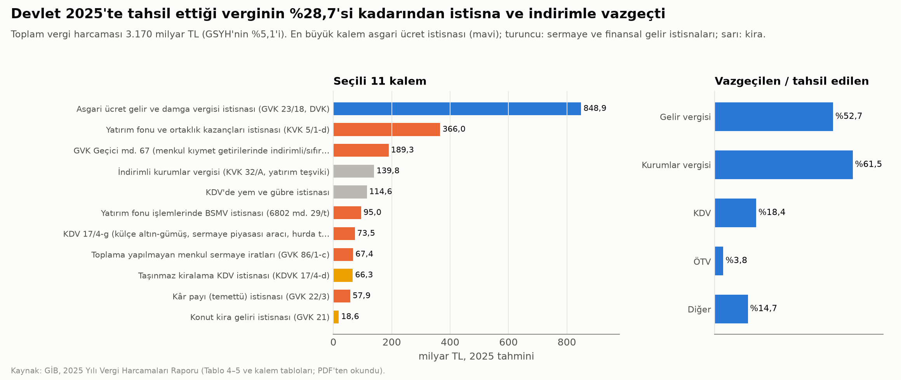

| Vergi | Vazgeçilen vergi 2025 (milyar TL) | Tahsil edilen (milyar TL) | Oran |
|---|---|---|---|
| Gelir vergisi | 1.483,7 (bunun 848,9'u asgari ücret istisnası) | 2.813,2 | %52,7 |
| Kurumlar vergisi | 752,9 | 1.223,9 | %61,5 |
| KDV | 605,0 | 3.280,1 | %18,4 |
| ÖTV | 76,9 | 2.024,3 | %3,8 |
| Diğer | 251,8 | 1.707,9 | %14,7 |
| **Toplam** | **3.170,3** (GSYH %5,1; 2026 tahmini 3.597,1) | 11.049,5 | **%28,7** |

*Kaynak: GİB, 2025 Yılı Vergi Harcamaları Raporu, Tablo 4–5 ve Ek I kalem tabloları [D].*

**Okuma:**
- **En büyük kalem asgari ücretlinin vergisizliği.** Bu, ücretlinin lehine bir harcama.
- **Sermayeye dönük kalemler.** Yatırım fonu ve ortaklık kazanç istisnası (366,0), Geçici md. 67 ile menkul kıymette indirimli ya da sıfır stopaj (189,3), toplanmayan menkul sermaye iradı (67,4) ve temettü istisnası (57,9) birlikte ≈681 milyar TL [D]. Bu tutar gıda KDV'sini sıfırlamanın maliyetinin (52 milyar TL) 13 katı.
- **Kira istisnaları küçük.** Konut kira geliri istisnası 18,6 milyar TL [D]; taşınmaz kiralamada KDV istisnası 66,3 milyar TL [D].
- **Bilinmeyen.** Bu istisnaların yatırıma ve tasarrufa gerçek katkısı ölçülmemiş [DY].

---

## 3. Ticaretin önündeki engeller

### 3.1 Ruhsat, imar ve düzenleme

| Engel | Bulgu | Kaynak |
|---|---|---|
| Sıhhi işyeri ruhsatı | Başvuru uygunsa **aynı gün** (md. 12); 2.–3. sınıf gayrisıhhi müessese **5 gün** | [D] İşyeri Açma ve Çalışma Ruhsatlarına İlişkin Yönetmelik (2005/9207) |
| Konut alanında zemin kat dükkânı | Ancak belediye meclisi o yolu "yol boyu ticaret" olarak karara bağlamışsa ve **yeni kullanımın otopark ihtiyacı karşılanırsa**. İzin verilen türler: dükkân, kuaför, terzi, eczane, muayenehane, lokanta, pastane | [D] PAİY md. 19/1-f-1 |
| Karma kullanım alanında konut | Oran belirtilmemişse en fazla %30 konut | [D] MPYY md. 21/10 |
| İşletme kurma | 7 gün (2020); B-READY 2025 "işletme kurma" puanı 80,4 / 100 | [D] Doing Business 2020; Dünya Bankası B-READY 2025 |
| İnşaat izni | 100 gün, 18 prosedür (2020) | [D] Doing Business 2020 |
| B-READY 2025 konu puanları (Türkiye) | İşyeri yeri 72,3 · vergilendirme **46,4** (en düşük) · piyasa rekabeti 57,9 · uluslararası ticaret 58,1 · uyuşmazlık çözümü 60,9 | [D] |
| B-READY 2025 sütunları (101 ülke) | Düzenleyici çerçeve 66,8 (sıra 56) · kamu hizmetleri 73,4 (11) · operasyonel verimlilik 62,9 (44) | [D/H] |

| OECD PMR 2023 (0 en serbest, 6 en kısıtlayıcı) | Türkiye | OECD ortalaması | 38 üye içinde sıra (1 = en kısıtlayıcı) |
|---|---|---|---|
| Genel PMR | 2,52 | 1,35 | **1** |
| Perakende fiyat kontrolleri | 3,89 | 1,11 | **1** |
| İdari ve düzenleyici yük | 2,93 | 1,74 | **1** |
| Devlet müdahalesinden kaynaklanan bozulma | 2,85 | 1,39 | **1** |
| Yerli ve yabancı girişe engeller | 2,19 | 1,30 | **1** |
| Limited şirket ve şahıs işletmesi kurmanın idari şartları | 2,56 | 1,86 | 6 |
| Perakende dağıtım | 1,00 | 1,04 | 19 |

*Kaynak: OECD PMR 2023 [D]; OECD ortalaması ve sıra bu çalışmada 38 üyeden hesaplandı [H].*

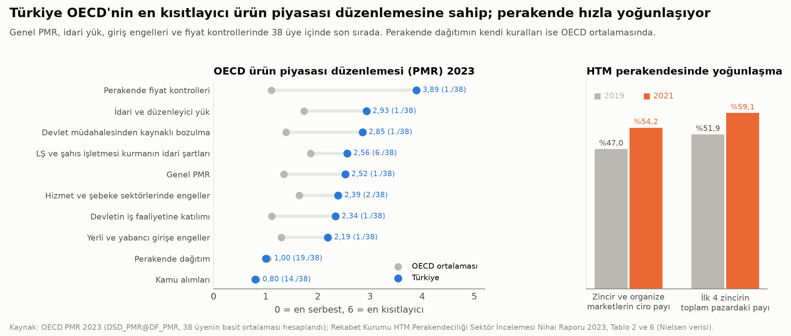

**Okuma:**
- **Kâğıt üstünde süre kısa, asıl engel imarda.** Mahalle içinde dükkân açmanın önündeki engel ruhsat süresi değil:
  - konut alanının kendiliğinden ticarete kapalı olması,
  - otopark yükü,
  - yapı kullanma izni ve denetim zinciri.
- **Başvurudan açılışa gerçek süre ölçülmüyor [DY].**
- **Genel düzenleme yükü yüksek.** Fiyat kontrolleri, idari yük ve devlet müdahalesinde Türkiye OECD'nin en kısıtlayıcı ülkesi. Perakende dağıtımın kendi kuralları ise OECD ortalamasında.

### 3.2 Perakende yoğunlaşması, AVM ve esnaf

| Gösterge | Değer | Yıl | Kaynak |
|---|---|---|---|
| Organize kanalın hızlı tüketim cirosundaki payı | %47,0 → %54,2 | 2019 → 2021 | [D] Rekabet Kurumu HTM raporu (Nielsen) |
| İlk 4 zincirin toplam HTM pazarındaki payı (CR4) | %51,9 → %59,2; organize pazarda %77,5 | 2019 → 2021 | [D] |
| Mağaza sayısı: geleneksel / organize | 188.915 / 39.147 | 2021 | [D] |
| En büyük zincirin mağaza sayısı | 1.287 → 11.227 | 2011 → 2021 | [D] |
| AVM sayısı; kiralanabilir alan | 445; 13,9 milyon m² (≈162 m² / 1.000 kişi) | 2025 | [İ] AYD, değerleme raporları; kişi başı [H] |
| TESK'e kayıtlı esnaf ve sanatkâr | 2.282.188 | 30.09.2026 | [D] |
| Esnaf açılış / kapanış | 323.480 / 120.423 | 2025 | [D] TESK |
| Kurulan / kapanan şirket | 115.627 / 34.546 | 2025 | [D] TOBB |
| İşyeri kirası: H-ÜFE gayrimenkul kiralama yıllık değişimi | %47,2 (Aralık 2024) → %20,8 (Ağustos 2026) | — | [D] TÜİK SDMX |

**Okuma:**
- **Yoğunlaşma hızlı.** Zincir marketler on yılda mahalle bakkalının yerini büyük ölçüde aldı.
- **Esnaf sayısı yine de artıyor.** Esnaf kaydında açılış kapanışın 2,7 katı (2025). Esnafın hangi sektörlerde çoğaldığı ayrıştırılmadı [DY].
- **İşyeri kira yükü bilinmiyor.** İşyeri kirası için bölgesel ya da cadde bazında açık bir seri bulunamadı [DY].

### 3.3 Kayıt dışılık

| Gösterge | Değer | Yıl | Kaynak |
|---|---|---|---|
| SGK'ya kayıtlı olmadan çalışanlar (toplam / tarım / tarım dışı) | %25,5 / %81,9 / %16,4 (2014: %34,5 / %81,6 / %22,5) | 2025 | [D] TÜİK SDMX |
| Aynı oran, 2026 ilk yarısı | %23,9 | 2026 | [D] |
| Kayıt dışı üretim / GSYH | %24,2 (DGE) – %31,0 (MIMIC) | 2020 | [D] Dünya Bankası |
| Kayıt dışı rakiple yarıştığını söyleyen firmalar | %50,2 | 2019 | [D] Dünya Bankası İşletme Anketi |

Kayıt dışılık tarım dışında belirgin biçimde azaldı. Tarımdaki oran ise neredeyse hiç değişmedi.

---

## 4. Kendi kendine yeterlilik

**Yeterlilik derecesi** = yurt içi üretim / yurt içi kullanım × 100. %100'ün altı ithalata bağımlılık demek.

| Ürün | Son yıl | Son 5 yıl ortalaması | 2015/16 sonrası en düşük | Kaynak |
|---|---|---|---|---|
| Buğday | %104 (2024/25) | %102 | %87 | [D] TÜİK bitkisel denge; 2024/25 [İ] |
| Tahıl toplamı | %91 (2024/25) | %95 | %80 | [D/İ] |
| Mısır | %73 (2024/25) | %83 | %70 | [D/İ] |
| Arpa | %85 (2024/25) | %91 | %67 | [D/İ] |
| Pirinç | %72 (2023/24) | %76 | %72 | [D] |
| Kırmızı / yeşil mercimek | %91 / %78 (2023/24) | %76 / %62 | %57 / %51 | [D] |
| Kuru fasulye; nohut | %84; %115 (2023/24) | %94; %113 | %72; %88 | [D] |
| Ayçiçeği | %72 (2023/24) | %61 | %51 | [D] |
| Soya | %4 (2024/25) | %5 | %4 | [D/İ] |
| Sebze toplamı; domates | %109; %112 (2024/25) | %111; %118 | %106; %111 | [D/İ] |
| Patates; kuru soğan | %102; %105 (2023/24) | %105; %109 | %101; %97 | [D] |
| Kırmızı et | %96 (2024) | — | — | [H] TEPGE raporlarındaki TÜİK verisinden |
| Tavuk eti; yumurta | %115; %117 (2024) | — | — | [H] |

| İthalat (milyon dolar) | 2018 | 2022 | 2025 | Kaynak |
|---|---|---|---|---|
| Yağlı tohum (HS 12) | 1.966 | 3.306 | 3.358 | [D] UN Comtrade |
| Bitkisel ve hayvansal yağ (HS 15) | 1.216 | 4.105 | 3.106 | [D] |
| Canlı sığır | 1.692 | 158 | 1.191 | [D] |
| Et (HS 02) | 324 | 141 | 602 | [D] |

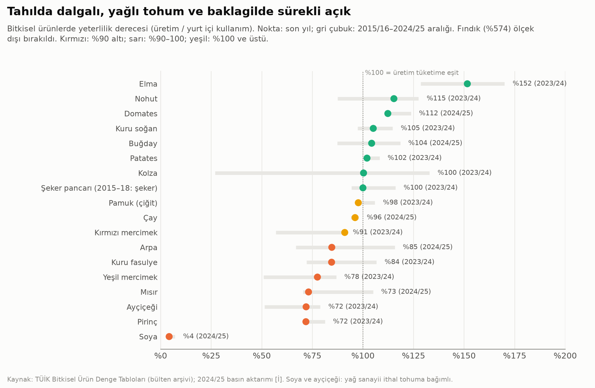

**Kısa tedarik zinciri:**
- **Fiyat farkı büyük.** Üretici ile market fiyatı arasındaki fark birçok sebze ve meyvede 3–4 kat. Aralık 2025'te havuç markette üreticinin 4,2 katına, mandalina 3,5 katına satıldı (TZOB) [İ].
- **Farkın kaynağı bilinmiyor.** Farkın ne kadarının lojistik, fire ve depolama, ne kadarının pazar gücü olduğu ayrıştırılamadı [DY].
- **Rapor 19'la bağlantı.** Fiyat dalgalanması ve hasat sonrası kayıp Rapor 19'da hesaplandı. Hasat ve hasat sonrası kayıp 4,3–8,5 milyon ton, yılda 1,9–3,8 milyar dolar; burada tekrarlanmadı ([Rapor 19 §2.4](19_israf_fire_kacak.md)).
- **Hukuki çerçeve.** Sebze ve meyvenin hal üzerinden kayıtla satılmasını 5957 sayılı Hal Kanunu düzenliyor [D]. Üreticinin pazarda ve doğrudan satışında kayıt kolaylığı, kısa zincirin hukuki kapısı.

**Okuma:**
- **Açık, iklim ve sudan kaynaklanıyor.** Açık; yağlı tohum (soya, ayçiçeği), yem (mısır, arpa) ve bazı baklagillerde. Bu ürünlerde tam yeterlilik iklim ve su nedeniyle pahalı ya da imkânsız olabilir.
- **Gerçekçi hedef ölçeğe göre değişir:**
  - **Şehir ve bölge:** taze sebze-meyvede bölge ölçeğinde yeterlilik ve kısa zincir.
  - **Ülke:** stratejik ürünlerde (yağlı tohum, yem, baklagil) dalgalanmayı azaltacak bir alt sınır ve depolama.

---

## 5. Seçenekler ve ölçek

### 5.1 Basit dağılım hesabı: hangi değişiklik kime ne kazandırır?

`ekonomi_dagilim.py` ile yapılan statik hesap. Davranış tepkisi yok. Arsa vergisinin tamamen arsa sahibinde kaldığı (kiracıya yansımadığı) varsayıldı (Oates ve Schwab 1997) [V]. Konut arsasının dilimlere dağılımı yükletilmiş kira harcamasıyla vekillendi [V].

| Senaryo | Hanehalkı yükünde değişim (milyar TL, 2025) | En yoksul %20 (gelirin %'si) | Orta %20 | En zengin %20 | En yoksul %20'nin kazançtaki payı |
|---|---|---|---|---|---|
| S1 · Genel KDV %20 → %18 | −145 | −0,52 | −0,46 | −0,28 | %8 |
| S2 · Gıdada KDV %1 → %0 | −52 | −0,37 | −0,19 | −0,07 | %16 |
| S4 · S2'nin bütçesi herkese eşit kişi başı ödeme | −52 | −0,47 | −0,19 | −0,05 | %20 |
| S5 · S2'nin bütçesi yalnız en yoksul %20'ye | −52 | **−2,37** | 0 | 0 | %100 |
| S3A · Arsa değer vergisi (GSYH %0,5 = 315 milyar TL) + genel KDV %15,7; yalnız konut arsası | 0 (gelir-nötr) | **+0,46** | +0,03 | −0,09 | — |
| S3B · Aynı; konut + işletme arsası | 0 | +0,05 | −0,15 | +0,08 | — |
| S3C · Aynı; konut + işletme arsası, alt iki dilimde tek konut muaf | 0 | **−0,90** | +0,07 | +0,20 | — |

*Eksi: yük azalır (kazanç). Kaynak: `ekonomi_dagilim_ozet.csv`, `ekonomi_dagilim_senaryolar.csv` [H].*

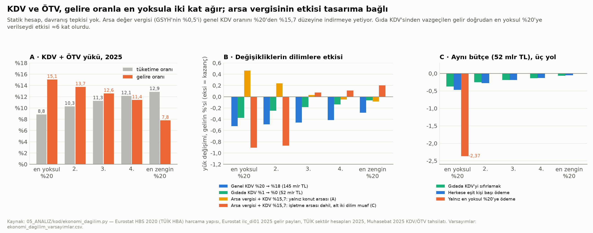

**Okuma:**
- **KDV indirimi zengine de gider.** Genel KDV indiriminin kazancının yalnızca %8'i en yoksul %20'ye gider. Gıdada bu pay %16.
- **Aynı para doğrudan verilirse daha etkili.** Aynı para en yoksula doğrudan verilirse etkisi 6 kat. Ancak bunun için hane gelirini doğru ölçen bir kayıt ve hedefleme gerekir. Hedefleme hatası, kayıt dışı gelir ve damgalanma bu farkın bir kısmını yer.
- **Arsa vergisinin etkisi tasarıma bağlı.**
  - Türkiye'de yoksul hanelerin önemli kısmı ev sahibi; yükletilmiş kira, alt dilimlerin tüketiminde daha büyük bir pay. Bu yüzden yalnız konut arsasına konan bir vergi KDV indirimine rağmen en yoksula yük getirir (S3A).
  - İşletme ve kiralık arsayı kapsayıp küçük konutu muaf tutan bir tasarım yükü tersine çevirir (S3C).

**Temel gelirin kaba maliyeti (2025):**

| Kişi başı aylık ödeme | Tutar (TL) | Yıllık maliyet | GSYH'ye oranı |
|---|---|---|---|
| Açlık sınırının yarısı (aile sınırı / 8) | 3.273 | 3.381 milyar TL | %5,4 |
| Açlık sınırı (aile sınırı / 4) | 6.546 | 6.762 milyar TL | %10,7 |
| Yoksulluk sınırı (aile sınırı / 4) | 21.321 | 22.027 milyar TL | %35,0 |

*Karşılaştırma: Hanehalkına giden bütün sosyal yardımlar (çoğu emekli aylığı) 5.190 milyar TL, GSYH'nin %8,2'si [D/H]. Evrensel ödeme; finansman ve davranış etkisi hesaba katılmadı [V]. Kaynak: `ekonomi_temel_gelir_maliyet.csv`.*

**Negatif gelir vergisi:** Eşiğin altındaki haneye, eşikle geliri arasındaki farkın bir oranı kadar ödeme yapar. Bu yüzden evrensel temel gelirden ucuzdur; maliyeti hane gelir kaydına ve azalma oranına bağlıdır. Türkiye için hane düzeyinde gelir kaydı olmadan maliyet hesaplanamadı [DY].

### 5.2 Seçenekler: kanıt, etki, maliyet, yan etki

Ayrıntılı tablo `ekonomi_secenekler.csv` dosyasında. Her satırda yükü taşıyan ve fayda gören taraf da yazılı.

| Seçenek | Kanıt düzeyi | Beklenen etki | Maliyet / hasılat | Başlıca yan etkiler |
|---|---|---|---|---|
| **V1 · Arsa değer vergisi** (emlak vergisinin arsa değerine kaydırılması) | Orta–güçlü (teori; OECD, Arnold vd. 2011) [İ]; Türkiye'de ölçülmedi | KDV %20 → %15,7 (gelir-nötr); dağılım tasarıma bağlı (−%0,90 ile +%0,46) [H] | ≈315 milyar TL/yıl; değerleme altyapısı [DY] | Arsa fiyatında bir kerelik düşüş; ev sahibi emeklide nakit sıkışıklığı; değerleme hatası |
| **V2 · Dolaylıdan doğrudana kayış** | Orta | En yoksulun yükü azalır (KDV yükü gelirin %15'i → indirimle) | Gelir-nötr olabilir; idari maliyet yüksek | Kayıt dışılık, çalışma ve tasarruf güdüsü, sermaye kaçışı |
| **V3 · Temel gıdada KDV %0** | Orta (hesap güçlü, fiyata yansıma belirsiz) | En yoksulun geliri +%0,37 | 52 milyar TL | İndirim fiyata yansımayabilir (CR4 %59); KDV iadesi |
| **V4 · İstisnaların daraltılması** | Güçlü (resmî tutarlar) | Sermaye geliriyle ilgili dört kalem ≈681 milyar TL; bir kısmı geri gelir | Hasılat artışı | Sermaye piyasası ve yatırım kaygısı; altına ve yurt dışına kayış |
| **V5 · Belediyeye arsa değer artışından pay** | Orta (literatür) / zayıf (tahsilat verisi yok) | İmar rantının kamuya dönmesi; donatı finansmanı | Belirsiz | Dönüşümün yavaşlaması; değerleme keyfîliği; istisnalar |
| **T1 · Karma kullanımlı imar** | Orta (uluslararası örnek) | Mahalle içinde dükkân ve atölye arzı | Düşük | Gürültü, teslimat trafiği, komşu şikâyeti |
| **T2 · Ruhsat sadeleştirme** | Orta | Giriş maliyeti düşer | Düşük | Denetim zayıflarsa güvenlik riski |
| **T3 · Açık pazar ve üretici pazarı** | Zayıf–orta | Üreticiye yüksek, tüketiciye düşük fiyat beklenir; ölçülmedi [DY] | Belediye yer ve temizlik maliyeti | Trafik, aracıların pazara da hâkim olması |
| **T4 · Esnaf ortak alım kooperatifi** | Zayıf | Satın alma gücü ve lojistikte ölçek | Gönüllü | Yönetim sorunları; ortak fiyatlama rekabet hukukunu ihlal edebilir |
| **T5 · Kayıt dışılığı azaltan sade rejim** | Orta | Kayıtlı rekabet; işçinin emeklilik hakkı | Kısa vadede gelir kaybı | Kötüye kullanım (işletmeyi bölme) |
| **T6 · Fiyat kontrolleri ve giriş engellerinin gözden geçirilmesi** | Orta | Rekabet ve verimlilik | Düşük | Kısa vadede bazı fiyatlarda artış |
| **K1 · Kooperatif konut ve arsa vakfı** | Orta (Rapor 06; Viyana, Batıkent) | Konut fiyatı %17–37 düşer (Rapor 06) [H] | Kamu arsasının fırsat maliyeti | Geçmiş kooperatif iflasları; tahsiste kayırma |
| **G1 · Negatif gelir vergisi / temel gelir** | Orta (yurt dışı deneyler) | Gelirsiz hanenin tabanı yükselir | Evrensel: GSYH %5–11 | Maliyet, çalışma güdüsü, enflasyon |
| **G2 · Taban gelirlerin kurala bağlanması** | Orta | Öngörülebilirlik | Otomatik maliyet artışı | Asgari ücretin ortancaya yaklaşması kayıt dışılığı artırabilir |
| **G3 · Atıl işgücünü işe bağlama** | Orta (Card, Kluve ve Weber 2018) [İ] | ≈10 milyon atıl kişinin bir kısmı işe | Program, kreş, ulaşım | Etkisiz programa kaynak |
| **Y1 · Kısa tedarik zinciri** | Zayıf–orta | Üretici payı artar, fire azalır | Soğuk depo, teslim noktası | Ölçek ekonomisi kaybı; gıda güvenliği denetimi |
| **Y2 · Stratejik ürünlerde yeterlilik** | Güçlü (açık) / orta (çözüm) | Yağlı tohum ve yemde bağımlılık azalır | Destek, sulama | Su stresi; karşılaştırmalı üstünlüğün kaybı |

**Ödünleşimler (açıkça):**
1. **Etkinlik mi, hedefleme mi?**
   - KDV indirimi herkese gider, uygulaması kolaydır, ama en yoksula küçük pay düşer.
   - Hedefli destek 6 kat etkilidir, ama kayıt, idari kapasite ve dürüst beyan ister.
2. **Arsa vergisi: büyüme mi, servet mi?**
   - Büyümeye en az zarar veren vergi.
   - Ama bugünkü arsa sahipleri bir kerelik servet kaybı yaşar. Yük, tasarım hatası varsa yoksul ev sahibine biner.
   - Erteleme ve küçük konut muafiyeti yükü hafifletir, hasılatı azaltır.
3. **Canlı sokak mı, sessiz sokak mı?** Karma kullanım ticareti mahalleye taşır, ama bazı sakinlerin sessizlik beklentisiyle çatışır. Rapor 12'deki model mahallede zemin kat birimi esnaf talebinin üstünde çıktı; arz tek başına ticareti canlandırmaz.
4. **Kendi kendine yeterlilik mi, maliyet mi?** Her üründe yeterlilik pahalıdır. Seçim, stratejik ürün ve bölgesel taze gıda arasında yapılmalı.

### 5.3 Kademe tablosu: hangi araç hangi ölçekte?

Tam tablo: `05_ANALIZ/sonuclar/ekonomi_kademe.csv`. Ölçeklenebilir şehir modeline girdi olarak tasarlandı. Kademe nüfusları kademe şeması ve Rapor 18 ile aynı.

| Araç | Mahalle (≈7 bin) | Semt (≈35 bin) | Şehir (≈210 bin) | Bölge (≈1,25 milyon) | Ülke |
|---|---|---|---|---|---|
| V1 Arsa değer vergisi | Değer haritası güncelleme, itiraz noktası | — | **Tahsil**, oran bandı içinde oran, erteleme başvurusu | Değerleme ofisi | **Kanun**: oran bandı, değerleme standardı, muafiyet |
| V2–V4 KDV, gelir vergisi, istisnalar | Fiyat izleme (V3) | — | — | — | **Karar ve kural** |
| V5 Değer artış payı | Payın bir kısmı mahalle bütçesine | Semt donatısı | **Plan, değerleme, tahsil**; ayrı hesap | Yoğunluk koridorları | İstisnaların daraltılması |
| T1 Karma kullanım | **Zemin kat dükkân, atölye, kreş** | Çarşı, semt merkezi | Plan notu; küçük işyerine otopark muafiyeti | — | PAİY md. 19 değişikliği |
| T2 Ruhsat | — | Tek pencere | **Ruhsat, iskân, itfaiye tek süreç** | — | Yönetmelik |
| T3 Pazar | Haftalık üretici tezgâhı | **Haftalık semt pazarı** | Pazar yeri planı, hal bağlantısı | Üretici kaydı | Üretici satış kolaylığı |
| T4 Esnaf kooperatifi | — | **Ortak depo** | Ortak alım, lojistik | Toptan alım birliği | Rekabet hukuku sınırları |
| T5–T6 Kayıt dışılık, fiyat kontrolü | — | Danışma noktası (T5) | Fiyat tarifeleri envanteri (T6) | — | **Kural** |
| K1 Kooperatif konut | Ada ölçeğinde kooperatif (40–100 konut) | Kooperatif birliği | **Kamu arsası, üst hakkı, maliyet kirası** | — | 1163 düzeltmesi, aile kredisi |
| G1–G2 NGV, taban gelirler | Başvuru yardımı (muhtarlık) | — | — | — | **Finansman ve kural** |
| G3 Atıl işgücü | İş arayan kaydı | **İstihdam ve mesleki eğitim ofisi** | OSB ve esnafla eşleştirme | Talep tahmini | İŞKUR programları |
| Y1 Kısa zincir | Teslim noktası, abonelik sepeti | Pazar üretici tezgâhı | Hal ve soğuk depo | **Tarım kuşağı, üretici kooperatifi** | Hal Kanunu |
| Y2 Stratejik ürün | — | — | — | Havza planı, sulama | **Destek ve planlama** |

**Kademe başına büyüklükler** (ulusal kişi başı değer × kademe nüfusu, 2025 fiyatları; `ekonomi_kademe_parametre.csv`) [H]:

| Büyüklük (yıllık) | Mahalle | Semt | Şehir | Bölge |
|---|---|---|---|---|
| Hanehalkı brüt kullanılabilir geliri | 3,2 milyar TL | 15,9 milyar TL | 95,1 milyar TL | 571 milyar TL |
| Hanehalkının ödediği KDV + ÖTV (tahmin) | 323 milyon TL | 1,6 milyar TL | 9,7 milyar TL | 58,1 milyar TL |
| Hanehalkına giden sosyal yardımlar | 418 milyon TL | 2,1 milyar TL | 12,5 milyar TL | 75,1 milyar TL |
| Bugünkü emlak vergisi | 4,5 milyon TL | 22,7 milyon TL | 136 milyon TL | 817 milyon TL |
| Arsa değer vergisi, GSYH'nin %0,5'i (seçenek) | 25,3 milyon TL | 127 milyon TL | 760 milyon TL | 4,6 milyar TL |
| İşsiz / atıl işgücü (kişi) | 239 / ≈850 | 1.195 / ≈4.250 | 7.170 / ≈25.500 | 43.000 / ≈153.000 |
| Kayıtlı esnaf (işletme) | 184 | 918 | 5.507 | 33.042 |
| Hızlı tüketim mağazası: geleneksel / zincir | 15 / 3 | 77 / 16 | 464 / 96 | 2.781 / 576 |

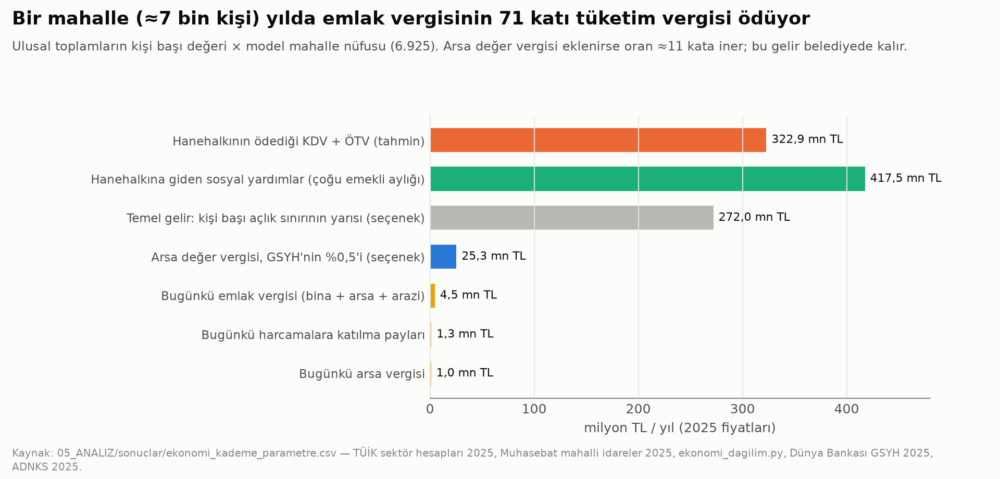

**Model için anlamı:**
- **Vergi kuralı ülkede, rant şehirde.** Bugün bir mahallenin ödediği tüketim vergisi, ödediği emlak vergisinin 71 katı [H]. Gelirin tamamı merkeze gidiyor; belediyeye payla dönüyor.
- **Arsa vergisi oranı değiştirir.** Arsa değer vergisi bu oranı ≈11 kata indirir ve geliri arazinin değerini yaratan yerel yönetimde tutar [H].
- **Ticaret mahallede başlar, semtte toplanır.** Mahalle dükkânı (184 esnaf / mahalle), semt pazarı ve ortak depo, şehir ruhsat ve plan kararı.
- **Gıda zinciri bölgede kurulur.** Tarım kuşağı ve kooperatif bölge ölçeğinde.

### 5.4 Proje ilkeleriyle uyum

Proje ilkesi gereği hiçbir araç zorlayıcı değil. Mülkiyet hakkını kısmadan, değeri yaratan kamu kararından (imar, altyapı) pay alan araçlar öne çıktı:
- arsa değer vergisi,
- değer artış payı,
- imar hakkı aktarımı (Rapor 06).

"Gerçek serbest piyasa" hedefi açısından en doğrudan araçlar ikisi:
- düzenleme yükünün azaltılması (T2, T6),
- konut alanında ticaretin kendiliğinden serbest olması (T1).

Bunlar devletin bütçesine yük getirmiyor. Vergi tabanını genişletmek (V4) ise gelir adaleti ile yatırım teşviki arasında siyasi bir tercih gerektiriyor; bu rapor tercihi değil, tutarı ve ödünleşimi gösteriyor.

---

## 6. Sınırlılıklar

1. **Gelir verisi.**
   - TÜİK'in ulusal bülten tabloları ve GYKA mikro verisi bu oturumda okunamadı (veri portalı komut satırına kapalı). Bu yüzden ulusal Gini ve gelir türleri basın aktarımı [İ].
   - Eurostat ile TÜİK değerlerinin farkı açıklanamadı [DY].
2. **Taban gelir serileri.** En düşük emekli aylığı ve memur maaşı basın aktarımı [İ]. Memur serisi yalnızca Temmuz 2025'ten başlıyor. Taban aylığı alan emeklilerin sayısı bilinmiyor [DY].
3. **Ortanca ücret tahmini.** 2018 medyan/ortalama oranı 2022'ye taşındı; 2022 oranı 2026'ya taşındı [V]. Asgari ücretin hızlı artışı dağılımı daha da sıkıştırmış olabilir.
4. **Eşikler aile, gelirler birey.** Açlık ve yoksulluk sınırı 4 kişilik aile içindir. Hane geliri birden fazla kazançtan oluşabilir; tablo tek gelirin yeterliliğini gösterir, hane yoksulluğunu değil. TÜRK-İŞ'in yoksulluk sınırı yöntemi (gıda payı %30,7) eski bir anket yapısına dayanıyor.
5. **Kira serisi.** TCMB birim kirası değerleme raporlarına dayanıyor. Yeni kiracı kirasına yakın; mevcut kiracıların ödediği ortalamadan yüksek olabilir.
6. **Dağılım hesabı statik.**
   - Davranış tepkisi, fiyata kısmi yansıma, kayıt dışı tüketim ve işletmelerin ödediği KDV'nin son yükü yok.
   - Harcama yapısı 2020 anketinden. Hanehalkı payı (%75) ve ÖTV'nin hanehalkı payları varsayım [V].
   - Arsa değerinin dilimlere dağılımı için doğrudan veri yok; yükletilmiş kira ve mülk geliri yoğunlaşmasıyla vekillendi [V]. Bu, S3 senaryolarının en zayıf halkası.
7. **Etkin oranlar örnek kişiler için.** Tek gelirli, istisnasız örnekler. Gerçek mükelleflerin beyan verisi kullanılmadı.
8. **Vergi harcamaları tahmin.** GİB tutarları "vazgeçilen gelir" yöntemiyle hesaplanıyor. İstisna kaldırılırsa davranış değişir; geri gelecek tutar daha küçüktür.
9. **Ticaret verisi.** Perakende yoğunlaşması 2021'de kalıyor. İşyeri kirası, ruhsatta gerçek süre ve pazar–market fiyat karşılaştırması bulunamadı [DY]. AVM verisi sektör derneğinden [İ].
10. **Yeterlilik.**
    - 2024/25 sütunu basın aktarımı [İ].
    - Hayvansal ürünlerde TÜİK denge tablosu yerine TEPGE raporlarındaki TÜİK verisi kullanıldı [H].
    - Bölge ölçeğinde yeterlilik hesaplanmadı. İl bazında üretim ve tüketim verisiyle bir sonraki adımda yapılabilir.
11. **Nedensellik.** Rapordaki ilişkilerin hiçbiri nedensel olarak sınanmadı. Seçenek etkileri literatür ve statik hesaba dayanıyor.

---

## Yeniden üretim

```
PYTHONIOENCODING=utf-8 python 05_ANALIZ/kod/ekonomi_veri.py                  # indirme (anahtarsız) ve derleme
PYTHONIOENCODING=utf-8 python 05_ANALIZ/kod/ekonomi_dagilim.py               # KDV, ÖTV, arsa vergisi dağılım hesabı; temel gelir maliyeti
PYTHONIOENCODING=utf-8 python 05_ANALIZ/kod/ekonomi_ticaret_yeterlilik.py    # PMR, B-READY, perakende, kayıt dışı, yeterlilik
PYTHONIOENCODING=utf-8 python 05_ANALIZ/kod/ekonomi_kademe.py                # seçenekler ve kademe tabloları
PYTHONIOENCODING=utf-8 python 05_ANALIZ/kod/ekonomi_grafikler.py             # 11 grafik (PNG + SVG)
```

Python 3.11; pandas, numpy, matplotlib, xlrd, PyMuPDF (fitz), openpyxl. Kaynakların erişim yolları ve doğrulama notları [kaynaklar.md](../03_VERI/ham/ekonomi/kaynaklar.md) içinde.
