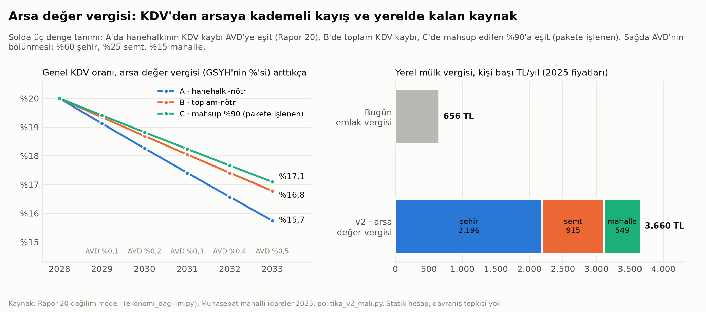

# Faz 5 · Rapor 2 — Politika Paketi v2: Arsa Değer Vergisi, Karma Kullanım ve Semt Meclisi

*27 Ekim 2026 · Sürüm 0.1*

| Ne | Nerede |
|---|---|
| Değişiklik paketi v2 (24 yeni, 3 genişletilmiş öneri; taslak madde dili, künyeler) | [08_MEVZUAT_POLITIKA/degisiklik_paketi_v2.md](../08_MEVZUAT_POLITIKA/degisiklik_paketi_v2.md) |
| Rapor 20'nin diğer seçenekleri için mevzuat araştırması (15 kanun) | [08_MEVZUAT_POLITIKA/arastirma_diger_secenekler.md](../08_MEVZUAT_POLITIKA/arastirma_diger_secenekler.md) |
| Sürüm 1 (28 öneri) ve özeti | [degisiklik_paketi_v1.md](../08_MEVZUAT_POLITIKA/degisiklik_paketi_v1.md) · [Rapor 06](06_politika_paketi_ozet.md) |
| Mali etki hesabı (kod, 5 CSV, 1 grafik) | [08_MEVZUAT_POLITIKA/politika_v2/](../08_MEVZUAT_POLITIKA/politika_v2/) · `politika_v2_mali.py` |
| Kanıt tabanı | [Rapor 20](20_ekonomi_gelir_vergi_ticaret.md) (gelir, vergi, ticaret) · [Rapor 21](21_olceklenebilir_sehir.md) (kademeler) |

---

## Özet

**Soru:** Rapor 20'nin en güçlü üç seçeneği hangi maddelerle, hangi sırayla ve ne mali sonuçla mevzuat paketine girer? Üç seçenek:

- arsa değer vergisi,
- karma kullanımlı imar,
- semt düzeyinde yönetişim.

Ek soru: Rapor 20'nin kalan seçenekleri hangi maddelere bağlı ve hangileri mevcut yetkiyle yapılabilir?

**Kısa cevap:** Üçü birbirini taşıyan bir paket.

- **Arsa değer vergisi:** Tüketim vergisinin yerine gelir ve semt ile mahalle bütçesinin kaynağı olur.
- **Karma kullanım:** Mahalle içinde dükkânı kendiliğinden serbest bırakır ve arsanın değerini canlı tutar.
- **Semt meclisi:** Bu bütçenin nereye harcanacağına karar veren organ.

Karma kullanım ve semt meclisi pilotu mevcut yetkiyle 2027'de başlayabilir. Arsa değer vergisi ve semt bütçesi kanun ister; geçiş 2029–2033.

1. **Mevzuatta yedi bulgu** (27.10.2026'da birincil metinden doğrulandı):
   - **Emlak Vergisi Kanunu md. 29:** Bina vergisinin matrahı zaten "arsa payı değeri" ile inşaat maliyetinden oluşuyor. Arsa ile yapıyı ayrı oranla vergilemek (bölünmüş oran) için yeni bir değerleme sistemi gerekmiyor; oran yapısını değiştirmek yetiyor.
   - **Emlak Vergisi Kanunu md. 30:** Tapuda bekleyen vergi mekanizması kanunda var. Kısıtlı taşınmazda 9/10 tecil ediliyor, satışta ödeniyor. Ev sahibi emekliler için erteleme bunun örneğiyle kurulabilir.
   - **KDV Kanunu md. 28:** Cumhurbaşkanı genel oranı %1'e kadar indirebiliyor. KDV tarafı mevcut yetkiyle yapılabilir.
   - **5779 md. 2/4:** Cumhurbaşkanı belediye paylarını yalnız kanuni haddine kadar indirebiliyor. Arsa değer vergisini belediyeye bırakıp merkezi payı denkleştirmek kanun ister.
   - **PAİY md. 19/1-f-1:** Konut alanında dükkân ancak meclis o yolun "yol boyu ticaret olarak teşekkül ettiğine" karar verirse ve otopark ihtiyacı karşılanırsa açılabiliyor. Varsayılan "kapalı".
   - **MPYY md. 24/9:** Karma kullanımın uygulama planında "ayrıştırılması esastır". md. 21/10'a göre oranı belirtilmemiş karma alanda en fazla %30 konut olabiliyor.
   - **5393 sayılı Belediye Kanunu:** "Semt" kelimesi hiç geçmiyor. Ama Kent Konseyi Yönetmeliği (md. 12) konseyin "meclis ve çalışma grupları" kurmasına izin veriyor. Semt meclisi pilotu buna ve belediye meclisi kararına dayanabilir.
2. **Arsa değer vergisi:**
   - **Geçiş:** GSYH'nin %0,1'inden başlayıp 2033'te %0,5'e çıkar. 2025 fiyatlarıyla 315 milyar TL; bugünkü emlak vergisinin 5,6 katı.
   - **KDV:** Genel oran %20'den %17,1'e iner. Bu, pakete işlenen kural: KDV indirimi, merkezi paydan mahsup edilen tutara (arsa vergisinin %90'ı) eşit. Tam mahsupla %16,8'e, yalnız hanehalkı için nötr tanımla %15,7'ye inerdi.
   - **Dağılım:** Konut ve işletme arsası birlikte vergilenir, alt iki gelir diliminde tek konut muaf olur. Bu tasarımda en yoksul %20 gelirinin %0,54'ü kadar kazanır, üst üç dilim %0,39–0,40'ı kadar öder [H]. Diğer kurallarla aralık %0,5–0,9 kazanç, %0,2–0,4 yük.
3. **Yerel kaynak:**
   - **Bölüşüm:** Arsa değer vergisi kişi başı 3.660 TL/yıl. %25'i semt, %15'i mahalle bütçesine ayrılırsa 35 bin kişilik bir semtin bütçesi ≈ 32 milyon TL, bir mahalleninki ≈ 3,8 milyon TL olur. İkisi birlikte mahalli idare gelirinin %5,8'i.
   - **Vergi dengesi:** Bir mahallenin ödediği tüketim vergisi bugün yerel mülk vergisinin 71 katı; geçişten sonra 10 katı [H].
   - **Merkezi denge:** Arsa vergisinin %90'ı merkezi paydan mahsup edilir; bu, bugünkü payların %22,9'u. %10'u (kişi başı 366 TL; ≈ 210 bin kişilik şehirde ≈ 76 milyon TL) vergiyi toplayan belediyede kalır. Paydaş oyunu (Rapor 24) bu pay olmadan belediyenin dirence geçtiğini gösterdi; bu payla çekirdek paketin desteği +0,32'ye çıkıyor.
4. **Karma kullanım:**
   - **Bugünkü yük:** Otopark Yönetmeliği Ek-1'e göre 70 m²'lik zemin kat dükkânı 1,4 otopark yeri ister. Bedel yoluyla 638 bin TL; dükkân değerinin %11–17'si (bodrumda %15–23).
   - **Model mahalle:** 213 zemin kat birimi için 298 yer, 136–179 milyon TL.
   - **Öneri:** 100 m²'ye kadar mahalle işyerinde otopark şartı kaldırılır; meydan ve ana sokak cephesinde izin meclis kararı aranmadan verilir [H].
5. **Rapor 20'nin diğer seçenekleri** 15 kanunda madde madde araştırıldı ve 12 öneri olarak pakete girdi. En dikkat çekici bulgular:
   - **Sermaye geliri vergisinin önemli kısmı mevcut yetkiyle değişebiliyor.** Menkul kıymet kazancı stopajında Cumhurbaşkanı oranı araca, vadeye ve elde tutma süresine göre sıfır ile %40 arasında belirleyebiliyor. Bu düzenleme 10680 sayılı Kararla 2030'a kadar uzatıldı (GVK Geçici md. 67). Temettü istisnasının oranı da Cumhurbaşkanı kararıyla değişebiliyor (GVK md. 22/5).
   - **Gıdada KDV %0 kanun ister.** Cumhurbaşkanı KDV'yi en fazla %1'e indirebiliyor. Bu seçenek pakete alınmadı; aynı bütçe gelir testli nakit desteğe yönlendirildi (A1).
   - **En düşük emekli aylığı endeksli değil.** Kanunda sabit bir TL tutarı (5510 Ek md. 19); 65 yaş aylığı ise memur katsayısına bağlı.
   - **Kısa tedarik zinciri iki kat hal rüsumu ödüyor.** Hal dışı satışta %2, halde %1. Cumhurbaşkanı rüsumu mevcut yetkiyle %90'a kadar indirebilir (5957 md. 8).
   - **Sayısal giriş kotaları ve rakibin çalışma saati.** Eczane ilçede en az 3.500 kişiye bir. Taksi sayısını büyükşehir belediyesi belirliyor. Çalışma saatlerini, meslek kuruluşlarının teklifiyle vali belirleyebiliyor.

**Proje için anlamı:** Rapor 21'in kademe modelinde ekonomik düzen "ülke kural koyar, şehir tahsil eder, semt hizmet verir, mahalle mekân sağlar" diye kurulmuştu. Bu paket o cümlenin mevzuat karşılığı.

- **Ülke** oran bandını ve korumaları yasayla koyar.
- **Şehir** arsa değer vergisini tahsil eder.
- **Semt meclisi** semt bütçesinin önceliklerini belirler.
- **Mahalle** zemin katını ticarete açar.

Hiçbiri zorlayıcı değil, hiçbiri mülkiyet hakkını kısmıyor. Vergi yükünün toplamı artmıyor, tüketimden arsaya kayıyor.

---

## 1. Yeni öneriler

| # | Öneri | Mevzuat | Araç | Öncelik |
|---|---|---|---|---|
| **Arsa değer vergisi** | | | | |
| E1 | Bölünmüş oran: arsa ve arsa payı vergilenir, yapı üzerindeki vergi beş yılda sıfıra iner; oran bandı kanunda, oran Cumhurbaşkanınca | 1319 md. 8, 18, 29 | Kanun | 3 |
| E2 | Değerleme: parsel bazında açık değer haritası, yıllık güncelleme, mahallede itiraz; 2027–2028'de üç ilçede pilot | 1319 md. 29, 31 | Yönetmelik + kanun | 2 / 3 |
| E3 | Korumalar: alt iki dilimde tek konut muaf; 65 yaş üstüne tapuya şerhle erteleme (md. 30 örneği) | 1319 md. 8/2, 30 | Kanun | 3 |
| E4 | KDV genel oranı her yıl önceki yılın mahsup edilen arsa vergisi tutarı kadar iner (2033'te %17,1) | 3065 md. 28 | Cumhurbaşkanı kararı | 2 |
| E5 | Mali denkleştirme: arsa vergisinin %90'ı merkezi paydan mahsup edilir, %10'u belediyede kalır; kişi başı pay grup ortalamasının %80'inin altına inmez | 5779 md. 2 | Kanun | 3 |
| **Karma kullanım** | | | | |
| P6 | Meydan, yaya yolu ve "mahalle ticaret cephesi"nde ≤ 150 m² işyeri ve atölye meclis kararı aranmadan serbest | PAİY md. 19/1-f | Yönetmelik | 1 |
| O4 | ≤ 100 m² zemin kat mahalle işyerine otopark ihtiyacı aranmaz | Otopark Yön. Ek-1 | Yönetmelik | 1 |
| M5 | "Mahalle karma alanı" (konut ≥ %70, zemin kat ticaret); "ayrıştırılması esastır" kuralının kaldırılması | MPYY md. 21/10, 24/9 | Yönetmelik | 1 |
| I5 | Emsal artırmayan zemin kat ticaret kararı değer artış payından muaf; değer artış payının yarısı semtte harcanır | 3194 Ek md. 8 | Kanun | 3 |
| R1 | Mahalle işyerine tek başvuru, aynı gün ruhsat, sonradan denetim; başvurudan açılışa süre istatistiği | Ruhsat Yön. md. 12 | Yönetmelik | 2 |
| **Semt yönetişimi** | | | | |
| B3 | Semt meclisi pilotu: muhtarlar, mahalle meclislerinden kurayla üyeler, semt donatısı temsilcileri; yatırım bütçesinin %5'i | 5393 md. 18, 76; Kent Konseyi Yön. md. 12 | Meclis kararı | 1 |
| B4 | Semt: tüzel kişiliği olmayan hizmet ve katılım birimi; arsa değer vergisinin %25'i semt, %15'i mahalle bütçesine | 5393 (yeni md. 9/A), 41 | Kanun | 3 |

Sürüm 1'den genişletilenler:

- **I3:** Değer artış payının donatıya ayrılan kısmı değişikliğin yapıldığı semtte harcanır.
- **K2:** Mahalle karma alanında zemin kat dükkânı için kat malikleri kurulunun üçte iki çoğunluğu yeter.
- **B1:** Mahalle bütçesinin kalıcı kaynağı arsa değer vergisinin %15'i olur.

**Rapor 20'nin diğer seçeneklerinden (12)** (ayrıntı: [paket v2 §5](../08_MEVZUAT_POLITIKA/degisiklik_paketi_v2.md#5-rapor-20nin-diğer-seçenekleri-vergi-gelir-tabanı-esnaf-gıda-zinciri)):

| # | Öneri | Mevzuat | Araç | Öncelik |
|---|---|---|---|---|
| **Sermaye geliri vergisi** | | | | |
| S1 | Bir yıldan kısa tutulan pay senedi ve pay senedi yoğun fon kazancına kanuni oran (%15) | GVK Geçici md. 67/17 | Cumhurbaşkanı kararı | 2 |
| S2 | Temettü yarım istisnasının üç yılda %50'den %25'e inmesi | GVK md. 22/3, 22/5 | Cumhurbaşkanı kararı | 2 |
| S3 | Uzun vadeli TL mevduat ve tahvilde reel getirinin vergilenmesi | GVK Geçici md. 67 | Kanun | 3 |
| **Asgari ve taban gelir** | | | | |
| A1 | Genel tüketim vergisi indirimleri yerine aynı bütçeyle gelir testli düzenli nakit destek | 3294 md. 1–2 | İdari ve bütçe | 2 |
| A2 | En düşük emekli aylığında sabit tutar yerine gösterge × memur katsayısı | 5510 Ek md. 19 | Kanun | 3 |
| A3 | Asgari ücret kararının ölçütleriyle gerekçeli yayımı | 4857 md. 39 | Yönetmelik | 2 |
| **Esnaf ve rekabet** | | | | |
| C1 | Basit usulden çıkışta iki yıllık rampa | GVK md. 46–48, mük. md. 20/A | Kanun | 3 |
| C2 | Eczane, taksi ve çalışma saati kotalarının rekabet etkisi açısından gözden geçirilmesi | 6197 md. 5; 5216 md. 7/1-f; 6585 md. 13 | İdari | 2 |
| C3 | Esnaf ortak alım rehberi | 6585 md. 14; 4054 md. 4–5 | İdari | 2 |
| C4 | Semt pazarında üretici payının (en az %20) yıllık izlenmesi | 5957 md. 7/2 | Belediye, semt meclisi | 1 |
| **Gıda zinciri** | | | | |
| Y1 | Kısa zincirde hal rüsumunun %2'den %0,2'ye indirilmesi | 5957 md. 8/1 | Cumhurbaşkanı kararı | 1 |
| Y2 | Stratejik ürünlerde üretim izni yerine havza bazlı fark ödemesi | 5488 md. 7 | İdari | 2 |

Gıdada KDV'nin %0'a indirilmesi pakete alınmadı. Bunun için kanun gerekir, KDV iadesi sorunu doğurur ve aynı bütçe hedefli destekle 6 kat etkili.

Toplam öneri sayısı 52: sürüm 1'in 28'i ve sürüm 2'nin 24 yeni önerisi.

---

## 2. Mali etki



### 2.1 Geçiş yolu ve dağılım

Hesap Rapor 20'nin dağılım modeliyle yapıldı; model değiştirilmeden çalıştırıldı ve çıktıları birebir aynı kaldı. Yöntem:

- Statik hesap, davranış tepkisi yok.
- Arsa değer vergisi arsa sahibinde kalır.
- KDV indirimi fiyata tam yansır [V].

| Yıl | AVD (GSYH %) | AVD (milyar TL, 2025) | Genel KDV, A · hanehalkı-nötr | B · toplam-nötr | **C · mahsup %90 (pakete işlenen)** |
|---|---|---|---|---|---|
| 2028 | 0 | 0 | %20 | %20 | %20 |
| 2029 | 0,1 | 63 | %19,1 | %19,3 | **%19,4** |
| 2030 | 0,2 | 126 | %18,3 | %18,7 | **%18,8** |
| 2031 | 0,3 | 189 | %17,4 | %18,1 | **%18,2** |
| 2032 | 0,4 | 252 | %16,6 | %17,4 | **%17,7** |
| 2033 | 0,5 | 315 | %15,7 | %16,8 | **%17,1** |

**Tam geçişte dilimlere net etki** (gelirin %'si; eksi = yük azalır; S3C tasarımı):

| Gelir dilimi | A · hanehalkı-nötr | B · toplam-nötr | **C · mahsup %90** |
|---|---|---|---|
| En yoksul %20 | −0,90 | −0,62 | **−0,54** |
| 2. %20 | −0,87 | −0,60 | **−0,52** |
| 3. %20 | +0,07 | +0,32 | **+0,39** |
| 4. %20 | +0,11 | +0,34 | **+0,40** |
| En zengin %20 | +0,20 | +0,36 | **+0,40** |

**Okuma:**

- **Fark nereden geliyor?** İki tanımın farkı hanehalkı dışındaki KDV. Rapor 20'deki hesap (A), yalnız hanehalkının ödediği KDV'yi arsa vergisine eşitliyordu. Oysa genel oran indirilince hanehalkı dışında ödenen KDV de düşer: kamu alımları ve indirim hakkı olmayan işletmeler. Bu kısım KDV'nin %25'i varsayıldı [V].
  - **A'nın bedeli:** Merkezi bütçe tam geçişte yaklaşık 105 milyar TL kaybeder.
  - **B'nin bedeli:** Hanehalkı net 79 milyar TL daha fazla öder; bu tutar hanehalkı dışına giden KDV indirimidir.
  - **C'nin bedeli:** Arsa vergisinin %10'u (≈ 31,5 milyar TL) belediyede kaldığı için KDV indirimi o kadar küçük. Hanehalkı net 102 milyar TL fazla öder. Merkez nötr kalır.
- **Öneri: kural C** (paket v2, E4–E5). Merkez için mali disiplini korur; vergiyi toplayan belediyeyi uygulamaya bağlar (Rapor 24). Bu durumda da kazanan alt iki dilim, ödeyen üst üç dilim.
- **Tasarımın önemi:** Rapor 20'nin uyarısı geçerli. Vergi yalnız konut arsasına konsa en yoksul %20 gelirinin %0,46'sı kadar fazla öder (S3A). Bu yüzden işletme arsasını kapsamak ve küçük konutu muaf tutmak (E3) paketin vazgeçilmez parçası.

### 2.2 Yerel kaynak ve denkleştirme

| Kalem (2025 fiyatları) | TL/kişi·yıl | Mahalle (≈ 6.900) | Semt (≈ 35 bin) | Şehir (≈ 210 bin) |
|---|---|---|---|---|
| Bugün: emlak vergisi | 656 | 4,5 mn TL | 22,7 mn TL | 136 mn TL |
| v2: arsa değer vergisi | 3.660 | 25,3 mn TL | 127 mn TL | 760 mn TL |
| · şehir genel bütçesi (%60) | 2.196 | | | 456 mn TL |
| · semt bütçesi (%25) | 915 | | 31,7 mn TL | |
| · mahalle bütçesi (%15) | 549 | 3,8 mn TL | | |
| v2: merkezi paydan mahsup (%90, E5) | 3.294 | 22,8 mn TL | 114 mn TL | 684 mn TL |
| v2: mahsup dışı, belediyede kalan (%10) | 366 | 2,5 mn TL | 12,7 mn TL | 76 mn TL |
| Bugün: merkezi vergi payları | 14.394 | 100 mn TL | 498 mn TL | 2.990 mn TL |
| Bugün: mahalli idare toplam geliri | 25.151 | 174 mn TL | 871 mn TL | 5.225 mn TL |

*Kaynak: `politika_v2/yerel_kaynak.csv`; Muhasebat mahalli idareler 2025 [D/H]; bölüşüm oranları öneri [V].*

**Okuma:**

- **Semt bütçesinin ölçeği:** Semt bütçesi kişi başı yılda 915 TL. Bir lise binasını değil, semt kütüphanesinin işletmesini, pazar yerinin bakımını, okul yolu güvenliğini ve küçük donatıyı karşılayacak büyüklükte. Büyük yatırım belediye programında kalır.
- **Denkleştirme:** Arsa değer vergisi merkezi payların %25,4'ü kadar. Bunun %90'ı mahsup edilir; paylar %22,9 azalır (E5). KDV indirimi de mahsup edilen tutarla sınırlı olduğu için merkezi bütçe nötr kalır.
  - **Sonuç:** Belediyenin toplam geliri arsa vergisinin %10'u kadar artar (kişi başı 366 TL). Asıl değişen gelirin kaynağı ve harcama kararının yeri.
  - **Neden %10?** Paydaş oyunu (Rapor 24), tam mahsupta belediyenin "vergiyi toplayan ama parayı tutamayan" taraf olarak dirence geçtiğini gösterdi. %10'luk pay bu direnci kaldırıyor.
  - **Koruma:** Arsa değeri düşük kentler eşitleme tabanıyla korunur (kişi başı pay grup ortalamasının %80'inin altına inmez [V]).

### 2.3 Karma kullanımın önündeki otopark yükü

| | Türkiye ort. fiyat (42.488 TL/m²) | İstanbul ort. fiyat (63.788 TL/m²) |
|---|---|---|
| 70 m² zemin kat dükkânının değeri (konut fiyatı × 1,25 [V]) | 3,72 mn TL | 5,58 mn TL |
| Otopark ihtiyacı (Ek-1: 50 m²'ye 1) | 1,4 yer | 1,4 yer |
| Bedelle karşılama: (A + B) × 20 = 456 bin TL/yer | 638 bin TL · **%17,2** | 638 bin TL · **%11,4** |
| Bodrumda karşılama: 601 bin TL/yer | 842 bin TL · %22,6 | 842 bin TL · %15,1 |
| Model mahalle v2.1 (213 birim, 298 yer) | 136–179 mn TL | 136–179 mn TL |
| O4 sonrası (≤ 100 m²) | 0 | 0 |

*Kaynak: `politika_v2/karma_kullanim_otopark.csv`.*

- **Varsayımlar:** Fiyatlar ve A terimi M6 finansman modelinin varsayımları [İ/V]. B, 2026 Yapı Yaklaşık Birim Maliyetleri Tebliğindeki III.A birim fiyatı [D].
- **Sonuç:** Mahalle dükkânının müşterisi yürüyerek geliyor. Otopark şartı, küçük işyerinin açılış maliyetine değerinin onda biri ile beşte biri arasında bir yük ekliyor.

---

## 3. Riskler

| Risk | Nerede | Önlem |
|---|---|---|
| **Değerleme hatası ve kapasite** | E1, E2 | Önce üç ilçede pilot; değer bandı yayımı; mahallede itiraz; oran bandı pilottan sonra |
| **Ev sahibi emeklinin nakit sıkıntısı** | E1 | E3: tek konut muafiyeti, tapuya şerhle erteleme |
| **Arsa fiyatında bir kerelik düşüş, malik direnci** | E1 | Beş yıllık geçiş; yapı vergisinin aynı anda sıfırlanması; KDV indiriminin görünür kılınması |
| **KDV indiriminin fiyata yansımaması** | E4 | Rekabet Kurumu fiyat izlemesi (hızlı tüketimde ilk dört zincirin payı %59) |
| **Merkez–yerel çatışması; belediyenin vergi toplama isteksizliği** | E4, E5 | Kanunda otomatik mahsup kuralı; arsa vergisinin %10'u belediyede (Rapor 24); eşitleme tabanı |
| **Gürültü, gece kullanımı, teslimat trafiği** | P6, O4 | Gürültü ve koku kısıtı; meclisin sokak ve saat istisnası; yükleme cebi; sürüm 1'deki O2 ve trafik sakinleştirme |
| **Zincir marketin mahalleye yayılması** | P6 | Bağımsız bölüm başına 150 m² sınırı |
| **Arzın talebi aşması** | P6, M5 | Rapor 12 dersi: birimleri "esnek zemin kat" olarak tasarlamak; konuta dönüşebilmeli |
| **Semt meclisinin siyasallaşması, temsil sorunu** | B3, B4 | Danışma niteliği; kura ve kota; açık tutanak; belediyenin gerekçe yükümlülüğü |
| **Küçük bütçelerin verimsizliği** | B4 | Semt bütçesi bakım, hizmet ve küçük yatırım için; büyük yatırım belediye programında |
| **Sermaye piyasasında hacim kaybı, vergilenmeyen araçlara kayış** | S1, S2 | Kademeli geçiş; benzer araçların aynı kararda taranması; önce hasılat analizi |
| **Hedefleme hatası, damgalanma, çalışma güdüsü** | A1 | Kayıtlarla gelir testi; kademeli azalma (azalma oranı ≤ %50) |
| **Otomatik maliyet artışı** | A2 | Endeks memur katsayısına bağlı; katsayının kendisi bütçe kararıyla belirleniyor |
| **Kotaların gerekçesinin (ilaç güvenliği, kırsal erişim) zayıflaması** | C2 | Kaldırma değil gözden geçirme; mesafe, hizmet ve nöbet şartı alternatifleri |
| **Kısa zincirde gıda güvenliği ve kayıt kaybı** | Y1 | Hale bildirim şartı korunuyor; yalnız rüsum oranı iniyor |

---

## 4. Takvim (özet)

| Dönem | Adım |
|---|---|
| **Kasım – Aralık 2026** | Pilot illerde semt sınırları ve semt meclisi yönergesi (B3); semt pazarında üretici payının ilk ölçümü (C4); kısa zincirde hal rüsumu indirimi (Y1, Cumhurbaşkanı kararı) |
| **Ocak – Haziran 2027** | P6, O4, M5 taslakları sürüm 1'deki otopark ve MPYY taslaklarıyla birlikte görüşe açılır; üç ilçede değer haritası pilotu (E2); sermaye geliri hasılat analizi (S1, S2); giriş kotalarının gözden geçirilmesi ve esnaf ortak alım rehberi (C2, C3); asgari ücret kararına gerekçe hükmü (A3) |
| **Temmuz – Aralık 2027** | Karma kullanım değişiklikleri yürürlüğe girer; mahalle işyeri tek başvurusu (R1); semt meclisi pilotunun değerlendirmesi; kısa süreli hisse kazancı ve temettü kararları (S1, S2); 2028 bütçesinde gelir testli destek ve havza bazlı fark ödemesi (A1, Y2) |
| **2028** | Kanun paketi: 1319 (E1, E3), 5779 (E5), 3194 Ek md. 8 (I5), 5393 md. 9/A (B4), GVK (S3, C1), 5510 Ek md. 19 (A2); değerleme yönetmeliği (E2) |
| **2029 – 2033** | Arsa değer vergisi GSYH'nin %0,1'inden %0,5'ine; her yıl KDV indirimi (E4) |
| **2030** | İlk semt ve mahalle bütçeleri |

Geçiş 2029'da başlıyor, çünkü Emlak Vergisi Kanunu Geçici md. 23 vergi değerlerini 2029'a kadar 2026 değerlerine bağlıyor.

---

## 5. Sınırlılıklar ve sonraki adımlar

1. **Arsa değeri stoku bilinmiyor.** Bu yüzden hasılat hedefi GSYH oranı olarak verildi, vergi oranı (binde) verilmedi. Sonraki adım: E2 pilotunda emlak vergisi matrahının piyasa değerine oranını ölçmek.
2. **Dağılım hesabı Rapor 20'nin bütün varsayımlarını taşıyor.**
   - Statik hesap; 2020 harcama yapısı.
   - Arsa değerinin dilimlere dağılımı vekil değişkenle: konut arsası yükletilmiş kirayla, işletme arsası varsayılan paylarla [V].
   - Hanehalkı dışı KDV payı (%25) da varsayım [V].
   - En zayıf halka arsanın dilimlere dağılımı; GYKA veya Hanehalkı Bütçe Anketi mikro verisiyle yeniden hesaplanmalı.
3. **Bölüşüm oranları öneri.** %60, %25, %15 ve eşitleme tabanı %80 [V]. Belediye bütçe yapısı (yatırım ve cari ayrımı) bu çalışmada incelenmedi.
4. **Otopark yükü örnek bir birim için.** A terimi ve dükkân fiyat çarpanı varsayım [V]. Gerçek başvurulardaki otopark bedeli ve küçük işyerine düşen tahsilat bilinmiyor [DY].
5. **Hukuki doğrulama.**
   - Kent Konseyi Yönetmeliğinin güncel metni kısmen doğrulandı [K]. Anayasa md. 73 doğrulandı [D].
   - Mahalle karma alanı kararının değer artış payına tabi olup olmadığı bir yorum [DY].
   - Asgari Ücret Yönetmeliği, tarımsal destek mevzuatı ve İŞKUR'un güncel dayanağı okunmadı [DY].
   - Ayrıntı: [paket v2 §7](../08_MEVZUAT_POLITIKA/degisiklik_paketi_v2.md#7-doğrulama-durumu-sürüm-2).
6. **Semt meclisinin etkisi ölçülmedi.** Kanıt yurt dışı katılımcı bütçe deneyimlerinden [İ] ve normatif. Pilotun değerlendirme tasarımı (karşılaştırma semtleri, ölçütler) ayrıca hazırlanmalı.

---

## Yeniden üretim

```
PYTHONIOENCODING=utf-8 python 05_ANALIZ/kod/ekonomi_veri.py                    # Rapor 20 verisi (bir kez)
PYTHONIOENCODING=utf-8 python 08_MEVZUAT_POLITIKA/politika_v2/politika_v2_mali.py  # geçiş, yerel kaynak, otopark; grafik
```

Betik Rapor 20'nin `ekonomi_dagilim.py` modelini içinden çalıştırır. Modelin çıktıları birebir aynı kalır; bu bu çalışmada md5 ile doğrulandı. Betik iki tutarlılık denetimi içerir: tam geçişte A oranı Rapor 20'nin %15,7'si, en yoksul dilimin net etkisi Rapor 20'nin −%0,90'ı. Mahsup oranı betikte `MAHSUP = 0.90` olarak tanımlı (kural C).
