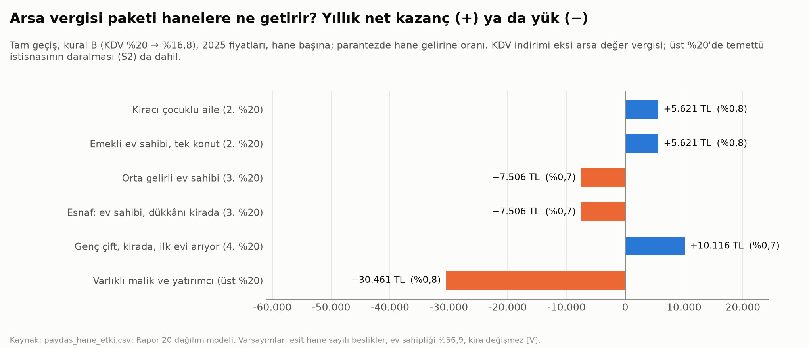
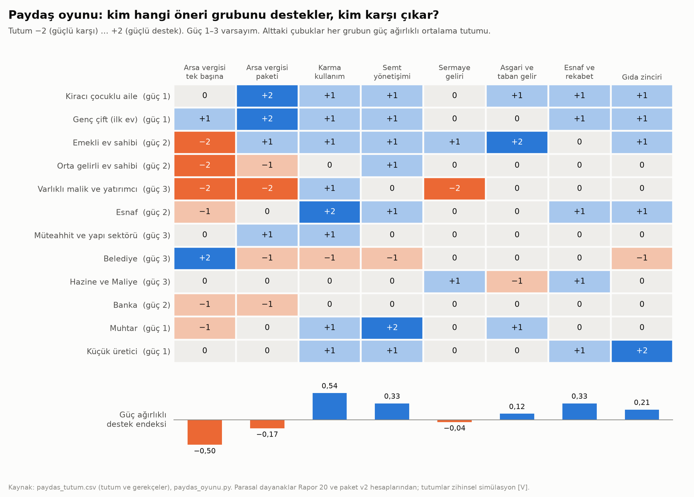

# Faz 5 · Rapor 3 — Paydaş Oyunu: Politika Paketi v2 Kimi Nasıl Etkiler, Kim Destekler, Kim Engeller?

*28 Ekim 2026 · Sürüm 0.1*

| Ne | Nerede |
|---|---|
| Model (kod) | [06_SIMULASYON/kod/paydas_oyunu.py](../06_SIMULASYON/kod/paydas_oyunu.py) |
| Tutumlar ve gerekçeleri (96 hücre) | `06_SIMULASYON/sonuclar/paydas_tutum.csv` |
| Paydaşlar ve güç varsayımları | `paydas_tanimlari.csv` |
| Hane ve kurum etkileri | `paydas_hane_etki.csv`, `paydas_kurum_etki.csv` |
| Destek endeksleri ve paketler | `paydas_destek.csv`, `paydas_destek_esit_guc.csv` (duyarlılık) |
| Paketin kendisi | [Rapor 23](23_politika_paketi_v2.md) · [degisiklik_paketi_v2.md](../08_MEVZUAT_POLITIKA/degisiklik_paketi_v2.md) |

---

## Özet

**Soru:** Paket v2 uygulanırsa her paydaş ne kazanır ya da ne kaybeder? Kim destekler, kim engeller? Hangi paketleme ve hangi telafi, öneriyi uygulanabilir kılar? Bu, ana planın §4.1(d)'deki paydaş oyununun ilk sürümü. Rapor 05 bu işi sonraya bırakmıştı.

**Yöntem:** 12 paydaş ve 8 öneri grubu.

- **Hesap:** Hane paydaşlarının parasal etkisi Rapor 20'nin dağılım modeliyle hesaplandı [H]. Kurumların etkisi paket v2 ve M6 finansman modelinin sayılarından alındı [H].
- **Tutum:** Her paydaşın her gruba tutumu −2 ile +2 arasında, gerekçesiyle yazıldı. Tutumlar bir zihinsel simülasyon: parasal dayanak varsa ona dayanıyor, yoksa rol ve çıkar üzerinden kuruldu [V].
- **Destek endeksi:** Paydaşların gücüne göre ağırlıklı (1–3 [V]) ortalama tutum.

**Kısa cevap:** Paket tek tek önerilerle değil, birlikte sunulursa geçer. Asıl direnç beklenmedik bir yerde: belediyede.

1. **Arsa vergisi tek başına kaybeder.**
   - Arsa değer vergisi KDV indirimi ve muafiyet olmadan sunulursa destek endeksi −0,50. 6 paydaş karşı.
   - Varlıklı malik engelleme gücüyle karşı; emekli ve orta gelirli ev sahibi güçlü karşı.
   - **Paket tasarımı tabloyu değiştiriyor.** Muafiyet (E3) ve KDV indirimi (E4) kiracıları, genç çifti ve tek konutlu emekliyi kazanana çeviriyor: yılda 5.600–10.100 TL [H]. Endeks −0,17'ye çıkıyor.
2. **Haneler arasında kazanan çoğunlukta.**
   - **Kazananlar:** Kiracı aile ve tek konutlu emekli yılda +5.621 TL (gelirin %0,8'i), genç çift +10.116 TL (%0,7).
   - **Yük taşıyanlar:** Orta gelirli ev sahibi −7.506 TL (%0,7). Varlıklı malik ortalama −30.461 TL (%0,8; temettü istisnasının daralması dahil).
3. **Paketleme engeli kaldırıyor.**
   - **Çekirdek paket +0,24:** Arsa vergisi, karma kullanım ve semt yönetimi aynı pakette sunulunca destek pozitife dönüyor ve varlıklı malikin engel riski kalkıyor. Sebep karma kullanım: zemin katın ticari değeri artıyor.
   - **Gıda zinciri ve esnaf önerileri:** Pakete eklemek desteği az değiştiriyor (+0,25).
   - **Sermaye geliri önerileri:** Eklemek desteği düşürüyor (bütün paket +0,19).
4. **Gizli direnç belediyede.**
   - Arsa vergisini tek başına en çok isteyen paydaş belediye (+2): kendi geliri 5,6 katına çıkıyor.
   - Ama paket tasarımında her grupta −1. Sebepler:
     - görünür vergiyi belediye topluyor, merkezi pay aynı tutarda düşüyor;
     - arsa vergisinin %40'ı semt ve mahalle önceliğine bağlanıyor;
     - otopark bedeli ve hal rüsumu gelirinden kayıp var.
5. **Belediyeye küçük bir telafi yetiyor.**
   - **Telafi:** Arsa vergisinin %10'u mahsup dışı kalsın; şehir başına yılda ≈ 76 milyon TL.
   - **Sonuç:** Çekirdek paketin desteği +0,28'e çıkıyor; hiçbir güçlü paydaş direnç göstermiyor.
   - **Bedel:** Merkezi bütçe için yılda ≈ 31,5 milyar TL.
   - **Finansman ödünleşimi:** Temettü istisnasının daraltılması (S2, ≈ 28,9 milyar TL) bu bedeli hesap olarak neredeyse tam karşılıyor. Ama bu kez varlıklı malik dirence geçiyor (+0,20).
   - **Pakete işlenen biçim (P6):** KDV indirimi mahsup edilen tutarla sınırlanıyor. Genel oran %16,8 yerine %17,1'e iniyor ve merkez nötr kalıyor. Destek +0,32; hiçbir güçlü paydaşta engel ya da direnç yok. Paket v2'de E4–E5 bu biçimle güncellendi (28.10.2026).
6. **Kolay kazançlar önce gelmeli.** Bu gruplar mevcut yetkiyle 2027'de uygulanabilir:
   - **Karma kullanım:** +0,54; 8 paydaş lehte.
   - **Esnaf ve rekabet:** +0,33; karşı çıkan yok.
   - **Semt yönetişimi:** +0,33.
   - **Gıda zinciri:** +0,21.

   Bu ilk dalga, arsa vergisi kanunu için gereken güveni ve koalisyonu kurar.

**Proje için anlamı:** Rapor 21'in kademe cümlesi "ülke kural koyar, şehir tahsil eder, semt hizmet verir". Oyun bu cümlenin siyasi bir koşulunu ortaya çıkarıyor: tahsil eden kademe kazanmıyorsa tahsil etmez. Mali nötrlük (E5) merkez için doğru, belediye için caydırıcı. Bu yüzden paketin tasarımına belediyeye kalan küçük bir pay (%10) eklendi (paket v2, E4–E5).

---

## 1. Paydaşlar ve güç

| Kod | Paydaş | Güç | Neden bu güç? [V] |
|---|---|---|---|
| KIR | Kiracı çocuklu aile (2. %20) | 1 | Dağınık, örgütsüz; kiracılar hanelerin ≈ %43'ü ama ortak temsilcisi yok |
| GENC | Genç çift, ilk evini arıyor (4. %20) | 1 | Örgütsüz |
| EMK | Emekli ev sahibi, tek konut (2. %20) | 2 | Geniş ve sandığa giden seçmen bloğu |
| EVS | Orta gelirli ev sahibi (3. %20) | 2 | Ev sahipleri hanelerin %57'si; mülk vergisine duyarlı |
| VAR | Varlıklı malik ve yatırımcı (üst %20) | 3 | Sermaye, medya ve karar alıcıya erişim |
| ESN | Esnaf (ev sahibi, dükkânı kirada) | 2 | TESK ve odalarla örgütlü |
| MUT | Müteahhit ve yapı sektörü | 3 | İhale, istihdam, yerel siyasete erişim |
| BEL | Belediye (şehir kademesi) | 3 | Uygulayıcı: plan, ruhsat, tahsil |
| HAZ | Hazine ve Maliye | 3 | Bütçe ve vergi kanunlarında fiilî veto |
| BNK | Banka | 2 | Kredi ve teminat |
| MUH | Muhtar | 1 | Yerel güven; resmî yetkisi dar |
| URE | Küçük üretici | 1 | Ziraat odaları ve kooperatifler; dağınık |

**Öneri grupları:**

| Kod | Grup | Öneriler |
|---|---|---|
| G1a | Arsa vergisi tek başına | E1 (karşılaştırma için: KDV indirimi, muafiyet ve mahsup yok) |
| G1 | Arsa vergisi paketi | E1–E5 |
| G2 | Karma kullanım | P6, O4, M5, I5, R1 |
| G3 | Semt yönetişimi | B3, B4 (+ B1) |
| G4 | Sermaye geliri | S1–S3 |
| G5 | Asgari ve taban gelir | A1–A3 |
| G6 | Esnaf ve rekabet | C1–C4 |
| G7 | Gıda zinciri | Y1–Y2 |

---

## 2. Kim ne kazanır, ne kaybeder?

### 2.1 Haneler



| Hane (dilim) | KDV indirimi | Arsa vergisi (konut) | Arsa vergisi (işletme) | Temettü (S2) | **Net, TL/yıl** | Gelire oranı |
|---|---|---|---|---|---|---|
| Kiracı çocuklu aile (2.) | +5.621 | 0 | 0 | 0 | **+5.621** | +%0,8 |
| Emekli ev sahibi, tek konut (2.) | +5.621 | 0 (muaf) | 0 | 0 | **+5.621** | +%0,8 |
| Orta gelirli ev sahibi (3.) | +7.670 | −15.176 | 0 | 0 | **−7.506** | −%0,7 |
| Esnaf, ev sahibi (3.) | +7.670 | −15.176 | 0 | 0 | **−7.506** | −%0,7 |
| Genç çift, kirada (4.) | +10.116 | 0 | 0 | 0 | **+10.116** | +%0,7 |
| Varlıklı malik ve yatırımcı (5.) | +16.916 | −27.996 | −14.016 | −5.366 | **−30.461** | −%0,8 |

*Kaynak: `paydas_hane_etki.csv`.*

- **Hesap tanımı:** Tam geçiş, kural B (KDV %16,8), 2025 fiyatları, hane başına [H].
- **Varsayımlar [V]:**
  - Her beşlikte eşit hane sayısı.
  - Ev sahipliği her dilimde %56,9.
  - Arsa vergisi kiraya yansımıyor (Rapor 20 ile aynı varsayım).
  - Varlıklı malikin işletme arsası yükü dilim ortalaması; birden çok kiralık taşınmazı olanın yükü daha büyük.
- **Tabloyu hangi kural belirliyor?** Tablo kural B'ye göre (KDV %16,8). Pakete işlenen kural C'de (KDV %17,1) KDV kazançları %10 daha küçük. Örneğin kiracı aile +5.059 TL, genç çift +9.105 TL, orta gelirli ev sahibi −8.273 TL. P6 senaryosunda hanelerin tutumlarının bu farkla değişmediği varsayıldı [V].

**Okuma:**

- **Kazanan ve kaybeden çizgisi mülkiyette, gelirde değil.** Kiracılar her dilimde kazanıyor. Ev sahipleri üçüncü dilimden itibaren net ödüyor.
- **Orta gelirli ev sahibi önemli bir kayıp.** Gücü 2 ve sayıca kalabalık. Onu kazanmanın yolları ve ödünleşimleri §4'te.
- **Bir kerelik etkiler bu tabloda yok.** Arsa değerindeki düşüş varlıklı malikin servetini azaltır. Aynı düşüş genç çiftin ilk evini ucuzlatır. Büyüklük için değerleme pilotu (E2) gerekiyor.

### 2.2 Kurumlar

| Paydaş | Kalem | Değer | Kaynak |
|---|---|---|---|
| Müteahhit | Arsa kalıntı değeri, İstanbul fiyatı: 12 katlı blok / Z+2 avlulu | 128,9 / 298,1 milyon TL/ha | M6 [H] |
| Müteahhit | Otopark reformu + harç indirimi + hızlı onayın az katlı projeye kazandırdığı | 34,6 milyon TL/ha | M6 [H] |
| Esnaf | 70 m² zemin kat dükkânının otopark yükü (O4 ile sıfır) | 638.400 TL; dükkân değerinin %17,2'si | paket v2 [H] |
| Belediye (≈ 210 bin) | Arsa değer vergisi / bugünkü emlak vergisi | 760 / 136 milyon TL/yıl | paket v2 [H] |
| Belediye | Merkezi pay mahsubu (E5) / semt ve mahalle bütçesine ayrılan (B4) | −760 / 304 milyon TL/yıl | paket v2 [H] |
| Hazine | KDV kaybı / merkezi pay mahsubu | −315 / +315 milyar TL/yıl | paket v2 [H] |
| Hazine | Temettü istisnası %50 → %25 (S2), statik | +28,9 milyar TL/yıl | GİB 2025 [D] → [H] |
| Muhtar | Önceliğini önereceği mahalle bütçesi / semt bütçesi | 3,8 / 31,7 milyon TL/yıl | paket v2 [H] |
| Küçük üretici | 1 milyon TL doğrudan satışta hal rüsumu: bugün / Y1 sonrası | 20.000 / 2.000 TL/yıl | 5957 md. 8 [D] → [H] |
| Genç çift | 124 m² aile konutunda taksit / medyan aile geliri: piyasa kredisi / aile kredisi + kooperatif ve kamu arsası | %182 / %26 | M6 [H] |

*Kaynak: `paydas_kurum_etki.csv`.*

---

## 3. Kim destekler, kim engeller?



| Grup ya da paket | Destek endeksi | Lehte | Aleyhte | Engel riski (güç 3, tutum ≤ −1,5) | Direnç (güç 3, tutum −1) |
|---|---|---|---|---|---|
| Arsa vergisi tek başına (G1a) | **−0,50** | 2 | 6 | Varlıklı malik | — |
| Arsa vergisi paketi (G1) | −0,17 | 4 | 4 | Varlıklı malik | Belediye |
| Karma kullanım (G2) | **+0,54** | 8 | 1 | — | Belediye |
| Semt yönetişimi (G3) | +0,33 | 7 | 1 | — | Belediye |
| Sermaye geliri (G4) | −0,04 | 2 | 1 | Varlıklı malik | — |
| Asgari ve taban gelir (G5) | +0,12 | 3 | 1 | — | Hazine |
| Esnaf ve rekabet (G6) | +0,33 | 5 | **0** | — | — |
| Gıda zinciri (G7) | +0,21 | 5 | 1 | — | Belediye |
| **P1** Çekirdek: G1 + G2 + G3 | +0,24 | 7 | 3 | — | Belediye |
| **P2** Çekirdek + gıda zinciri + esnaf | +0,25 | 8 | 3 | — | Belediye |
| **P3** Bütün paket v2 | +0,19 | 8 | 3 | — | Belediye |
| **P4** Çekirdek + belediyeye telafi (mahsup %90) | **+0,28** | 7 | 4 | — | **—** |
| **P5** P4 + telafinin temettüden (S2) finansmanı | +0,20 | 7 | 3 | — | Varlıklı malik |
| **P6** Çekirdek + telafi, KDV indirimi mahsupla sınırlı (merkez nötr; **paket v2'ye işlendi**) | **+0,32** | 7 | 3 | — | **—** |

*Kaynak: `paydas_destek.csv`.*

- **Hesap:** Endeks −2 … +2 arasında; paketlerde her paydaşın tutumu, içerdiği grupların ortalaması.
- **Sağlamlık (`paydas_destek_esit_guc.csv`):** Güçler eşit alınınca uçlar değişmiyor. En yüksek destek yine karma kullanımda (+0,67), en düşük yine arsa vergisinin tek başına sunulmasında (−0,50). Değişen arsa vergisi paketi: eşit güçle hafif pozitife dönüyor (+0,08) ve sermaye gelirinin (0,00) önüne geçiyor. Yani bu paketin olumsuz görünmesinin sebebi paydaş sayısı değil güç dağılımı: varlıklı malik, belediye ve banka.

**Okuma:**

1. **Paketleme bir telafi aracı.** Varlıklı malik arsa vergisinde −2, sermaye gelirinde −2, ama karma kullanımda +1.
   - **Çekirdek pakette:** Ortalaması −0,33; engel olmaktan çıkıyor.
   - **Sermaye geliri eklenince:** Ortalaması −0,75'e düşüyor ve direnç yeniden doğuyor.
   - **Sonuç:** Sermaye geliri önerileri (S1–S3) arsa vergisi kanunuyla aynı pakete konmamalı. Ayrı bir takvimde ve kendi gerekçesiyle ilerlemeli.
2. **Belediye her pakette dirençli; sebebi tasarım.** Mali nötrlük kuralı (E5) belediyeyi "vergiyi toplayan ama parayı tutamayan" taraf yapıyor. Üstüne:
   - semt ve mahalle bütçesi (B4) takdir yetkisini daraltıyor,
   - otopark bedeli (O4) ve hal rüsumu (Y1) gelirini azaltıyor.

   %10'luk küçük bir pay (P4) direnci kaldırıyor.
3. **Hazine yalnız iki yerde itiraz ediyor.**
   - **Taban aylığın endekslenmesi (A2):** Otomatik maliyet.
   - **Belediyeye telafi (P4):** 31,5 milyar TL/yıl.

   İkisinin bedeli de hesaplanabilir. Temettü önerisi (S2) bu iki maliyetten birini karşılayacak büyüklükte, ama her ikisini birden karşılamıyor.
4. **Banka arsa vergisine sessiz bir karşı.** Teminattaki arsa değeri düşüyor. Ama gücü 2; tek başına engel değil.

---

## 4. Kaybedenler ve telafi

| Kaybeden | Neden kaybediyor? | Paketteki telafi | Önerilen ek telafi | Ödünleşim |
|---|---|---|---|---|
| **Belediye** | Görünür vergiyi topluyor, net geliri değişmiyor; takdir yetkisi daralıyor | Kendi gelirinin payı artıyor (E1); semt meclisi pilot bütçesi (B3) | **Mahsup %90:** arsa vergisinin %10'u belediyede (şehir başına ≈ 76 milyon TL/yıl). **Paket v2'ye işlendi (E5)** | KDV indirimi mahsupla sınırlanınca merkez nötr. Bedeli hanelerde: KDV %16,8 yerine %17,1, KDV kazancı %10 küçük |
| **Varlıklı malik** | Arsa vergisi, işletme arsası ve temettü; arsa değerinde bir kerelik düşüş | Yapı vergisinin sıfırlanması (E1); zemin katın ticari değeri (P6) | Arsa vergisini beş yılda kademeli yükseltmek (paket v2'de zaten var); S1–S3'ü ayrı takvimde yürütmek | Kademe yavaşladıkça KDV indirimi de yavaşlar |
| **Orta gelirli ev sahibi** | Konut arsasında net yük ≈ 7.500 TL/yıl | KDV indirimi | **Her konutun ilk X m² arsa payına muafiyet** (ev sahibi indirimi) | Hasılat üst dilimlere kayar; varlıklı malik direnci artar. Tutarı E2 pilotundan sonra hesaplanmalı |
| **Banka** | Teminat değeri düşüyor | Konut talebi ve aile kredisi (F2) artıyor | Geçiş döneminde kredi/değer oranı kurallarının gözden geçirilmesi | Finansal istikrar denetimi |
| **Kota sahipleri** (eczane, taksi plakası) | Kotaların gözden geçirilmesi plaka ve ruhsat değerini düşürebilir (C2) | Yok; C2 yalnız gözden geçirme öneriyor | Kota değiştirilirse geçiş süresi ve mevcut sahiplere öncelik | Rekabetin gecikmesi |
| **Hal komisyoncuları** | Doğrudan satışta rüsum avantajı (Y1) | Yok | Gerek görülmedi; halde satış %1 rüsumla sürüyor | — |

---

## 5. Sıralama önerisi

Oyunun mantığı sıralamayı şöyle belirliyor:

1. Destek yüksek ve mevcut yetkiyle yapılabilenler önce gelir.
2. Belediyenin kaybettiği yerlerde telafi aynı anda verilir.
3. Kanun gerektiren arsa vergisi, ilk dalganın görünür kazançlarından sonra gelir.

| Dalga | Ne? | Destek | Not |
|---|---|---|---|
| **1 · 2026 sonu – 2027** (mevcut yetki) | Gıda zinciri (Y1, C4), karma kullanım yönetmelikleri (P6, O4, M5), semt meclisi pilotu (B3), esnaf ve rekabet (C2, C3), mahalle işyeri tek başvurusu (R1) | +0,21 … +0,54 | Belediye karma kullanımda ve gıda zincirinde −1. **Pilot belediyelere semt pilot bütçesi aynı kararla verilmeli** |
| **2 · 2027 – 2028** (hazırlık) | Değerleme pilotu (E2), gelir testli destek (A1), asgari ücret gerekçesi (A3), sermaye geliri hasılat analizi | — | Arsa vergisinin oran bandı ve orta gelirli ev sahibi indirimi bu dalgada hesaplanır |
| **3 · 2028 kanun paketi** | Arsa vergisi paketi (E1, E3–E5), semt bütçesi (B4), değer artış payı (I5), **mahsup %90** | Çekirdek + telafi, merkez nötr: +0,32 | Sermaye geliri önerileri (S3, ayrıca S1–S2 kararları) bu paketten ayrı tutulur |
| **4 · 2029 – 2033** | Arsa vergisinin beş yıllık geçişi ve her yıl KDV indirimi (E4) | — | Her yıl hane kazancı görünür kılınır (KDV oranı fişte) |

---

## 6. Zihinsel simülasyon: sekiz paydaş, 2027–2033

Personaların bir kısmı Rapor 05'teki karakterler. Sayılar bu raporun hesaplarından; davranışlar varsayım.

**Hüseyin (76, emekli, Fatih'te tek dairesinin sahibi).**

- **2027:** Mahalle meclisine kurayla çıkıyor. İlk toplantıda kaldırımdaki bozuk rampayı yazdırıyor.
- **2029:** Arsa vergisini duyunca endişeleniyor. Muhtarlıktaki değer haritasına bakıyor; tek konutu ve geliri yüzünden muaf olduğunu öğreniyor.
- **2033:** Market fişinde KDV'nin düştüğünü görüyor. Yılda ≈ 5.600 TL'lik kazancı tek tek fark etmiyor; ama kira öder gibi vergi ödemediğini biliyor.
- **Risk:** Değerleme mektubu yanlış giderse ilk itiraz eden o olur.

**Zeynep ve Mert (29 ve 32, kirada, ilk evlerini arıyorlar).**

- **KDV:** İndirim yılda ≈ 10.100 TL kazandırıyor.
- **Asıl değişiklik:** Sürüm 1'in aile kredisi ve kooperatif modeli. 124 m²'lik konutun taksiti medyan aile gelirinin %182'si yerine %26'sı.
- **2031:** Semt meclisinin önerdiği kooperatif adasına başvuruyorlar. Arsa vergisi yüzünden kooperatifin arsa bedeli beklediklerinden düşük çıkıyor [V].

**Ayşe ve Ahmet (kirada, iki çocuk).**

- **Kazanç:** KDV indirimiyle yılda ≈ 5.600 TL.
- **2027:** Mahallede bir fırın ve bir terzi açılıyor; otopark şartı kalkınca açılabilmişler. Ayşe'nin yarı zamanlı işine yürüyerek gitmesi kolaylaşıyor.

**Mehmet usta (52, bakkal; evi kendisinin, dükkânı kirada).**

- **2027 kazancı:** Meydana bakan 70 m²'lik ikinci dükkânı açarken 638 bin TL'lik otopark bedelinden kurtuluyor. Manav reyonuna üreticiden doğrudan alıyor; rüsum %2 yerine %0,2.
- **2029 yükü:** Evinin arsası için yılda ≈ 7.500 TL net ödemeye başlıyor; ilk tepkisi olumsuz.
- **Sonuç:** Semt pazarındaki ortak depoyla alış maliyeti düşünce dengeyi kendi lehine görüyor. Esnaf odasında arsa vergisine "karşı değil, değerlemeye dikkat" tutumu çıkıyor.

**Nevzat (61, Kadıköy'de üç kiralık daire ve bir boş arsa sahibi, borsada hisse).**

- **Yük:** Yılda ortalama ≈ 30.500 TL ödüyor; kiralık mülkü fazla olduğu için gerçekte daha fazla.
- **Arsa:** Değeri bir kerelik düşüyor; boş arsayı tutmak pahalılaşıyor.
- **2030:** Arsayı bir yapı grubuna satıyor; arsada dört katlı avlulu bir ada yükseliyor.
- **Politik tutum:** Arsa vergisine karşı lobi yapıyor. Ama aynı pakette sermaye geliri vergisi yoksa ve zemin kat dükkânının değeri artıyorsa direnci sınırlı kalıyor.

**Kemal (müteahhit, Kayseri).**

- **Hesap:** Arsa kalıntı değeri hesabı az katlı lehine dönüyor. Otopark, harç ve onay süresi kazancı İstanbul fiyatında hektar başına 34,6 milyon TL.
- **Yeni iş:** Yeni yapının vergisi sıfırlanınca eski stokun yenilenmesi işi artıyor.
- **Kaybı:** Elindeki arsa stokunun taşıma maliyeti artıyor. Arsayı beklemek yerine yapmaya başlıyor.

**Belediyenin mali işler müdürü (≈ 210 bin kişilik şehir).**

- **Gelirin değişimi:** Emlak vergisi 136 milyon TL'den 760 milyon TL'ye çıkıyor, ama merkezi pay aynı tutarda düşüyor. Bunun 304 milyon TL'si semt ve mahalle bütçelerine bağlanıyor.
- **Başkana notu:** "Vergiyi biz topluyoruz, şikâyeti biz alıyoruz, para aynı."
- **Telafi gelirse:** %10 telafiyle ≈ 76 milyon TL'lik ek kaynak oluşuyor; not "değerleme ofisini kuralım" diye değişiyor.

**Gülsüm (muhtar) ve Hatice (üretici, Meram'ın kırsalı).**

- **Gülsüm:** Muhtarlığa değer haritası itirazlarıyla birlikte yılda ≈ 3,8 milyon TL'lik mahalle bütçesinin öncelik listesi geliyor. Gülsüm için ilk kez "muhtar ne yapabilir?" sorusunun cevabı var.
- **Hatice:** Semt pazarında üreticiye ayrılan tezgâhın gerçekten üreticiye verildiğini semt meclisinin raporunda görüyor. Manava doğrudan sattığı domatesin rüsumu 1 milyon TL'lik satışta 20 bin TL'den 2 bin TL'ye iniyor.

---

## 7. Sınırlılıklar

1. **Tutumlar varsayım.** 96 tutumun her birinin gerekçesi `paydas_tutum.csv`'de yazılı. Ama hiçbiri anket ya da görüşmeyle sınanmadı [V].
   - **Sonraki adım:** Pilot illerde belediye, esnaf odası, muhtar ve banka temsilcileriyle yapılandırılmış görüşmeler. Tutumlar bu görüşmelerle güncellenir.
2. **Güç ağırlıkları keyfî.** Duyarlılık hesabı (eşit güç) sıralamayı değiştirmiyor; arsa vergisi paketinin işaretini değiştiriyor. Destek endeksi bir oy sayımı değil, direncin nerede yoğunlaştığını gösteren bir araç.
3. **Hane hesabı dilim ortalaması.**
   - Ev sahipliği oranının dilimlere göre değiştiği, kiracıya yansıma ve davranış tepkisi modelde yok.
   - Varlıklı malikin işletme arsası yükü ortalama; çok taşınmazlı malikte daha yüksek.
   - Rapor 20'nin bütün varsayımları geçerli.
4. **Bir kerelik servet etkileri hesaplanmadı.** Arsa değerinin düşüşü ve genç çiftin ilk evinin ucuzlaması için arsa değeri stoku ve değerleme verisi gerekiyor (E2).
5. **Seçim ve siyaset dinamiği yok.** Oyun durağan: koalisyonların zaman içinde değişmesi, seçim takvimi ve medya etkisi modelde yok. Ajan tabanlı bir sürüm (Rapor 05'teki M3 gibi) sonraki adım olabilir.
6. **Kurumlar tek parça sayıldı.** Belediye, Hazine ve sektör kendi içinde farklı çıkarlar taşır. Örnekler: büyükşehir ve ilçe; vergi idaresi ve bütçe; büyük ve küçük müteahhit.

---

## Yeniden üretim

```
PYTHONIOENCODING=utf-8 python 05_ANALIZ/kod/ekonomi_veri.py                       # Rapor 20 verisi (bir kez)
PYTHONIOENCODING=utf-8 python 08_MEVZUAT_POLITIKA/politika_v2/politika_v2_mali.py  # paket v2 hesapları
PYTHONIOENCODING=utf-8 python 06_SIMULASYON/kod/paydas_oyunu.py                    # oyun, 6 CSV, 2 grafik
```

Betik Rapor 20'nin dağılım modelini içinden çalıştırır. O modelin çıktıları birebir aynı kalır; bu, bu çalışmada md5 ile doğrulandı.
