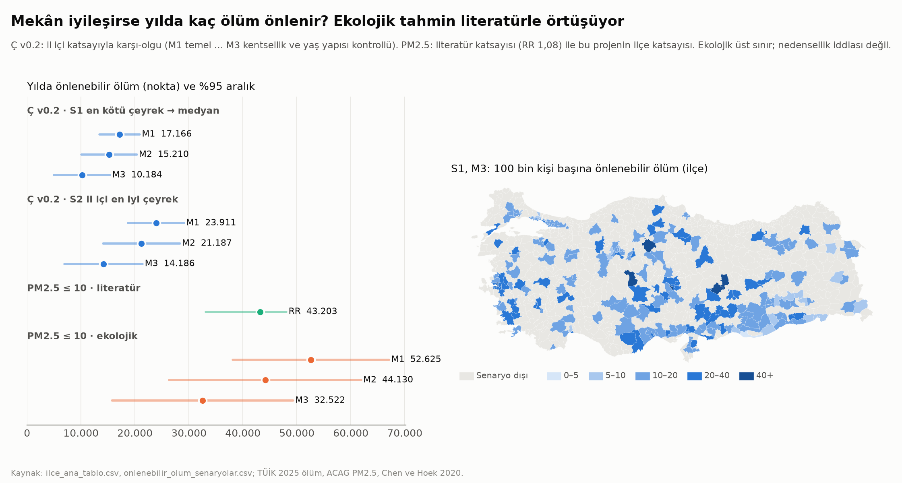

# Faz 5 · Rapor 4 — İlçe Ana Tablosu ve Önlenebilir Ölüm: Mekânın Sağlık Payı Kaç Can?

*28 Ekim 2026 · Sürüm 0.1*

| Ne | Nerede |
|---|---|
| Kod | [05_ANALIZ/kod/ilce_ana_tablo.py](../05_ANALIZ/kod/ilce_ana_tablo.py) |
| İlçe ana tablosu (973 ilçe × 186 değişken) ve sözlüğü | `03_VERI/islenmis/ilce_ana_tablo.csv`, `ilce_ana_tablo_sozluk.csv` |
| Senaryolar, ilçe ve il sonuçları | `05_ANALIZ/sonuclar/onlenebilir_olum_senaryolar.csv`, `_ilce.csv`, `_il.csv` |
| Grafik | [onlenebilir_olum.png](../05_ANALIZ/grafikler/onlenebilir_olum.png) |
| Dayandığı modeller | [Rapor 13](13_fue_uydu_cevre.md) (çevre-ölçek ekseni v0.2) · [Rapor 14](14_kentsel_stres.md) (PM2.5 literatürü) |

---

## Özet

**Soru:** Rapor 13, çevre-ölçek ekseninin (Ç: hava, ağaç, sıcaklık, bina yüksekliği, ana yol, yayılma) il içinde ölüm oranıyla güçlü biçimde ilişkili olduğunu bulmuştu. Bu ilişki gerçekse, mekân iyileşince yılda kaç ölüm önlenir? İlçe verisinden çıkan sayı literatürle tutarlı mı?

**Yöntem:**

1. **Tek tablo:** Projenin bütün ilçe katmanları tek tabloda birleştirildi (§1).
2. **Karşı-olgu:** Rapor 13'ün modeli birebir yeniden üretildi; katsayılar aynı (−0,41 / −0,36 / −0,24). Bu katsayılarla "Ç iyileşirse" sorusu soruldu.
3. **Sağlama:** PM2.5 için iki bağımsız hesap yapıldı: biri literatür katsayısıyla, öteki kendi ilçe verimizden.

**Kısa cevap:**

1. **Çevre-ölçek ekseni:** En kötü çeyrekteki 243 ilçe ulusal medyana çıksa yılda **≈ 10.200–17.200 ölüm** önlenir; 2025'teki 491.700 ölümün %2,1–3,5'i. Bu ilçeler az sayıda ama 58 milyon kişiyi barındırıyor; çoğu büyük kent ilçesi. Her ilçe ilinin en iyi çeyreğine çıksa sayı **≈ 14.200–23.900** olur.
2. **Hava kirliliği:** PM2.5 her ilçede 10 µg/m³'e inse literatür katsayısıyla yılda **≈ 43.200 ölüm** (33.100–48.100) önlenir. Bugün nüfus ağırlıklı ortalama 22,9 µg/m³ ve nüfusun tamamı 10'un üzerinde. Dünya Sağlık Örgütü kılavuzu olan 5 µg/m³'te sayı **≈ 60.100**.
3. **Ekolojik tahmin literatürle örtüşüyor.** Kendi ilçe verimizden tahmin edilen PM2.5 katsayısı, aynı hedef için **≈ 32.500–52.600** ölüm veriyor. Orta model 44.100; literatür 43.200. Rapor 13'ün yöntemi en iyi bilinen çevre–ölüm ilişkisini bağımsız olarak yeniden üretiyor. Bu, Ç sonucuna duyulan güveni artırıyor.
4. **Toplum hedefinin karşılığı.** Toplum hedefleri belgesindeki "Ç ekseninde en kötü çeyrekteki ilçe nüfusunu yarıya indirmek" hedefi yılda **≈ 5.100–8.600 ölüm** demek. PM2.5 ≤ 10 hedefi ise ≈ 43 bin.

**Proje için anlamı:**

- **Ölçülebilir gerekçe:** Mekânın gerekçesi artık bir sayıyla söylenebiliyor. Çevresi en kötü ilçeleri ortalamaya getirmek, yılda 10 binden fazla erken ölümü önleyebilecek büyüklükte bir kazanç.
- **En büyük kaldıraç:** Kanıtı en güçlü kaldıraç hava. Rapor 17'deki sanayi ve otoyol yer seçimi ile Rapor 18'deki enerji dönüşümü, bu ölümlerin en büyük kısmına dokunuyor.
- **Sınır:** Bunlar ekolojik üst sınırlar, kişi düzeyinde nedensellik değil (§4).

---

## 1. İlçe ana tablosu

**Taban:** `ilce_paneli_genis.csv`, 128 değişken. İçerik:

- nüfus,
- doğum ve evlenme 2014–2025 (yıllık), boşanma,
- ölüm ve beklenen ölüm 2024–2025,
- hane tipi ve medeni durum,
- kadın eğitimi,
- GHSL bina yüksekliği ve yayılma,
- OSM yeşil, kavşak, ibadethane, okul.

**Eklenenler:**

| Kaynak | Değişkenler |
|---|---|
| FUE v0.2 (Rapor 10, 13) | 16 gösterge, B1–B6 boyutları, erişim (E) ve çevre-ölçek (Ç) eksenleri, bileşik endeks |
| Uydu (Rapor 13) | PM2.5, ağaç örtüsü, yapılı alan, yüzey sıcaklığı |
| Kentsel stres (Rapor 14) | KSY ve 7 bileşeni |
| **250 m ulusal ızgara (bu rapor)** | Nüfus ağırlıklı: eğim; diri faya ≤ 1 km ve ≤ 5 km nüfus payı; 100 yıllık taşkın alanındaki nüfus payı; istasyon, hızlı tren, yük limanı ve sanayi mesafesi; havalimanı süresi |

**Izgaradan çıkan ilk tablo:** Ulusal toplamlar Rapor 17 ile tutarlı.

| Gösterge (ilçe ortalaması / medyan) | Değer |
|---|---|
| Diri faya ≤ 1 km nüfus | 5,33 milyon kişi; ilçelerde ortalama %7,6, en fazla %81 |
| Diri faya ≤ 5 km nüfus payı | ortalama %28, medyan %3,9 |
| 100 yıllık taşkın alanındaki nüfus | 3,24 milyon kişi |
| En yakın istasyon | ortalama 41 km, medyan 30 km |
| En yakın havalimanı | ortalama 61 dk |
| En yakın sanayi alanı | ortalama 6,9 km |

**Tablonun önemi:** Sonraki analizlerin (Rapor 22'nin gündemi ve "verileri birleştirme" önerileri B, C, D) hepsi bu tabloya dayanacak.

- **Zaman boyutu:** Doğum ve evlenme 2014–2025 yıllık. Panel sınamaları (öneri B) ve deprem olay çalışması (öneri C) için hazır.
- **Deprem riski:** Fay ve taşkın payları ile bina yüksekliği deprem riskinin ilçe göstergesi.
- **Donatı açığı:** Erişim mesafeleri, kademe modeliyle birleşince donatı açığı haritasının (öneri D) zeminini kuruyor.

---

## 2. Çevre-ölçek ekseni: karşı-olgu

**Model (Rapor 13 ile aynı):**

- **Denklem:** SMR = a + b × Ç + kontroller + il sabit etkisi.
- **Tahmin:** Nüfus ağırlıklı; il kümelenmiş standart hata.
- **Kontrol setleri:**
  - **M1:** eğitim ve göç.
  - **M2:** M1'e ek olarak yoğunluk.
  - **M3:** M2'ye ek olarak il merkezi payı ve yaşlı payı.
- **Kullanım:** b, Ç'nin her puanı için SMR değişimi. Önlenen ölüm = −b × ΔÇ × beklenen ölüm (2025).

| Model | b (puan başına SMR) | Standartlaştırılmış β | S1 · en kötü çeyrek → medyan | S2 · ilinin en iyi çeyreğine | S3 · medyanın altı → medyan |
|---|---|---|---|---|---|
| M1 | −0,0039 (SH 0,0004) | −0,41*** | **17.166** (13.448–20.884) | 23.911 | 19.086 |
| M2 | −0,0035 (0,0006) | −0,36*** | **15.210** (10.096–20.324) | 21.187 | 16.912 |
| M3 | −0,0023 (0,0006) | −0,24*** | **10.184** (4.988–15.380) | 14.186 | 11.324 |
| Etkilenen ilçe / nüfus | | | 243 / 58,4 milyon | 700 / 78,8 milyon | 486 / 75,9 milyon |
| Etkilenenlerde ortalama ΔÇ | | | +14,7 puan | +11,0 puan | +9,3 puan |

*Parantezler %95 aralık; yalnız katsayı belirsizliği. Ç'nin ulusal çeyreği 41,1, medyanı 49,4.*

**Okuma:**

- **Ölçek:** En kötü çeyrekteki bir ilçenin Ç'si medyana çıkarken ölüm oranı yaklaşık %3,4 (M3) ile %5,7 (M1) düşüyor.
- **Etki kentlerde yoğun.** Bu çeyreğin nüfusu büyük kentlerde. En çok ölüm önlenen iller (S1, M3):
  - İstanbul ≈ 1.900,
  - İzmir ≈ 1.000,
  - Ankara ≈ 850,
  - Bursa, Gaziantep, Mersin, Adana, Kayseri, Şanlıurfa, Antalya 240–430.
- **100 bin kişi başına ise karışık:** En yüksek ilçeler kent merkezleri (Karşıyaka, Konak: ≈ 41–42) ile yüksek ölümlü küçük ilçeler (Hekimhan, Darende, Hacılar: 43–57).
- **En savunulabilir senaryo S2.** Katsayı il içi farklardan tahmin edildi; bu yüzden "her ilçe ilinin en iyi çeyreğine" en savunulabilir karşı-olgu. S1 bu il içi eğimin ülke geneline taşınabildiğini varsayıyor.



---

## 3. Sağlama: PM2.5

| Yaklaşım | Hedef ≤ 10 µg/m³ | Hedef ≤ 5 µg/m³ |
|---|---|---|
| **Literatür**: RR 1,08 (1,06–1,09) / 10 µg/m³, doğal nedenli ölüm (Chen ve Hoek 2020) | **43.203** (33.135–48.072); ölümlerin %8,8'i | **60.133** (46.302–66.780); %12,2 |
| Ekolojik M1 (b = 0,0089 / µg) | 52.625 (38.148–67.103) | 74.553 |
| Ekolojik M2 (0,0075) | **44.130** (26.357–61.903) | 62.518 |
| Ekolojik M3 (0,0055) | 32.522 (15.746–49.299) | 46.073 |

**Okuma:**

- **Örtüşme gerçek bir sağlama.** Literatür katsayısı on milyonlarca kişiyi izleyen kohortlardan geliyor. Bizim katsayımız 973 ilçenin il içi farklarından. İkisi aynı büyüklüğü veriyor; orta model literatürden yalnız %2 farklı.
- **Bu, yöntemimize güven veriyor.** Rapor 13'ün modeli (ilçe, il sabit etkisi, eğitim, göç ve kentsellik kontrolleri) bilinen bir etkiyi doğru büyüklükte yakalıyor. Bu yüzden aynı modelin Ç için verdiği sayı (§2) da büyüklük sırası olarak ciddiye alınabilir.
- **Kontrol arttıkça katsayı küçülüyor.** M3'te PM2.5 katsayısı literatürün altında. Kentsellik ve yaş yapısı kontrolleri, PM2.5'in yoğun kentlerdeki etkisinin bir kısmını da soğuruyor olabilir (aşırı kontrol). Ç'nin M3 sonucu da bu yüzden alt sınıra yakın okunmalı.
- **Enerji karşılaştırması.** Rapor 18'in 2050 enerji senaryosu, yüksek yenilenebilir yoluyla yılda ≈ 5.200 ölüm önlüyordu. O sayı yalnız enerji kaynaklı PM2.5'i kapsıyor. Buradaki 43 bin, kaynağı ne olursa olsun bütün PM2.5'in 10 µg/m³'e inmesi. Sanayi, trafik, ısınma ve toz da bu sayının içinde.

---

## 4. Sınırlılıklar

1. **Ekolojik çıkarım.** İlçe düzeyindeki ilişki kişi düzeyinde nedensellik değil. Sayılar "bu ilişki nedensel olsaydı" sorusunun cevabı ve üst sınır olarak okunmalı.
2. **Ç ile PM2.5 toplanmaz.** Ç v0.2 PM2.5'i bir bileşen olarak içeriyor (Rapor 13). İki senaryonun önlediği ölümler büyük ölçüde örtüşüyor.
3. **Seçilim ve ters nedensellik.** Sağlıklı ve varlıklı haneler iyi çevreli ilçeleri seçiyor olabilir. Eğitim ve il sabit etkisi bunun bir kısmını alıyor, tamamını değil. Kişi düzeyinde veri (mikro veri başvuruları) ya da doğal deney (öneri C) gerekiyor.
4. **Ölüm verisi.** 2025 ölümleri ve ülke yaş-cinsiyet oranlarıyla beklenen ölüm kullanıldı. Deprem bölgesindeki 2023 sonrası nüfus hareketleri beklenen ölümü etkiliyor olabilir. Literatür katsayısı doğal nedenli ölüm için; tüm ölümlere uygulandı. Doğal nedenler toplamın çoğu, ama fark kayıtlı değil [V].
5. **Gecikme yok.** Hava kirliliğinin etkisi yıllar içinde birikiyor. Hedefe ulaşılsa da bütün kazanç ilk yıl gelmez.
6. **Hedeflerin gerçekçiliği.** Senaryolar "ne kadar kazanç var" sorusunun cevabı, "ne kadar sürede" sorusunun değil.
   - **Ç:** Ortalama 15 puanlık iyileşme ağaç örtüsü, yeşil erişim, ana yoldan uzaklık ve yükseklik gibi yavaş değişen bileşenlere bağlı.
   - **PM2.5:** 10 µg/m³ hedefi Avrupa'da bile birçok kentte henüz tutturulamıyor.
7. **Belirsizlik aralıkları dar.** Aralıklar yalnız katsayı belirsizliğini yansıtıyor. Model seçimi (M1–M3) daha büyük bir belirsizlik kaynağı; bu yüzden üç model birlikte raporlandı.

---

## 5. Sonraki adımlar (ana tabloyla)

1. **Zaman boyutu (öneri B):** 2014–2025 doğum ve evlenme ile GHSL 2000→2020 yapılaşma değişimi ve il konut fiyatı ve kira paneli. Kesitsel bulguların değişim üzerinden sınanması.
2. **Deprem olay çalışması (öneri C):** 6 Şubat 2023'ten etkilenen ilçelerde doğum, evlenme ve nüfus. Fay payı ve bina yüksekliğine göre etki farkı.
3. **Donatı açığı ve yatırım haritası (öneri D):** Kademe modeli × ızgara × OSM.
4. **Bu raporun güncellenmesi:** Gece ısısı ve gürültü katmanları gelince Ç ve stres endeksiyle birlikte yeniden hesaplanması.

---

## Yeniden üretim

```
PYTHONIOENCODING=utf-8 python 05_ANALIZ/kod/fue_ilce_gecerlilik.py   # ilce_fue_lite.csv, fue_ilce_gecerlilik.csv
PYTHONIOENCODING=utf-8 python 05_ANALIZ/kod/stres_endeks.py          # stres_ilce_endeks.csv
PYTHONIOENCODING=utf-8 python 05_ANALIZ/kod/ilce_ana_tablo.py        # ana tablo, karşı-olgu, grafik
```

**Denetimler:**

- Betik, Ç katsayılarının Rapor 13'tekilerle aynı olduğunu `assert` ile denetliyor.
- Bu çalışmada ikinci çalıştırma bütün çıktıları md5 düzeyinde birebir üretti.
- Izgara katmanları `.gitignore`'da; `ulusal_plan_*.py` zinciriyle yeniden üretilir (README).
