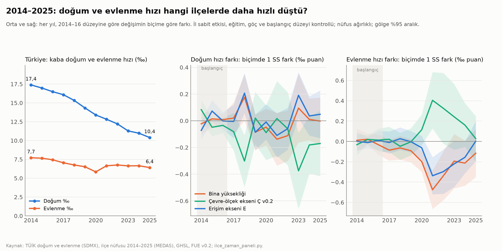

# Faz 5 · Rapor 5 — İlçe Zaman Paneli (2014–2025): Doğum ve Evlenme Hangi İlçelerde Daha Hızlı Düştü?

*28 Ekim 2026 · Sürüm 0.1*

| Ne | Nerede |
|---|---|
| Kod | [05_ANALIZ/kod/ilce_zaman_paneli.py](../05_ANALIZ/kod/ilce_zaman_paneli.py) · [ilce_ghsl_degisim.py](../05_ANALIZ/kod/ilce_ghsl_degisim.py) |
| Yeni veri: ilçe nüfusu 2014–2025 (TÜİK MEDAS) | `03_VERI/islenmis/ilce_nufus_2014_2025.csv` · ham: `03_VERI/ham/tuik/medas_ilce_nufus_2014_2025.csv` · [kaynak notu](../03_VERI/ham/tuik/ilce_kaynaklar.md) |
| Yeni veri: GHSL 2000→2020 ilçe değişimi | `03_VERI/islenmis/ilce_ghsl_degisim.csv` |
| Sonuçlar | `05_ANALIZ/sonuclar/zaman_paneli_*.csv` (ulusal seri, uzun fark, yıl katsayıları, varyans, kesit kıyası, ilçe) |
| Grafik | [zaman_paneli.png](../05_ANALIZ/grafikler/zaman_paneli.png) |
| Önceki bulgular | [Rapor 03](03_ilce_paneli_il_ici.md) (ilçe kesiti) · [Rapor 04](04_konut_maliyeti_h2.md) (il paneli, konut maliyeti) · [Rapor 25](25_ilce_ana_tablo_onlenebilir_olum.md) (ana tablo) |

---

## Özet

**Soru:** Faz 2, il içinde bir kat daha yüksek binada yaşanan ilçede doğurganlığın ≈ 0,03 çocuk düşük olduğunu tek bir yılın kesitinden bulmuştu. Zaman içinde bakınca ne görüyoruz? 2014–2025'te doğum ve evlenme hızı, kentsel biçimi farklı ilçelerde farklı hızlarda mı düştü?

**Yeni veri:** 2014–2025 yıllık ilçe nüfusu ilk kez projeye girdi.

- **Kaynak:** TÜİK MEDAS'tan yerleşik tarayıcıyla alındı; 389 sayfa, 11.666 ilçe-yıl.
- **Sağlama:** Yıllık Türkiye toplamları ADNKS bültenleriyle birebir aynı. 2024–2025 değerleri SDMX ile 973 ilçenin tamamında aynı.
- **Yöntem:** Bu nüfusla doğum ve evlenme hızı her ilçe ve yıl için hesaplandı.

**Kısa cevap:**

1. **Düşüş büyük ve neredeyse her yerde.**
   - **Doğum:** Türkiye'de kaba doğum hızı 2014'te ‰ 17,4, 2025'te ‰ 10,4 (−%40). Doğum sayısı 1,35 milyondan 0,90 milyona indi. 970 ilçenin yalnız 7'sinde doğum hızı düşmedi.
   - **Evlenme:** Kaba evlenme hızı ‰ 7,7'den ‰ 6,4'e indi. 2020'de salgınla dibe vurdu, 2021'de toparlandı.
2. **Düşüşün ilçeler arası farkının neredeyse tamamı ortak.** Başlangıçtan (2014–16) sona (2023–25) değişimin ilçeler arası farkı şöyle ayrışıyor:
   - **İl sabit etkisi:** Tek başına **%67**'sini açıklıyor; aynı ildeki ilçeler birlikte düşüyor.
   - **Başlangıç düzeyi, eğitim, göç ve yaş yapısı:** %18 ekliyor.
   - **Kentsel biçim:** Bina yüksekliği, çevre-ölçek ekseni (Ç), erişim ekseni (E) ve yoğunluk değişimi, dördü birlikte **yalnız %0,4** ekliyor.
3. **Yüksek binalı ilçelerde doğum hızı daha hızlı düşmedi.** Bina yüksekliğinin katsayısı 0'a çok yakın ve anlamsız: başlangıç kontrollü +0,03 (p 0,73), yaş yapısı kontrollü +0,004 (p 0,96). Faz 2'nin "mekânın doğurganlığa doğrudan etkisi küçük" bulgusu zaman boyutunda da geçerli.
4. **Evlenmede küçük ve geçici bir iz var.**
   - **Büyüklük:** Yüksek binalı ilçelerde evlenme hızının düşüşü biraz daha büyük; 1 standart sapma yükseklik başına −0,17 ile −0,25‰ puan (p 0,04–0,14). Bu, ortalama düşüşün beşte biri kadar.
   - **Zamanlama:** Yıl yıl bakınca fark büyük ölçüde 2020–2023'te, salgın düşüşü ve sonrasındaki telafi döneminde. 2021'de −0,48; 2025'te −0,12'ye iniyor. Kalıcı bir ayrışma değil, şoka farklı tepki.
5. **Kaba hızlar yanıltabilir.**
   - **Kesitte:** Aynı il içinde yüksek binalı ilçelerin kaba doğum hızı daha **yüksek** (2014'te +0,55‰ / SS). Bunun sebebi orada genç yetişkinlerin yoğunlaşması. Faz 2'nin toplam doğurganlık hızı bulgusunun tersi; yaş yapısının farkı.
   - **Değişimde:** Ç'nin katsayısının işareti başlangıç kontrolüne göre dönüyor (−0,24 ile +0,49 arası). Bu sonuç sağlam değil.

**Proje için anlamı:**

- **Doğurganlık:** "Mekân doğurganlığı kurtarır" iddiası zaman boyutunda da desteklenmiyor. Son on yıldaki düşüş ulusal ve il düzeyinde ortak; kentsel biçim aynı ildeki ilçeler arasındaki farkın %1'ini bile açıklamıyor.
- **Mekânın gerekçesi:** Sağlık (Rapor 25: yılda 10–17 bin önlenebilir ölüm), zaman, güvenlik ve komşuluk.
- **Doğurganlığın kaldıraçları mekân dışında:** konut erişimi, aile kredisi ve kooperatif (paket F2–F3), eğitim ile aile kurmanın uyumu, iş-aile dengesi.
- **Evlilik:** Evlilikteki küçük iz mikro veriyle (TÜİK Gelir ve Yaşam Koşulları, Hacettepe Türkiye Nüfus ve Sağlık Araştırması) kişi düzeyinde sınanmaya değer.

---

## 1. Veri

| Değişken | Kaynak | Yıl |
|---|---|---|
| Doğum, evlenme (ilçe) | TÜİK SDMX (Rapor 03, 07) | 2014–2025 yıllık |
| **Nüfus (ilçe)** | **TÜİK MEDAS, ADNKS (bu rapor)** | **2014–2025 yıllık** |
| Bina yüksekliği | GHSL ANBH 2018 | kesit |
| Ç v0.2, E | FUE (Rapor 13) | kesit (2021–2025 verisi) |
| Yoğunluk değişimi | GHSL 2000 → 2020 (bu rapor) | iki dönem |
| Eğitim, yaş yapısı | MEDAS 2024–2025 | kesit |

**Üç ilçe kapsam dışı:** 2105, 2106 ve 2107 kodlu ilçeler 2017'de kuruldu ve 2014–2016 değerleri yok; uzun fark 970 ilçeyle yapıldı.

**GHSL değişimi (sağlama):**

- **Yapılı alan:** 2000→2020'de 2.398 km²'den 3.398 km²'ye çıktı (+%41,7, Rapor 19 ile aynı).
- **Yoğunluk:** İlçelerin medyanında yapılı alan başına nüfus %23 azaldı (Δln −0,26). Türkiye 20 yılda daha seyrek yapılaştı.

---

## 2. Ulusal seyir



| Yıl | Doğum | Kaba doğum hızı (‰) | Evlenme | Kaba evlenme hızı (‰) |
|---|---|---|---|---|
| 2014 | 1.351.088 | 17,4 | 599.704 | 7,7 |
| 2017 | 1.300.258 | 16,1 | 569.459 | 7,0 |
| 2020 | 1.120.430 | 13,4 | 488.335 | 5,8 |
| 2021 | 1.086.136 | 12,8 | 563.140 | 6,7 |
| 2023 | 963.075 | 11,3 | 567.011 | 6,6 |
| 2025 | 895.374 | 10,4 | 552.237 | 6,4 |

*Kaynak: `zaman_paneli_ulusal.csv` [D/H].*

İlçe başına doğum hızı ortalama %36 düştü (nüfus ağırlıklı; medyan %34). Düşmeyen ilçe yalnız 7.

---

## 3. Uzun fark: 2014–16 → 2023–25

**Yöntem:**

- **Değişim:** Δ = ortalama(2023–25) − ortalama(2014–16).
- **Model:** Δ ~ biçim (standartlaştırılmış) + kontroller + il sabit etkisi. Kontroller: başlangıç düzeyi, kadın eğitimi, göç (Δ ln nüfus 2014→2025).
- **Tahmin:** Nüfus ağırlıklı; il kümelenmiş standart hata.
- **Okunuş:** Katsayı, biçimde 1 standart sapmalık farkın değişime eklediği ‰ puan.

| Biçim | Doğum hızı · başlangıç kontrollü | + yaş yapısı | başlangıç kontrolsüz | Evlenme hızı · başlangıç kontrollü | + yaş yapısı | başlangıç kontrolsüz |
|---|---|---|---|---|---|---|
| Bina yüksekliği | +0,03 (p 0,73) | **+0,00** (0,96) | −0,31 (0,11) | −0,17 (0,14) | **−0,24** (0,07) | −0,25 (0,04) |
| Çevre-ölçek ekseni Ç | −0,24 (0,05) | −0,21 (0,04) | +0,49 (0,04) | +0,14 (0,25) | +0,26 (0,03) | +0,29 (0,01) |
| Erişim ekseni E | +0,09 (0,26) | +0,04 (0,64) | −0,47 (0,04) | −0,13 (0,16) | −0,21 (0,03) | −0,21 (0,07) |
| Yoğunluk değişimi | −0,06 (0,48) | −0,13 (0,08) | −0,69 (<0,001) | −0,06 (0,52) | −0,11 (0,40) | −0,06 (0,63) |
| *Ortalama değişim* | *−6,17‰ (başlangıç 17,06)* | | | *−1,01‰ (başlangıç 7,59)* | | |

*Sağlamlık (deprem bölgesi 11 il hariç; en hızlı büyüyen %10 ilçe hariç): `zaman_paneli_uzun_fark.csv`. Yükseklik–doğum ilişkisi iki örneklemde de küçük ve pozitif (+0,03; +0,16†), yani hipotezin tersi yönde. Yükseklik–evlenme ilişkisi −0,22 ile −0,29 arası.*

**Okuma:**

- **Yükseklik ve doğum:** Bütün tanımlarda sıfıra yakın. Kontrolsüz tanımdaki −0,31 de anlamsız. Yüksek binalı ilçelerin doğurganlığı diğer ilçelerden daha hızlı düşmedi.
- **Yükseklik ve evlenme:** Tutarlı biçimde negatif ve sınırda anlamlı. Ortalama düşüş 1,0‰ puan; bir standart sapma daha yüksek binalı ilçede yaklaşık 0,2 puan daha fazla.
- **Ç ve E işaret değiştiriyor.** Başlangıç düzeyi kontrol edilince Ç–doğum ilişkisi işaret değiştiriyor; E'de de benzeri var. Bu, "başlangıçtaki düzeye dönüş" ile kaba hızın yaş yapısına duyarlılığının birleşik etkisi. Bu katsayılardan bir yön çıkarılmamalı.

---

## 4. Düşüşün ne kadarı ortak?

| Adım | Doğum hızı değişimi: R² | Artış | Evlenme hızı değişimi: R² | Artış |
|---|---|---|---|---|
| İl sabit etkisi | 0,668 | 0,668 | 0,119 | 0,119 |
| + başlangıç, eğitim, göç, yaş yapısı | 0,845 | 0,177 | 0,303 | 0,183 |
| + dört biçim göstergesi | 0,849 | **0,004** | 0,315 | **0,013** |

*Nüfus ağırlıklı; 970 ilçe. Kaynak: `zaman_paneli_varyans.csv`.*

**Okuma:**

- **Doğumda ortaklık yüksek.** Doğum hızındaki düşüşün ilçeler arası farkının üçte ikisi, ilçenin hangi ilde olduğuyla açıklanıyor. Bu, Rapor 04'ün il panelindeki tabloyla tutarlı: düşüşü süren güçler ulusal ve bölgesel. Örnekler: kredi koşulları, enflasyon, kira şoku, eğitim ve kadın istihdamındaki ortak eğilim.
- **Biçimin payı %1'in altında.**
- **Evlenmede ilçeye özgü değişim daha fazla.** Evlenme hızı değişiminin çoğu (R² 0,32) açıklanamıyor. Bu kısım ilçeye özgü ve daha gürültülü. Biçimin payı burada da küçük (%1,3).

---

## 5. Yıl yıl: fark nerede doğuyor?

Biçimde 1 standart sapma başına fark (‰ puan), 2014–16 düzeyine göre. Kontroller uzun farktakiyle aynı.

| | 2018 | 2020 | 2021 | 2023 | 2025 |
|---|---|---|---|---|---|
| Doğum · yükseklik | +0,18 | −0,05 | −0,14 | +0,10 | −0,00 |
| Doğum · Ç | −0,30 | −0,09 | +0,02 | −0,37 | −0,17 |
| Evlenme · yükseklik | −0,06 | −0,20 | **−0,48** | −0,19 | −0,12 |
| Evlenme · Ç | −0,05 | +0,11 | **+0,40** | +0,24 | +0,03 |

*Kaynak: `zaman_paneli_yil_katsayilari.csv`.*

**Okuma:**

- **Doğumda kalıcı ayrışma yok.** Doğum katsayıları sıfır çevresinde gidip geliyor.
- **2023'teki Ç sıçraması depremle uyumlu.** Bu yıl deprem bölgesinde doğum ve nüfus kayıtlarının bozulduğu yıl. Deprem olay çalışması (öneri C) bunu ayrıca ele alacak.
- **Evlenmedeki ayrışma salgınla geliyor.** Salgının evlilikleri ertelettiği 2020'den sonra, 2021'deki telafi az katlı ve çevre-ölçek ekseni iyi ilçelerde daha güçlü oldu. Fark 2025'e doğru kapanıyor.
- **Olası açıklamalar (sınanmadı):**
  - kırsal ve küçük kent ilçelerinde düğün ve tören kısıtlarının daha erken kalkması;
  - bu ilçelerde ertelenen evliliklerin daha hızlı telafi edilmesi.

---

## 6. Sınırlılıklar

1. **Kaba hızlar.** Doğum ve evlenme hızı nüfusa bölündü; yaş yapısının değişimi hesaba girmedi.
   - **Kesitteki işaret:** Yüksek binalı ilçelerde kaba doğum hızının daha yüksek çıkması bu sorunun en açık örneği.
   - **Doğru ölçü:** Doğurganlık için 15–49 yaş kadın başına doğum (genel doğurganlık hızı) ya da toplam doğurganlık hızı.
   - **Gereken veri:** MEDAS'tan kadın × yaş grubu × yıl. 973 × 7 × 10 hücre sorgu sınırını aşıyor; iki parçada alınabilir.
2. **Biçim çoğunlukla tek kesit.** Bina yüksekliği 2018, Ç ve E 2021–2025 verisinden. Biçimin değişimi yalnız yoğunluk için (GHSL 2000→2020) ölçüldü, ve o dönem doğum serisiyle tam örtüşmüyor.
3. **Göç ve bileşim.** Göç kontrolü (Δ ln nüfus) bileşimi tam yakalamaz. Örneğin genç ailelerin yeni sitelere taşınması hem biçimle hem doğum hızıyla ilişkili.
4. **Kayıt.** Doğumlar annenin ikamet ilçesine göre. Deprem sonrası adres değişiklikleri 2023–2024'ü etkiliyor olabilir; deprem bölgesi hariç tutulunca sonuçlar değişmiyor.
5. **Ekolojik çıkarım.** İlçe ilişkisi kişi kararı değil. Konut tipinin evlilik ve ilk doğum zamanlamasına etkisi ancak mikro veriyle sınanır.

---

## 7. Sonraki adımlar

1. **Genel doğurganlık hızı:** MEDAS'tan 2014–2023 kadın 15–49 nüfusu alınıp aynı tasarım doğurganlık hızıyla tekrarlanmalı.
2. **Deprem olay çalışması (öneri C):** Yıllık ilçe nüfusu artık var. Etkilenen ilçelerde nüfus, doğum ve evlenmenin 2023 öncesi ve sonrası seyri, fay payı ve bina yüksekliğine göre sınanabilir.
3. **Mikro veri başvuruları:** Kişi düzeyinde konut tipi, evlilik ve ilk doğum. Bu raporun evlenme bulgusu başvurunun gerekçesine eklenebilir.

---

## Yeniden üretim

```
PYTHONIOENCODING=utf-8 python 05_ANALIZ/kod/ilce_ghsl_degisim.py     # GHSL 2000→2020 ilçe değişimi
PYTHONIOENCODING=utf-8 python 05_ANALIZ/kod/ilce_ana_tablo.py        # ana tablo (Rapor 25)
PYTHONIOENCODING=utf-8 python 05_ANALIZ/kod/ilce_zaman_paneli.py     # panel, uzun fark, yıl katsayıları, grafik
```

İlçe nüfusu 2014–2023 MEDAS'tan tarayıcıyla alındı; adımlar [kaynak notunda](../03_VERI/ham/tuik/ilce_kaynaklar.md). Dosya depoda olduğu için yeniden indirmek gerekmez.
