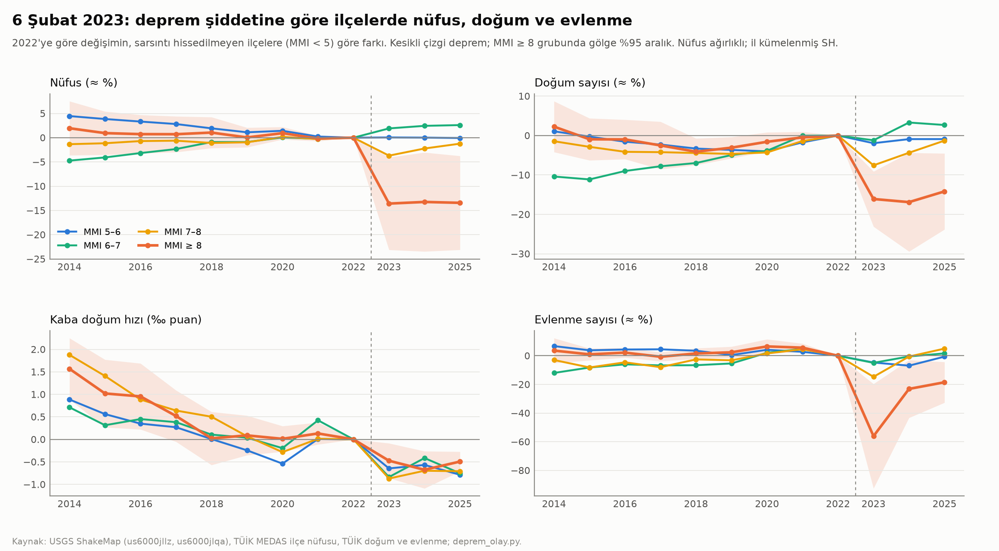

# Faz 5 · Rapor 6 — 6 Şubat 2023 Depremleri: İlçelerde Nüfus, Doğum ve Evlenme Ne Oldu?

*29 Ekim 2026 · Sürüm 0.1*

| Ne | Nerede |
|---|---|
| Kod | [05_ANALIZ/kod/deprem_olay.py](../05_ANALIZ/kod/deprem_olay.py) |
| Deprem şiddeti (USGS ShakeMap MMI; kullanıcı onayıyla indirildi) | `03_VERI/ham/deprem/us6000jllz_mmi_high_res.covjson` (Mw 7,8 Pazarcık), `us6000jlqa_…` (Mw 7,5 Elbistan) |
| İlçe şiddet tablosu | `03_VERI/islenmis/ilce_deprem_siddet.csv` (nüfus ağırlıklı MMI, MMI ≥ 8 ve ≥ 7 nüfus payı) |
| Sonuçlar | `05_ANALIZ/sonuclar/deprem_*.csv` (gruplar, olay katsayıları, ön eğilimden arındırılmış etki, yükseklik farkı, en çok etkilenen ve pilot ilçeler) |
| Grafik | [deprem_olay.png](../05_ANALIZ/grafikler/deprem_olay.png) |
| Dayandığı veri | [Rapor 25](25_ilce_ana_tablo_onlenebilir_olum.md) (ana tablo) · [Rapor 26](26_ilce_zaman_paneli.md) (ilçe nüfusu 2014–2025) |

---

## Özet

**Soru:** 6 Şubat 2023 depremleri ilçelerin nüfusunu, doğumlarını ve evliliklerini nasıl etkiledi? Etki kalıcı mı? Aynı şiddette sarsılan ilçeler arasında bina yüksekliği fark yarattı mı? Faz 5'in deprem pilotları (Antakya, Onikişubat) ve az katlı yeniden yapım önerisi için en doğrudan kanıt bu.

**Yöntem:**

- **Şiddet:** Her ilçe için iki depremin en büyük sarsıntı şiddeti (MMI), 250 m nüfus ızgarasıyla nüfus ağırlıklı olarak hesaplandı. Kaynak USGS ShakeMap.
- **Gruplar:** MMI ≥ 8, 7–8, 6–7, 5–6. Kontrol: sarsıntının hissedilmediği ilçeler (MMI < 5; 834 ilçe).
- **Model:** Olay çalışması: her yıl, 2022'ye göre değişimin kontrol grubuna göre farkı. Nüfus ağırlıklı, il kümelenmiş standart hata.
- **Sağlamlık:** Ayrıca 2014–2022 eğiliminden arındırılmış etki hesaplandı.

**Kısa cevap:**

1. **En şiddetli sarsılan ilçeler nüfusunun sekizde birini kaybetti ve geri kazanmadı.**
   - **Kapsam:** MMI ≥ 8 olan 16 ilçede 2022'de 1,42 milyon kişi yaşıyordu.
   - **Kayıp:** Kontrol grubuna ve kendi eğilimlerine göre nüfus 2023'te %13 düştü; 2025'te hâlâ %13 eksik (p 0,03). Karşı-olguya göre yaklaşık **170 bin kişi** eksik. Depremden önce bu ilçelerin kontrolden ayrışan bir eğilimi yoktu.
   - **Ara grup:** MMI 7–8 ilçelerde kayıp küçük (2023'te %3,7) ve büyük ölçüde geri geldi (2025'te %1,2).
   - **Göç alanlar:** MMI 6–7 ilçeler %2,6 nüfus kazandı; büyük olasılıkla göç edenleri aldılar.
2. **Doğumlar nüfusla birlikte düştü; kişi başı doğum hızı değişmedi.**
   - **Sayı:** En şiddetli grupta doğum sayısı 2023'te %16, 2025'te %15 düşük (p 0,01).
   - **Hız:** Kişi başı doğum hızı, eğilimden arındırılınca anlamlı biçimde değişmedi (2025: −0,07‰, p 0,75). Ham düşüş (−0,5‰) bölgede depremden önce de süren bir yakınsamanın devamı: yıllık −0,14‰, p 0,008.
   - **Anlam:** Doğumlar insanlar gittiği için azaldı; kalanların doğurganlığı belirgin değişmedi. Afet sonrası "doğum patlaması" ya da "doğum çöküşü" görülmüyor (kaba hızla).
3. **Evlilikler bir yıl durdu, sonra büyük ölçüde toparlandı.**
   - **Şok:** En şiddetli grupta 2023'te evlenme sayısı %56 düştü.
   - **Toparlanma:** Kişi başı evlenme hızı 2025'te neredeyse eski düzeyde (−0,13‰). Sayı hâlâ %17 düşük, çünkü nüfus eksik.
4. **Aynı ilde ve aynı şiddette, daha yüksek binalı ilçeler daha çok nüfus kaybetti.**
   - **Kapsam:** MMI ≥ 7 olan 46 ilçe. Kontroller: sarsıntı şiddeti, faya yakınlık, il sabit etkisi.
   - **Etki:** Bina yüksekliğinde 1 standart sapma (≈ 2,9 m, yaklaşık bir kat) fark, 2023'te **%4,7** (p < 0,01), 2025'te **%4,4** (p 0,003–0,09) daha fazla nüfus kaybı demek. Doğum sayısında da benzer büyüklük (2025: %4,4).
   - **Belirsizlik:** Örneklem küçük ve il sayısı az (7). Bu bulgu güçlü ama kesin değil (§4).
5. **Pilotlar birbirinden çok farklı.**
   - **Antakya** (MMI 8,7): nüfus 2025'te hâlâ %24 eksik; doğum %33, evlilik %49 düşük.
   - **Onikişubat** (MMI 7,5): 2023'te %6 kayıp, 2025'te %1,4'e geriledi.
   - **Defne** −%16, **İskenderun** −%9, **Battalgazi** −%11, **Adıyaman Merkez** −%6.

**Proje için anlamı:**

- **Asıl kayıp, gidip dönmeyen insanlar.** Kişi başı doğurganlık değişmedi. En ağır sarsılan ilçelerin kaybı nüfus, aile ve mahalle bağı. Paket v1'deki yeniden yapım ölçütleri bu yüzden kritik:
  - yerinden edilme süresi ≤ 18 ay (ölçüt 24),
  - mevcut sakinlerin ≥ %70'ine aynı ada ya da mahallede yer (ölçüt 18),
  - ada bazlı yeniden yapım (D1),
  - komşu kümesi tahsisi.
- **Hız dönüşü belirliyor.** Az katlı yeniden yapımın yapım ve yerinden edilme süresi M6 modelinde 16 ay, blokta 30 ay [V]. Antakya'da iki yılı aşan eksiklik, dönüşün hızla ilişkili olduğunu düşündürüyor.
- **Biçim ve kayıp ilişkili.** Aynı şiddette daha yüksek binalı ilçelerin daha çok kaybetmesi, deprem bölgesi için "zemin + 3 kat üstüne çıkmama" önerisinin nüfus düzeyindeki ilk kanıtı.
- **Sınır:** Bu ilişki yükseklik dışı nedenlerden de gelebilir: kiracı payı, yapı yaşı, zemin.

---

## 1. Veri ve şiddet ölçüsü

| Gösterge | Değer |
|---|---|
| MMI ≥ 8 bölgede yaşayan nüfus (250 m ızgara) | 1,57 milyon |
| MMI ≥ 7 bölgede yaşayan nüfus | 6,26 milyon |
| Kaynak | USGS ShakeMap, Mw 7,8 Pazarcık (us6000jllz, sürüm 19) ve Mw 7,5 Elbistan (us6000jlqa, sürüm 12); 30″ ızgara; kamu malı |

**Gruplar (ilçe nüfus ağırlıklı MMI):**

| Grup | İlçe | İl | Nüfus 2022 | Nüfus 2025 | Değişim |
|---|---|---|---|---|---|
| MMI ≥ 8 | 16 | 5 | 1.416.207 | 1.258.697 | **−%11,1** |
| 7–8 | 30 | 7 | 5.057.571 | 5.057.050 | −%0,0 |
| 6–7 | 46 | 13 | 3.187.907 | 3.312.407 | +%3,9 |
| 5–6 | 44 | 10 | 5.039.483 | 5.090.404 | +%1,0 |
| Kontrol (< 5) | 834 | 74 | 70.534.085 | 71.326.667 | +%1,1 |

*Kaynak: `deprem_gruplar.csv`. 2014'ten beri var olan 970 ilçe.*

**Neden ShakeMap?**

- **Fay katmanı yetmedi:** Elimizdeki GEM diri fay katmanında fay adı yok. 2023'te kırılan segmentler ayrılamıyor.
- **Merkez üssü yanıltıcı:** Mw 7,8 depremin kırığı Hatay'dan Malatya'ya ≈ 350 km uzandı. Merkez üssüne uzaklık, ağır hasarlı Antakya'yı "uzak" gösterirdi.

---

## 2. Olay çalışması



**Ham katsayılar** (2022'ye göre, kontrol farkı; ≈ % ya da ‰ puan):

| Sonuç · grup | 2019 | 2021 | 2023 | 2024 | 2025 |
|---|---|---|---|---|---|
| Nüfus · MMI ≥ 8 | +0,1 | −0,2 | **−13,6** | −13,3 | −13,4 |
| Nüfus · 7–8 | −1,0 | −0,3 | −3,7 | −2,2 | −1,2 |
| Nüfus · 6–7 | −0,9 | −0,2 | +1,9 | +2,4 | +2,6 |
| Doğum sayısı · MMI ≥ 8 | −3,1 | −0,5 | **−16,1** | −16,9 | −14,2 |
| Evlenme sayısı · MMI ≥ 8 | +2,4 | +5,6 | **−56,1** | −23,1 | −18,5 |
| Kaba doğum hızı · MMI ≥ 8 (‰) | +0,1 | +0,1 | −0,5 | −0,7 | −0,5 |
| Kaba evlenme hızı · MMI ≥ 8 (‰) | +0,2 | +0,4 | **−2,2** | −0,5 | −0,2 |

*Kaynak: `deprem_olay_katsayilari.csv`.*

**Ön eğilimden arındırılmış etki, MMI ≥ 8:**

- **Model:** Grup başına 2014–2022 doğrusal eğilimi; deprem sonrası yıllar bu eğilimden sapma olarak ölçüldü.

| Sonuç | Yıllık ön eğilim (p) | 2023 | 2024 | 2025 (p) |
|---|---|---|---|---|
| Nüfus (≈ %) | −0,18 (0,61) | −13,4 | −12,9 | **−12,9** (0,03) |
| Doğum sayısı (≈ %) | +0,18 (0,68) | −16,3 | −17,3 | **−14,7** (0,01) |
| Evlenme sayısı (≈ %) | −0,38 (0,19) | −55,7 | −22,4 | **−17,4** (0,02) |
| Kaba doğum hızı (‰) | **−0,14 (0,008)** | −0,33 | −0,40 | −0,07 (0,75) |
| Kaba evlenme hızı (‰) | −0,03 (0,38) | −2,19 | −0,47 | −0,13 (0,07) |

*Kaynak: `deprem_olay_arindirilmis.csv`.*

**Okuma:**

- **Nüfus, doğum ve evlenme sayısı:** Ön eğilim yok, etki büyük ve kalıcı.
- **Kişi başı doğum hızı:**
  - **Ön eğilim var:** Deprem bölgesinin yüksek doğum hızı depremden önce de ulusal ortalamaya yakınsıyordu (grafikte 2014–2022 arası iniş).
  - **Arındırılınca etki yok:** Bu eğilim çıkarılınca depremin kişi başı doğum hızına anlamlı bir etkisi kalmıyor.
  - **Ham karşılaştırma yanıltıcı:** "Deprem bölgede doğurganlığı düşürdü" demek ham karşılaştırmayla yanlış olur.

---

## 3. En çok etkilenen ve pilot ilçeler

| İlçe | MMI | Bina yüks. (m) | Nüfus 2022 | Nüfus 2023 | Nüfus 2025 | Doğum 2025 | Evlenme 2025 |
|---|---|---|---|---|---|---|---|
| Antakya (Hatay) | 8,7 | 9,0 | 399.045 | **−%25,2** | **−%24,4** | −%33,4 | −%49,0 |
| Defne (Hatay) | 8,6 | 8,3 | 165.494 | −%14,1 | −%15,6 | −%37,8 | +%18,4 |
| Kırıkhan (Hatay) | 8,8 | 8,5 | 121.028 | −%11,6 | −%10,6 | −%18,3 | −%16,4 |
| İslahiye (Gaziantep) | 8,9 | 6,2 | 67.650 | −%5,4 | −%2,3 | −%17,6 | +%1,0 |
| Nurdağı (Gaziantep) | 8,4 | 5,9 | 41.322 | −%4,5 | −%7,4 | −%22,5 | −%13,2 |
| Dulkadiroğlu (K.Maraş) | 8,2 | 9,0 | 226.409 | −%5,2 | −%5,5 | −%13,1 | −%12,2 |
| Battalgazi (Malatya) | 7,9 | 11,7 | 307.478 | −%12,5 | −%10,7 | −%22,4 | −%21,6 |
| İskenderun (Hatay) | 7,6 | 10,5 | 251.682 | −%9,6 | −%9,4 | −%20,3 | −%7,2 |
| **Onikişubat (K.Maraş)** | 7,5 | 11,5 | 453.730 | −%5,8 | **−%1,4** | −%17,9 | +%4,7 |
| Adıyaman Merkez | 7,4 | 8,2 | 316.140 | −%9,9 | −%6,1 | −%22,3 | +%2,6 |

*Değişimler 2022'ye göre, ham. Kaynak: `deprem_pilot_ilceler.csv`, `deprem_en_etkilenen_ilceler.csv`.*

**Okuma:**

- **Antakya ayrı bir vaka.** İki yıl sonra hâlâ dörtte bir eksik.
- **Kayıp ile sarsıntı farkı arasında orantı yok.** Onikişubat ile Antakya arasında sarsıntı farkı bir MMI birimi, ama kayıp farkı 23 puan. Bu fark yalnız sarsıntıyla açıklanamıyor. Olası etkenler: yıkılan bina oranı, kent merkezinin işlevini kaybetmesi, geçici barınmanın yeri ve süresi. Bu çalışmada ölçülmedi [DY].
- **Kırsal ilçeler kayıp verdi ama kentlerden az.** Hassa, Çelikhan ve Ekinözü gibi çok şiddetli sarsılan kırsal ilçelerde nüfus kaybı küçük (%0–4). Doğumlar ise %20–34 düştü: kayıt dışı göç ya da doğumun başka ilde kaydı olabilir [DY].

---

## 4. Bina yüksekliği farkı (MMI ≥ 7, 46 ilçe, 7 il)

Değişim (2022'ye göre) ~ yükseklik_z + MMI (+ faya ≤ 1 km nüfus payı) (+ il SE); nüfus ağırlıklı.

| Sonuç | Dönem | Yalnız MMI kontrolü | + fay payı | + il SE (p kümeli / HC1) |
|---|---|---|---|---|
| Nüfus (≈ %) | 2022→2023 | −3,0 (0,10 / 0,02) | −3,0 (0,09 / 0,02) | **−4,7** (0,007 / <0,001) |
| Nüfus | 2022→2025 | −2,4 (0,29 / 0,10) | −2,4 (0,32 / 0,10) | **−4,4** (0,09 / 0,003) |
| Doğum sayısı | 2022→2025 | −2,1 (0,38 / 0,14) | −2,5 (0,34 / 0,08) | **−4,4** (0,11 / 0,001) |
| Evlenme sayısı | 2022→2023 | −4,8 (0,44 / 0,30) | −5,1 (0,39) | −10,6 (0,07) |
| Kaba doğum hızı (‰) | 2022→2025 | −0,11 (0,50) | −0,17 (0,29) | −0,12 (0,22) |

*1 SS = 2,9 m. MMI'nin kendi katsayısı: bir MMI birimi başına nüfusta −11 ile −13 puan. Kaynak: `deprem_yukseklik_farki.csv`.*

**Okuma:**

- **Bulgu:** Aynı il içinde ve aynı sarsıntı şiddetinde, bir kat daha yüksek yapılaşmış ilçeler yaklaşık %4–5 daha fazla nüfus kaybetti. Doğumlarda da aynı büyüklük var; kişi başı doğum hızında yok. Yani yükseklik doğurganlığı değil, kalan nüfusu etkiliyor.
- **Neden kesin değil?**
  1. **Belirsizlik:** 46 ilçe ve 7 il var; il kümeli standart hata az küme yüzünden güvenilmez, HC1 ise iyimser olabilir.
  2. **Yükseklik başka şeyleri de taşıyor:** daha çok kiracı (taşınması kolay), daha çok çok katlı ve eski yapı stoku, kent merkezinin ticaret işlevi.
  3. **Ölçü tarihi:** Yükseklik 2018 GHSL ölçüsü; yapı yaşı ve zemin sınıfı yok.
- **Kesin sınama için gereken veri:** Bina bazında hasar verisi (ÇŞİDB hasar tespiti, AFAD), mahalle düzeyinde nüfus ve yapı yaşı. Bu veriler açık değil [DY].

---

## 5. Sınırlılıklar

1. **Kayıtlı nüfus, gerçek nüfus değil.** ADNKS adres kaydına dayanıyor.
   - **Kayıt eksiği:** Depremden sonra başka ile taşınıp adresini değiştirmeyenler kayıtta kalıyor; çadır ve konteyner kentlerdeki nüfus bazen başka ilçede kayıtlı.
   - **Sonuç:** Nüfus kaybı muhtemelen eksik ölçülüyor.
2. **Ölümler ayrıca ölçülmedi.** İlçe ölüm verisi elimizde yalnız 2024–2025 için var. 2023'teki deprem ölümleri (resmî açıklamalara göre 50 bini aşkın [K]) nüfus kaybının bir parçası, ama göçten ayrılamıyor [DY].
3. **Kaba hızlar.** Yaş yapısı değişimi hesaba girmedi. Göç edenler gençse kalan nüfusun doğum hızı düşmüş görünür. Arındırılmış hızın sıfır çıkması bu yüzden "doğurganlık değişmedi" yerine "belirgin değişim görünmüyor" diye okunmalı.
4. **Kontrol grubu.** MMI < 5 ilçeler ülkenin geri kalanı. Deprem bölgesine göç, kontrol grubundaki bazı ilçelerin (Ankara, Mersin, Antalya, İstanbul) nüfusunu artırmış olabilir. Bu, etkiyi biraz büyütür.
5. **Şiddet ölçüsü.** MMI bir tahmin; hasar değil. ShakeMap'in 30″ çözünürlüğü kent içi farkları yakalamaz.

---

## 6. Sonraki adımlar

1. **Paket v2'ye işleme.** Deprem bölgesi yeniden yapım hükümleri (paket v1 §10, D1, ölçüt 18 ve 24) bu bulgularla güçlendirilebilir:
   - **Dönüş hedefi:** "Dönüş oranı" bir izleme göstergesi olur; örneğin 2022 nüfusuna göre yeniden yapım sonrası yerinde kalanlar.
   - **Süre sınırı:** Yerinden edilme süresi üst sınırı kanuna yazılır.
2. **Antakya pilot planı.** Nüfusun dörtte birini geri getirmenin koşulları:
   - geçici barınma ile kalıcı konutun aynı mahallede olması,
   - az katlı ada projeleri,
   - çarşı ve iş yerinin önce açılması.

   Model mahalle v2.1'in deprem bölgesi sürümüyle birleştirilebilir.
3. **Veri başvurusu.** ÇŞİDB hasar tespit verisi (bina bazında), AFAD geçici barınma verisi.

---

## Yeniden üretim

```
PYTHONIOENCODING=utf-8 python 05_ANALIZ/kod/ilce_ana_tablo.py      # ana tablo (Rapor 25)
PYTHONIOENCODING=utf-8 python 05_ANALIZ/kod/deprem_olay.py         # şiddet, olay çalışması, arındırma, yükseklik, grafik
```

**Veri:**

- **ShakeMap:** Dosyalar 29.10.2026'da indirildi (USGS event servisi, `coverage_mmi_high_res.covjson`; 1,9 MB + 0,8 MB) ve depoda.
- **Nüfus ızgarası:** `.gitignore`'da; `ulusal_plan_*.py` zinciriyle yeniden üretilir.
