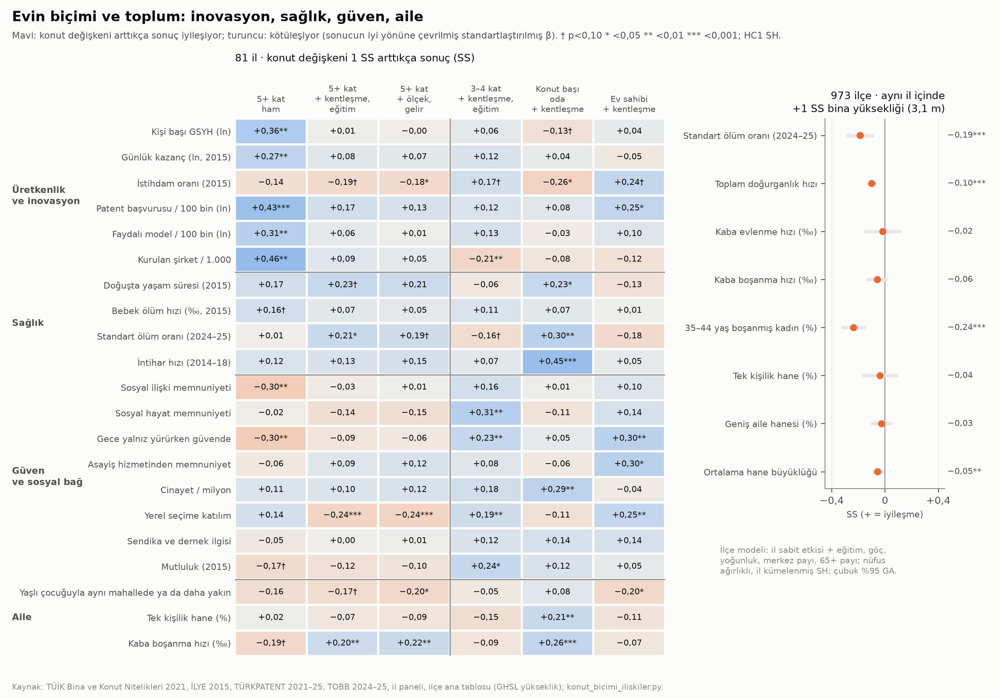

# Faz 5 · Rapor 7 — Evin Biçimi ile İnovasyon, Üretkenlik, Sağlık, Güven ve Aile

*29 Ekim 2026 · Sürüm 0.1*

| Ne | Nerede |
|---|---|
| Kod | [05_ANALIZ/kod/konut_bicimi_iliskiler.py](../05_ANALIZ/kod/konut_bicimi_iliskiler.py) |
| İl tablosu (81 il, birleştirilmiş) | `03_VERI/islenmis/il_konut_bicimi_tablosu.csv` |
| Sonuçlar | `05_ANALIZ/sonuclar/konut_bicimi_iliskiler.csv` (147 test × 3 model, BH q) · `konut_bicimi_duyarlilik.csv` · `konut_bicimi_inovasyon_ayristirma.csv` · `konut_bicimi_ilce_yukseklik.csv` |
| Grafik | [konut_bicimi_iliskiler.png](../05_ANALIZ/grafikler/konut_bicimi_iliskiler.png) |
| Yeni ham veri | `03_VERI/ham/inovasyon/` (TÜRKPATENT patent ve faydalı model, il × yıl; kullanıcı onayıyla indirildi; [kaynak notu](../03_VERI/ham/inovasyon/kaynak.md)) |
| Literatür | [02_LITERATUR/konut_bicimi_literatur.md](../02_LITERATUR/konut_bicimi_literatur.md) · `konut_bicimi_kaynakca.csv` |
| Dayandığı veri | [Rapor 15](15_fitrata_uygun_konut.md) (konut göstergeleri) · [Rapor 14](14_kentsel_stres.md) (İLYE 2015) · [Rapor 25](25_ilce_ana_tablo_onlenebilir_olum.md) (ilçe ana tablosu) |

---

## Özet

**Soru:** Evin biçimi (kaç katlı binada oturulduğu, konutun büyüklüğü, mülkiyet) bir toplumun inovasyonu ve üretkenliğiyle ilişkili mi? Sağlık, güvenlik duygusu, sosyal bağ ve aile yapısıyla ilişkisi ne? Kısacası "yüksek bina = modern, üretken şehir" varsayımı veride tutuyor mu?

**Yöntem:**

- **Konut biçimi (81 il, TÜİK 2021):**
  - 5+ katlı, 3–4 katlı ve 1–2 katlı binada oturan hane payı; ortalama kat.
  - Konut başına oda.
  - Ev sahibi hane payı.
- **Sonuçlar (21 gösterge):**
  - **Üretkenlik ve inovasyon:** kişi başı GSYH, kazanç, istihdam, patent ve faydalı model başvurusu (TÜRKPATENT 2021–25), kurulan şirket (TOBB 2024–25).
  - **Sağlık:** yaşam süresi, bebek ölümü, standart ölüm oranı, intihar.
  - **Güven ve sosyal bağ:** İLYE 2015'ten yedi gösterge ve mutluluk.
  - **Aile:** çocuğuyla aynı mahallede ya da daha yakın oturan yaşlı, tek kişilik hane, boşanma.
- **Modeller:**
  - M0 ham ilişki.
  - M1 + kentleşme (yoğun kent payı, yoğunluk) + ortalama eğitim süresi + doğu kuklası.
  - M2 + kent ölçeği (ln nüfus) + gelir.
  - Standartlaştırılmış katsayı, HC1 standart hata. Her modelde 147 test için Benjamini–Hochberg düzeltmesi.
- **Duyarlılık:** Üç büyükşehir hariç; nüfus ağırlıklı; hane büyüklüğü kontrolü.
- **İl içi karşılaştırma (973 ilçe):** Aynı il içinde bina yüksekliği (GHSL) ile ölüm, doğurganlık, evlilik, boşanma ve hane yapısı. İl sabit etkisi, eğitim, göç, yoğunluk, merkez payı ve yaş yapısı kontrol edildi.

**Kısa cevap:**

1. **Yüksek bina inovasyon getirmiyor; ölçek ve eğitim getiriyor.**
   - **Ham ilişki:** 5+ katlı konut payı yüksek iller daha çok patent alıyor (β +0,43), daha çok şirket kuruyor (+0,46) ve daha zengin (+0,36).
   - **Kontrollerle:** Eğitim ve kentleşme hesaba katılınca bu ilişkilerin hepsi sıfıra yakın (+0,01…+0,17, hiçbiri anlamlı değil).
   - **Ayrıştırma:** Aynı modelde patenti açıklayan eğitim (+0,32) ve kent ölçeği (+0,41). 3–4 katlı konuta göre 5+ katlı konutun ek bir inovasyon avantajı yok (−0,17, anlamsız).
   - **Tek istisna:** 1–2 katlı, kırsal tipte konut payı. Bu iller her kontrolde daha az patent alıyor (−0,42). Bu bir kırsal ekonomi izi; az katlı kent dokusunun etkisi değil.
2. **3–4 katlı konut, güven ve sosyal hayatla en tutarlı ilişkiyi veren biçim.** Her ilişki kentleşme ve eğitim kontrollüdür ve dört duyarlılık sınamasında ayakta kalır. 3–4 katlı konut payı 1 SS (9 puan) yüksek olan illerde:
   - sosyal hayat memnuniyeti **+3,5 puan** (β +0,31, q 0,03),
   - gece yalnız yürürken güvende hissetme **+2,1 puan** (+0,23, q 0,03),
   - yerel seçime katılım **+0,6 puan** (+0,19, q 0,03).
   - **5+ kat ters yönde:** Yerel seçime katılım −0,75 puan (−0,24, q 0,005).
3. **Ev sahipliği güvenlik duygusu ve katılımla birlikte gidiyor.** Ev sahibi payı 1 SS (4,6 puan) yüksek olan illerde gece güvende hissetme +2,8 puan (q 0,02), yerel seçime katılım +0,8 puan (q 0,03).
4. **Büyük konut, daha az intihar ve daha az ölüm.**
   - **Büyüklük:** Konut başına oda 1 SS (0,16 oda) fazla olan illerde intihar ≈ %14 düşük (−0,59 / 100 bin, β −0,45, q < 0,001), standart ölüm oranı %2,2 düşük (q 0,02), cinayet %12 düşük (q 0,03), boşanma %9 düşük (q 0,002).
   - **Sağlamlık:** Dört duyarlılık sınamasının hepsinde aynı yönde ve anlamlı.
   - **Uyarı:** Ekolojik ilişki. Konutun büyüklüğü bölgesel kültürü ve aile yapısını da taşıyor olabilir.
5. **Aynı il içinde daha yüksek binalı ilçelerde ölüm daha yüksek, doğurganlık düşük, boşanmış kadın payı yüksek.** +1 SS bina yüksekliği (3,1 m, yaklaşık bir kat):
   - standart ölüm oranı **+%2,1** (p < 0,001),
   - toplam doğurganlık **−0,044 çocuk** (p < 0,001),
   - 35–44 yaşta boşanmış kadın payı **+0,8 puan** (+%11, p < 0,001).
   - Evlenme, kaba boşanma hızı, tek kişilik ve geniş aile hanesi il içinde yükseklikle ilişkili değil.
6. **İller arası ve il içi karşılaştırma ölümde ve boşanmada ters işaret veriyor.**
   - **İller arası:** 5+ katlı iller daha düşük ölüm oranı ve boşanma gösteriyor (−0,21, −0,20).
   - **İl içi:** Daha yüksek binalı ilçelerde ölüm ve boşanmış kadın payı daha yüksek.
   - **Hangisi daha güvenilir:** İl içi karşılaştırma bölgesel farkları (sağlık hizmeti, beslenme, kültür) sabit tuttuğu için daha güvenilir. İller arası işaret büyükşehirlerin sağlık ve gelir avantajını taşıyor.

**Proje için anlamı:**

- **"Dikey şehir = üretken şehir" savunusu veride yok.** İnovasyonu ölçek ve eğitim taşıyor. Ölçek ise erişimle (semt ×5, şehir ×30, bölge ×180 kademesi; [Rapor 21](21_olceklenebilir_sehir.md)) sağlanabilir, kuleyle değil. 3–4 katlı iller, 5+ katlılar kadar inovatif.
  - **Literatür de aynı yönde:** Yoğunluğun verimlilik faydası güçlü ve yürüme ölçeğinde. Yükseklik primi yalnız ofis kulelerinde gösterildi (§6).
  - **Literatürün uyarısı:** Verimli kentte konut arzını kısmanın bedeli büyük. Az katlı düzen toplam konut arzını azaltmamalı; bu yüzden emsal aktarımı (P2, I4) şart.
- **Orta yükseklik toplumsal tarafta en iyi sonucu veriyor.** Bu, paket v1'deki "aile dostu ada düzeni" önerisinin (P1: zemin dahil en fazla 4 kat, ada içi avlu) il düzeyinde toplumsal tarafta destekleyici bir kanıt (ekolojik). 1–2 katlı kırsal doku ise inovasyonda geride kalıyor. Hedef köy evi değil, **yoğun ve orta yükseklikte kent**.
- **Konutun büyüklüğü ve mülkiyeti politika değişkeni.**
  - **Büyüklük:** Konut başına oda intihar, ölüm ve boşanmayla en sağlam ilişkiyi veren değişken. T1 (TOKİ'de 3+1, 4+1 ve büyüyebilen tipler) ve [Rapor 15](15_fitrata_uygun_konut.md)'teki "5 kişiye ≥ 4 oda" ölçütü bunu destekliyor.
  - **Mülkiyet:** Ev sahipliği güvenlik ve katılımla birlikte gidiyor. Ama rastgele atamaya dayalı çalışmada ev sahipliğinin katılıma etkisi yok (§6). Mekanizma büyük olasılıkla mülkiyetin kendisi değil, **aynı yerde uzun süre oturmak**. Toplum hedeflerindeki "ev sahipliği ≥ %65" hedefi (2025: %56,9) yanında güvenceli ve uzun süreli kiracılık da aynı amaca hizmet eder.
- **Sınır:** Bunların hepsi kesit ve ekolojik ilişki. İl düzeyinde 81 gözlem var ve güven göstergeleri 2015 yılından. Nedensellik için mikro veri (TÜİK Yaşam Memnuniyeti ve Gelir ve Yaşam Koşulları mikro verisi) ya da doğal deney gerekiyor (§7).



---

## 1. Veri ve tanımlar

### 1.1 Konut biçimi (il, TÜİK Bina ve Konut Nitelikleri Araştırması 2021)

| Değişken | Tanım | Ortalama | SS | Aralık | En yüksek | En düşük |
|---|---|---|---|---|---|---|
| 5+ kat | 5 ve daha çok katlı binada oturan hane (%) | 36,8 | 12,6 | 8,6–83,2 | Ankara, İstanbul, Kayseri | Muğla, Sakarya, Düzce |
| 3–4 kat | 3–4 katlı binada oturan hane (%) | 21,5 | 9,1 | 6,4–47,2 | Kocaeli, Sakarya, Bursa | Kars, Ardahan, Ağrı |
| 1–2 kat | 1–2 katlı binada oturan hane (%) | 41,7 | 13,4 | 5,8–77,2 | Ardahan, Ağrı, Kars | İstanbul, Ankara, Bursa |
| Ortalama kat | Oturulan binanın ortalama kat sayısı | 4,0 | 1,0 | 2,2–8,2 | Kayseri, Ankara, İstanbul | Ardahan, Ağrı, Muğla |
| Konut başına oda | Mutfak, banyo, hol hariç | 3,57 | 0,16 | 3,1–4,0 | Ankara, Elazığ, Rize | Ardahan, Çanakkale, Gaziantep |
| Ev sahibi | Oturduğu konutun sahibi olan hane (%) | 63,9 | 4,6 | 49,2–74,1 | Tokat, Burdur, Niğde | Batman, İstanbul, Yalova |

**Notlar:**

- **Kat payları:** Üç kat payı toplamı 100'dür. Bu yüzden birlikte modele girdiklerinde katsayılar dışarıda bırakılan gruba (3–4 kat) göredir (§2.2).
- **Kişi başı oda ayrı tutuldu:** Bu değişken (ortalama 1,13) hane büyüklüğüyle neredeyse aynı şey (r = −0,95). İnovasyon, istihdam ve bebek ölümüyle çok güçlü ilişkisi aslında demografik geçişi ölçüyor: küçük hane, düşük doğurganlık, kentli ve eğitimli nüfus. Hane büyüklüğü kontrol edilince katsayıları işaret değiştiriyor (örneğin istihdam +0,63'ten −0,69'a). Bu yüzden konut biçimi olarak yorumlanmadı. Tablo CSV'de var, grafikte yok.

### 1.2 Sonuçlar

| Grup | Gösterge | Yıl | Kaynak |
|---|---|---|---|
| Üretkenlik | Kişi başı GSYH (ln) | 2024 | TÜİK, il paneli |
| | Ortalama günlük kazanç (ln), istihdam oranı | 2015 | TÜİK İLYE |
| İnovasyon | Patent ve faydalı model başvurusu / 100 bin (ln(1+x)) | 2021–25 ort. | TÜRKPATENT; ilk başvuru sahibinin ili |
| | Kurulan şirket / 1.000 kişi | 2024–25 ort. | TOBB |
| Sağlık | Doğuşta yaşam süresi, bebek ölüm hızı | 2015 | İLYE |
| | Standart ölüm oranı (yaşa göre beklenen ölüme oran) | 2024–25 | İlçe ana tablosundan toplandı (Rapor 25) |
| | Kaba intihar hızı / 100 bin | 2014–18 ort. | TÜİK (Rapor 14) |
| Güven ve sosyal bağ | Sosyal ilişki ve sosyal hayat memnuniyeti, gece yalnız yürürken güvende hissetme, asayiş hizmetinden memnuniyet, cinayet / milyon, yerel seçime katılım, sendika ve dernek ilgisi, mutluluk | 2015 | İLYE |
| Aile | Çocuğuyla aynı adreste, binada, sokakta ya da mahallede oturan yaşlı payı; tek kişilik hane payı | 2025 | TÜİK İstatistiklerle Aile 2025 (il paneli) |
| | Kaba boşanma hızı | 2025 | TÜİK |

**Yıl uyumsuzluğu:** Konut stoku 2021, güven göstergeleri 2015. Konut stoku yavaş değiştiği için bu kabul edilebilir. Yine de 2015 sonrası hızlı dikeyleşen illerde ilişki zayıflamış olabilir.

**Patent verisi:** İl, ilk başvuru sahibinin sicildeki adresidir. Büyük şirketlerin merkezi İstanbul ve Ankara'da olduğu için bu iki il şişer. Bazı üniversite illeri de beklenenden yüksek (Erzurum 19,0 / 100 bin; Türkiye 11,1); bunun üniversite başvurularından gelip gelmediği doğrulanmadı.

### 1.3 Modeller

| Model | Kontroller |
|---|---|
| M0 | Yok (ham ilişki) |
| M1 | Yoğun kent payı, ln yaşanan yoğunluk, ortalama eğitim süresi (2025), doğu kuklası |
| M2 | M1 + ln nüfus (kent ölçeği) + ln kişi başı GSYH (GSYH sonucunda yalnız ln nüfus) |

**Katsayı ve çoklu test:**

- **Okuma:** Bütün katsayılar standartlaştırılmış: konut değişkeni 1 SS arttıkça sonucun kaç SS değiştiği. Standart hata HC1.
- **Düzeltme:** 21 sonuç × 7 konut değişkeni = 147 testte Benjamini–Hochberg q hesaplandı.
- **Kaç ilişki kaldı:** M1'de q < 0,05 kalan 27 ilişki var. Hepsi rastgele olsaydı yanlış keşif beklentisi ≈ 1,4. Metinde q < 0,05 olanlar "sağlam", yalnız p < 0,05 olanlar "zayıf kanıt" diye anılıyor.

**Kodda düzeltilen hata:** İl panelindeki `egitim_yili` sütunu eğitim ölçüsü değil, verinin yılı (bütün illerde 2025). İlk çalıştırmada eğitim kontrolü bu yüzden boş kaldı. Eğitim kontrolü olarak `ort_egitim_suresi_2025` kullanıldı. Başka hiçbir betik bu sütunu kullanmıyor, önceki raporlar etkilenmedi.

---

## 2. İnovasyon ve üretkenlik

### 2.1 5+ katlı konut: ham ilişki kontrollerle kayboluyor

| Sonuç | M0 ham | M1 + kentleşme, eğitim | M2 + ölçek, gelir |
|---|---|---|---|
| Kişi başı GSYH (ln) | +0,36** | +0,01 | −0,00 |
| Günlük kazanç (ln) | +0,27** | +0,08 | +0,07 |
| İstihdam oranı | −0,14 | −0,19† | −0,18* |
| Patent / 100 bin (ln) | +0,43*** | +0,17 | +0,13 |
| Faydalı model / 100 bin (ln) | +0,31** | +0,06 | +0,01 |
| Kurulan şirket / 1.000 | +0,46** | +0,09 | +0,05 |

† p < 0,10 · * < 0,05 · ** < 0,01 · *** < 0,001.

**Okuma:**

- **Ham fark nereden geliyor:** 5+ katlı iller Türkiye'nin en eğitimli ve en büyük kentleri. Patent, şirket ve gelirdeki ham fark bu iki özellikten geliyor.
- **Kontrollerle:** Eğitim ve kentleşme sabitken bina yüksekliği inovasyona bir şey eklemiyor.
- **İstihdam:** Kontrollerle hafif negatife dönüyor (−0,18*). Zayıf kanıt.

### 2.2 Ne açıklıyor? Aynı modelde eğitim, ölçek, yoğunluk ve konut

Aynı modelde bütün değişkenler, standartlaştırılmış β. Kat payları 3–4 kata göredir.

| Değişken | Patent | Faydalı model | Şirket | GSYH | Kazanç |
|---|---|---|---|---|---|
| Eğitim süresi | **+0,32**** | +0,20† | **+0,46***** | **+0,62***** | +0,30* |
| ln nüfus (ölçek) | **+0,41**** | **+0,45**** | +0,30† | +0,11 | +0,13 |
| ln yoğunluk | −0,29† | −0,45** | +0,36* | −0,10 | −0,07 |
| 5+ kat (3–4 kata göre) | −0,17 | −0,20 | +0,25** | −0,06 | −0,15 |
| 1–2 kat (3–4 kata göre) | **−0,55***** | −0,45* | +0,31† | −0,21 | −0,42 |
| Konut başına oda | +0,01 | −0,08 | −0,09 | −0,16* | −0,01 |
| R² | 0,56 | 0,38 | 0,75 | 0,76 | 0,28 |

**Bulgular:**

1. **İnovasyonun iki kaynağı eğitim ve kent ölçeği.** Bu, toplanma ekonomisi literatürüyle uyumlu: büyük ve eğitimli işgücü havuzları fikir üretir (§6). Ölçek sabitken yaşanan yoğunluk patent ve faydalı modelde negatif. Aynı nüfusu daha sıkışık konutta yaşatmak ek inovasyon getirmiyor.
2. **Kule ile orta yükseklik arasında inovasyon farkı yok.** 5+ kat, 3–4 kata göre patentte −0,17 (anlamsız). Kurulan şirkette 5+ kat hafif avantajlı (+0,25). Ama şirket kuruluşu sicil kaydını, yani şirket merkezinin yerini izliyor; üretimin yerini değil.
3. **1–2 katlı konut payı inovasyonda geride.** −0,55 farkı kırsal ve tarım ağırlıklı ekonomiyi yansıtıyor. 1–2 katlı payın en yüksek olduğu iller Ardahan, Ağrı ve Kars. Bu bulgu "az katlı kent" ile "kırsal yerleşim" arasındaki farkı gösteriyor; az katlı kent dokusunun kendisini değil. Verideki az katlı il çoğunlukla kırsal il. Bu yüzden il düzeyinde yoğun ve az katlı kent tipini ayrı ölçmek mümkün değil.

### 2.3 3–4 katlı konut ve üretkenlik

- **İnovasyon:** 3–4 katlı konut payı M1'de inovasyon ve gelirle zayıf pozitif (+0,06…+0,13, anlamsız).
- **İstihdam:** +0,17†. Üç büyükşehir hariç tutulunca patent (+0,31*), GSYH (+0,19*) ve istihdam (+0,23*) pozitif ve anlamlı oluyor.
- **Şirket kuruluşu:** Negatif (−0,21, q 0,03). Olası açıklama: 3–4 katlı payın en yüksek olduğu iller (Kocaeli, Sakarya, Bursa) sanayi illeri; şirket merkezleri ise İstanbul ve Ankara'da kayıtlı. Bu açıklama sınanmadı.

---

## 3. Sağlık

### 3.1 İl düzeyi

| Konut değişkeni (1 SS) | Yaşam süresi | Bebek ölümü | Standart ölüm oranı | İntihar |
|---|---|---|---|---|
| 5+ kat | +0,23† | −0,07 | −0,21* | −0,13 |
| Ortalama kat | +0,31* | +0,02 | −0,26** (q 0,045) | −0,16 |
| 3–4 kat | −0,06 | −0,11 | +0,16† | −0,07 |
| Konut başına oda | +0,23* | −0,07 | **−0,30**** (q 0,015) | **−0,45***** (q < 0,001) |
| Ev sahibi | −0,13 | −0,01 | +0,18 | −0,05 |

M1, ham β (işaret sonucun kendi yönünde: ölüm ve intiharda negatif = iyi).

**Konutun büyüklüğü en sağlam sağlık ilişkisini veriyor.**

- **Etki:** Konut başına 0,16 oda fazlalık (1 SS) şunlarla birlikte gidiyor:
  - intihar hızında −0,59 / 100 bin (ortalama 4,26; ≈ −%14),
  - standart ölüm oranında −%2,2.
- **Sağlamlık:**
  - İntihar ilişkisi dört duyarlılık sınamasında −0,34 ile −0,45 arasında; hepsinde p < 0,001.
  - Ham ilişki (−0,43) kontrollerle değişmiyor. Yani eğitim ve kentleşmeden gelmiyor.
- **Olası mekanizmalar:**
  - Kalabalık ve mahremiyet eksikliği aile içi gerilimi ve psikolojik sıkıntıyı artırır (§6).
  - Ayrıca konut büyüklüğüyle birlikte değişen bölgesel bir etken de olabilir. Doğu kuklası bunun yalnız bir kısmını yakalıyor.

**İller arası yükseklik–ölüm ilişkisi negatif, ama yanıltıcı.** 5+ katlı ve yüksek ortalama katlı iller daha düşük ölüm oranı gösteriyor (−0,21; −0,26). Bu iller (Ankara, İstanbul, Kayseri) sağlık hizmeti ve gelir bakımından avantajlı. Aynı il içinde karşılaştırınca işaret dönüyor (§3.2).

### 3.2 İl içi: aynı ildeki ilçeler

973 ilçe; il sabit etkisi + eğitim, göç, yoğunluk, il merkezi payı, 65+ payı. Nüfus ağırlıklı, il kümelenmiş SH. Sonuçlar +1 SS (3,1 m) GHSL bina yüksekliği içindir.

| Sonuç | Yalnız il SE | + eğitim, göç | + kentsellik, yaş | Fiziksel etki (son model) |
|---|---|---|---|---|
| Standart ölüm oranı | −0,09* | +0,28*** | **+0,19***** | +0,021 (≈ +%2,1) |
| Toplam doğurganlık hızı | −0,32*** | −0,05* | **−0,10***** | −0,044 çocuk |

**Okuma:**

- **Ölüm:** Eğitim ve göç kontrol edilince daha yüksek binalı ilçelerde ölüm daha yüksek.
  - **Önceki raporlarla tutarlı:** Rapor 10'da aynı kontrollerle kat başına ≈ %1,3 (p 0,03–0,06) bulunmuştu.
  - **Kanal:** Rapor 13'te PM2.5 ve ağaç örtüsü eklenince yükseklik etkisi anlamsızlaşıyordu (kat başına %0,85, p 0,15). Yani yüksekliğin ölümle ilişkisi büyük ölçüde hava kirliliği ve yeşil eksikliği üzerinden geçiyor.
- **Doğurganlık:** Bulgu Faz 2'nin il içi tahminiyle aynı aralıkta (kat başına −0,03 ile −0,14 çocuk).

---

## 4. Güven, güvenlik ve sosyal bağ

M1, ham β. Parantez içinde BH q (yalnız q < 0,05 olanlar için).

| Konut değişkeni (1 SS) | Sosyal hayat memnuniyeti | Gece güvende | Asayiş memnuniyeti | Cinayet | Yerel seçime katılım | Sendika, dernek | Mutluluk |
|---|---|---|---|---|---|---|---|
| 5+ kat | −0,14 | −0,09 | +0,09 | −0,10 | **−0,24***** (0,005) | 0,00 | −0,12 |
| 3–4 kat | **+0,31**** (0,03) | **+0,23**** (0,03) | +0,08 | −0,18 | **+0,19**** (0,03) | +0,12 | +0,24* |
| 1–2 kat | −0,14 | −0,13 | −0,24† | +0,38* | +0,16 | −0,15 | −0,09 |
| Konut başına oda | −0,11 | +0,05 | −0,06 | **−0,29**** (0,03) | −0,11 | +0,14 | +0,12 |
| Ev sahibi | +0,14 | **+0,30**** (0,02) | +0,30* | +0,04 | **+0,25**** (0,03) | +0,14 | +0,05 |

**Bulgular:**

1. **3–4 katlı konut üç göstergede birden olumlu.** Sosyal hayat memnuniyeti, gece güvende hissetme ve yerel seçime katılım.
   - **Sağlamlık:** Dört duyarlılık sınamasında katsayı aralıkları sırasıyla +0,21…+0,36, +0,18…+0,27 ve +0,16…+0,20.
   - **Büyüklük:** 9 puanlık (1 SS) fark sosyal hayat memnuniyetinde 3,5 puan (ortalama 54,3), gece güvende hissetmede 2,1 puan (ortalama 67,6).
2. **5+ katlı konut yerel katılımda geride.**
   - **Etki:** Kentleşme ve eğitim sabitken 5+ katlı konut payı 1 SS (12,6 puan) yüksek olan illerde yerel seçime katılım 0,75 puan düşük. Bütün duyarlılıklarda aynı yönde (−0,16…−0,25).
   - **Ham ilişki ters:** Ham ilişki pozitif (+0,14); işaret kentleşme ve eğitim kontrolüyle dönüyor.
   - **Yorum:** Kontrollü işaret literatürdeki "yüksek blokta yerel bağ zayıf" bulgusuyla uyumlu (§6).
3. **Ev sahipliği güvenlik duygusu ve katılımla.** Ev sahibi payı 1 SS (4,6 puan) yüksek olan illerde:
   - gece güvende hissetme +2,8 puan,
   - yerel seçime katılım +0,8 puan,
   - asayiş memnuniyeti +2,1 puan (q 0,10).
   - Bu, ev sahipliğinin yurttaşlık katılımını artırdığı yönündeki klasik bulguyla uyumlu (§6).
4. **Ham ilişkiler yanıltıcı.**
   - **Ham:** 5+ katlı iller sosyal ilişki memnuniyetinde (−0,30) ve gece güvende hissetmede (−0,30) ham olarak geride.
   - **Kontrollerle:** Bu farklar kentleşme ve eğitim kontrolüyle −0,03 ve −0,09'a iniyor. Yani büyük kent olmanın etkisi, bina biçiminin değil.
   - **Mutluluk ve sosyal ilişki:** 2015 göstergeleri hiçbir konut değişkeniyle sağlam ilişki vermiyor.

---

## 5. Aile

### 5.1 İl düzeyi (M1)

| Konut değişkeni (1 SS) | Yaşlı çocuğuna yakın (aynı mahalle ya da daha yakın) | Tek kişilik hane | Kaba boşanma |
|---|---|---|---|
| 5+ kat | −0,17† | +0,07 | **−0,20**** (q 0,03) |
| 3–4 kat | −0,05 | +0,15 | +0,09 |
| 1–2 kat | **+0,34***** (q 0,015) | **−0,28**** (q 0,03) | +0,23* |
| Konut başına oda | +0,08 | **−0,21**** (q 0,03) | **−0,26***** (q 0,002) |
| Ev sahibi | −0,20* | +0,11 | +0,07 |

### 5.2 İl içi (973 ilçe, son model)

| Sonuç | β | Fiziksel etki (+3,1 m) |
|---|---|---|
| 35–44 yaşta boşanmış kadın payı | **+0,24***** | +0,80 puan (ortalama 7,1; +%11) |
| Kaba boşanma hızı | +0,06 | +0,07‰ (anlamsız) |
| Kaba evlenme hızı | −0,02 | anlamsız |
| Tek kişilik hane payı | +0,04 | anlamsız |
| Geniş aile hanesi payı | −0,03 | anlamsız |
| Ortalama hane büyüklüğü | −0,05** | −0,035 kişi |

**Bulgular:**

1. **Kuşaklar arası yakınlık az katlı dokuda.** 1–2 katlı konut payı 1 SS yüksek olan illerde çocuğuyla aynı mahallede ya da daha yakın oturan yaşlı payı 3,7 puan yüksek (ortalama 58,5). 5+ katta ise −0,17†. Kuşaklar arası destek ağı, konut biçimiyle ilişkili bir aile gücü göstergesi.
2. **Boşanmada iki düzey farklı konuşuyor.**
   - **İller arası:** 5+ katlı illerde kaba boşanma hızı düşük (−0,20).
   - **İl içi:** Daha yüksek binalı ilçelerde boşanmış kadın payı yüksek (+0,24). Kaba boşanma hızı ise il içinde ilişkisiz.
   - **Yorum:** Boşanmış kadın payı bir **stok** göstergesi. Boşanan kadınların il merkezindeki apartmanlara taşınmasıyla (seçici göç) yükselebilir; ters nedensellik dışlanamaz. Kaba boşanma hızı bir **akım** göstergesi ve il içinde yükseklikle ilişkisiz. Bu yüzden "yüksek bina boşanmayı artırır" denemez.
3. **Büyük konut, daha az tek kişilik hane ve daha az boşanma.** Konut başına oda tek kişilik haneyle (−0,21) ve boşanmayla (−0,26) negatif ve sağlam.

---

## 6. Literatürle karşılaştırma

**Tarama:** [konut_bicimi_literatur.md](../02_LITERATUR/konut_bicimi_literatur.md).

- **Kapsam:** 58 kaynak; 47'si [D] (bulgu yayımlanmış özette kelimesi kelimesine geçiyor), 11'i [K] (çalışma makalesi özeti ya da yalnız künye). Kanıt düzeyleri 10 G, 38 O, 10 Z.
- **Doğrulama:** Künyeler Crossref'ten, özetler PubMed, Crossref, Europe PMC, Semantic Scholar ve OpenAlex'ten. Denetimi `05_ANALIZ/kod/konut_bicimi_literatur_dogrula.py` yapıyor. Betik önbellekten yeniden çalıştırıldı; çıktılar birebir aynı (md5).

| Bu raporun bulgusu | Literatür | Uyum |
|---|---|---|
| Yükseklik eğitim ve ölçek sabitken inovasyona bir şey eklemiyor; ölçek ve eğitim ekliyor | **Yoğunluk ve yakınlık verimliliği güçlü biçimde artırıyor:** yoğunluk +%10 → ücret +140 $, kira +243 $ (Ahlfeldt ve Pietrostefani 2019, 102 çalışma) [D]; yan yana laboratuvarlar → ortak araştırma ×3,5 (Catalini 2018, doğal deney) [D]. **Fayda çok yerel:** mesafeyle "son derece hızlı" sönüyor (Arzaghi ve Henderson 2008) [D]; sokak ağı yoğunluğu inovasyon farkını açıklıyor (Roche 2020) [D]. **Yükseklik primi** yalnız ofis kulelerinde gösterildi (Liu ve ark. 2018) [D]; konut kulesi için kanıt yok | **Uyumlu.** İnovasyonu taşıyan, yürüme ölçeğinde yakınlık ve kent büyüklüğü; konutun kat sayısı değil |
| Ölçek sabitken yaşanan konut yoğunluğu patentle negatif (−0,29†) | Yoğunluk faydası istihdam yoğunluğunda ve iş yerlerinde ölçülüyor. Mahalle ölçeğinde kompakt yer pahalı, inovatif firma az; bölge ölçeğinde kompaktlık inovatif firmayı artırıyor (Hamidi ve Zandiatashbar 2019) [D] | **Çelişki değil.** Bizim ölçümüz il ortalaması ve konut yoğunluğu. İş yeri yakınlığını ölçmüyor |
| 3–4 katlı konut sosyal hayat, güvenlik duygusu ve katılımla olumlu; 5+ kat katılımla negatif | **Orta yoğunluk:** komşuyla etkileşim ve gruplara katılım orta yoğunlukta en iyi (Bramley ve ark. 2009) [D]. **Yürünebilirlik:** yürünebilir karma mahallede güven ve siyasi katılım yüksek (Leyden 2003) [D]. **Yoğunluğun kendisi** komşuluk bağıyla ilişkisiz (Freeman 2001) [D]. **Güvenlik korkusu:** bina büyüklüğü korkuyu artırıyor, suçu daha zayıf (Newman ve Franck 1982) [K] | **Uyumlu.** Yine de iki taraf da kesitsel |
| Ev sahipliği güvenlik duygusu ve katılımla olumlu (il, ekolojik) | **Gözlemsel çalışmalar:** ev sahipleri sosyal sermayeye daha çok yatırım yapıyor; etkinin büyük kısmı daha az taşınmaktan (DiPasquale ve Glaeser 1999) [K]. **Rastgele atamaya dayalı araç değişken:** siyasi katılıma etki yok (Engelhardt ve ark. 2010) [K]. **Çocuk sonuçları:** seçilim denetlenince ev sahipliğinin çocuğa yararı için az kanıt var (Holupka ve Newman 2012) [D] | **Dikkat.** Bizim ilişkimiz büyük olasılıkla seçilim ve **oturma süresi** taşıyor. Mekanizma mülkiyetin kendisinden çok istikrar olabilir. Güvenceli kiracılık da aynı istikrarı sağlayabilir |
| Konut başına oda intihar, ölüm, cinayet ve boşanmayla negatif | **Taramadaki en sağlam aile bulgusu kalabalık:** oda başına kişi +0,2 → 3 yaşında davranış sorunu +0,20 SDQ puanı (Marsh ve ark. 2019) [D]; lise bitirme düşüyor (Lopoo ve London 2016) [D]; sınıf tekrarı (Goux ve Maurin 2005) [K]. ABD, İngiltere ve Fransa'da aynı yön | **Uyumlu yön.** Ama bizim değişkenimiz kalabalık değil konutun büyüklüğü; yetişkin sonuçları (intihar, cinayet) için doğrudan kaynak taranmadı |
| İl içinde yüksek binalı ilçelerde ölüm daha yüksek; il düzeyinde ters işaret | **Belçika, 6,1 milyon kişi:** yüksek binada iyi sağlık ham OR 0,67; sosyoekonomik düzeltmeyle 1,04 (Verhaeghe ve ark. 2016) [D]. Yani ham farkın neredeyse tamamı seçilim. **Somut bedel:** kalp durmasında hayatta kalma 3. katın altında %4,2, 16. katın üstünde %0,9 (Drennan ve ark. 2016) [D]. **Seyreklik de kötü:** km²'de 1.800 konutun altında yoğunluk arttıkça obezite artıyor (Sarkar ve ark. 2017) [D] | **Uyumlu.** Düzey seçimi işareti değiştiriyor; il içi küçük bir yükseklik bedeli kalıyor. Seyrek yerleşim de çözüm değil |
| Yükseklik → doğurganlık −0,044 / 3,1 m (il içi kesit); Rapor 26'da yükseklik → doğum düşüşü ≈ 0 | Doğurganlık müstakil evde en yüksek, apartmanda en düşük; farkın çoğu seçici taşınmadan (Kulu ve Vikat 2007, Finlandiya) [K] | **Uyumlu.** Kesit farkı büyük olasılıkla çocuk isteyen ailelerin az katlıya taşınması |
| 1–2 katlı illerde yaşlı çocuğuna daha yakın oturuyor | Anneye ya da kayınvalideye yakın oturmak küçük çocuklu kadının istihdamını +4–10 yüzde puan artırıyor (Compton ve Pollak 2014) [K] | **Tamamlayıcı.** Kuşak yakınlığı hem aile hem üretkenlik değişkeni |
| — (bu raporda ölçülmedi) | **Evde çalışma:** performans +%13, bunun 4 puanı daha sessiz ve elverişli ortamdan (Bloom ve ark. 2015, randomize) [D]. **Uzaktan ekipler** daha az çığır açan buluş yapıyor (Lin, Frey ve Wu 2023) [D] | Evde çalışacak bir oda bireysel üretkenliğe yarıyor; buluş ise yüz yüze karşılaşma istiyor. İkisi de "geniş konut + yürüme mesafesinde iş ve karşılaşma yeri" dokusunu destekliyor |

**Literatürün bu rapora iki düzeltmesi:**

1. **Konut arzını kısmanın bedeli büyük.** Verimli şehirlerdeki konut arzı kısıtları ABD büyümesini 1964–2009'da %36 düşürmüş (Hsieh ve Moretti 2019, model) [D].
   - **Sonuç:** Az katlı düzen, verimli kentlerde toplam konut arzını azaltmamalı.
   - **Paketin durumu:** Paket v1 bunu P2 ve I4 ile gözetiyor: kullanılmayan emsal raylı sistem koridoruna aktarılıyor, hak kısılmıyor. P1'in M6 modelinde aynı 1 ha'da az katlı düzen bloktan daha çok inşaat alanı veriyor. Bu sınır korunmalı.
2. **Yoksulluğun toplandığı kule ile yüksekliği ayırmak gerek.**
   - **Bulgular:** Chicago'da toplu konut yıkımı çevrede suçu %8,8 düşürdü (Sandler 2017) [D]. Benzer mahalleye taşınan çocukların okul başarısı ise değişmedi (Jacob 2004) [D].
   - **Yorum:** Etkinin kaynağı yükseklik değil, yoksulluğun tek yerde toplanması.
   - **Türkiye'ye aktarım:** Türkiye'de hanelerin %70,8'i 3 ve daha çok katlı binada oturuyor (Rapor 15). Apartman çoğunluğun konutu, bu yüzden bu bulgular doğrudan aktarılamaz.

**Tasarım uyarısı:** Galeri (deck) erişimli konut alanlarında depresyon daha sık (OR 1,28, 1,03–1,58; Weich ve ark. 2002) [D]. Kesitsel bir çalışma (Z) ve mekanizması bilinmiyor. Yine de Rapor 15'teki Z+3 galerili blok (tip e) için bir dikkat noktası. Öneri (sınanmadı): galeri dar ve uzun bir koridor olmamalı; az sayıda daireye açılan, gün ışığı alan ve oturulabilir bir alan olmalı.

**Taranmayan ya da doğrulanamayan öncüller:**

- Glaeser ve Sacerdote 2000 (büyük apartman ve sosyal sermaye): yalnız künye doğrulandı.
- Brueckner ve Largey 2008 (yoğunluk ve sosyal etkileşim): sonucun yönü bu taramada doğrulanmadı.
- Ayrıntı literatür notunun son bölümünde.

---

## 7. Sınırlar

1. **Ekolojik çıkarım.** İl ve ilçe ortalamaları arasındaki ilişki, bireyler arasında aynı ilişkinin olduğunu göstermez. Örneğin 3–4 katlı payı yüksek ilde sosyal hayat memnuniyetinin yüksek olması, 3–4 katlı binada oturanların daha memnun olduğu anlamına gelmeyebilir.
2. **81 gözlem.** İl düzeyinde güç sınırlı. Duyarlılık sınamaları (üç büyükşehir hariç, nüfus ağırlıklı, hane büyüklüğü) bazı ilişkileri güçlendirip bazılarını zayıflattı. Yalnız dördünde de aynı yönde ve anlamlı olanlar ana bulgu sayıldı.
3. **Yıl uyumsuzluğu.** Güven göstergeleri 2015, konut 2021, patent 2021–25. İl kırılımlı güven verisi yalnız İLYE 2015'te var; "gece güvende" serisi 2017'de kesiliyor (Rapor 14).
4. **Kontrol edilemeyen etkenler.** Bölgesel kültür, din ve gelenek, iklim ve sanayi yapısı konut biçimiyle birlikte değişiyor. Doğu kuklası bunun ancak bir kısmını yakalıyor.
5. **Kat payları ölçek dışı bilgi taşımıyor.** 1–2 kat payı hem kırsal köy evini hem kentsel müstakil evi kapsıyor. Türkiye'de kentsel müstakil ev nadir olduğu için il düzeyinde "yoğun ve az katlı kent" ile "kırsal yerleşim" ayrılamıyor. Bu ayrım için mahalle düzeyinde morfoloji (Rapor 11) ve FUE ekseni (Rapor 10, 13) gerekiyor.
6. **Patent ve şirket ili.** Merkez adresi Ar-Ge'nin yapıldığı yeri göstermeyebilir. İstanbul ve Ankara'daki şişme üç büyükşehir hariç sınamasıyla kontrol edildi; sonuçlar değişmedi.

**Nedensellik için sonraki adımlar:**

- **Mikro veri (kullanıcı kararı bekliyor):**
  - TÜİK Yaşam Memnuniyeti Araştırması ve Gelir ve Yaşam Koşulları Araştırması mikro verisi bireyin konut tipini, oda sayısını ve mülkiyetini; memnuniyeti, güveni ve sağlığı aynı kişide ölçüyor.
  - Bu, ekolojik çıkarım sorununu kaldırır.
- **Doğal deney:**
  - TOKİ kura ile hak sahipliği (aynı başvuranların farklı tip konutlara rastgele düşmesi).
  - Deprem sonrası yeniden yapımda az katlı ile blok yerleşimlerin karşılaştırılması (Rapor 27'nin devamı).

---

## 8. Proje için sonuç

| Bulgu | Kanıt gücü | Pakete etkisi |
|---|---|---|
| Yüksek bina inovasyon ve üretkenlik getirmiyor; eğitim ve ölçek getiriyor | Orta (il, ekolojik; literatürle uyumlu) | Az katlı yoğun düzen (P1, P2, I4) "verimlilik kaybı" itirazına karşı savunulabilir. Ölçek erişimle (semt, şehir, bölge kademesi) sağlanır. Koşul: toplam konut arzı azalmamalı (Hsieh ve Moretti 2019) |
| 3–4 katlı konut sosyal hayat, güvenlik duygusu ve katılımla olumlu | Orta (q < 0,05, dört duyarlılıkta sağlam) | P1 "aile dostu ada düzeni" (zemin dahil ≤ 4 kat) için toplumsal gerekçe |
| 5+ katlı konut yerel katılımla negatif | Orta | Semt meclisi (B3, B4) yüksek bloklu alanlarda öncelikli pilot olmalı |
| Konut büyüklüğü intihar, ölüm, cinayet ve boşanmayla negatif | Orta (en sağlam il bulgusu; ekolojik) | T1 (3+1, 4+1, büyüyebilen tipler) ve Rapor 15'teki oda ölçütü |
| Ev sahipliği güvenlik duygusu ve katılımla pozitif | Zayıf–orta (rastgele atamalı çalışmada etki yok; büyük olasılıkla oturma süresi) | Ev sahipliği ≥ %65 hedefi; kooperatif ve arsa değer vergisinin tek konut muafiyeti (E3). Ek olarak uzun süreli kiracılık güvencesi araştırılmalı |
| İl içinde yükseklik → ölüm +%2,1 ve doğurganlık −0,044 / 3,1 m | Güçlü (il içi, önceki raporlarla tutarlı) | Değişiklik yok; önceki bulgular doğrulandı |
| Az katlı kırsal doku inovasyonda geride | Orta | Hedef köy evi değil, yoğun ve orta yükseklikte kent |

**Toplum hedeflerine katkı:** [toplum_hedefleri.md](../01_KAVRAMSAL_CERCEVE/toplum_hedefleri.md) dosyasındaki ev sahipliği ve intihar satırlarına bu raporun ilişkileri gerekçe olarak eklenebilir. Hedef değerler değişmiyor.

---

## Yeniden üretim

```bash
PYTHONIOENCODING=utf-8 python 05_ANALIZ/kod/konut_bicimi_iliskiler.py
```

**Girdiler:**

- `03_VERI/islenmis/il_paneli_2025.csv`
- `03_VERI/ham/stres/il_ilye_2015_gostergeler.csv`, `il_intihar_2000_2018_birlesik.csv`
- `03_VERI/ham/inovasyon/*.xls`
- `03_VERI/ham/ekonomi/ticaret_tarim/tobb_kurulan_kapanan_sirket_2025-12.xls`
- `03_VERI/islenmis/ilce_ana_tablo.csv`

**Çalışma süresi:** Yaklaşık 1 dakika.
